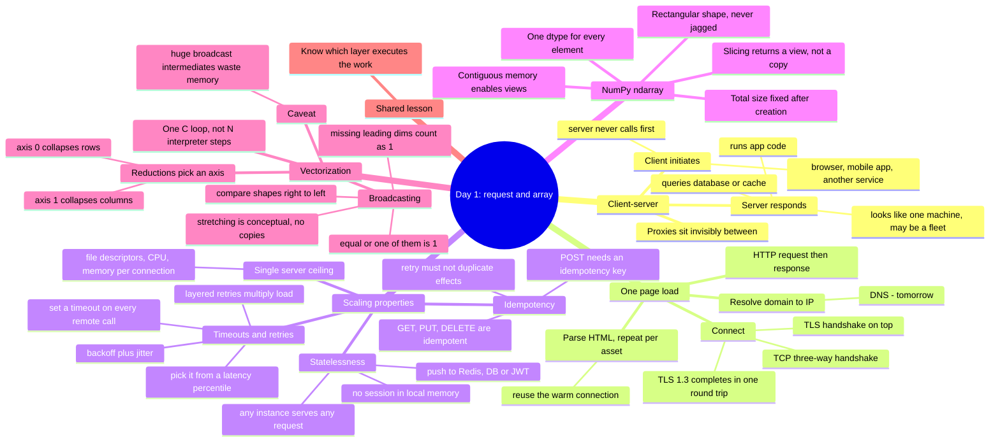

# Today's goal

## Goal

By tonight you can take any "what happens when I type a URL and hit enter" question and answer it as a chain of round trips — resolve, connect, request, render — naming what runs where, which hop costs a round trip, and what runs out first when one client becomes a million. You can state why application servers are built stateless and where the state goes instead (shared store or signed token), and why a retried request has to be idempotent for the retry to be safe. On the ML side, you can create NumPy `ndarray`s, read `shape`, `ndim`, `dtype` and `size` fluently, predict the result shape of a broadcast operation by applying the trailing-dimension rule on paper *before* running the code, choose the right `axis` for a reduction, and demonstrate with your own timing experiment why vectorized code beats a Python loop — because the loop runs in C, not in the interpreter. The thread connecting both halves: performance comes from knowing which layer your work actually executes in.

## Concept map

## The 2 hours

```mermaid
gantt
    title Day 1 study block
    dateFormat HH:mm
    axisFormat %H:%M
    section System design 55m
    Read client-server and the request chain    :a1, 00:00, 15m
    Draw the request sequence closed-book       :a2, after a1, 15m
    Stateless, idempotency, timeouts            :a3, after a2, 15m
    Write the one-million-clients note          :a4, after a3, 10m
    section ML and GenAI 55m
    ndarray, shape, dtype in a REPL             :b1, after a4, 15m
    Broadcasting by hand, then verify           :b2, after b1, 20m
    Loop versus vectorized timing               :b3, after b2, 20m
    section Recall 10m
    Answer every question cold                  :c1, after b3, 10m
```

1. **0:00-0:15 — Read the request chain.** Read the Client-Server Model section of the course plus MDN's HTTP overview. Note the two things MDN adds that the day notes do not: what looks like a single server is often a load-balanced fleet with proxies in between doing caching and filtering, and HTTP/1.1 onward *reuses* the connection instead of reopening one per asset.
2. **0:15-0:30 — Draw it closed-book.** On paper, draw the sequence diagram for `GET /home` over HTTPS without looking. Label each arrow with whether it costs a round trip. Then compare against the notes and mark only what you missed.
3. **0:30-0:45 — The three scaling properties.** For statelessness, idempotency, and timeouts, write one sentence of definition and one sentence naming the concrete failure you get without it: the user appears logged out when the load balancer sends request two to a different instance; a retried payment charges twice; one slow dependency eats the whole thread pool.
4. **0:45-0:55 — The ceiling note.** Write five lines on what actually runs out first on a single server at high connection counts — file descriptors, memory per open connection, CPU — and note that each of Weeks 2-4 raises exactly one of these ceilings.
5. **0:55-1:10 — ndarray in a REPL.** Create arrays and inspect `.shape`, `.ndim`, `.dtype`, `.size`. Verify `len(a.shape) == a.ndim` and `a.size == math.prod(a.shape)`. Deliberately trigger a jagged-array error so you feel the rectangular constraint. Then slice an array, mutate the slice, and print the original — confirm for yourself that slicing gave you a view.
6. **1:10-1:30 — Broadcasting by hand.** For each pair, write the result shape on paper *before* running it: `(4,3)+(3,)`, `(4,3)+(4,)`, `(256,256,3)*(3,)`, `(8,1,6,1)+(7,1,5)`, `(5,1)+(1,6)`. Then run them. The second must raise `ValueError` — read the message carefully, it names both shapes. Finish with `b.sum(axis=0)` and `b.sum(axis=1)`, predicting each first.
7. **1:30-1:50 — Timing experiment.** Run the loop-versus-vectorized block from the notes. Repeat it with `n = 10_000` and `n = 10_000_000` and record the ratio each time. Ask why the ratio is roughly stable rather than growing: the per-element interpreter cost is a constant factor, not a worse complexity class.
8. **1:50-2:00 — Recall, cold.** Answer the four recall questions and the five below from memory, out loud, before checking anything. Then run `python3 -m pipeline learn --done`.

## Key ideas

1. **The client always initiates.** The server responds and never contacts the client unprompted; server-sent events and WebSockets only simulate the reverse by keeping a client-opened channel alive.
2. **A page load is four stages, not one request:** resolve the domain to an IP, open a connection (TCP three-way handshake, plus a TLS handshake if HTTPS), send the HTTP request and read the response, then parse the HTML and repeat for every script, stylesheet, and image — reusing the warm connection rather than redoing the handshakes.
3. **The handshake costs are a real latency lever.** TCP setup is three messages because each side must send its initial sequence number and have it acknowledged (the server's SYN and its ACK ride in one segment), which also prevents stale duplicate connection attempts from being accepted as new. TLS 1.3 then completes its full handshake in one round trip, with an optional 0-RTT mode that trades forward secrecy and replay protection for speed.
4. **HTTP is stateless by design but not sessionless.** Each request stands alone; cookies and tokens layer sessions on top. That is what lets any instance behind a load balancer serve any request — the alternative is sticky sessions, which pin a user to one box and lose the session when it dies.
5. **Idempotency is what makes retries safe.** A client that times out cannot distinguish "never arrived" from "succeeded but the response was lost," so it will retry. `GET`, `PUT`, and `DELETE` are idempotent; `POST` and `PATCH` are not unless you make them so with a deduplication key — Stripe's API takes an `Idempotency-Key` header and replays the saved response, and EC2's `RunInstances` takes a client token for the same reason.
6. **Every remote call needs a timeout, and retries need discipline.** Pick the timeout from downstream latency metrics (choose an acceptable false-timeout rate, then read that percentile, e.g. p99.9). Retry at a single point in the stack: three retries at each of five layers is 243x the load on the bottom dependency. Add jitter, because plain backoff leaves failures correlated and they all wake up together.
7. **The `ndarray`'s three restrictions are the source of its speed:** one dtype for all elements, total size fixed after creation, and a rectangular shape. Those guarantees let NumPy store the data contiguously and dispatch one C loop over all of it.
8. **Slicing an array returns a view, not a copy** — unlike a Python list. Mutating the view mutates the original. This is a memory win and a correctness trap; `.copy()` when you mean a copy.
9. **Broadcasting compares shapes from the trailing dimension leftward.** Two dimensions are compatible if they are equal or one of them is 1; missing leading dimensions count as 1; the result takes the largest size in each position. The "stretching" is conceptual — no copies are made, which is why `a * 2.0` moves less memory than `a * np.array([2.,2.,2.])`.
10. **Broadcasting can still be the wrong tool.** Combining `(10,3)` with `(5,1,3)` builds a `(5,10,3)` intermediate the calculation never needed; at scale an explicit Python loop over the outer dimension is both faster and easier to read. And `axis` is just the direction a reduction collapses: `sum(axis=0)` gives column sums, `sum(axis=1)` gives row sums.

## Check yourself

**1. Walk me through what happens when a user types `app.example.com` and presses enter.**
DNS resolution turns the hostname into an IP, possibly hitting the browser cache, OS cache, resolver, and authoritative nameserver. The browser opens a TCP connection to that IP on port 443 — SYN, SYN-ACK, ACK — then runs a TLS handshake over it to agree a version, cipher suite, and shared secret, and to verify the server's certificate. It sends `GET / HTTP/1.1` with a `Host` header; what looks like one server is usually a load balancer in front of a fleet, which forwards to an app instance that may hit a cache or database. The HTML comes back, the browser parses it and issues further requests for every referenced asset, reusing the already-warm connection. The point worth volunteering: each stage is a round trip you can later remove with caching, connection reuse, or a CDN closer to the user.

**2. Why do we insist application servers be stateless, and where does the state actually go?**
Because if session state lives in one instance's memory, requests from that user must keep landing on that instance. That forces sticky sessions, which constrain the load balancer and mean the session dies with the box. Stateless instances are interchangeable: any one serves any request, so you scale by adding instances and recover by replacing them — which is exactly why Kubernetes can restart pods freely. The state does not disappear; it moves to a shared store like Redis or the database, or gets encoded into a signed token the client carries. The usual shape is a stateless request tier over a deliberately stateful data tier, and the hard problems migrate there.

**3. A client times out on a request. Should it retry, and what has to be true for that retry to be safe?**
The client cannot tell a lost request from a lost response, so a retry may duplicate work that already succeeded. It is safe only if the operation is idempotent — applying it twice leaves the same state as applying it once. `GET`, `PUT`, and `DELETE` are specified as idempotent; `POST` is not. For non-idempotent operations you make the retry safe server-side with a deduplication key: the client sends a stable idempotency key or chooses the resource ID itself, and the server records it and returns the original response on a repeat. I would also bound the attempts, use exponential backoff with jitter, and retry at only one layer of the stack — naive layered retries multiply load on the dependency that is already struggling.

**4. What is broadcasting, and will `np.ones((4,3)) + np.array([1,2,3,4])` work?**
Broadcasting lets arrays of different but compatible shapes combine elementwise without a Python loop. NumPy lines the shapes up from the right and requires each dimension pair to be equal or to include a 1; absent leading dimensions count as 1. That example fails: aligned from the right, 3 against 4 is neither equal nor 1, so it raises `ValueError: operands could not be broadcast together with shapes (4,3) (4,)`. It works with a length-3 array, added to each of the four rows, or with the length-4 array reshaped to `(4,1)` so it is added down each column. Nothing is copied either way — the stretching is virtual.

**5. Why is `(x * 2).sum()` so much faster than `sum(v * 2 for v in x)` for a million floats?**
The Python version pays interpreter overhead per element: bytecode dispatch, a boxed float object per value, reference counting, a bounds-checked fetch. The NumPy version dispatches one C loop over a contiguous single-dtype block, so the per-element cost is a machine instruction or two on cache-friendly, often SIMD-vectorizable data. You see roughly 10-50x, and it is a constant factor rather than a complexity improvement — both are O(n). That constant is the entire reason NumPy exists, and why pandas, scikit-learn, and PyTorch are built on the same array abstraction.

## Where this leads

Tomorrow opens up stage one of today's chain — "resolve the domain to an IP" — into recursive resolvers, record types, TTLs, and DNS as the first and bluntest load-balancing and failover tool you have. Treating DNS as a cache whose TTL you control is also your first encounter with the theme that dominates Weeks 2-4: almost every scaling move is a caching or placement decision.

The stateless-server idea is the precondition for the load balancer you add later this week, and the reason the interesting failures migrate down into the data tier. Idempotency and timeouts come back as the central concerns the moment you design payments, message queues, or anything with at-least-once delivery; in production code they look like idempotency-key tables, client tokens, and bounded retries with jitter. Things you can go look at today: Stripe's `Idempotency-Key` header exists because clients retry, AWS jitters periodic jobs across its fleets to stop thundering herds, and a 20 ms timeout that accidentally included TLS setup took down a real AWS service after a deployment — the timer covered more than its author thought.

The NumPy half compounds faster than it looks. `shape` and `dtype` discipline is the same skill as reading a PyTorch tensor shape error at 2am, and broadcasting is literally how attention scores, batched matmuls, and per-feature normalization are written. "Know which layer the work executes in" is the same reasoning you will apply to batching LLM inference requests and to deciding whether a slow eval harness is bottlenecked on Python or on the network — today's system design question, asked about your own code.

## Sources

- [MDN: An overview of HTTP](https://developer.mozilla.org/en-US/docs/Web/HTTP/Guides/Overview) — the HTTP flow, connection reuse from HTTP/1.1 onward, statelessness versus sessions
- [MDN: Client-Server overview](https://developer.mozilla.org/en-US/docs/Learn_web_development/Extensions/Server-side/First_steps/Client-Server_overview) — annotated real request and response, static versus dynamic handling, the anatomy of a dynamic request
- [RFC 9293: Transmission Control Protocol](https://www.rfc-editor.org/rfc/rfc9293.html) — the three-way handshake, why three messages, and stale duplicate connections
- [RFC 8446: TLS 1.3](https://www.rfc-editor.org/rfc/rfc8446.html) — the 1-RTT full handshake, HelloRetryRequest, and the security trade-offs of 0-RTT
- [Amazon Builders' Library: Timeouts, retries, and backoff with jitter](https://builder.aws.com/content/3EumjoZascWd1oZiEgL8ORlv3qE/timeouts-retries-and-backoff-with-jitter) — choosing timeouts from latency percentiles, retry amplification, jitter, token buckets, client tokens for idempotency
- [Stripe API: Idempotent requests](https://docs.stripe.com/api/idempotent_requests) — the `Idempotency-Key` header and replaying the saved response
- [NumPy: the absolute basics for beginners](https://numpy.org/doc/stable/user/absolute_beginners.html) — the three `ndarray` restrictions, `shape`/`ndim`/`size`/`dtype`, views versus copies
- [NumPy: Broadcasting](https://numpy.org/doc/stable/user/basics.broadcasting.html) — the trailing-dimension rules, worked compatible and failing shapes, and when a broadcast intermediate wastes memory
- [NumPy: Quickstart](https://numpy.org/doc/stable/user/quickstart.html) — array creation and axis-wise operations
- [NumPy releases](https://numpy.org/news/) — current version is 2.5.4 (10 Oct 2026); 2.5.0 dropped Python 3.11 and removed distutils, so check your interpreter version before installing

*Researched by claude and kiro; merged by claude.*
