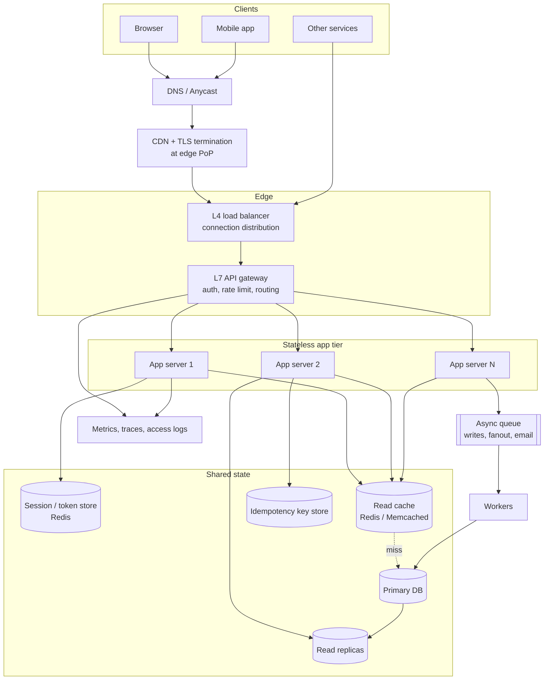

# System design: the client-server model

## The problem

"Client-server" is the diagram you draw in the first five minutes of an interview and then forget. It is actually the thing being stressed for the rest of the hour. The model says: a client initiates a request, a server processes it and returns a response, and the network between them is unreliable, variable in latency, and occasionally lies about what happened.

Four properties of that contract decide whether the system scales at all:

1. **Who holds state.** If the server keeps session state in process memory, the client is bound to one machine. That machine is now a single point of failure and the fleet can no longer be grown by adding boxes. Statelessness is not an aesthetic preference; it is what makes a server *fungible*.
2. **What a connection costs.** The request/response abstraction hides a TCP socket, a TLS session, kernel send/receive buffers, a file descriptor, and — in a thread-per-request server — an OS thread with a multi-megabyte stack. The last item is why the C10K problem existed and why edge tiers moved to event loops.
3. **What a timeout means.** A client that times out does not know whether the server did the work; it knows only that it did not hear back. So "retry on failure" silently converts an at-most-once API into an at-least-once one, and the server must absorb that. This is the gap idempotency keys fill.
4. **Where the contract lives.** Client and server ship independently, often written by different teams. The wire contract — protocol, schema, versioning, error semantics — *is* the system. The code on either side is an implementation detail you can replace.

The senior-level framing is therefore: *given one client and one server, enumerate every piece of state and every failure mode in between, then ask what each one does when you multiply clients by a million.*

Concrete target for the rest of this write-up: a consumer app, 20M daily active users, read-heavy JSON API plus media, with a real-time notification channel.

## Architecture



Two things to say out loud about this picture. First, every box in the app tier is identical and disposable — all durable and session state was pushed right, into the shared-state subgraph. Second, the edge and the app tier are separated deliberately: the edge is optimised for *many idle connections* (event loop, non-blocking), the app tier for *CPU work per request*. Those are different scaling curves, and mixing them means over-provisioning CPU just to hold sockets open.

## Request flow

```mermaid
sequenceDiagram
    autonumber
    participant C as Client
    participant R as DNS resolver
    participant E as Edge / CDN
    participant G as API gateway
    participant A as App server
    participant K as Cache
    participant D as Database

    C->>R: Resolve api.example.com
    R-->>C: A record (anycast IP), cached for TTL
    C->>E: TCP SYN / SYN-ACK / ACK (1 RTT)
    C->>E: TLS 1.3 ClientHello + key share
    E-->>C: ServerHello + Finished (1 RTT)
    Note over C,E: TLS 1.3 = 1 RTT for a new connection;<br/>TLS 1.2 needed 2. 0-RTT saves one more<br/>on resumption, but only for replay-safe GETs.
    C->>E: HTTP GET /v1/feed (Authorization: Bearer ...)
    E->>G: Forward over pooled, warm connection
    G->>G: Verify token, rate limit, pick route
    G->>A: GET /v1/feed  (timeout 300 ms)
    A->>K: GET feed:user:42
    K-->>A: MISS
    A->>D: SELECT ... (timeout 150 ms)
    D-->>A: Rows
    A->>K: SET feed:user:42 (TTL 60 s)
    A-->>G: 200 + JSON
    G-->>E: 200 (+ cache headers)
    E-->>C: 200 over the same connection

    rect rgb(245, 235, 235)
    Note over C,A: Failure path
    C->>E: POST /v1/payments (Idempotency-Key: abc123)
    E--xC: Connection dropped after the server committed
    C->>E: Retry POST with the same Idempotency-Key
    E->>A: Forward retry
    A->>D: Key abc123 already recorded
    A-->>C: 200 + the original stored response body
    end
```

The failure path at the bottom is the part candidates skip and interviewers care about. The happy path is table stakes.

Note the per-hop timeouts. A 300 ms gateway budget containing a 150 ms database call is a *latency budget*, allocated top-down. Without it, one slow dependency holds request slots open until the pool is exhausted and an unrelated endpoint starts failing — cascading failure.

## Numbers

Assumptions: 20M DAU, 30 API requests per user per day, 3x peak-to-average, 20 KB average compressed JSON response, 5 MB of media per user per day, writes are ~5% of traffic at ~1 KB each, 10% of users connected simultaneously at peak for notifications, 50 ms p50 service time.

| Dimension | Calculation | Result |
|---|---|---|
| Requests/day | 20M x 30 | 600M req/day |
| Average QPS | 600M / 86,400 s | ~7,000 req/s |
| Peak QPS | 7,000 x 3 | ~21,000 req/s |
| Write QPS at peak | 21,000 x 5% | ~1,050 writes/s |
| In-flight requests at peak (Little's Law) | 21,000 x 0.05 s | ~1,050 concurrent |
| App servers needed | 21,000 / 500 req/s per server, + spare capacity per AZ | ~42 -> provision 60 |
| Concurrent persistent connections | 20M x 10% | ~2,000,000 |
| Memory for connections at the edge | 2M x ~10 KB (socket buffers + TLS + app) | ~20 GB fleet-wide |
| Edge nodes for connections | 500K connections per 64 GB node | 4 minimum -> 12 for failure domains |
| API egress, average | 7,000 x 20 KB | 140 MB/s = ~1.1 Gbps |
| API egress, peak | 21,000 x 20 KB | 420 MB/s = ~3.4 Gbps |
| Media egress (CDN-offloaded) | 20M x 5 MB / 86,400 s | ~1.2 GB/s = ~9.3 Gbps |
| New durable data/day | 1,050 w/s avg-adjusted x 86,400 x 1 KB | ~30 GB/day = ~11 TB/year |
| Session store | 2M sessions x 1 KB | ~2 GB (one Redis node, replicated for HA) |
| Idempotency key store | 24 h of writes x 1 KB | ~30 GB with TTL eviction |
| Access logs, raw | 600M req/day x 500 B | 300 GB/day = ~110 TB/year |
| Access logs, compressed 10:1 | 110 TB / 10 | ~11 TB/year retained |

Three conclusions worth stating from this table. The API tier is small — 60 boxes — while the log and trace pipeline is the expensive part, which is why *sampling* traces rather than storing all of them is a standard call. Writes are only ~1,000/s, trivial for a single primary, so the first scaling moves are a cache and read replicas, not sharding the write master. And 2M persistent connections cost almost no CPU but pin ~20 GB and 2M file descriptors, so the edge is sized by memory and fd limits while the app tier is sized by CPU: different tiers, different bottlenecks, different autoscaling signals.

## Trade-offs

| Option | Gains | Costs | When to pick it |
|---|---|---|---|
| **Stateless servers + shared session store** | Any server serves any request; rolling deploys and instance death are invisible to clients; instant revocation | Extra ~1 ms hop per request; the store becomes a dependency to make HA | Default for anything you intend to scale horizontally |
| **Self-contained tokens (JWT)** | Zero lookup, verifies locally, works across services | Revocation is hard before expiry; token bloat on every request; key rotation | Short-lived access tokens at a high-fanout edge; pair with a refresh token checked server-side |
| **Sticky sessions (affinity)** | No shared store; high in-process cache hit rates | Uneven load; deploys drop sessions; scaling in loses state | Legacy apps you cannot refactor; genuinely unmovable state (transcode, WebRTC) |
| **L4 load balancer** | Very high throughput, protocol-agnostic, low latency | No path routing, no TLS termination, no per-request retries | Raw TCP/UDP, extreme throughput, TLS terminated elsewhere |
| **L7 gateway** | Path/host routing, auth, rate limits, canaries, smart retries | More CPU and latency per request; large config surface | HTTP APIs that need routing and policy in one place |
| **Thread-per-request (blocking)** | Simple code; a stack trace is an accurate snapshot of a request | One thread per in-flight request caps concurrency; memory per thread | CPU-bound app tier at modest concurrency — most business logic |
| **Event loop (non-blocking)** | Millions of mostly-idle connections per fleet; connections decoupled from threads | Harder to debug — stack traces do not follow a request; one blocking call stalls a whole loop | Edge, gateways, proxies, real-time push |
| **Short-lived connections** | No server-side connection state; trivially rebalanced | Pays DNS + TCP + TLS per request; 2-3 RTT before any payload | Low-frequency clients; server-to-server over a warm pool |
| **Persistent connections (HTTP/2, WebSocket)** | Amortises handshakes, enables push, cuts mobile battery and latency | LBs cannot rebalance mid-connection; deploys mass-disconnect; thundering-herd reconnects | Chat, presence, live feeds, trading; budget for resumption and jittered reconnect |
| **Synchronous call to a dependency** | Simple mental model; immediate result | Caller blocks; a slow dependency drains the thread pool | Fast work the response genuinely needs |
| **Async via queue** | Decouples slow work, smooths spikes, survives downstream outages | Eventual consistency; more infra; harder debugging | Email, media processing, fanout — anything not needed in the response |
| **Retries without idempotency** | Trivial to implement | Duplicate charges and messages; retry storms turn partial outages into full ones | Never for mutations. Read-only GETs only |
| **Idempotency keys on mutations** | Safe automatic retries; client converges on server state | Key store, TTL policy, concurrent-request semantics to define | Any POST with real side effects |

## How real companies do it

**Netflix — Zuul 2 and the cost of holding connections open.** Zuul 1 was built on the Servlet framework: blocking, multithreaded, one thread per connection. To support persistent connections from tens of millions of devices back into their infrastructure, Netflix rebuilt Zuul on Netty, trading thread-per-connection for an event loop and callbacks. Their stated primary motivation was precisely the connection-scaling problem — persistent connections let them replace polling, which was a significant share of all device requests. Their write-up is candid about the price: async systems are harder to debug, because a blocking thread's stack is an accurate snapshot of request processing while an event-loop stack trace does not follow a request. That is the best real-world illustration of the "thread-per-request vs event loop" row above. ([Zuul 2: The Netflix Journey to Asynchronous, Non-Blocking Systems](https://netflixtechblog.com/zuul-2-the-netflix-journey-to-asynchronous-non-blocking-systems-45947377fb5c))

**Discord and Postman — separating the connection tier from the request/response tier.** Discord ran its persistent-connection gateway on Elixir/BEAM, where each WebSocket connection is its own lightweight process, and kept the API as a separate Python service. Scaling past 5M concurrent connections broke things invisible in an architecture diagram: guild PID lookups funnelled ~5M session processes through ten registry processes; a consistent-hash ring owned by a single process collapsed under reconnect bursts until they moved it to a read-only shared heap, cutting lookups from ~7 µs to ~0.3 µs and total restart lookup time from ~30 s to ~750 ms; and timed-out registry calls retried until message queues ballooned and VMs OOMed, producing cascading outages. They deliberately rejected a circuit breaker — "we didn't want a burst in timeouts to result in a temporary state where no attempts are made at all" — and used an ETS-counter semaphore instead. Postman hit the same wall from the other direction: their oldest service, Sync, held both WebSocket connections and database transactions, so every deploy severed client sockets and reconnection storms took 6 to 8 hours to recover. They split out a dedicated gateway ("Bifrost") with Redis as the message broker, and scale it sideways with many small instances to limit the blast radius of any one failure. ([How Discord Scaled Elixir to 5,000,000 Concurrent Users](https://discord.com/blog/how-discord-scaled-elixir-to-5-000-000-concurrent-users), [Real-time communication at scale with Elixir at Discord](https://elixir-lang.org/blog/2020/10/08/real-time-communication-at-scale-with-elixir-at-discord/), [How Postman Engineering Handles a Million Concurrent Connections](https://blog.postman.com/postman-engineering-million-concurrent-connections/))

**Stripe and AWS — making the request/response contract survive retries.** Stripe frames the problem precisely: in many failure cases the success of an operation is ambiguous *from the client's perspective*, so the client cannot know whether retrying is safe. Their answer is an `Idempotency-Key` header on mutating endpoints; if the operation succeeded but the response was lost, the server returns the stored result of the original operation rather than doing the work twice. AWS reaches the same conclusion with a caller-supplied `ClientToken` on EC2 APIs, and insists that recording the token and performing the mutation be a single all-or-nothing transaction — they explicitly reject hashing request parameters as the key, since two identical launch requests may legitimately mean the customer wants two instances. AWS's companion article makes the complementary argument about *why* retries are dangerous: retries are "selfish," and a five-deep call stack retrying three times per layer multiplies load on the bottom tier by 243x, making recovery unlikely. Hence capped exponential backoff *with jitter* — without jitter, correlated clients back off to the same instant and re-collide. They also prefer a local token bucket to a circuit breaker, because breakers "introduce modal behavior into systems that can be difficult to test." ([Designing robust and predictable APIs with idempotency](https://stripe.com/blog/idempotency), [Making retries safe with idempotent APIs](https://aws.amazon.com/builders-library/making-retries-safe-with-idempotent-APIs/), [Timeouts, retries, and backoff with jitter](https://aws.amazon.com/builders-library/timeouts-retries-and-backoff-with-jitter/))

## Interview questions

**1. You say the server is "stateless." A user is logged in across three requests that hit three different servers. Where does the state actually live, and what breaks if you use sticky sessions instead?**

Stateless means no *per-client* state in process memory, not that the system is stateless. The session lives in one of two places: a shared store (Redis/DB) keyed by an opaque session ID in a cookie, costing one ~1 ms lookup per request but allowing instant revocation; or encoded in a signed token the client presents, costing zero lookups but making revocation-before-expiry hard, which you mitigate with short-lived access tokens plus a refresh token checked against a server-side store.

Sticky sessions break three things. Load becomes uneven, because affinity is assigned at connection time and takes no account of how expensive each client turns out to be. Deploys and instance failures log users out, so a routine rolling restart becomes a user-visible event. And scaling in is lossy — you cannot drain a node without destroying state, so autoscaling is effectively one-directional. Sticky sessions are reasonable only when the state is genuinely unmovable, such as an in-progress media or WebRTC session.

**2. A client sends `POST /payments`, times out after 2 seconds, and retries twice. Walk me through exactly what the server must do so the customer is charged once.**

The client must send a stable idempotency key generated *before* the first attempt and reused for all retries of that logical operation. If the key is regenerated per attempt, nothing works.

Server side, three cases. (a) Key not seen: insert the key in the same transaction that does the work, commit, store the response body against the key, return it. The insert must be a unique-constraint insert, not a read-then-write, or two concurrent retries both pass the check — AWS's framing is that recording the token and doing the work are one ACID operation. (b) Key seen and complete: return the stored response, with the original status code — do not re-execute. (c) Key seen and still in progress: return 409 so the client backs off rather than racing its own earlier request.

The key must be scoped to the API credential and bound to a fingerprint of the request body, so reusing a key with different parameters is a validation error rather than silently returning the wrong cached response. Keys get a TTL — 24 hours is typical, and AWS keeps EC2 tokens roughly for the resource lifetime plus a buffer — which is why the estimate above budgeted ~30 GB for that store.

Finally, the retries themselves need capped exponential backoff with jitter. Three immediate retries from every client during a partial outage is how you convert degradation into an outage.

**3. A single server benchmarks at 10,000 req/s on your laptop but falls over at 2,000 req/s in production. Give me four plausible reasons.**

Connection and descriptor limits: the benchmark reused a handful of keep-alive connections while production opens thousands, hitting `ulimit -n`, ephemeral port exhaustion, or accept-queue overflow (`somaxconn`). TLS: the benchmark ran plaintext, while production pays asymmetric crypto on every new handshake — which is why edge termination and session resumption matter. Blocking downstreams: the laptop hit a warm local cache; production has a database at p99 300 ms, and with a 200-slot thread pool, Little's Law caps you at 200 / 0.3 = ~666 req/s regardless of CPU. And tail latency plus fan-out: a request touching 10 shards waits on the slowest of 10, so p99 at the leaf becomes p90 at the root.

The structural point is that a single server's ceiling is rarely CPU. It is whichever resource is consumed *per concurrent request* rather than per unit of work.

**4. How do you choose timeouts for a service that calls three downstream dependencies?**

Top-down from a user-facing SLO, not bottom-up from what feels safe. If the client contract is 500 ms p99, that is the budget. Subtract network and gateway overhead, then allocate based on whether calls are serial or parallel: three serial calls might get 150/100/100 ms, while three parallel calls can each get 300 ms since you wait only on the slowest.

Pick each value from the measured latency distribution of that dependency, not by intuition. AWS's method is to choose an acceptable false-timeout rate — say 0.1% — and set the timeout at the corresponding percentile (p99.9) of observed downstream latency, padding where p99.9 sits close to p50. Then enforce the budget by propagating remaining time with the request (a deadline, as gRPC does), so a downstream does not start 200 ms of work when 20 ms remain.

Two additions make it production-grade. Separate connect and request timeouts: connect failures are fast and cheap to retry, request failures may mean work was done — and some timeout implementations silently exclude DNS and TLS, which is a classic post-deploy incident. And bound total concurrency per dependency with a bulkhead or token bucket, so one slow dependency cannot consume the whole thread pool. Prefer the token bucket to a circuit breaker for the reason AWS gives: breakers add modal behaviour that is hard to test, and Discord rejected one for the same reason.

**5. When do you move from request/response to persistent connections, and what new problem have you created?**

Move when the client needs server-initiated data (chat, presence, live prices, notifications) or when handshake cost dominates useful work. Polling a feed every 5 seconds for 2M users is 400K req/s of mostly-empty responses, each paying handshakes on mobile networks where an RTT can be 200 ms; one persistent connection replaces all of it. This was exactly Netflix's motivation for Zuul 2.

The new problems all stem from the connection becoming state. Load balancers can no longer rebalance: a connection established before a scale-out stays put, so a new node gets no traffic until clients churn — you need connection draining or a max connection age to force rebalancing. Deploys become mass-disconnection events; Postman's pre-Bifrost deploys took 6 to 8 hours to recover from reconnection storms, so you need jittered reconnect backoff on the client and resumption on the server. Fanout becomes a routing problem: delivering one event to a 500K-member guild means finding which of hundreds of nodes holds each recipient, which forces a registry or pub/sub layer that becomes its own bottleneck — Discord's ten registry processes serving ~5M sessions, and their batched-fanout library, are the worked example. And capacity planning shifts from CPU to memory and file descriptors, so your autoscaling signal has to change with it.

## Sources

- [Zuul 2: The Netflix Journey to Asynchronous, Non-Blocking Systems](https://netflixtechblog.com/zuul-2-the-netflix-journey-to-asynchronous-non-blocking-systems-45947377fb5c) — Netflix Technology Blog
- [Netflix/zuul](https://github.com/netflix/zuul) — source and filter-pipeline documentation
- [How Discord Scaled Elixir to 5,000,000 Concurrent Users](https://discord.com/blog/how-discord-scaled-elixir-to-5-000-000-concurrent-users) — Discord Blog
- [Real-time communication at scale with Elixir at Discord](https://elixir-lang.org/blog/2020/10/08/real-time-communication-at-scale-with-elixir-at-discord/) — elixir-lang.org
- [How Postman Engineering Handles a Million Concurrent Connections](https://blog.postman.com/postman-engineering-million-concurrent-connections/) — Postman Blog
- [Designing robust and predictable APIs with idempotency](https://stripe.com/blog/idempotency) — Brandur Leach, Stripe
- [Timeouts, retries, and backoff with jitter](https://aws.amazon.com/builders-library/timeouts-retries-and-backoff-with-jitter/) — Marc Brooker, Amazon Builders' Library
- [Making retries safe with idempotent APIs](https://aws.amazon.com/builders-library/making-retries-safe-with-idempotent-APIs/) — Malcolm Featonby, Amazon Builders' Library
- [Introducing Zero Round Trip Time Resumption (0-RTT)](https://blog.cloudflare.com/introducing-0-rtt/) — Cloudflare Blog (round-trip breakdown of an HTTPS request, and replay risk)
- [An overview of HTTP](https://developer.mozilla.org/en-US/docs/Web/HTTP/Guides/Overview) — MDN Web Docs

*Researched by claude and kiro; merged by claude.*
