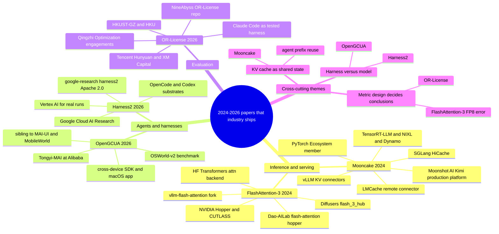
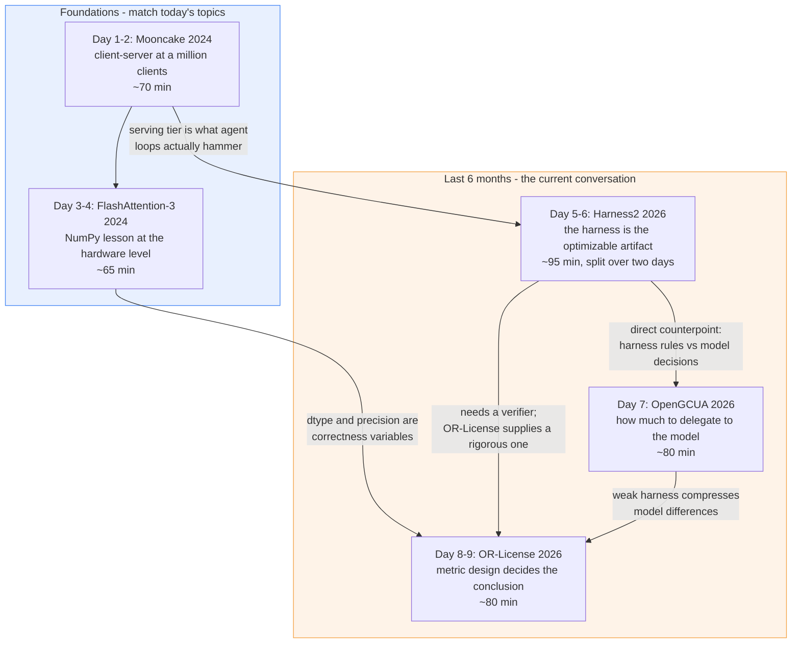

# Papers to read

## Mooncake: A KVCache-centric Disaggregated Architecture for LLM Serving (2024)

Ruoyu Qin, Zheming Li, Weiran He, Mingxing Zhang, Yongwei Wu, Weimin Zheng, Xinran Xu (Moonshot AI, Tsinghua University)

[arXiv:2407.00079](https://arxiv.org/abs/2407.00079) — also published at USENIX FAST '25 / [ACM DL](https://dl.acm.org/doi/10.1145/3773772)

**Problem.** Today's notes ask "where does each step run, and what happens when one client becomes one million clients?" This paper is that question for LLM serving. A naive LLM server handles a request end to end on one GPU replica, but an LLM request has two phases with opposite resource profiles: *prefill* (process the whole prompt, compute-bound, parallel) and *decode* (emit one token at a time, memory-bandwidth-bound, serial). Colocating them means one phase always starves the other, and the KV cache — the per-request state that makes decode fast — is trapped in the GPU memory of whichever replica served the request.

**Idea.** Stop treating the server as one box. Split it into a prefill cluster and a decode cluster, and promote the KV cache from a local implementation detail to a **first-class, shared, disaggregated storage tier** pooled from the otherwise-idle CPU, DRAM and SSD capacity already sitting in the GPU cluster.

**How it works.** A conductor (Mooncake's scheduler) routes each request to a prefill node chosen to maximize KV-cache reuse, then hands the produced KV cache to a decode node. The KVCache tier is built from two pieces: a *Transfer Engine* that moves cache blocks over RDMA/TCP/NVLink with multi-NIC bandwidth aggregation and topology-aware path selection, and a *Mooncake Store* that stripes, tiers (DRAM then SSD), replicates and evicts cache objects. Because the cluster is overloaded in practice, the scheduler also does prediction-based early rejection — it refuses requests it forecasts will miss their SLO rather than admitting them and degrading everyone.

**Results.** The paper reports up to a **525% increase in throughput** in certain simulated scenarios while adhering to SLOs versus the baseline method, and that the architecture enables Kimi to handle **75% more requests** under real workloads.

**In industry.** Mooncake *is* the production serving platform for Kimi at Moonshot AI, and the open-source implementation at [kvcache-ai/Mooncake](https://github.com/kvcache-ai/Mooncake) has become the de facto KV-cache transport layer for the whole inference stack: it [joined the PyTorch Ecosystem](https://pytorch.org/blog/mooncake-joins-pytorch-ecosystem/), ships connectors for vLLM, SGLang, TensorRT-LLM, LMDeploy, NIXL and Dynamo, and was adopted by [LMCache as a remote connector](https://blog.lmcache.ai/en/2025/05/08/lmcache-x-mooncake-unite-to-pioneer-kvcache-centric-llm-serving-system/). The [vLLM blog post on Mooncake Store](https://github.com/vllm-project/vllm-project.github.io/blob/main/_posts/2026-05-06-mooncake-store.md) reports 3.8x higher throughput and 46x lower TTFT on agentic traces after the integration, with cache hit rate going from 1.7% to 92.2%.

**Why it matters for you.** Agent harnesses are the workload that breaks naive serving. An agent turn re-sends a long, mostly-identical prefix on every step, so your harness's throughput is dominated by whether the serving tier can reuse the KV cache across steps. This paper gives you the vocabulary to reason about why your eval suite is slow — cache locality, prefill/decode split, admission control — rather than just asking for more GPUs. It also lands exactly on today's statelessness theme: the server is stateless, but the *state* has to live somewhere, and that somewhere is a design decision.

**Read.** Sections 1 and 2 (problem + disaggregation architecture) first, ~30 min — this is the core idea and the part that maps onto today's notes. Then Section 4 on the KVCache-centric scheduling and early rejection, ~25 min. Skim Section 5's evaluation for the throughput tables, ~15 min. Skip the implementation minutiae on first pass. Total ~70 min.

---

## FlashAttention-3: Fast and Accurate Attention with Asynchrony and Low-precision (2024)

Jay Shah, Ganesh Bikshandi, Ying Zhang, Vijay Thakkar, Pradeep Ramani, Tri Dao (Colfax Research, Meta, NVIDIA, Georgia Tech, Princeton, Together AI)

[arXiv:2407.08608](https://arxiv.org/abs/2407.08608)

**Problem.** This is the same lesson as today's NumPy session, one level down. Your notes make the point that NumPy is fast because a C loop touches all elements contiguously instead of the Python interpreter paying per-element overhead. The hardware version of that lesson: attention on a modern GPU is bottlenecked not by arithmetic but by *moving data through the memory hierarchy*. FlashAttention-2 — already the standard fast kernel — reached **only 35% utilization on the H100 GPU**, because it was designed for an older GPU architecture and leaves Hopper's new capabilities on the table.

**Idea.** Exploit three Hopper-specific hardware features that NumPy's mental model would call "don't materialize intermediates, keep data contiguous, and pick the right dtype": asynchrony between the tensor cores and the memory-movement engine, warp specialization, and FP8 low-precision arithmetic.

**How it works.** Three techniques. (1) *Producer-consumer asynchrony*: split warps into producers that issue TMA (Tensor Memory Accelerator) loads and consumers that run matmuls, so data movement and compute overlap instead of alternating. (2) *Hiding softmax under the GEMMs*: interleave the non-matmul softmax work with the asynchronous matmuls of the following block, since softmax's low-throughput exponentials would otherwise stall the tensor cores. (3) *Block quantization and incoherent processing* for FP8, which keeps the accuracy loss from aggressive quantization under control. The whole thing is still tiled so the full attention matrix is never written to HBM — the FlashAttention invariant.

**Results.** 1.5–2.0x speedup over FlashAttention-2 on H100, reaching up to **740 TFLOPs/s in FP16 (75% utilization)**, and close to **1.2 PFLOPs/s with FP8**. FP8 FlashAttention-3 achieves **2.6x lower numerical error** than a baseline FP8 attention.

**In industry.** The reference implementation lives in the `hopper/` directory of [Dao-AILab/flash-attention](https://github.com/Dao-AILab/flash-attention), and FA-3 is a selectable attention backend across the stack: Hugging Face Transformers exposes it as [`attn_implementation="flash_attention_3"`](https://huggingface.co/docs/transformers/en/attention_interface) (including a paged variant), vLLM ships a vendored fork as [vllm-flash-attention](https://github.com/neuralmagic/vllm-flash-attention/blob/main/usage.md), Diffusers supports a `_flash_3_hub` backend, and there's a Hub-distributed kernel at [kernels-community/vllm-flash-attn3](https://huggingface.co/kernels-community/vllm-flash-attn3). Worth knowing: it is opt-in rather than the default anywhere, and is Hopper-gated — SDPA and FA-2 remain the broad defaults.

**Why it matters for you.** Two things. First, it's the honest continuation of today's NumPy lesson: `shape`, `dtype`, contiguity and "don't build the intermediate array" are not beginner topics, they are what the fastest kernel in production ML is about. Second, when you measure agent latency, the FP8-vs-FP16 choice is a *correctness* variable, not just a speed one — this paper is where you learn to quantify that, which is directly your job in LLM evaluation.

**Read.** Section 2's background on the GPU memory hierarchy and the standard attention algorithm, ~20 min, even if you know attention — the hardware framing is the point. Section 3 on the three techniques, ~30 min. Section 4.2 on FP8 numerical error, ~15 min, this is the part relevant to evaluation. Skip the CUTLASS/CuTe code listings unless you want to write kernels. Total ~65 min.

---

## Harness^2: Recursive Agent Harnessing for an Open World (2026)

Ruiyao Xu, Yanfei Chen, Zhongying CuiZhu, Bhavana Dalvi Mishra, Yifei Ming, Han Yu, Rujun Han, Chen-Yu Lee, Tomas Pfister (Google Cloud AI Research; first author on internship from Northwestern)

[arXiv:2610.14224](https://arxiv.org/abs/2610.14224) — submitted 9 Oct 2026

**Problem.** An agent's capability comes from two places: the model weights, and the *execution harness* around them — prompts, tools, memory, skills, orchestration. Recursive self-improvement work mostly tries to evolve the harness automatically, but two things break it in open-world deployment. Tasks are unseen at design time and novel at test time, so there is **no reliable ground-truth verifier** to score an online harness edit against. And the self-improvement that does happen stays task-specific: it does not generalize to the next task.

**Idea.** Do the recursion at two levels, with the model weights frozen throughout. *Task-level recursion* revises the harness for the task in front of you right now, without a verifier. *Harnessing-level recursion* mines the experience from those edits into a continual-improvement harness that carries forward to future tasks.

**How it works.** Task-level recursion uses a contrastive **Propose–Probe–Compose** step: propose candidate harness edits, probe them against each other (the contrast is what substitutes for the missing ground-truth verifier), then compose the surviving edits into a revised harness. It scales two ways — `parallel` mode probes K general and K domain-specific candidates then composes, `sequential` mode refines over K steps. Harnessing-level recursion then abstracts the accepted edits into reusable experience. The framework is plug-and-play over different executors; the released code defaults to OpenCode and can swap in Codex as the substrate.

**Results.** Across three professional benchmarks and four model-harness configurations, a single step improves GLM-5 and Gemini 3.5 Flash over their base harnesses, with gains of **up to 11.5 points on WorkBuddy-Bench, 4.5 points on JobBench, and 11.8 percentage points on LAB**, improving further with a larger task-level recursion budget.

**In industry.** Open-sourced by Google Research at [google-research/harness2](https://github.com/google-research/harness2) under Apache 2.0, with a project page at harness2.github.io. Install is `uv pip install -e '.[render]'`, then `harness2-setup jb` and `harness2 --bench jb --k 1 --mode parallel`; a local demo runs without credentials on Linux + Python 3.12, while real-model benchmarks need a Google Cloud project with Vertex AI.

**Why it matters for you.** This is the most directly job-relevant paper on the list. You build agent harnesses; this paper argues the harness is an optimizable artifact rather than hand-tuned scaffolding, and — more importantly for an evaluator — it confronts the problem you actually have, which is scoring harness changes when you have no ground truth. The contrastive probe is a technique you can lift into your own eval loop. The honest caveat: "verifier-free" means the probe is itself a proxy metric, so treat the reported gains as evidence the method works on these three benchmarks, not as a general claim.

**Read.** Abstract and Section 1, ~15 min, to get the harness/harnessing distinction clear. The Propose–Probe–Compose section, ~30 min, slowly — this is the contribution. Then the harnessing-level recursion section, ~20 min. Then clone the repo and run the credential-free local demo, ~30 min; reading this one without running it wastes it. Total ~95 min, best split across two days.

---

## OR-License: Evaluating LLM Agents as Real-World Operations Research Practitioners (2026)

Peisong Wang, Feixue Liu, Yize Meng, Bowen Liu, Ruoyu Chen, Gaoyang Dai, Xing He, Aiqian Li, Fengchi Yuan, Aochuan Chen, Chenyi Zi, Yuhan Li, Hongchuan Zeng, Yimo Yan, Nuo Chen, Jie Fu, Zuo-Jun Max Shen, Yong-Hong Kuo, Jia Li (HKUST-GZ, HKU, Qingzhi Optimization, Tencent Hunyuan, XM Capital, and others)

[arXiv:2610.24087](https://arxiv.org/abs/2610.24087) — submitted 16 Oct 2026

**Problem.** Existing operations-research benchmarks hand the agent a self-contained problem description or a predefined optimization task. Real consulting work doesn't: it starts from raw client materials, and the hardest part is *translating messy business documents into a validated, feasible deliverable*. Benchmarks that skip the translation step measure the wrong thing, and they systematically flatter agents.

**Idea.** Build the benchmark from real paid engagements, keep the original mess, hide the evaluation, and — critically — make the missing information something the agent has to go *ask for*, through a simulated client that knows the business facts but not the OR expertise.

**How it works.** OR-License is an end-to-end benchmark of **31 instances across 10 industrial scenarios**, drawn from paid OR engagements totaling **USD 3.68 million**. De-identification preserves the original requirements, input data, deliverable formats and information boundaries. A companion simulator, **ORSim**, is a controlled client that discloses business facts without supplying OR know-how, so the agent's information-gathering behavior becomes observable and measurable. Evaluation is hidden: it tests strict feasibility and compares objective quality against the expert solutions the clients had already accepted. The headline metric, **Deployment-Adjusted Quality (DAQ)**, averages expert-relative quality across instances and scores infeasible deliveries as **zero** — which is the design choice that makes the benchmark bite.

**Results.** Across **11 frontier LLMs** run in coding-agent harnesses: several models beat the expert reference on *conditional* objective quality, but **none matches it on DAQ**. The best primary Claude Code setup reached **88.39% strict feasibility and a DAQ of 0.87** against an expert reference of 1. Task-equalized research-chain completion rates spanned **24% to 45%** across models on evaluable tasks. The authors also find that information requests to the simulated client keep arriving well past the clarification phase, into solution building and validation, with some later stages resolving a greater share of confirmed issues. Trajectory inspection surfaced both formulation and implementation failures.

**In industry.** Code and data at [NineAbyss/OR-License](https://github.com/NineAbyss/OR-License). The agents under test are the commercial coding harnesses engineers actually use, and several authors are at Tencent Hunyuan, Qingzhi Optimization and XM Capital, so the engagements behind it are real industrial work rather than synthetic tasks.

**Why it matters for you.** This is a masterclass in the thing you do for a living, and it contains the single most transferable idea on this list: **scoring infeasible output as zero instead of partial credit**. That one decision flips the result from "models beat experts" to "no model matches the expert," which is exactly the kind of metric-design trap you are paid to catch. The finding that information-seeking continues into the validation phase is also a direct design input for agent harnesses — your harness probably assumes clarification happens up front, and this says that assumption is wrong.

**Read.** Abstract and the benchmark-construction section, ~25 min. Then the DAQ metric definition, ~15 min, carefully — compare it against how your own harness scores partial success. Then ORSim's design, ~20 min. Then the failure-mode trajectory analysis, ~20 min. The per-model results tables can be skimmed. Total ~80 min.

---

## OpenGCUA: Toward a Fully Open Stack for Generalist Computer Use (2026)

Hanzhang Zhou, Long Li, Quyu Kong, Lei Wang, Panrong Tong, Long Chen, Tianyu Xia, Gongjie Zhang, Xu Zhang, Chen Liu, Jianan Zhang, Chenglin Cai, Zhengwen Zeng, Steven Hoi, Yue Wang (Tongyi-MAI, Alibaba)

[arXiv:2610.22200](https://arxiv.org/abs/2610.22200) — submitted 15 Oct 2026

**Problem.** Computer-use agents are moving past pure GUI control (look at pixels, click) toward agents that work through **both visual and programmatic interfaces**. But the frontier systems that do this well — the paper names GPT-6 Astra's computer-use stack — remain largely closed, so nobody outside those labs can study which design choices actually produce the capability.

**Idea.** Open the entire stack, and make two specific bets about what matters. First, **code execution** as a first-class action, so intermediate results can determine subsequent operations and the model can reuse its programming ability for computer interaction instead of translating everything into clicks. Second, **harness-to-model decision transfer**: move decisions about what to observe and how to track task state *out of fixed harness rules* and *into the model*.

**How it works.** The agent is defined as a system where the model itself chooses how to observe, how to act, and how to organize its work, rather than following a harness-imposed loop. Instead of batching GUI screenshots and steps under harness control, the model decides when to look, when to execute code, and how to represent where it is in the task. The release includes the implementation and prompts, evaluation trajectories from all evaluated models, a preliminary real-device harness (for the real-device problems that benchmarks don't capture), and a cross-device SDK giving one programming interface across computers, mobiles and browsers.

**Results.** On **OSWorld-v2**, the full configuration raised task scores for all **eight** evaluated models, including GPT-6 Astra, Claude Opus 5 and Gemini 3.8 Flash, improving mean partial score by **+19.6 points** — and the spread between the strongest and weakest model shrank by more than half. Reported steps per task fell by an average of **53.0%** versus batched GUI-only execution. On the real-device harness, across **four real macOS tasks**, selected Qwen3.8-Max runs consumed **19.4x** as many reported reasoning tokens as GPT-6 Astra.

**In industry.** Released at [Tongyi-MAI/OpenGCUA](https://github.com/Tongyi-MAI/OpenGCUA) under Apache 2.0, from the Alibaba team that also ships [MAI-UI / Qwen-UI-Agent](https://github.com/Tongyi-MAI/MAI-UI) and the MobileWorld mobile-agent benchmark (ACL 2026). The cross-device SDK and macOS menu-bar app make it the most directly usable open baseline for computer-use work.

**Why it matters for you.** The "harness-to-model decision transfer" framing is the question your job turns on: how much of agent behavior should be hard-coded scaffolding versus delegated to the model? This paper gives you an empirical answer on one domain, and the fact that the best-to-worst model gap *shrinks by more than half* under their stack is a warning about your own evaluations — a weak harness compresses model differences, so harness quality is a confound in every model comparison you run. The 19.4x token-consumption spread on real macOS tasks is also a reminder that benchmark scores and deployment cost are different axes.

**Read.** Abstract and Section 1, ~15 min. The architecture section on code execution plus decision transfer, ~30 min. The OSWorld-v2 results and the model-gap-compression analysis, ~20 min — that's the part with the methodological lesson. Then skim the real-device harness section, ~15 min, for the gap between benchmark and reality. Total ~80 min. Read this *after* Harness^2, since the two are arguing opposite directions about where intelligence should live.

---

## Industry map

## Reading order

Rationale for the order: Mooncake and FlashAttention-3 first because they attach to today's two topics and give you the systems vocabulary (shared state, memory hierarchy, dtype as a correctness knob) that the 2026 papers assume. Harness^2 and OpenGCUA next, read back to back because they disagree productively about where agent capability should live. OR-License last, because it is the sharpest paper on the list and lands hardest once you have seen two harness designs and can ask what would happen to each under a metric that gives zero credit for infeasible output.
