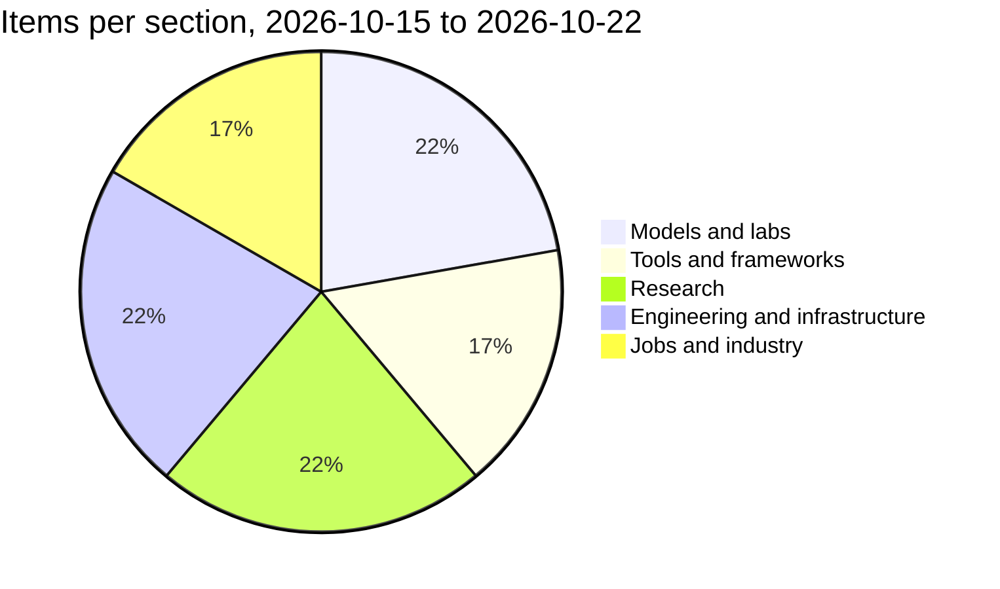

# Tech news

## Models and labs

**Meta releases Muse Spark Open, 816B total and 42B active, under permissive weights** — 2026-10-15
Meta Superintelligence Labs published the weights for Muse Spark Open, a natively multimodal 816B-parameter mixture-of-experts model with 42B active per token and a 1M-token context, billed as the first in its class to run on a desktop (two M5 Ultra Mac Studios with MLX). Active-parameter count, not total, drives serving cost, which is why MoE keeps winning open-weight releases, and a frontier-adjacent model you can host yourself changes the privacy and cost maths for any agent harness.
[https://techcrunch.com/2026/10/15/meta-launches-an-open-weight-model-that-runs-on-macs/](https://techcrunch.com/2026/10/15/meta-launches-an-open-weight-model-that-runs-on-macs/)

**Nvidia ships Nemotron 3.5 Super VL with weights, datasets and RL environments** — 2026-10-15
The model is a 120B/12B-active hybrid Mamba-attention MoE with a RADIO vision tower and up to 1M-token context, released under the OpenMDW license along with training recipes and the RL environments used for post-training. Releasing the environments, not just the weights, is the part worth copying: it is the difference between a model you can run and a pipeline you can reproduce.
[https://developer.nvidia.com/blog/nvidia-nemotron-3-5-super-vl-powers-specialized-agents-with-multimodal-reasoning/](https://developer.nvidia.com/blog/nvidia-nemotron-3-5-super-vl-powers-specialized-agents-with-multimodal-reasoning/)

**Tencent open-sources the Hy Memory 2.0 agent-memory stack** — 2026-10-16
Tencent Hunyuan put a three-layer memory system on GitHub under Apache 2.0: a 30B/3B-active writer model, a framework covering chat, working and coding memory with pluggable vector and graph stores, and a local MemHub app that consolidates history across coding agents. Agent memory has been the hand-rolled part of every harness, and a referenceable open implementation gives you a baseline to evaluate your own retention and recall logic against.
[https://github.com/Tencent-Hunyuan/Hy-Memory](https://github.com/Tencent-Hunyuan/Hy-Memory)

**DeepSeek refreshes V4.1-Flash and adds Search and Fetch APIs** — 2026-10-17
DeepSeek-V4.1-Flash-1017 is an MIT-licensed update that cuts task execution time and output length, reporting 77% on DeepSWE v1.1 against 74.2% for the September build, and it shipped alongside a Search API returning up to 50 ranked results and a Fetch API that converts a page to Markdown, both at 75 cents per 1,000 requests. Labs are now selling the retrieval tools, not just the model, which collapses a chunk of the plumbing most agent stacks build in-house.
[https://siliconangle.com/2026/10/18/deepseek-releases-updated-v4-1-flash-model-it-says-completes-tasks-faster/](https://siliconangle.com/2026/10/18/deepseek-releases-updated-v4-1-flash-model-it-says-completes-tasks-faster/)

## Tools and frameworks

**llm-d 1.0 brings day-2 operations to distributed LLM serving on Kubernetes** — 2026-10-20
The CNCF project founded by Red Hat, IBM, Google Cloud, CoreWeave and Nvidia reached 1.0 with multi-tenant quality of service, router high availability, coordinated rolling upgrades for disaggregated deployments, a stable v1 config API and session-aware routing for agents, on top of prefix-cache-aware routing and KV-cache offloading. Contributors report roughly 98% prefix-cache hit rates and about $0.11 per million tokens in one IBM Research deployment, which is the clearest statement yet that agentic traffic is an input-processing problem, not a generation problem.
[https://www.redhat.com/en/about/press-releases/llm-d-1-advances-open-cost-efficient-ai-inference-production-scale](https://www.redhat.com/en/about/press-releases/llm-d-1-advances-open-cost-efficient-ai-inference-production-scale)

**AWS opens TorchNeuron in public beta, making Trainium a native PyTorch device** — 2026-10-20
TorchNeuron registers Trainium through PyTorch's PrivateUse1 hook so code moves over by changing `.to('cuda')` to `.to('neuron')`, with eager mode, `torch.compile` and TorchTitan supported, released under Apache 2.0 for Trainium2 and Trainium3 instances. This is the most credible attempt yet to make CUDA an implementation detail, and it only holds if the PyTorch surface really stays unchanged.
[https://aws.amazon.com/about-aws/whats-new/2026/10/aws-announce-native-pytorch-support-trainium/](https://aws.amazon.com/about-aws/whats-new/2026/10/aws-announce-native-pytorch-support-trainium/)

**Microsoft tells enterprises to treat AI agents as insider risks** — 2026-10-19
Microsoft shipped new agent security capabilities spanning discovery, runtime monitoring and independent auditing, extending agent discovery to 60 local agent types including Claude Code, OpenAI Codex and GitHub Copilot, with Guardian Agents able to strip privileges mid-task when risk rises. The design lesson for interviews is direct: every agent needs its own identity, audit trail and revocable scope rather than borrowing its sponsoring user's credentials.
[https://techcrunch.com/2026/10/19/microsoft-says-ai-agents-are-like-insider-threats-as-frontier-models-cant-be-trusted/](https://techcrunch.com/2026/10/19/microsoft-says-ai-agents-are-like-insider-threats-as-frontier-models-cant-be-trusted/)

## Research

**"After the Attacker Leaves" benchmarks carryover attacks through agent memory** — 2026-10-20
The paper shows that a single indirect prompt injection stored in a memory file or a scheduled task can re-fire across sessions long after the attacker disconnects, and introduces CarryoverBench with 12 personal-assistant scenarios and 101 attack tasks. Persistent memory is the feature every agent product is adding this quarter, and the finding is that memory writes need the same trust boundary as any other untrusted input, enforced at the runtime layer rather than in the prompt.
[https://arxiv.org/abs/2610.28425](https://arxiv.org/abs/2610.28425)

**DecisionPivot separates probability ordering from decision correctness** — 2026-10-20
The diagnostic suite spans 48 tasks and 40,033 items across seven decision roles, using contrast groups to catch models that score well per item but collapse under controlled variation: two 27B models within 2.6 points on the reference track scored 70.1% versus 44.2% on contrast groups. If you build eval harnesses for routing, guardrails or output verification, the contrast-group design is directly reusable and exposes right-answer-wrong-reason behaviour that aggregate accuracy hides.
[https://arxiv.org/abs/2610.28522](https://arxiv.org/abs/2610.28522)

**OptionWorld diagnoses where multi-day assistants actually break** — 2026-10-20
The benchmark simulates everyday tasks over multi-day horizons and tracks information gathering, judgment, action and outcome separately, finding that in 35.5% of failed instances the needed fact was already in the model's final pre-deadline input and went unused. The three recurring failure modes, unsynthesised information, missed windows to act, and invented constraints, give you vocabulary for debugging an agent that "just got worse" instead of rerunning it and hoping.
[https://arxiv.org/abs/2610.28491](https://arxiv.org/abs/2610.28491)

**Axiomatic World Modeling names "modeling drift" in physics reasoning** — 2026-10-17
The NeurIPS 2026 paper shows models quietly alter given values, invent laws or add assumptions to fit a familiar template, then reason correctly inside that wrong world, and proposes a training-time reward that scores the inferred world model separately from the derivation, reporting up to +12.2 points on PhysReason at no inference cost. Silent fabrication is worse than refusal for any evaluation pipeline, because it sails through string-match scoring.
[https://arxiv.org/abs/2610.24519](https://arxiv.org/abs/2610.24519)

## Engineering and infrastructure

**Nvidia unveils the DSX POD, an AI factory assembled inside a shipping container** — 2026-10-21
At GTC Berlin, Nvidia introduced a reference design where partners build and validate seven Vera Rubin racks, cabling, power and liquid cooling inside a roughly 28,000 kg container, cutting on-site deployment from about six months to as little as 14 days, with 17 partners and availability in early 2027. Jensen Huang's framing is the system-design point: a 1 GW facility runs about $50 billion, and a three-month delay forfeits roughly $10 billion of revenue opportunity, so build speed is now a first-class constraint, with the 14-day clock starting only once power, cooling and network are ready.
[https://www.datacenterknowledge.com/ai-data-centers/nvidia-unveils-dsx-pod-for-faster-ai-data-center-builds](https://www.datacenterknowledge.com/ai-data-centers/nvidia-unveils-dsx-pod-for-faster-ai-data-center-builds)

**Nvidia prepays six suppliers to unblock substrates, packaging and optics through 2028** — 2026-10-21
Agreements with Ibiden, Samsung Electro-Mechanics and Unimicron target a 2.5x substrate capacity increase over three years, Amkor plans more than 300% more advanced packaging capacity by end-2028, SPIL agreed to a 15-fold increase in optical-engine capacity by mid-2027, and KYEC gets a $1.1 billion capacity reservation advance for new US facilities. The compute shortage is as much a packaging and substrate problem as a GPU one, which is exactly why squeezing more tokens out of existing accelerators keeps paying.
[https://www.forbes.com/sites/jonmarkman/2026/10/21/nvidia-lines-up-six-suppliers-to-expand-ai-chip-capacity-through-2028/](https://www.forbes.com/sites/jonmarkman/2026/10/21/nvidia-lines-up-six-suppliers-to-expand-ai-chip-capacity-through-2028/)

**Nscale and Anthropic reportedly near a second $45 billion compute deal** — 2026-10-19
Bloomberg sources say the pair are close to announcing another $45 billion agreement, matching the one revealed on 26 August, against reporting that Anthropic has committed roughly $517 billion of compute in 11 months while Nscale faces investor pushback on a $30 billion IPO valuation. Contracts this size are simultaneously the moat and the risk, and they explain why labs keep investing in their own serving stacks to lower cost per token.
[https://techcrunch.com/2026/10/19/nscale-and-anthropic-are-reportedly-in-talks-for-yet-another-45-billion-compute-deal/](https://techcrunch.com/2026/10/19/nscale-and-anthropic-are-reportedly-in-talks-for-yet-another-45-billion-compute-deal/)

**Saudi Arabia's Humain expands its Nvidia partnership to 84MW** — 2026-10-22
Humain detailed up to 84MW, roughly 27,000 GPUs, in two phases: 14MW of Blackwell HGX B300 in Q4 this year for Humain Cloud customers, then 70MW of Vera Rubin from mid-2027 with 50MW reserved for an undisclosed US customer. Sovereign AI buildouts are becoming their own market segment, and reserving capacity for a foreign tenant shows compute is being traded like any other commodity with a geography attached.
[https://www.thenationalnews.com/future/technology/2026/10/22/saudi-arabias-humain-expands-nvidia-deal-with-84mw-ai-computing-plan/](https://www.thenationalnews.com/future/technology/2026/10/22/saudi-arabias-humain-expands-nvidia-deal-with-84mw-ai-computing-plan/)

## Jobs and industry (India and remote)

**Forward deployed engineer postings in India grew nearly 19x in a year** — 2026-10-15
Indeed data shows FDE listings up about 19x between June 2025 and June 2026, peaking at 1,807% year-on-year in June before moderating to roughly 16x in July and 6x in August, spread across Bengaluru, Hyderabad, Chennai, Delhi, Mumbai and remote. Listings ask for Python, APIs, cloud, RAG, agents, tool calling, vector databases and AI evals plus customer-facing judgment, which is the harness-and-evaluation skill set with a consulting layer bolted on.
[https://www.peoplematters.in/news/workforce-planning/demand-for-forward-deployed-engineers-jumps-19-fold-in-india-report-52770](https://www.peoplematters.in/news/workforce-planning/demand-for-forward-deployed-engineers-jumps-19-fold-in-india-report-52770)

**October listings data: Bengaluru leads India, remote is only 4.4% of roles** — 2026-10-16
India posted 10,986 software and 4,865 data and AI openings, about 29.3% of all Indian listings, with Bengaluru at 4,578, Hyderabad 1,684 and Pune 1,402, while only 4.4% of Indian listings on employer career sites were remote. The remote share is the number to remember: remote-first is a strategy for reaching the global market from India, not a way to work locally.
[https://dev.to/jobrise/software-and-ai-engineering-jobs-in-october-2026-what-the-listings-show-336i](https://dev.to/jobrise/software-and-ai-engineering-jobs-in-october-2026-what-the-listings-show-336i)

**Q2 FY27 results split Indian IT headcount two ways** — 2026-10-16
Wipro's workforce fell 2.8% sequentially to 236,328, down 6,716 in the quarter with utilisation at 83.4%, while Tech Mahindra added 5,446 people to reach 152,206 and put over 12,500 associates through Gemini workshops. Aggregate headcount is no longer a demand signal for this sector: the hiring that is happening is concentrated in AI, data and deployment roles rather than general delivery capacity.
[https://www.peoplematters.in/news/business/wipro-workforce-declines-28percent-sequentially-to-236328-in-q2-fy27-52773](https://www.peoplematters.in/news/business/wipro-workforce-declines-28percent-sequentially-to-236328-in-q2-fy27-52773)

## At a glance

## Try this week

Turn the llm-d 1.0 release into a client-server measurement exercise, since that is today's system design topic. Serve one small open model locally with vLLM, then write a plain Python client that fires N requests at it and records every round-trip time into a NumPy array. One script answers both of today's recall questions: `times.mean()` and `np.percentile(times, [50, 99])` are latency, `len(times) / wall_clock` is throughput, and the array does it without a single Python loop over the samples.

Then run it twice, once at concurrency 1 and once at concurrency 16, and watch p99 latency climb while throughput climbs too. That divergence is the latency-versus-throughput distinction the course flags as an experience signal, measured on your own machine instead of memorised. Keep the script: the same percentile harness is what you will reach for when you start evaluating agent pipelines, and it is the first thing llm-d's prefix-cache-aware routing claims would show up in.

*Researched by claude and kiro; merged by claude.*
