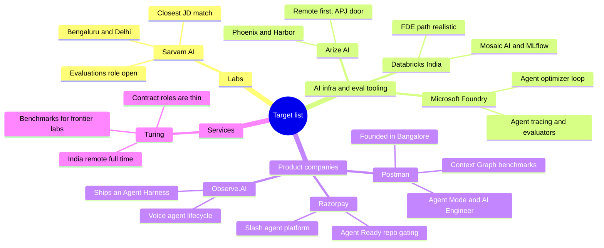

# Companies to look at

Eight places with live or very recent openings that line up with roughly two years of backend work plus LLM-evaluation and agent-harness experience. India-based or genuinely remote-friendly. Grouped later into labs, AI infra, product companies, and services.

## Sarvam AI

**What they build.** Sovereign Indian foundation models and the products on top of them: Indic LLMs, speech (Saaras ASR, Bulbul TTS), document intelligence, on-device Edge models, and an enterprise deployment programme called Chanakya. They open-sourced Sarvam 30B and 105B in March 2026.

**Stack.** Python, PyTorch, large-scale distributed training, HPC/SRE, inference performance work down to CUDA kernels, telephony and real-time audio for voice agents, and a model API platform.

**Role that fits.** [Data Scientist – Evaluations, Chanakya](https://www.sarvam.ai/careers/jobs/7c42207a-bb56-413c-839f-9ad692df840e) (Bengaluru, Engineering, on-site) is the closest thing on this list to a job description written from the resume: it asks for eval frameworks across document comprehension, command summarisation, geospatial reasoning and workflow automation, defining quality metrics with domain experts, pre- and post-deployment eval cycles with production dashboards, failure-mode and distribution-shift hunting, and eval pipelines that are "automated, triggered by deployment events, versioned, and reproducible." It lists 3–6 years, so two is a stretch but not a wall. Backend-adjacent alternatives on the same board: *Software Engineer – Model API Platform*, *ML Ops Engineer, Chanakya*, *Platform Engineer – AI Infrastructure*. 42 open roles, all on-site Bengaluru or Delhi.

**Recent.** [Introducing Bulbul V4 Flash](https://www.sarvam.ai/blogs/bulbul-v4-flash) (13 Oct 2026), expressive real-time TTS for live voice agents. Read [Indic DiarBench](https://www.sarvam.ai/blogs) (11 Aug 2026) too — a joint diarization-ASR benchmark, i.e. benchmark construction from first principles, which is the interview conversation you want.

**Careers.** [https://www.sarvam.ai/careers](https://www.sarvam.ai/careers)

## Arize AI

**What they build.** AI observability and evaluation: the commercial AX platform and open-source **Phoenix**. Tracing, LLM-as-a-judge and code-based evaluators, experiment comparison, agent evaluation. One of the few companies where an eval harness is the product rather than internal tooling.

**Stack.** Python and TypeScript, OpenTelemetry-based tracing, sandboxed task execution (Harbor), datasets/experiments/runs as first-class objects, optimizers like GEPA. Remote-first.

**Role that fits.** The engineering roles on the [job board](https://job-boards.greenhouse.io/arizeai) are mostly Remote (US) — Senior AI Product Engineer (Backend and Fullstack), Senior Open Source Design Engineer — with *AI Application Engineer, APJ* and *Enterprise Account Executive, APJ* based in Singapore. Realistic path from India: the APJ application-engineering role, or open-source contribution to Phoenix as the way in, since the OSS work is public and visible.

**Recent.** [How to test agent tool descriptions with Harbor and Phoenix](https://arize.com/blog/how-to-test-agent-tool-descriptions-with-harbor-and-phoenix/) (Nancy Chauhan, Oct 2026) is the single best prep item on this page: versioned task folders instead of eval scripts, grading outcomes rather than trajectories, validating the judge before optimising against it ("The LLM judge looked like the easy part. It was wrong a lot of the time"), 18 tasks × 5 configs × 3 attempts for stochastic agents, and a one-line tool-description change that cut a run's cost from $11.85 to $8.34 with reward unchanged. Also [Agent tool selection: the tool your agent almost called](https://arize.com/blog/ai-agent-tool-selection-decision-tracing/).

**Careers.** [https://job-boards.greenhouse1.io/arizeai](https://job-boards.greenhouse.io/arizeai)

## Microsoft (Hyderabad / Bengaluru)

**What they build.** Microsoft Foundry (formerly Azure AI Foundry) — the agent platform sold to enterprises — plus Copilot and the CoreAI stack. Foundry productises agent evaluation: tracing for hosted agents, evaluators that check intent-following and tool-call accuracy, an AI Red Teaming Agent, and an Agent Optimizer that ingests production traces and eval scores to propose ranked prompt and skill changes.

**Stack.** Python and C#/.NET, Azure, Agent Framework (Semantic Kernel plus AutoGen), OpenTelemetry pipelines for agent traces, judge-model evaluators, golden datasets, CI-gated evals in GitHub Actions and Azure DevOps.

**Role that fits.** Applied AI Engineer and Software Engineer II rungs on the Foundry evaluation, observability and Copilot teams in Hyderabad and Bengaluru. MSR India in Bangalore posts agentic-systems research roles, but those skew senior. Target the applied/platform side at two years.

**Recent.** [Build and run agents at scale with Microsoft Foundry at Build 2026](https://devblogs.microsoft.com/foundry/agent-service-build2026/) (Tina Schuchman, 2 Jun 2026) names the exact problem the resume solves: "traces halt at the agent boundary and evaluation is done by hand." Everything — model calls, tool invocations, sub-agent hops — moves through one OpenTelemetry pipeline so you can jump "from the score to the exact production trace." Its Rubric component scores task success, tone, safety, cost and latency as weighted criteria.

**Careers.** [https://apply.careers.microsoft.com/](https://apply.careers.microsoft.com/)

## Databricks (Bengaluru)

**What they build.** The lakehouse, and on top of it Mosaic AI — model serving, vector search, Agent Bricks, and MLflow 3 with agent tracing and LLM-judge evaluation.

**Stack.** Python, Scala/JVM, Spark, MLflow, RAG and agentic RAG, MCP, vector search, LangChain/LangGraph, AWS/Azure/GCP.

**Role that fits.** [Senior ML & AI Technical Solutions Engineer](https://www.databricks.com/company/careers/support/senior-ml--ai-technical-solutions-engineer--7845325002) (req P-1377, Bengaluru) has the highest keyword overlap of anything here — it names "experiment tracking, model registry, versioning, evaluation, labelling, tracing, and lifecycle observability" in one sentence, plus agentic frameworks, RAG/Agentic RAG, MCP, prompt design, memory management and retrieval — but asks 8+ years, so treat it as a target to grow into and a map of the vocabulary. The nearer-term shape is the *AI Engineer, Forward Deployed Engineer* track (Bengaluru, Delhi, Mumbai, Pune; roughly 3–5 years), which productionises customer AI applications — where eval harnesses actually get written under deadline.

**Recent.** The [Databricks engineering blog](https://www.databricks.com/blog/category/engineering) has been active through Sept–Oct 2026; MLflow 3's agent tracing and LLM-judge evaluation is the thread to follow before an interview.

**Careers.** [https://www.databricks.com/company/careers/open-positions](https://www.databricks.com/company/careers/open-positions)

## Postman

**What they build.** The API platform (50M+ developers), rebuilt AI-native: Agent Mode, an autonomous AI Engineer for long-running tasks, Fabric Gateway, Astro AI, and a Context Graph over collections, environments, schemas and usage patterns from millions of workspaces. Founded in Bangalore, with real engineering leadership still there.

**Stack.** Node/TypeScript backend, agent sandboxes and remote execution environments, code-generation pipelines, knowledge-graph retrieval, experimentation infrastructure, agent governance.

**Role that fits.** [Senior Engineer – AI](https://postman.wd108.myworkdayjobs.com/careers/job/Bangalore-India/Senior-Engineer---AI_JR1000054) (Bangalore, JR1000054) is written for people fluent in agent tooling — sandboxes, remote execution, codegen — and includes building the data and experimentation infrastructure behind Agent Mode, which is the eval work under a different name. Also open in Bengaluru: *Senior Engineer, Messaging Platform* (agentic event-driven notification workflows, 6+ years backend) and *Engineering Manager, Postman AI*.

**Recent.** [Steer Your Agents Until They Steer Themselves](https://blog.postman.com/steer-your-agents-until-they-steer-themselves/) covers "evals for non-verifiable domains," the hardest problem in this field. [AI Sprawl Is the New Shadow IT](https://blog.postman.com/ai-sprawl-is-the-new-shadow-it-how-postman-got-ahead-of-ours/) describes finding 866 internal agents and apps and putting them under governance. [Context Graph Makes Haiku 5.5 23% faster, for 19% less money, in fewer steps](https://blog.postman.com/context-graph-makes-haiku-5-5-23-faster-for-19-less-money-in-fewer-steps/) is a 17-question, 802-repo benchmark run. Three posts, three interview openings.

**Careers.** [https://www.postman.com/company/careers/open-positions/](https://www.postman.com/company/careers/open-positions/)

## Razorpay (Bengaluru)

**What they build.** India's largest payments platform, now running agents in production at unusual scale: **Slash**, an internal cloud agent platform wired into Slack, Jira and GitHub CI, plus Agent Studio, an Agentic Platform and agentic payments.

**Stack.** Go/Java/Python backend microservices at payments scale, fraud/risk ML, an MCP/CLI gateway with scoped permissions to tickets, GitHub, Grafana, the data lake and Slack, and a knowledge graph ("Discover") over 10+ internal sources.

**Role that fits.** Backend SDE roles, plus the open [AI Builder](https://razorpay.com/ai-builders) track — a deliberately short funnel (form, project or GitHub link, call within 48 hours if there's signal) for people who turn vague problems into working agentic systems. The quality-gate side of Slash is where evaluation experience lands.

**Recent.** [Razorpay Engineers Built Slash. Slash Builds the Rest.](https://razorpay.com/blog/razorpay-engineers-built-slash-slash-builds-the-rest/) (Prabu Ram, SVP Engineering, 18 May 2026): tens of thousands of agent sessions a month, PRs via Slash going from ~100/week to ~1,000/week, zero-human-in-the-loop merges from ~10/week to ~100/week, roughly one review in three merged with no human comment, a reviewer built from specialised sub-agents (bugs, security, code quality, design system, i18n, pre-mortem) with a false-positive filter in front, and repos scored on context, testing and CI/CD needing 80% on all three to earn an "Agent Ready" label. That scoring-and-gating system is an eval harness for code agents.

**Careers.** [https://razorpay.com/careers/](https://razorpay.com/careers/)

## Observe.AI (Bengaluru)

**What they build.** Autonomous voice and chat agents for contact centres plus copilots for human staff, across hundreds of enterprises. Their platform navigation lists a product literally called **Agent Harness** — "versioning, testing & release" — alongside an Agent Platform and an AI CoBuilder for authoring agents in plain English.

**Stack.** Python backend, ASR/TTS and LLM orchestration, AWS, MCP and CRM/CCaaS integrations, real-time streaming for live-call assist.

**Role that fits.** Backend or platform engineering on the Agent Platform / Agent Harness side — the versioning-and-release path, which is where regression suites, offline replay of recorded calls and promotion gating live. Bengaluru office, with hybrid options.

**Recent.** [Strategic Collaboration Agreement with AWS to accelerate adoption of AI agents](https://www.observe.ai/press) (22 Jul 2026) and [DoorDash, Observe.AI and AWS partner to scale customer-centric AI across 19,000 agents](https://www.observe.ai/press-releases/doordash-observe-ai-and-aws-partner-to-scale-customer-centric-ai-across-19-000-agents) (14 Jul 2026). Research caution: January 2026 "Snowflake acquires Observe" headlines refer to Observe, Inc., the observability company — a different firm.

**Careers.** [https://www.observe.ai/careers](https://www.observe.ai/careers)

## Turing

**What they build.** Research data, benchmarks and evaluation for frontier model labs, plus forward-deployed AI engineering for enterprises. Their business is substantially the construction of the evaluation and post-training data other people's models are measured against.

**Stack.** Python, SQL, cloud; SFT, LoRA/QLoRA, DPO, PPO, GRPO, RLHF on the post-training side; SWE-Bench, MLE-Bench and Terminal Bench-style harnesses on the eval side.

**Role that fits.** Two tiers, and the distinction matters. Full-time on the [official board](https://job-boards.greenhouse.io/turing) (31 openings): *Forward-Deployed AI Engineer* (Bengaluru and Hyderabad), *Staff Software Engineer* (India – Remote), *Strategic Project Lead – Code* (India – Remote), and a US-based *Senior Software Engineer, AI Evaluation Infrastructure* that describes the charter well even if you cannot apply. Separately there is a large pool of contract eval gigs — SWE-Bench data engineering, agentic evaluation, LLM post-training and RL workflows — which are 2–3 months, no benefits, 4-hour PST overlap, and the India-remote benchmark-data listings quote 4–12 LPA. Chase the full-time India-remote and Bengaluru roles; use the contract work only as deliberate signal-building.

**Recent.** Turing's own board carries the AI Evaluation Infrastructure posting as the clearest public statement of what the team does. Disambiguation: 2026 "Turing funding" headlines about a ¥12.62bn raise and a $10bn IPO refer to a Japanese autonomous-driving company of the same name.

**Careers.** [https://job-boards.greenhouse.io/turing](https://job-boards.greenhouse.io/turing)

## Where they sit

## Talking points

**Labs (Sarvam).** The pitch is that evaluation is the gate on model release, not QA afterwards. Indic DiarBench is the opening: they built a benchmark because none existed, and the resume's eval work is the same act at application scale — deciding what "correct" means with no labelled ground truth, then making that judgement cheap and repeatable. Bring numbers: how many eval cases, what judge-model or inter-rater agreement you measured, which regression you caught before it shipped. The Chanakya role explicitly wants pipelines triggered by deployment events, versioned and reproducible, so talk about how your harness handled prompt and model version churn without invalidating old scores. For Sarvam specifically, connect it to speech: eval for voice agents means latency, barge-in and turn-taking, not just token accuracy.

**AI infra and eval tooling (Arize, Microsoft, Databricks).** These teams have productised what the resume did by hand, so the strongest move is to narrate the gap. Here is the harness I built, here is where it broke, here is what a platform must provide: trace capture at every tool call, deterministic replay, judge-model versioning so scores stay comparable, cost accounting per sweep. Having independently arrived at the same primitives Foundry and MLFlow 3 ship is the credential. Arize's Harbor post gives you three specific positions to hold — grade outcomes not trajectories so one task set survives an agent swap; validate the verifier before trusting it; keep the trace next to the score, because three configs passing every task can still differ wildly in tool calls and cost. Backend depth counts as much as ML depth in all three orgs, and day 1's material is directly load-bearing: a harness fanning out thousands of model calls is a distributed systems problem with timeouts, retries, idempotency and partial failure, and if you cannot say why a retry must not double-count a judge call, the systems half of the interview is already lost.

**Product companies (Postman, Razorpay, Observe.AI).** Vocabulary matches nearly exactly, so lead with it and then go a level past the job description. Ask Observe.AI what their regression suite looks like when the input is a live phone call and how they decide an agent is safe to promote; their Agent Harness is versioning, testing and release, which is your job title spelled differently. With Razorpay, the "Agent Ready" repo score and the false-positive filter in front of Slash Reviewer are the hook — they learned that an agent reviewer which cries wolf gets ignored, which is a precision-versus-recall decision about an evaluator, and you should have a story about making that tradeoff. Postman's post on evals for non-verifiable domains is the right conversation: with no unit test for "did the agent do the right thing," you end up with rubrics, judge models and human spot-check sampling, each with a failure mode worth naming. Their Context Graph benchmark measures latency, cost and step count together, so bring a tradeoff you made across all three rather than an optimisation of one.

**Services (Turing).** Here the resume is already the deliverable: Turing sells benchmark design and evaluation infrastructure to frontier labs, and two years of doing that in-house is directly billable. Speak their language — SWE-Bench and MLE-Bench-style harnesses, RL environments, benchmark design across accuracy, robustness, safety, latency and cost — and pitch judgement over throughput: how you design a benchmark that is hard to game, and how you diagnose why an agent failed rather than only scoring pass/fail. The thing to screen for is ownership. Ask whether you would own a harness across engagements or rebuild one per customer, because the first compounds into senior-level scope and the second does not. Use the infra and product conversations above as your benchmark for what good scope looks like before accepting anything here.

*Researched by claude and kiro; merged by claude.*
