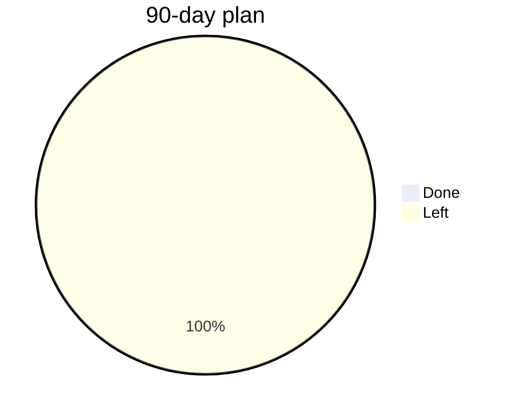
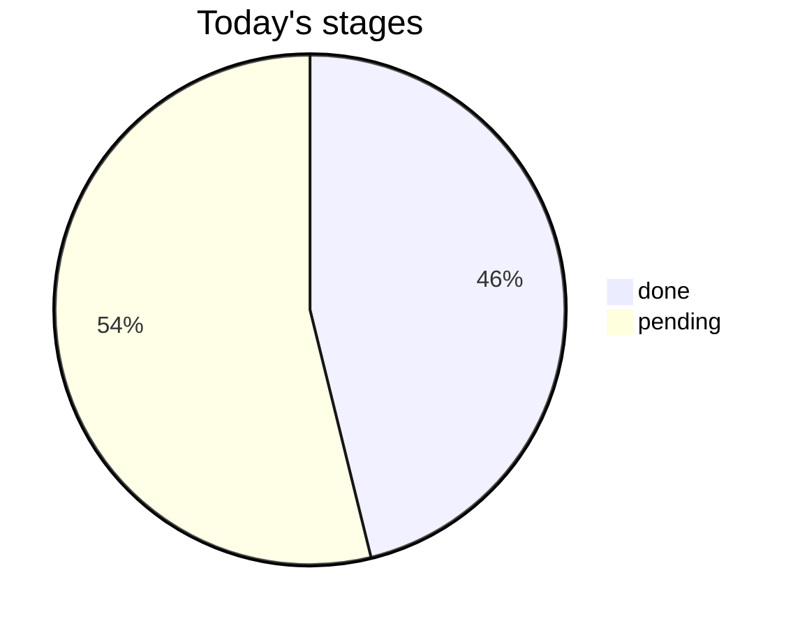

# Briefing 2026-10-22

Day 1 of 90. Topics: System Design: Client-Server Model; ML / GenAI: NumPy Fundamentals.

Study notes: [today.md](../../learning/today.md). Mark the day finished with `python3 -m pipeline learn --done`.

## Agents

| Agent | Status | File |
| --- | --- | --- |
| goal | done | [01-goal.md](01-goal.md) |
| system-design | done | [02-system-design.md](02-system-design.md) |
| papers | done | [03-papers.md](03-papers.md) |
| tech-news | done | [04-tech-news.md](04-tech-news.md) |
| companies | done | [05-companies.md](05-companies.md) |

## Progress





## Applications

```mermaid
xychart-beta
    title "Applications per day"
    x-axis ["10-22"]
    y-axis "Applied" 0 --> 1
    bar [0]
```
