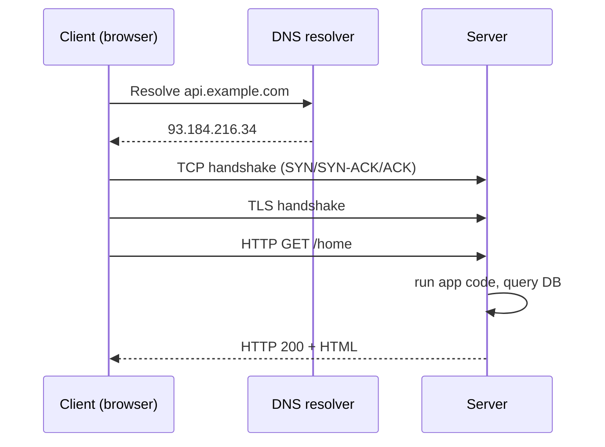
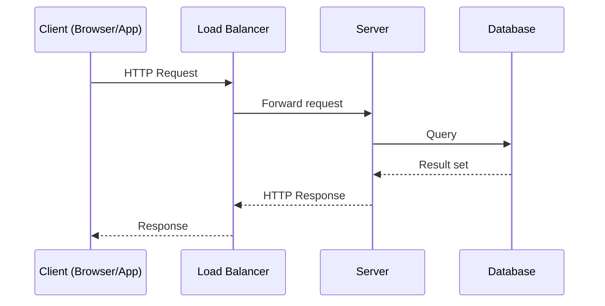
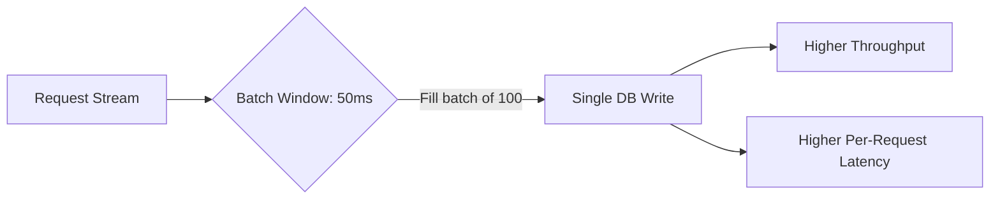

# 2026-10-22: Day 1 of 90 (week 1)

2 hours: 55 min system design, 55 min ML / GenAI, 10 min recall. When finished: `python3 -m pipeline learn --done`.

## Day 1: The client-server model and how a web request happens

**System Design: Client-Server Model** (55 min)

Every system you will design this quarter is a variation on one idea: a **client** (browser, mobile app, another service) sends a **request** over a network to a **server**, which does work and returns a **response**. The server is usually stateless per request (it does not remember you between calls unless you hand it a token or cookie), which is why it can be replaced, restarted, or multiplied without the client noticing.

A single page load is actually a chain of round trips:
1. Resolve the domain to an IP address (DNS - tomorrow's topic).
2. Open a TCP connection to that IP (three-way handshake: SYN, SYN-ACK, ACK).
3. If HTTPS, do a TLS handshake on top of that TCP connection.
4. Send the HTTP request; the server's app code runs, maybe queries a database, and returns an HTTP response.
5. The browser parses the HTML and repeats steps 1-4 for every image, script, and stylesheet the page references.



The architectural question you will ask for the rest of this course is: **where does each step run, and what happens when one client becomes one million clients?** A single server handling steps 2-4 has a ceiling (open file descriptors, CPU, memory for connections); everything in Weeks 2-4 is about raising that ceiling by adding storage tiers, caches, queues, and more servers behind a load balancer.

**ML / GenAI: NumPy Fundamentals** (55 min)

NumPy's core object is the `ndarray`: a fixed-type, fixed-shape grid of numbers stored contiguously in memory. The reason every ML library (pandas, scikit-learn, PyTorch) is built on this idea is **vectorization**: a loop written in C runs once and touches all elements, instead of Python's interpreter paying its per-iteration overhead on every single number.

Key mental model: an array has a `shape` (a tuple of dimension sizes) and a `dtype` (e.g. `float64`). Operations between arrays are elementwise by default, and **broadcasting** lets arrays of compatible but different shapes combine without you writing a loop - a shape `(3,)` vector added to a shape `(4, 3)` matrix is stretched across the 4 rows automatically.

```python
import numpy as np

a = np.array([1.0, 2.0, 3.0])
b = np.array([[1, 2, 3], [4, 5, 6]])

# Vectorized ops - no Python-level loop
print(a * 2)              # [2. 4. 6.]
print(b + a)               # broadcasting: a is added to every row of b
print(b.sum(axis=0))       # column sums -> [5 7 9]
print(b.sum(axis=1))       # row sums    -> [6 15]

# Timing contrast: vectorized vs pure Python loop
import time
x = np.random.rand(1_000_000)

t0 = time.time()
total = sum(v * 2 for v in x)     # pure Python loop
t1 = time.time()
total_np = (x * 2).sum()          # vectorized
t2 = time.time()
print(f"loop: {t1 - t0:.4f}s, vectorized: {t2 - t1:.4f}s")
```

Run this and you should see the vectorized version is 10-50x faster. That gap is the entire reason NumPy exists, and it is why every ML framework avoids raw Python loops over data.

**Recall** (10 min)
- What are the four steps between typing a URL and seeing a page, in order?
- Why is a web server usually designed to be stateless between requests?
- What is broadcasting, and why does `np.array([1,2,3]) + 5` work without a loop?
- What is the practical reason NumPy is faster than a Python `for` loop over a list?

**Go deeper**
- [course: Client-Server Model](../../../course/01-system-design/01-fundamentals.md#client-server-model)
- [course: Latency vs Throughput](../../../course/01-system-design/01-fundamentals.md#latency-vs-throughput)
- [NumPy: official quickstart](https://numpy.org/doc/stable/user/quickstart.html)

## From the course

The course sections this day links, quoted so today's reading is all here. The site version: `python3 course/serve.py`, then http://localhost:8000.

### Client-Server Model

The client-server model splits an application into two roles: the client initiates requests, the server processes them and returns a response. Almost everything in distributed systems is a variation on this: browser to web server, service to service, app to database.



Key properties interviewers expect you to name:
- **Statelessness**: servers should not hold session state in memory if you want to scale horizontally. Push session state to a shared store (Redis, DB) or encode it in a token (JWT).
- **Idempotency**: a client retry (on timeout) should not cause duplicate side effects. This matters constantly in distributed systems and resurfaces in payments, messaging, and APIs.
- **Timeouts and retries**: every network call needs a timeout. Without one, a single slow dependency can exhaust your thread pool and take down the whole service (cascading failure).

*From [01-fundamentals](../../../course/01-system-design/01-fundamentals.md#client-server-model).*

### Latency vs Throughput

These two metrics are often confused, and conflating them is a signal of inexperience.

- **Latency**: time to complete a single request (e.g., 50 ms p50, 300 ms p99).
- **Throughput**: number of requests the system handles per unit time (e.g., 10,000 requests/sec).

You can increase throughput while latency stays the same (more parallel workers). You can also increase throughput at the cost of latency (batching requests together before processing). A classic example: a message queue consumer that batches 100 messages before writing to DB increases throughput (fewer DB round trips) but increases latency for any individual message (it waits for the batch to fill).

Always talk about latency in percentiles, not averages. p50 (median) hides the tail. p99 and p999 are what users actually experience when things go wrong, and what pages someone at 3 AM. A system with 50 ms average latency but 5 second p99 has a bug, usually GC pauses, lock contention, or a slow downstream dependency.



*From [01-fundamentals](../../../course/01-system-design/01-fundamentals.md#latency-vs-throughput).*

**Extra from the course** (optional, outside the 2 hours): [Chapter 1: Arrays, Strings & Hashing](../../../course/02-dsa/01-arrays-strings-hashing.md). The plan's days do not link this chapter; it comes up here for a few days.

Also today: the briefing in `.research/daily/2026-10-22/` and one file from `.research/resume-learning/`.
