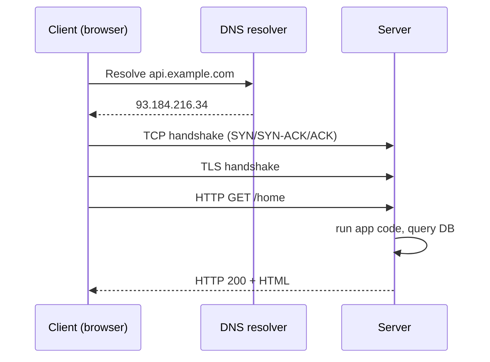
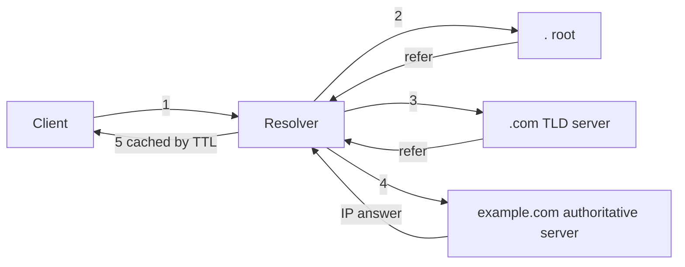
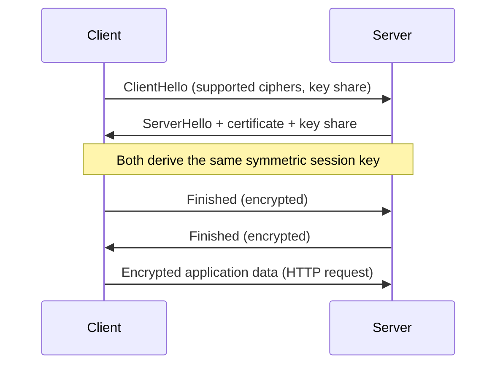
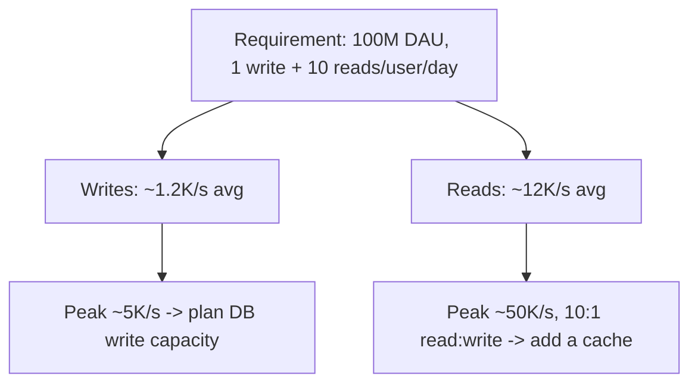
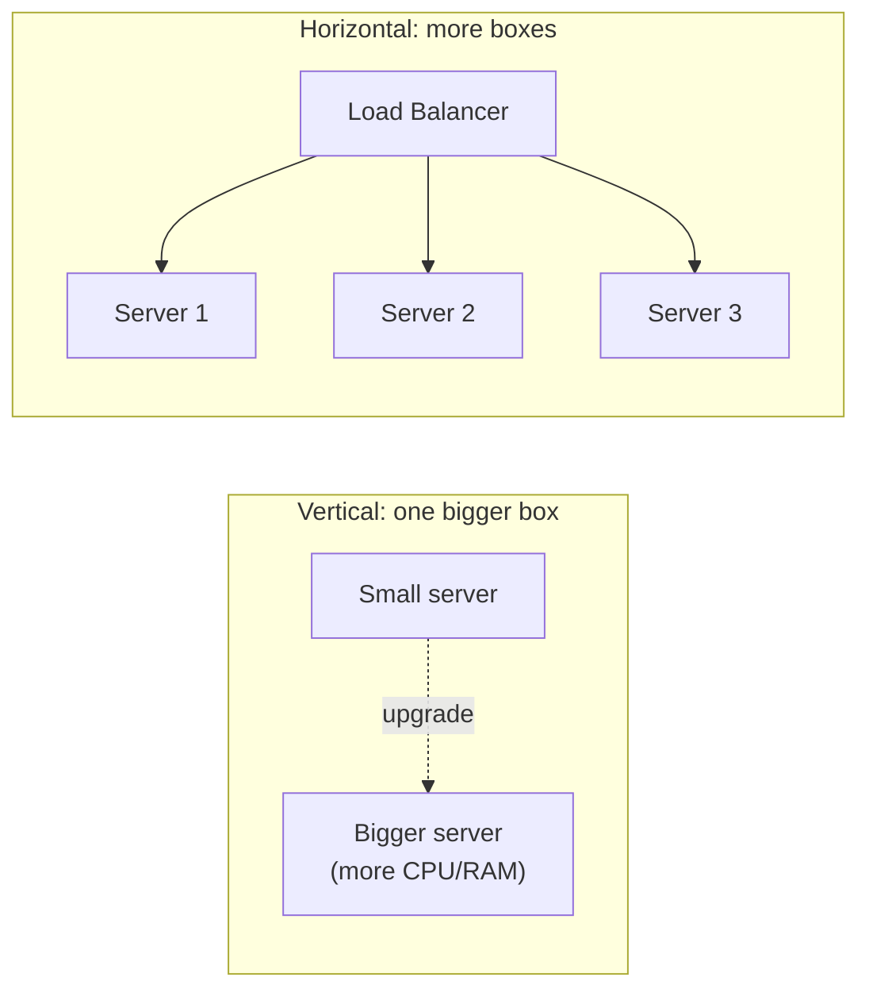
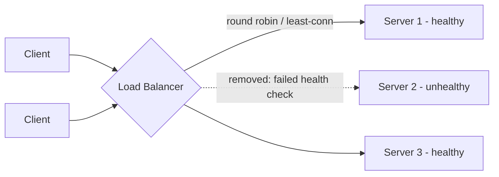
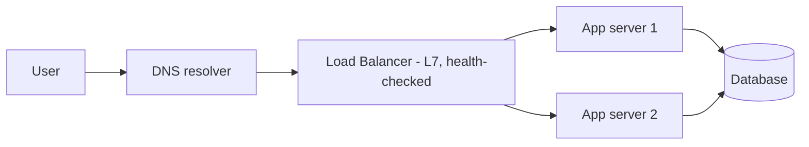

# Week 1: Foundations of the web and the Python tools of ML

This week lays the floor everything else stands on. On the system-design side you learn how a browser request actually turns into bytes on a wire: client-server, DNS, HTTP/TLS, the latency numbers that let you reason about any design, and the two ways to add capacity (vertical vs horizontal) plus the piece of infrastructure that makes horizontal scaling possible, the load balancer. On the ML side you get fluent in the three building blocks every later topic assumes: NumPy arrays, pandas data frames, and the linear algebra and statistics vocabulary (vectors, matrices, probability, distributions) that regression, gradient descent, and neural nets are written in.

## Day 1: The client-server model and how a web request happens

**System Design: Client-Server Model** (55 min)

Every system you will design this quarter is a variation on one idea: a **client** (browser, mobile app, another service) sends a **request** over a network to a **server**, which does work and returns a **response**. The server is usually stateless per request (it does not remember you between calls unless you hand it a token or cookie), which is why it can be replaced, restarted, or multiplied without the client noticing.

A single page load is actually a chain of round trips:
1. Resolve the domain to an IP address (DNS - tomorrow's topic).
2. Open a TCP connection to that IP (three-way handshake: SYN, SYN-ACK, ACK).
3. If HTTPS, do a TLS handshake on top of that TCP connection.
4. Send the HTTP request; the server's app code runs, maybe queries a database, and returns an HTTP response.
5. The browser parses the HTML and repeats steps 1-4 for every image, script, and stylesheet the page references.



The architectural question you will ask for the rest of this course is: **where does each step run, and what happens when one client becomes one million clients?** A single server handling steps 2-4 has a ceiling (open file descriptors, CPU, memory for connections); everything in Weeks 2-4 is about raising that ceiling by adding storage tiers, caches, queues, and more servers behind a load balancer.

**ML / GenAI: NumPy Fundamentals** (55 min)

NumPy's core object is the `ndarray`: a fixed-type, fixed-shape grid of numbers stored contiguously in memory. The reason every ML library (pandas, scikit-learn, PyTorch) is built on this idea is **vectorization**: a loop written in C runs once and touches all elements, instead of Python's interpreter paying its per-iteration overhead on every single number.

Key mental model: an array has a `shape` (a tuple of dimension sizes) and a `dtype` (e.g. `float64`). Operations between arrays are elementwise by default, and **broadcasting** lets arrays of compatible but different shapes combine without you writing a loop - a shape `(3,)` vector added to a shape `(4, 3)` matrix is stretched across the 4 rows automatically.

```python
import numpy as np

a = np.array([1.0, 2.0, 3.0])
b = np.array([[1, 2, 3], [4, 5, 6]])

# Vectorized ops - no Python-level loop
print(a * 2)              # [2. 4. 6.]
print(b + a)               # broadcasting: a is added to every row of b
print(b.sum(axis=0))       # column sums -> [5 7 9]
print(b.sum(axis=1))       # row sums    -> [6 15]

# Timing contrast: vectorized vs pure Python loop
import time
x = np.random.rand(1_000_000)

t0 = time.time()
total = sum(v * 2 for v in x)     # pure Python loop
t1 = time.time()
total_np = (x * 2).sum()          # vectorized
t2 = time.time()
print(f"loop: {t1 - t0:.4f}s, vectorized: {t2 - t1:.4f}s")
```

Run this and you should see the vectorized version is 10-50x faster. That gap is the entire reason NumPy exists, and it is why every ML framework avoids raw Python loops over data.

**Recall** (10 min)
- What are the four steps between typing a URL and seeing a page, in order?
- Why is a web server usually designed to be stateless between requests?
- What is broadcasting, and why does `np.array([1,2,3]) + 5` work without a loop?
- What is the practical reason NumPy is faster than a Python `for` loop over a list?

**Go deeper**
- [course: Client-Server Model](../../../course/01-system-design/01-fundamentals.md#client-server-model)
- [course: Latency vs Throughput](../../../course/01-system-design/01-fundamentals.md#latency-vs-throughput)
- [NumPy: official quickstart](https://numpy.org/doc/stable/user/quickstart.html)

## Day 2: DNS - turning names into addresses

**System Design: DNS** (55 min)

DNS (Domain Name System) is a globally distributed, hierarchical, heavily cached key-value lookup: given a name like `api.example.com`, find an IP address. "Hierarchical" is the important word - no single server knows every domain; instead each level of the hierarchy knows who to ask next.

Resolution path for `api.example.com`:
1. Your OS asks a **recursive resolver** (often your ISP's or a public one like 8.8.8.8).
2. The resolver asks a **root server** (`.`), which answers "ask the `.com` TLD servers."
3. It asks a **TLD server** (`.com`), which answers "ask `example.com`'s **authoritative nameserver**."
4. It asks the authoritative server, which answers "`api.example.com` is `93.184.216.34`."
5. The resolver caches the answer for the record's **TTL** (time-to-live, e.g. 300 seconds) and returns it to you.



This is why DNS scales to billions of lookups a second: aggressive caching at every layer means the root and TLD servers are rarely hit directly. It is also why DNS is a common load-balancing tool: an authoritative server can return different IPs for the same name based on the client's geography (GeoDNS) or round-robin across several healthy servers - a crude but effective first line of load distribution before a request ever reaches your load balancer.

Common record types to know: `A` (name to IPv4), `AAAA` (to IPv6), `CNAME` (alias to another name), `MX` (mail server), `TXT` (arbitrary text, often for verification).

**ML / GenAI: Pandas Fundamentals** (55 min)

pandas builds on NumPy to add labeled, heterogeneous (mixed dtype per column), tabular data: the `DataFrame`. Two mental models carry you through 90% of day-to-day data work: **selection** (get the rows/columns you want) and **aggregation** (group rows and summarize).

```python
import pandas as pd

df = pd.DataFrame({
    "user_id": [1, 2, 3, 4, 5],
    "country": ["US", "US", "IN", "IN", "DE"],
    "spend": [120.5, 80.0, 45.0, 60.0, 200.0],
})

# Selection
print(df[df["spend"] > 100])          # filter rows
print(df.loc[df["country"] == "IN", "spend"])  # label-based selection

# Aggregation: average spend per country
print(df.groupby("country")["spend"].mean())

# Cleaning: a common real-world step
df["spend"] = df["spend"].fillna(0)   # handle missing values
df["high_spender"] = df["spend"] > 100  # derived/engineered column

print(df.describe())  # count, mean, std, min, quartiles, max per numeric column
```

`.groupby()` is the pandas equivalent of SQL's `GROUP BY`: split rows into buckets by a key, apply a function (mean, sum, count) to each bucket, combine the results. You will use this constantly to turn raw event logs into features. `.describe()` is your first line of defense against bad data - always run it before trusting a dataset.

**Recall** (10 min)
- Put the DNS resolution steps in order: root, authoritative, recursive resolver, TLD.
- Why does a TTL matter for how fast DNS changes propagate?
- What is the difference between `df.loc[...]` selection and `df[df["col"] > x]` filtering?
- What does `.groupby("country")["spend"].mean()` compute?

**Go deeper**
- [course: DNS](../../../course/01-system-design/01-fundamentals.md#dns)
- [course: CDN](../../../course/01-system-design/01-fundamentals.md#cdn-content-delivery-network)
- [pandas: 10 minutes to pandas](https://pandas.pydata.org/docs/user_guide/10min.html)

## Day 3: HTTP and TLS

**System Design: HTTP and TLS** (55 min)

HTTP is a text-based request/response protocol. A request has a **method** (`GET`, `POST`, `PUT`, `PATCH`, `DELETE`), a **path**, **headers** (metadata like `Content-Type`, `Authorization`), and an optional **body**. A response has a **status code** - `2xx` success, `3xx` redirect, `4xx` client error (`404 Not Found`, `429 Too Many Requests`), `5xx` server error (`500`, `503 Service Unavailable`) - plus headers and body. HTTP/1.1 reuses TCP connections (`Connection: keep-alive`); HTTP/2 multiplexes many requests over one connection to avoid head-of-line blocking; HTTP/3 drops TCP entirely in favor of QUIC over UDP to fix head-of-line blocking at the transport layer too.

TLS (Transport Layer Security) is what turns HTTP into HTTPS: it gives you **encryption** (nobody on the path reads the data), **integrity** (nobody tampers with it undetected), and **authentication** (you are provably talking to the real server via its certificate). The modern TLS 1.3 handshake is one round trip:



The certificate is signed by a Certificate Authority the client already trusts, which is how you know the public key really belongs to `example.com` and not an attacker doing a man-in-the-middle. After the handshake, a cheap symmetric cipher (e.g. AES) encrypts the actual traffic because asymmetric crypto is too slow for bulk data.

Interview-relevant detail: TLS termination (decrypting HTTPS) often happens at the load balancer, not every backend instance, so backend-to-LB traffic inside a trusted datacenter network can be plain HTTP - this saves CPU on every app server.

**ML / GenAI: Linear Algebra Part 1 - Vectors** (55 min)

A **vector** is an ordered list of numbers, and in ML it is almost always a representation of "something" - a user's features, a word's embedding, an image's pixels flattened out. Two operations matter more than any others:

- **Dot product**: `a . b = sum(a_i * b_i)`. It measures alignment - two vectors pointing the same direction have a large positive dot product; perpendicular vectors have zero; opposite vectors are negative.
- **Norm** (length): `||a|| = sqrt(sum(a_i^2))` (the L2 norm). Dividing a vector by its norm gives a unit vector (length 1), used constantly to compare direction while ignoring magnitude.

**Cosine similarity**, the most common way to compare two embeddings (used everywhere in search and RAG later in this course), is just the dot product of the two unit vectors: `cos(theta) = (a . b) / (||a|| * ||b||)`.

```python
import numpy as np

a = np.array([1.0, 2.0, 3.0])
b = np.array([2.0, 4.0, 6.0])   # same direction as a, different length
c = np.array([3.0, -1.0, 0.0])  # a different direction

def cosine_similarity(x, y):
    return np.dot(x, y) / (np.linalg.norm(x) * np.linalg.norm(y))

print(cosine_similarity(a, b))  # 1.0 -> identical direction
print(cosine_similarity(a, c))  # close to 0 -> nearly unrelated direction
```

Hold onto this: in Week 9 (RAG) you will compare a query embedding against thousands of document embeddings using exactly this formula, at scale, via a vector index.

**Recall** (10 min)
- What do the first digit of an HTTP status code family (2xx, 4xx, 5xx) each broadly mean?
- Why does TLS use slow asymmetric crypto only during the handshake and fast symmetric crypto after?
- What does a dot product of 0 tell you about two vectors?
- Why is cosine similarity the dot product of two *unit* vectors?

**Go deeper**
- [course: Load Balancers (TLS termination context)](../../../course/01-system-design/01-fundamentals.md#load-balancers)
- [MDN: An overview of HTTP](https://developer.mozilla.org/en-US/docs/Web/HTTP/Overview)
- [NumPy: linalg module](https://numpy.org/doc/stable/reference/routines.linalg.html)

## Day 4: Latency numbers and back-of-envelope estimation

**System Design: Latency Numbers Every Engineer Should Know** (55 min)

You cannot design a system without rough numbers in your head. These are the ones interviewers expect you to know approximately (orders of magnitude matter far more than exact values):

| Operation | Approximate latency |
|---|---|
| L1 cache reference | ~1 ns |
| Main memory (RAM) reference | ~100 ns |
| Read 1 MB sequentially from RAM | ~10 microseconds |
| SSD random read | ~100 microseconds |
| Read 1 MB sequentially from SSD | ~1 millisecond |
| Round trip within same datacenter | ~0.5 millisecond |
| Read 1 MB over 1 Gbps network | ~10 milliseconds |
| Disk seek (spinning HDD) | ~10 milliseconds |
| Round trip CA to Netherlands (cross-continent) | ~150 milliseconds |

The takeaway: memory is ~100,000x faster than a network round trip, and "in the same datacenter" vs "across the ocean" is a 300x difference. This is why caching (Week 3) and regional deployment exist.

**Back-of-envelope estimation** is the skill of turning a vague requirement into numbers using these latencies plus simple arithmetic. Standard approach for a system design interview:
1. **Traffic**: daily active users (DAU) x requests per user per day -> requests/day -> divide by 86,400 to get average requests/second (QPS); multiply by 2-10x for peak QPS.
2. **Storage**: records/day x bytes per record x retention period.
3. **Bandwidth**: QPS x average payload size.

Worked example - design a URL shortener for 100M DAU, each user creates 1 short link/day and clicks 10 links/day:
- Writes/day = 100M -> ~1,160 writes/sec average, ~5,000/sec peak.
- Reads/day = 1B -> ~11,600 reads/sec average, ~50,000/sec peak.
- Read:write ratio ~10:1 -> a strong signal you need a cache in front of the database (Week 3), since reads dominate.
- Storage: if each record is ~500 bytes and you keep them for 5 years, 100M/day x 500B x 365 x 5 = ~91 TB - large enough that you need to think about partitioning (Week 2), not a single database instance.



**ML / GenAI: Linear Algebra Part 2 - Matrices** (55 min)

A **matrix** is a 2D grid of numbers, and the operation that matters most is **matrix multiplication**, because it is literally what a neural network layer computes: `y = Wx + b`, where `W` is a matrix of learned weights, `x` is the input vector, and `b` is a bias vector. Multiplying a matrix by a vector is "take the dot product of each row of the matrix with the vector" - it transforms the input into a new space, and stacking several of these (with a non-linearity in between) is a neural network.

Shape rules matter: `(m, n) @ (n, p) -> (m, p)` - the inner dimensions must match. Getting this wrong is the single most common bug when writing neural net code, so build the habit of checking `.shape` after every operation.

```python
import numpy as np

W = np.array([[0.2, 0.8, -0.5],
              [0.5, -0.91, 0.26]])   # shape (2, 3): 2 output neurons, 3 inputs
x = np.array([1.0, 2.0, 3.0])        # shape (3,): 3 input features
b = np.array([2.0, 3.0])             # shape (2,): one bias per output neuron

y = W @ x + b   # matrix-vector multiply + bias -> shape (2,)
print(y)        # one number per output neuron, before any activation function

# Batch version: process 4 examples at once (standard in real ML code)
X = np.random.rand(4, 3)             # 4 examples, 3 features each
Y = X @ W.T + b                      # shape (4, 2): 4 examples, 2 outputs each
print(Y.shape)
```

This `W @ x + b` pattern, repeated and composed, is 90% of what Day 22-23 (perceptron, backprop) and every deep learning architecture after it is built from.

**Recall** (10 min)
- Roughly how many times slower is a cross-continent round trip than a same-datacenter one?
- What three quantities does a standard back-of-envelope traffic estimate start from?
- In `y = Wx + b`, what does the shape of `W` need to satisfy relative to `x`?
- Why does a 10:1 read:write ratio push a design toward adding a cache?

**Go deeper**
- [course: Latency vs Throughput](../../../course/01-system-design/01-fundamentals.md#latency-vs-throughput)
- [course: Caching Strategies (next week, preview)](../../../course/01-system-design/03-caching-and-queues.md#caching-strategies)
- [NumPy: broadcasting rules](https://numpy.org/doc/stable/user/basics.broadcasting.html)

## Day 5: Vertical vs horizontal scaling

**System Design: Vertical vs Horizontal Scaling** (55 min)

When a single server runs out of capacity, you have exactly two options:

- **Vertical scaling (scale up)**: buy a bigger machine - more CPU cores, more RAM, faster disk. Simple (no code changes, no distributed-systems problems), but has a hard ceiling (the biggest instance a cloud provider sells) and a single point of failure - if that one box dies, everything is down.
- **Horizontal scaling (scale out)**: add more machines and spread the load across them. No practical ceiling, and failure of one machine does not take down the whole system - but it introduces real complexity: the machines need to share state (sessions, cache) or be stateless, requests need to be distributed (load balancer), and data needs to be partitioned or replicated (Week 2).



In practice almost every production system does both: scale vertically until it's clearly not enough or clearly too risky (single point of failure), then scale horizontally and keep each node a reasonable, cost-efficient size. The prerequisite for easy horizontal scaling is a **stateless** application tier - if a server keeps session data in its own process memory, that server becomes "sticky" (a client must always return to it), which defeats the purpose. The fix is externalizing state: put sessions in Redis, uploads in object storage, and let any server handle any request.

A related concept: **statelessness enables elasticity** - with stateless servers behind a load balancer, you can add or remove instances automatically based on load (auto-scaling), which is the foundation of handling traffic spikes cost-effectively.

**ML / GenAI: Probability Essentials** (55 min)

Three ideas from probability show up constantly in ML: **random variables and distributions**, **conditional probability**, and **Bayes' theorem**.

A distribution describes how likely each outcome is. The two you will meet most: the **Bernoulli/Binomial** (coin-flip-like, used for binary classification outcomes) and the **Normal/Gaussian** (the bell curve, which shows up because of the Central Limit Theorem - averages of many independent things tend toward a bell curve regardless of the underlying distribution).

**Bayes' theorem** lets you flip a conditional probability around, and it is the mathematical foundation of how a classifier should reason about evidence:

`P(A | B) = P(B | A) * P(A) / P(B)`

Classic example: a spam filter. You want `P(spam | contains "free money")`, but what you can easily count from training data is `P(contains "free money" | spam)`. Bayes' theorem converts one into the other using the base rate `P(spam)` - this matters because a word can be *very* common in spam and *still* not make a message spam if spam itself is rare (a low prior).

```python
import numpy as np

# Simulate: is a user who clicks an ad likely to be a bot?
np.random.seed(0)
n = 100_000
is_bot = np.random.rand(n) < 0.02          # prior P(bot) = 2%
click_prob = np.where(is_bot, 0.9, 0.05)   # bots click a lot; humans rarely
clicked = np.random.rand(n) < click_prob

p_bot = is_bot.mean()
p_click_given_bot = clicked[is_bot].mean()
p_click = clicked.mean()

# Bayes' theorem: P(bot | clicked) = P(clicked | bot) * P(bot) / P(clicked)
p_bot_given_click = p_click_given_bot * p_bot / p_click
print(f"P(bot)={p_bot:.3f}  P(bot | clicked)={p_bot_given_click:.3f}")
# Compare to the empirical answer to sanity-check the formula:
print(f"empirical P(bot | clicked) = {is_bot[clicked].mean():.3f}")
```

Even though clicking is rare for humans and common for bots, bots are so rare overall (2% prior) that the posterior `P(bot | clicked)` is nowhere near 90% - this "base rate" intuition is exactly what trips people up in real classification problems and is why you always check your class balance.

**Recall** (10 min)
- What is the single biggest practical downside of vertical scaling?
- What has to be true about an app server for horizontal scaling to be easy?
- Write Bayes' theorem from memory.
- Why can a rare class ("bot") still have a low posterior probability even given strong evidence (a 90% click rate)?

**Go deeper**
- [course: Vertical vs Horizontal Scaling](../../../course/01-system-design/01-fundamentals.md#vertical-vs-horizontal-scaling)
- [course: ML Fundamentals - Bias-Variance (preview)](../../../course/04-ml-genai-agents/01-ml-fundamentals.md)
- [NumPy: random sampling](https://numpy.org/doc/stable/reference/random/index.html)

## Day 6: Load balancers

**System Design: Load Balancers** (55 min)

A load balancer (LB) sits in front of a fleet of servers and decides which server handles each incoming request. It is the single piece of infrastructure that makes horizontal scaling actually work in practice.

**Layer 4 vs Layer 7**: an L4 load balancer works at the transport layer - it looks at IP and port and forwards TCP/UDP packets, fast and protocol-agnostic but blind to the HTTP content. An L7 load balancer understands HTTP - it can read the path, headers, and cookies, and route `/api/*` to one fleet and `/static/*` to another, or do content-based routing; this flexibility costs a bit more CPU and latency per request.

**Algorithms** for picking the next server:
- **Round robin**: cycle through servers in order - simple, assumes all requests and all servers are roughly equal.
- **Least connections**: send to whichever server currently has the fewest open connections - better when request duration varies a lot.
- **Weighted** versions of either, when servers have different capacity.
- **Consistent hashing** based on a request key (e.g. user ID) - used when you want the *same* user to repeatedly land on the *same* backend, useful for in-memory caching per server (you will see this idea again, applied to data partitioning, in Week 2).

**Health checks**: the LB periodically pings each backend (e.g. `GET /health`) and stops routing to any server that fails checks, automatically removing unhealthy nodes from rotation - this is a large part of how systems self-heal without a human intervening at 3 a.m.



LBs are usually deployed in pairs (active-passive or active-active) because the load balancer itself must not become a single point of failure - this is a recurring pattern in system design: every component you add to remove one bottleneck needs its own redundancy plan.

**ML / GenAI: Statistics Essentials** (55 min)

Four statistics underlie almost every ML metric and every "is this result real or noise" judgment you will make:

- **Mean and variance**: variance is the average squared distance from the mean; **standard deviation** (`sqrt(variance)`) puts that back in the original units, so "spend is 80 +/- 20 dollars" is directly readable.
- **Correlation**: a number from -1 to 1 describing how two variables move together linearly. High correlation between a feature and the label is a good early signal that a feature is useful; high correlation *between two features* is a sign of redundancy (and a cause of unstable linear models - "multicollinearity").
- **The Central Limit Theorem (CLT)**: the average of many independent samples approaches a Normal distribution regardless of the shape of the original data. This is why confidence intervals and A/B test significance (Week 11) can assume normality even when raw user behavior is wildly non-normal.
- **Confidence interval**: a range that is likely to contain the true population value, e.g. "95% CI for average spend is [75, 85]" - it quantifies how much you should trust a number computed from a sample rather than the full population.

```python
import numpy as np

np.random.seed(1)
spend = np.random.exponential(scale=80, size=5000)  # skewed, non-normal data

mean = spend.mean()
std = spend.std()
print(f"mean={mean:.2f}, std={std:.2f}")

# Correlation between spend and a noisy "engagement score"
engagement = spend * 0.3 + np.random.normal(0, 20, size=5000)
corr = np.corrcoef(spend, engagement)[0, 1]
print(f"correlation(spend, engagement) = {corr:.2f}")

# CLT in action: distribution of the *mean* of many samples is approx. Normal
# even though 'spend' itself is skewed (exponential).
sample_means = [np.random.exponential(80, 30).mean() for _ in range(2000)]
print(f"std of sample means (standard error) = {np.std(sample_means):.2f}")
# 95% CI for the true mean, using the standard error of the full sample:
se = std / np.sqrt(len(spend))
print(f"95% CI for mean spend: [{mean - 1.96*se:.2f}, {mean + 1.96*se:.2f}]")
```

Notice the raw data is skewed (`np.random.exponential`), but the *sample means* cluster tightly and symmetrically - that is the CLT doing its job, and it is the entire justification for using `mean +/- 1.96 * standard_error` as a 95% confidence interval regardless of the underlying distribution's shape.

**Recall** (10 min)
- What is the practical difference between an L4 and an L7 load balancer?
- Name two load-balancing algorithms and when you'd prefer each.
- Why must the load balancer itself be deployed redundantly?
- State the Central Limit Theorem in one sentence, and say why it justifies using Normal-based confidence intervals on non-normal data.

**Go deeper**
- [course: Load Balancers](../../../course/01-system-design/01-fundamentals.md#load-balancers)
- [course: Load Balancing Algorithms](../../../course/01-system-design/01-fundamentals.md#load-balancing-algorithms)
- [course: Health Checks and Failover](../../../course/01-system-design/01-fundamentals.md#health-checks-and-failover)

## Day 7: Revision and mini project

**System Design: Revision - the request path end to end** (55 min)

Redraw, from memory, the full path of a request without looking back at Day 1-6: DNS resolution, TCP + TLS handshake, load balancer, application server. Then add estimation on top of it.



**Mini project**: estimate capacity for a "pastebin"-style service with 10M DAU, where each user creates 1 paste/day and views 5 pastes/day, average paste size 2 KB, retained for 1 year.
1. Compute average and peak (use a 5x multiplier) writes/sec and reads/sec.
2. Compute total storage after 1 year.
3. Decide: does this need horizontal scaling on day one, or would one well-specified vertical server survive the average load? Justify with the numbers, not a guess.
4. State which component you'd add first as traffic grows (load balancer? cache? replica database?) and why, using this week's vocabulary.

Write your numbers down - you will reuse this exact scenario's shape in Week 4's URL shortener and pastebin case studies, so a concrete anchor now pays off later.

**ML / GenAI: Revision - from raw data to a trustworthy number** (55 min)

Build a 15-20 line script that chains everything from this week: generate (or load) tabular data with pandas, clean it, compute a vector/matrix operation with NumPy, and report a statistic with a confidence interval.

```python
import numpy as np
import pandas as pd

np.random.seed(42)
df = pd.DataFrame({
    "user_id": range(1, 2001),
    "country": np.random.choice(["US", "IN", "DE", "BR"], size=2000),
    "session_minutes": np.random.exponential(scale=15, size=2000),
})
df.loc[np.random.choice(df.index, 20), "session_minutes"] = np.nan  # inject missing data

# 1. Clean
df["session_minutes"] = df["session_minutes"].fillna(df["session_minutes"].median())

# 2. Aggregate (pandas)
by_country = df.groupby("country")["session_minutes"].mean().sort_values(ascending=False)
print(by_country)

# 3. A small linear-algebra step: normalize session_minutes into a unit vector
#    per country group's values (not meaningful in real life, but exercises the operation)
vals = df["session_minutes"].to_numpy()
unit = vals / np.linalg.norm(vals)
print("norm check (should be ~1.0):", np.linalg.norm(unit))

# 4. Statistics: mean with a 95% confidence interval
mean = vals.mean()
se = vals.std() / np.sqrt(len(vals))
print(f"mean session minutes: {mean:.2f}, 95% CI: [{mean - 1.96*se:.2f}, {mean + 1.96*se:.2f}]")
```

Extend it yourself: add a `groupby(...).agg(["mean", "std", "count"])` and interpret which country's estimate you'd trust least (hint: look at `count` - a smaller sample means a wider confidence interval even with the same standard deviation).

**Recall** (10 min)
- Without looking, list the 5 request-path components from this week in order.
- What are the three inputs to a traffic estimation (from Day 4)?
- What does `.fillna(median)` protect against that `.fillna(0)` would not?
- Why does a country with fewer rows get a wider, less trustworthy confidence interval even if its mean looks similar?
- Which one concept from this week do you still feel shaky on? Write one sentence explaining it to future-you.

**Go deeper**
- [course: System Design README](../../../course/01-system-design/README.md)
- [course: ML / GenAI README](../../../course/04-ml-genai-agents/README.md)
- [course: Case Studies - Pastebin preview](../../../course/01-system-design/07-case-studies.md)
