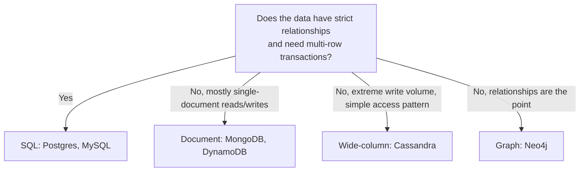
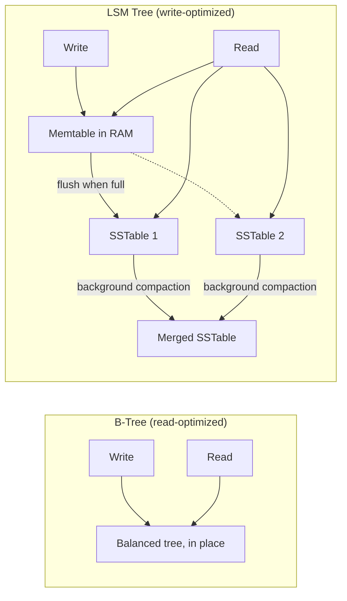
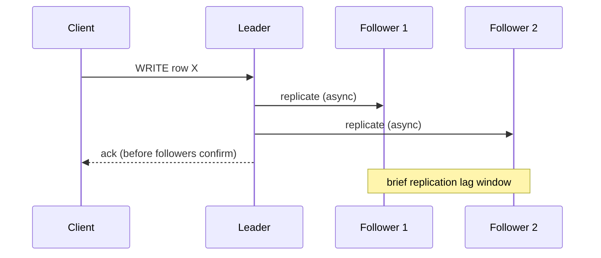
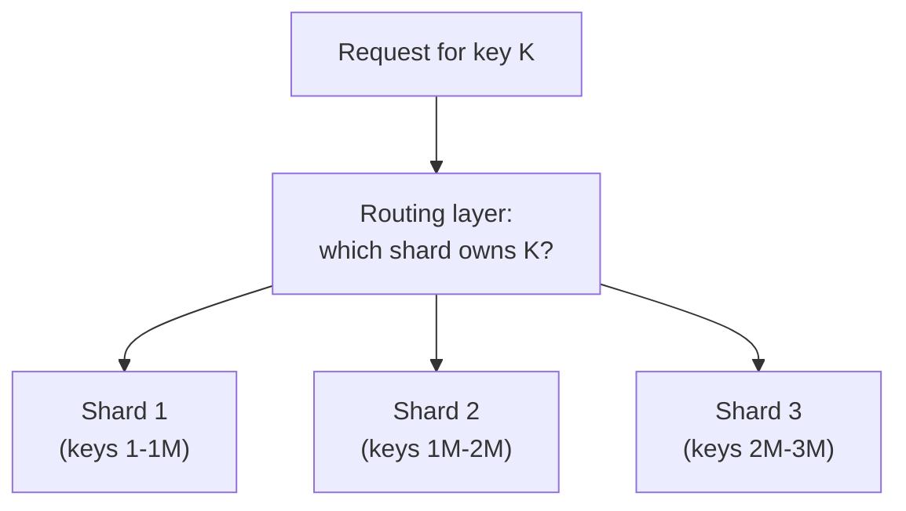
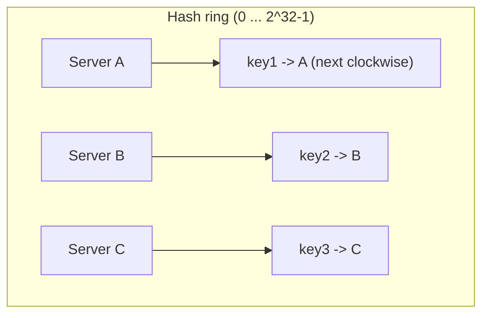
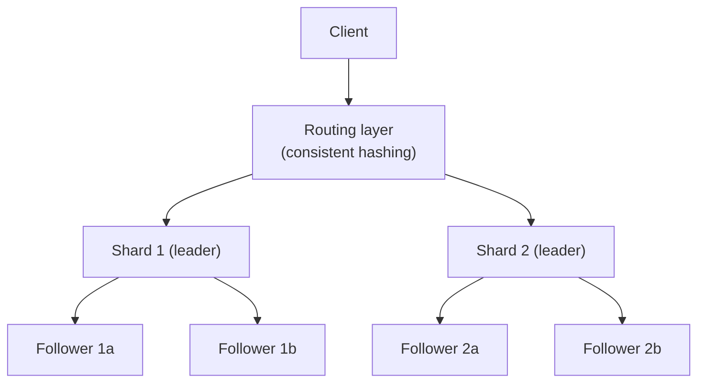

# Week 2: Storage systems and how models learn from data

This week moves from "how a request travels" to "where the data lives and how a model learns." On the system-design side you learn how databases actually store and find data (SQL vs NoSQL, B-tree and LSM indexes), how they survive a machine dying (replication), how they handle more data than one machine can hold (partitioning, consistent hashing), and the guarantees they give you when multiple requests touch the same row at once (transactions, isolation levels). On the ML side you learn the two training-wheels algorithms of the field, linear and logistic regression, the gradient descent procedure that fits almost every model in this course, and the vocabulary (bias-variance, precision/recall/F1/AUC) you need to say whether a model is actually any good.

## Day 8: SQL vs NoSQL

**System Design: SQL vs NoSQL** (55 min)

A **relational (SQL) database** stores data in tables with a fixed schema and enforces relationships between tables via foreign keys. Its superpower is **ACID transactions** (Atomicity, Consistency, Isolation, Durability) and **joins** - you can ask "all orders placed by users in Germany" in one query and the engine guarantees a correct, consistent answer even if ten other transactions are running concurrently.

A **NoSQL database** gives up some of that rigidity for flexibility and horizontal scale. The main families:
- **Document stores** (MongoDB, DynamoDB): JSON-like documents, no fixed schema, great when your data is naturally hierarchical and you mostly read/write whole documents.
- **Key-value stores** (Redis, Memcached): the simplest possible model, `get(key)` / `put(key, value)`, extremely fast, used for caching and sessions.
- **Wide-column stores** (Cassandra, HBase): rows can have different columns, built for very high write throughput across many machines.
- **Graph databases** (Neo4j): nodes and edges, optimized for traversing relationships (social graphs, fraud rings).



The real-world answer is rarely "pick one forever" - most large systems run several stores side by side (SQL for orders and billing where correctness is non-negotiable, a document store for a flexible product catalog, Redis for session/cache). The interview-relevant trade-off is **scalability vs consistency guarantees**: SQL databases historically scaled vertically and relied on a single writer (though modern distributed SQL like CockroachDB and Spanner changes this); NoSQL databases were designed from day one to scale horizontally by relaxing consistency or join support.

**ML / GenAI: Supervised vs Unsupervised Learning** (55 min)

**Supervised learning**: you have labeled examples, `(x, y)` pairs, and you want a function `f(x) -> y` that generalizes to new, unseen `x`. Two flavors: **regression** (y is a continuous number, e.g. house price) and **classification** (y is a category, e.g. spam/not-spam).

**Unsupervised learning**: you only have `x`, no labels, and you want to find structure - groups of similar points (**clustering**, e.g. k-means in Week 3), or a lower-dimensional representation that preserves the important variation (**dimensionality reduction**, e.g. PCA in Week 3).

The practical signal for which one you're doing: do you have ground-truth labels you trust, and are they expensive or cheap to get? Most production ML starts supervised because labels (click/no-click, fraud/not-fraud) already exist in logs; unsupervised techniques are most often used to explore data before you have labels, or to engineer features that make a supervised model better.

```python
import numpy as np

# Supervised: features X, labels y - we know the "right answer" for training
X_train = np.array([[1200], [1500], [1800], [2200]])  # house size (sqft)
y_train = np.array([250_000, 310_000, 365_000, 420_000])  # price - the label

# Unsupervised: only X, no y - we ask "what structure exists here?"
X_unlabeled = np.array([[1, 1], [1.1, 0.9], [8, 8], [8.2, 7.9], [15, 1]])
# A human would say: "two tight clusters near (1,1) and (8,8), one outlier at (15,1)"
# -- but nothing in the data says so explicitly; k-means (Week 3) finds this automatically.

print("Supervised: predict y from X using the (X, y) pairs above")
print("Unsupervised: find groups in X_unlabeled with no y given at all")
```

**Recall** (10 min)
- What does a relational database give you that most NoSQL stores do not?
- Name the four NoSQL families and one example database for each.
- What is the one-sentence difference between supervised and unsupervised learning?
- Why does production ML usually start with supervised learning?

**Go deeper**
- [course: SQL vs NoSQL](../../../course/01-system-design/02-storage-and-databases.md#sql-vs-nosql)
- [course: ML Fundamentals - Supervised vs Unsupervised](../../../course/04-ml-genai-agents/01-ml-fundamentals.md#1-supervised-vs-unsupervised-learning)
- [MongoDB: SQL vs NoSQL comparison](https://www.mongodb.com/nosql-explained/nosql-vs-sql)

## Day 9: Indexing - B-trees and LSM trees

**System Design: Indexing** (55 min)

Without an index, finding a row means scanning the whole table - O(n). An **index** is a separate data structure that maps a column's values to the location of the matching rows, turning a lookup into O(log n) or better. The cost: every write now has to update the index too, and the index takes extra disk space.

**B-tree** (used by Postgres, MySQL/InnoDB): a balanced tree where each node holds many keys and pointers, kept sorted. Reads are fast (`O(log n)` disk seeks) because the tree is shallow (a B-tree with branching factor 100 needs only ~4 levels to index a billion rows). Writes are in-place: find the leaf, insert the key, rebalance if the node overflows. This makes B-trees read-optimized but writes get progressively more random as the tree grows, which hurts on spinning disks and even SSDs under heavy write load.

**LSM tree** (Log-Structured Merge tree; used by Cassandra, RocksDB, LevelDB, and under the hood of many write-heavy systems): writes go to an in-memory buffer (**memtable**) and are appended to a sequential log, so every write is a fast, sequential disk operation. When the memtable fills up, it is flushed to disk as an immutable sorted file (**SSTable**). Reads may need to check several SSTables plus the memtable, so a **compaction** process periodically merges SSTables in the background to keep read latency bounded and reclaim space from overwritten/deleted keys.



Interview rule of thumb: **B-tree when reads dominate and you need in-place updates; LSM when writes dominate** (time-series data, logging, analytics ingestion) **and you can tolerate slightly slower or more complex reads in exchange for much faster, cheaper writes.**

**ML / GenAI: Linear Regression** (55 min)

Linear regression fits a line (or hyperplane in higher dimensions) to data: `y_pred = w . x + b`, where `w` is a weight vector and `b` is a bias/intercept. "Fitting" means choosing `w` and `b` to minimize the **mean squared error (MSE)**: `MSE = (1/n) * sum((y_pred_i - y_i)^2)`. Squaring the error punishes large mistakes disproportionately and makes the function smooth (differentiable) so calculus can find the minimum.

There is a closed-form solution (the **normal equation**, `w = (X^T X)^-1 X^T y`), but it does not scale to large feature counts or huge datasets because inverting a matrix is `O(d^3)` in the number of features. In practice (and in every deep learning framework) you instead use **gradient descent**, which tomorrow's lesson covers in depth - today, fit the closed form and see the line, so you have ground truth to check gradient descent against tomorrow.

```python
import numpy as np

# House size (sqft) -> price, a toy supervised regression dataset
X = np.array([1200, 1500, 1800, 2200, 2600]).reshape(-1, 1)
y = np.array([250_000, 310_000, 365_000, 420_000, 500_000])

# Add a column of 1s so the bias b is folded into the weight vector
X_b = np.hstack([X, np.ones((X.shape[0], 1))])

# Normal equation: w = (X^T X)^-1 X^T y
w = np.linalg.inv(X_b.T @ X_b) @ X_b.T @ y
slope, intercept = w
print(f"price ~= {slope:.2f} * sqft + {intercept:.2f}")

# Predict a new house
new_sqft = 2000
pred = slope * new_sqft + intercept
print(f"predicted price for {new_sqft} sqft: {pred:,.0f}")

# MSE on the training data - how good is this fit?
preds = X_b @ w
mse = np.mean((preds - y) ** 2)
print(f"training MSE: {mse:,.0f}")
```

**Recall** (10 min)
- Why is a B-tree lookup roughly O(log n) even for a billion rows?
- What makes LSM tree writes fast, and what do you pay for that later?
- Write the mean squared error formula from memory.
- Why does nobody use the normal equation to train a large neural network?

**Go deeper**
- [course: Indexing](../../../course/01-system-design/02-storage-and-databases.md#indexing)
- [course: LSM Trees vs B-Trees](../../../course/01-system-design/02-storage-and-databases.md#lsm-trees-vs-b-trees)
- [course: Linear Regression](../../../course/04-ml-genai-agents/01-ml-fundamentals.md#linear-regression)

## Day 10: Replication, logistic regression and loss functions

**System Design: Replication** (55 min)

Replication means keeping copies of the same data on multiple machines, for two reasons: **availability** (if one machine dies, another has the data) and **read scaling** (spread read traffic across replicas).

**Leader-follower (primary-replica) replication**: all writes go to one leader, which streams changes to followers. Reads can go to the leader (always fresh) or to followers (faster, more scalable, but possibly stale). **Synchronous replication** waits for a follower to confirm before acknowledging the write to the client (strong durability, higher write latency, and the write blocks if the follower is slow/down); **asynchronous replication** acknowledges immediately and ships the change in the background (low latency, but a leader crash right after the ack can lose the most recent writes).

**Multi-leader replication**: more than one node accepts writes (e.g. one leader per datacenter), which improves write availability across regions but opens the door to **write conflicts** (two leaders change the same row differently before syncing) that need a resolution strategy (last-write-wins, merge functions, or application-level logic).

**Replication lag** is the delay between a write on the leader and that write becoming visible on a follower. It causes real bugs: a user posts a comment, the page reloads and reads from a lagging follower, and the comment appears to have vanished. The standard fixes are **read-your-own-writes** (route a user's own reads to the leader right after they write) and bounding staleness with monitoring/alerts.



**ML / GenAI: Logistic Regression and Loss Functions** (55 min)

Logistic regression is linear regression's answer to classification: instead of predicting a raw number, it predicts a **probability** by squashing `w . x + b` through the **sigmoid function**, `sigmoid(z) = 1 / (1 + e^-z)`, which maps any real number into `(0, 1)`.

For classification, MSE is the wrong loss function (its gradient gets tiny when the model is very confident and very wrong, slowing learning right when you need it most). The right loss is **binary cross-entropy** (log loss): `L = -(y * log(p) + (1-y) * log(1-p))`, where `y` is the true label (0 or 1) and `p` is the predicted probability. This loss is small when the model is confidently correct and grows sharply as the model is confidently wrong - exactly the gradient signal you want.

```python
import numpy as np

def sigmoid(z):
    return 1 / (1 + np.exp(-z))

def binary_cross_entropy(y_true, p_pred, eps=1e-9):
    p_pred = np.clip(p_pred, eps, 1 - eps)  # avoid log(0)
    return -np.mean(y_true * np.log(p_pred) + (1 - y_true) * np.log(1 - p_pred))

# Toy data: hours studied -> pass (1) / fail (0)
hours = np.array([0.5, 1.0, 1.5, 3.0, 4.0, 5.0])
passed = np.array([0, 0, 0, 1, 1, 1])

w, b = 1.0, -3.0  # arbitrary starting weights, not yet trained
p = sigmoid(w * hours + b)
print("predicted probabilities:", np.round(p, 2))
print("loss with these starting weights:", binary_cross_entropy(passed, p))

# A well-fit model should give low loss and probabilities near the true labels
w_better, b_better = 1.8, -5.5
p_better = sigmoid(w_better * hours + b_better)
print("loss with better weights:", binary_cross_entropy(passed, p_better))
```

Notice the better weights produce a lower loss - this is exactly the quantity gradient descent (tomorrow) will minimize automatically instead of you guessing weights by hand.

**Recall** (10 min)
- What's the difference between synchronous and asynchronous replication, and what does each cost you?
- Give a concrete bug caused by replication lag and its standard fix.
- What does the sigmoid function do, and what range does it map into?
- Why is cross-entropy preferred over MSE for classification?

**Go deeper**
- [course: Replication](../../../course/01-system-design/02-storage-and-databases.md#replication)
- [course: Logistic Regression](../../../course/04-ml-genai-agents/01-ml-fundamentals.md#logistic-regression)
- [course: Evaluation Metrics](../../../course/04-ml-genai-agents/01-ml-fundamentals.md#4-evaluation-metrics)

## Day 11: Partitioning, sharding and gradient descent

**System Design: Partitioning and Sharding** (55 min)

When one machine can't hold all the data (or all the write traffic), you split the dataset across multiple machines - **partitioning** (the general term) or **sharding** (partitioning specifically applied to give each shard its own database instance).

Common strategies:
- **Range-based partitioning**: split by key ranges (e.g. user IDs 1-1M on shard A, 1M-2M on shard B). Simple and supports efficient range queries, but can create **hot spots** if traffic or data isn't evenly distributed across ranges (e.g. all new users land on the newest, most-loaded shard).
- **Hash-based partitioning**: `shard = hash(key) % num_shards`. Spreads load evenly, but range queries now have to hit every shard, and adding/removing a shard reshuffles almost every key (since `% num_shards` changes for nearly every key) - this is exactly the problem consistent hashing (tomorrow) solves.
- **Directory-based partitioning**: a lookup service tracks which shard owns which key. Flexible (can rebalance individual keys without a global reshuffle) but adds a dependency on that directory service being fast and highly available.

A partitioned system needs a **routing layer** that knows which shard owns a given key, and it needs a plan for **cross-shard queries** (joins or aggregations spanning multiple shards are expensive and often pushed to an offline analytics pipeline instead of the live path).



**ML / GenAI: Gradient Descent** (55 min)

Gradient descent is the algorithm behind nearly every trained model in this course: given a loss function `L(w)`, repeatedly nudge the parameters `w` in the direction that decreases the loss fastest, which is the **negative gradient**, `-dL/dw`.

Update rule: `w = w - lr * dL/dw`, where `lr` (the **learning rate**) controls the step size. Too large and the loss oscillates or diverges; too small and training crawls. **Batch gradient descent** computes the gradient over the whole dataset per step (accurate but slow for large data); **stochastic gradient descent (SGD)** uses one example per step (fast, noisy); **mini-batch SGD** (what virtually everyone uses) splits data into small batches (e.g. 32-256 examples) as a practical middle ground, and is also what makes GPU-parallel training efficient.

```python
import numpy as np

# Fit y = w*x + b with gradient descent instead of the normal equation
rng = np.random.default_rng(0)
x = rng.uniform(0, 10, size=200)
true_w, true_b = 3.0, 5.0
y = true_w * x + true_b + rng.normal(0, 1, size=200)  # noisy linear data

w, b = 0.0, 0.0       # start from scratch - this is what training "from random init" means
lr = 0.01
n = len(x)

for epoch in range(200):
    y_pred = w * x + b
    error = y_pred - y
    grad_w = (2 / n) * np.sum(error * x)   # dL/dw for MSE loss
    grad_b = (2 / n) * np.sum(error)        # dL/db
    w -= lr * grad_w
    b -= lr * grad_b
    if epoch % 50 == 0:
        mse = np.mean(error ** 2)
        print(f"epoch {epoch:3d}: w={w:.3f}, b={b:.3f}, mse={mse:.3f}")

print(f"\nlearned w={w:.3f} (true {true_w}), learned b={b:.3f} (true {true_b})")
```

Run this and watch `w` and `b` converge toward the true values purely from the gradient - no closed-form matrix inversion needed, and the exact same loop (with a different model and loss) is what trains a logistic regression, a neural network, or an LLM.

**Recall** (10 min)
- What problem does hash-based partitioning solve that range-based partitioning has, and what new problem does it create?
- What does a "routing layer" need to know in a sharded system?
- Write the gradient descent update rule from memory.
- What happens if the learning rate is too large? Too small?

**Go deeper**
- [course: Sharding and Partitioning](../../../course/01-system-design/02-storage-and-databases.md#sharding-and-partitioning)
- [course: ML Fundamentals overview](../../../course/04-ml-genai-agents/01-ml-fundamentals.md)
- [course: Backpropagation intuition (gradient descent applied to networks, preview)](../../../course/04-ml-genai-agents/02-deep-learning.md#3-optimizers)

## Day 12: Consistent hashing, CAP theorem and bias-variance

**System Design: Consistent Hashing and the CAP Theorem** (55 min)

**Consistent hashing** fixes the rebalancing problem from yesterday: instead of `hash(key) % num_shards`, map both servers and keys onto a **hash ring** (a circle of hash values, e.g. 0 to 2^32-1). A key belongs to the first server found walking clockwise from the key's hash position. Adding or removing one server now only reassigns the keys between it and its clockwise neighbor - roughly `1/N` of all keys - instead of nearly all of them.



In practice each physical server gets many points on the ring (**virtual nodes**) so load stays balanced even with few servers. This exact mechanism is used by DynamoDB, Cassandra, and many caching layers (and underlies how a CDN or LB can route a key to "the same" backend consistently, from Week 1).

**CAP theorem**: during a network partition, a distributed system must choose between **Consistency** (every read sees the latest write) and **Availability** (every request gets a response, even if it might be stale). You cannot have both during a partition - you can always have both when the network is healthy, which is why the more useful refinement is **PACELC**: even without a Partition, you still trade off **Latency vs Consistency** (ELC) during normal operation, because waiting for strong consistency across replicas costs time. In interviews, naming a concrete choice ("I'd pick AP here because stale product listings are tolerable, but PC for payment balances") shows more understanding than reciting the acronym.

**ML / GenAI: Bias-Variance Tradeoff** (55 min)

**Bias** is error from a model being too simple to capture the true pattern (**underfitting**) - a straight line trying to fit a curve. **Variance** is error from a model being so flexible it fits the noise in the training data (**overfitting**) - a high-degree polynomial that wiggles through every training point but fails on new data. Total expected error decomposes roughly as `bias^2 + variance + irreducible noise`, and the two terms move in opposite directions as model complexity increases - this is the tradeoff.

```python
import numpy as np

rng = np.random.default_rng(0)
x = np.linspace(0, 1, 20)
true_y = np.sin(2 * np.pi * x)
y = true_y + rng.normal(0, 0.2, size=20)  # noisy observations of a sine wave

def fit_and_eval(degree):
    coeffs = np.polyfit(x, y, degree)
    y_pred = np.polyval(coeffs, x)
    train_mse = np.mean((y_pred - y) ** 2)
    return train_mse

for degree in [1, 3, 9, 15]:
    mse = fit_and_eval(degree)
    print(f"polynomial degree {degree:2d}: training MSE = {mse:.4f}")
```

Run this: training error keeps dropping as degree increases (a degree-15 polynomial can nearly memorize 20 points) - but that model has high variance and would perform far worse on new, unseen x values, which training MSE alone cannot show you. This is exactly why Week 3's cross-validation exists: it measures error on data the model did not memorize, which is the only honest way to detect overfitting.

**Recall** (10 min)
- Why does adding a server in consistent hashing only move ~1/N of the keys, not nearly all of them?
- What are "virtual nodes" for?
- State the CAP theorem's actual claim (what trade-off, under what condition).
- Why does low training error alone not tell you whether a model will generalize?

**Go deeper**
- [course: Consistent Hashing](../../../course/01-system-design/02-storage-and-databases.md#consistent-hashing)
- [course: CAP Theorem and PACELC](../../../course/01-system-design/02-storage-and-databases.md#cap-theorem-and-pacelc)
- [course: Bias-Variance Tradeoff](../../../course/04-ml-genai-agents/01-ml-fundamentals.md#2-bias-variance-tradeoff)

## Day 13: Transactions, isolation levels and evaluation metrics

**System Design: Transactions and Isolation Levels** (55 min)

A **transaction** groups multiple operations so they succeed or fail as a unit (**atomicity**): transferring money between two accounts must debit one and credit the other, or do neither. ACID's other letters: **consistency** (the database never ends up in a state that violates its own constraints), **isolation** (concurrent transactions don't see each other's half-finished work), **durability** (once committed, a write survives a crash).

Isolation is the subtle one, graded by **isolation levels**, each preventing a different class of anomaly:
- **Read uncommitted**: can see another transaction's uncommitted changes (a "dirty read") - rarely used.
- **Read committed**: only sees committed data, but a value can change between two reads in the same transaction (**non-repeatable read**).
- **Repeatable read**: the same row read twice in one transaction returns the same value, but a *new* row matching your query's filter can appear (**phantom read**).
- **Serializable**: transactions behave as if run one at a time in some order - strongest guarantee, usually the slowest, because the database must detect and block/retry conflicting transactions.


The practical interview point: **stronger isolation costs throughput** (more locking, more retries on conflict), so production systems default to `Read Committed` and reach for `Serializable` only for the specific operations where correctness (money, inventory counts) is worth the cost.

**ML / GenAI: Evaluation Metrics** (55 min)

**Accuracy** (fraction correct) is misleading on imbalanced data: a model that always predicts "not fraud" is 99% accurate if fraud is 1% of transactions, and completely useless. The confusion matrix fixes this:

|  | Predicted positive | Predicted negative |
|---|---|---|
| **Actual positive** | True Positive (TP) | False Negative (FN) |
| **Actual negative** | False Positive (FP) | True Negative (TN) |

- **Precision** = `TP / (TP + FP)` - of everything you flagged positive, how much was actually positive? High precision matters when false positives are costly (flagging a legitimate transaction as fraud).
- **Recall** = `TP / (TP + FN)` - of everything that was actually positive, how much did you catch? High recall matters when missing a positive is costly (missing an actual tumor).
- **F1 score** = harmonic mean of precision and recall, `2PR / (P+R)` - a single number balancing both when neither is clearly more important.
- **AUC-ROC** summarizes performance across every possible classification threshold at once, useful for comparing models independent of where you'll set the decision cutoff.

```python
import numpy as np

y_true = np.array([1, 0, 1, 1, 0, 1, 0, 0, 1, 0])
y_pred = np.array([1, 0, 1, 0, 0, 1, 1, 0, 1, 0])

tp = np.sum((y_true == 1) & (y_pred == 1))
fp = np.sum((y_true == 0) & (y_pred == 1))
fn = np.sum((y_true == 1) & (y_pred == 0))
tn = np.sum((y_true == 0) & (y_pred == 0))

precision = tp / (tp + fp)
recall = tp / (tp + fn)
f1 = 2 * precision * recall / (precision + recall)
accuracy = (tp + tn) / len(y_true)

print(f"TP={tp} FP={fp} FN={fn} TN={tn}")
print(f"accuracy={accuracy:.2f}  precision={precision:.2f}  recall={recall:.2f}  f1={f1:.2f}")
```

**Recall** (10 min)
- What anomaly does Repeatable Read prevent that Read Committed does not?
- Why does stronger isolation usually cost throughput?
- Why is accuracy a bad metric on an imbalanced dataset - give a concrete example.
- When would you prioritize recall over precision, and vice versa?

**Go deeper**
- [course: Isolation Levels](../../../course/01-system-design/02-storage-and-databases.md#isolation-levels)
- [course: Evaluation Metrics - Classification metrics](../../../course/04-ml-genai-agents/01-ml-fundamentals.md#classification-metrics)
- [course: ML Fundamentals README](../../../course/04-ml-genai-agents/README.md)

## Day 14: Revision and mini project

**System Design: Revision - design a replicated, sharded key-value store** (55 min)

Without looking back, redraw a system that stores user profile data for 50M users, each profile ~2 KB, needing both high read throughput and durability against a single machine failing.



**Mini project**: write down, with numbers:
1. Total data size (50M x 2 KB) and how many shards you'd need if each machine comfortably holds 100 GB.
2. Which isolation level you'd pick for a "update profile" write, and why Serializable would be overkill here.
3. One scenario where replication lag would cause a visible bug for this profile service, and your fix.
4. Whether you'd choose range-based or hash-based sharding for user IDs, and the one trade-off that decided it.

**ML / GenAI: Revision - train and evaluate a logistic regression from scratch** (55 min)

Combine this week's gradient descent and metrics into one script: train a logistic regression with gradient descent (no library), then evaluate it with precision/recall/F1, and finally check it isn't overfitting by comparing train vs a held-out split.

```python
import numpy as np

rng = np.random.default_rng(7)
n = 300
hours_studied = rng.uniform(0, 10, n)
passed = (hours_studied + rng.normal(0, 1.5, n) > 5).astype(int)  # noisy threshold rule

# Train/test split (the honest way to check generalization - full cross-validation is Week 3)
split = int(0.8 * n)
X_train, X_test = hours_studied[:split], hours_studied[split:]
y_train, y_test = passed[:split], passed[split:]

def sigmoid(z):
    return 1 / (1 + np.exp(-z))

w, b, lr = 0.0, 0.0, 0.05
for epoch in range(500):
    p = sigmoid(w * X_train + b)
    error = p - y_train
    grad_w = np.mean(error * X_train)
    grad_b = np.mean(error)
    w -= lr * grad_w
    b -= lr * grad_b

train_pred = (sigmoid(w * X_train + b) > 0.5).astype(int)
test_pred = (sigmoid(w * X_test + b) > 0.5).astype(int)

def precision_recall_f1(y_true, y_pred):
    tp = np.sum((y_true == 1) & (y_pred == 1))
    fp = np.sum((y_true == 0) & (y_pred == 1))
    fn = np.sum((y_true == 1) & (y_pred == 0))
    p = tp / (tp + fp) if (tp + fp) else 0
    r = tp / (tp + fn) if (tp + fn) else 0
    f1 = 2 * p * r / (p + r) if (p + r) else 0
    return p, r, f1

for name, y_t, y_p in [("train", y_train, train_pred), ("test", y_test, test_pred)]:
    p, r, f1 = precision_recall_f1(y_t, y_p)
    acc = np.mean(y_t == y_p)
    print(f"{name}: accuracy={acc:.2f} precision={p:.2f} recall={r:.2f} f1={f1:.2f}")
```

If train and test metrics are close, the model is generalizing; a large gap would be a bias-variance red flag worth investigating (too few examples, too complex a model for how little data you have, or a noisy label rule, as simulated here on purpose).

**Recall** (10 min)
- What two numbers did you compute to size the key-value store's shard count?
- Which isolation level did you choose for the profile write and why?
- What would you look for to tell if your logistic regression is overfitting?
- Name one thing from this week you want to revisit before Week 3's classic ML models build on it.

**Go deeper**
- [course: Storage and Databases README](../../../course/01-system-design/02-storage-and-databases.md)
- [course: ML Fundamentals - Train/Validation/Test Split and Cross-Validation](../../../course/04-ml-genai-agents/01-ml-fundamentals.md#7-trainvalidationtest-split-and-cross-validation)
- [course: ML / GenAI README](../../../course/04-ml-genai-agents/README.md)
