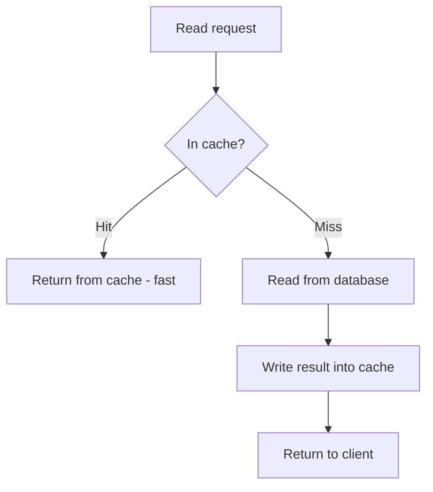
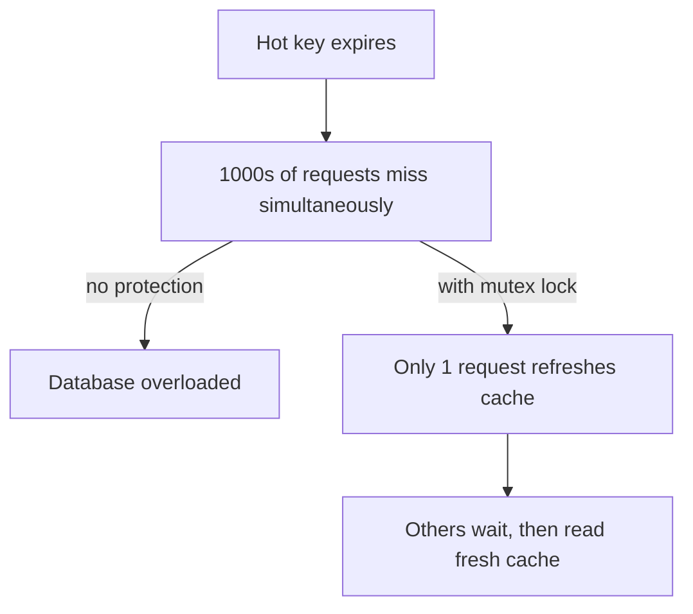
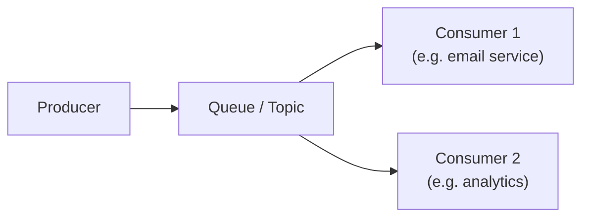
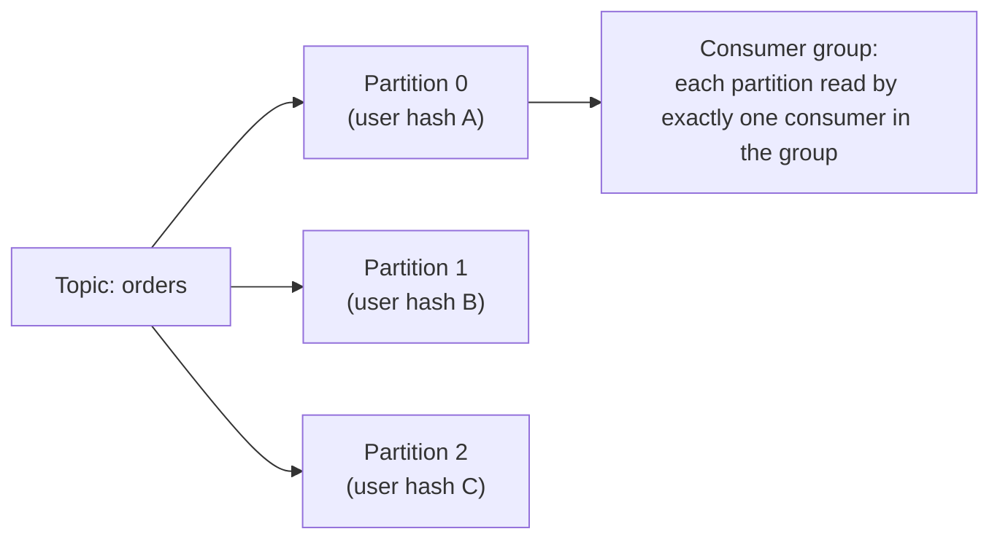
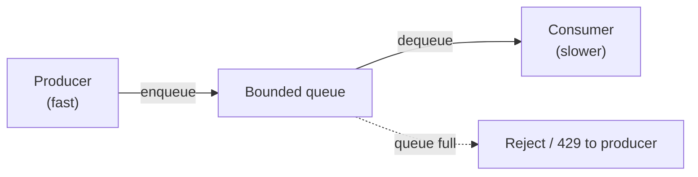
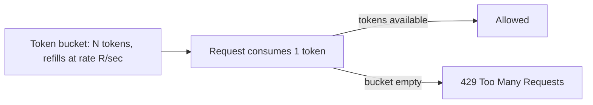
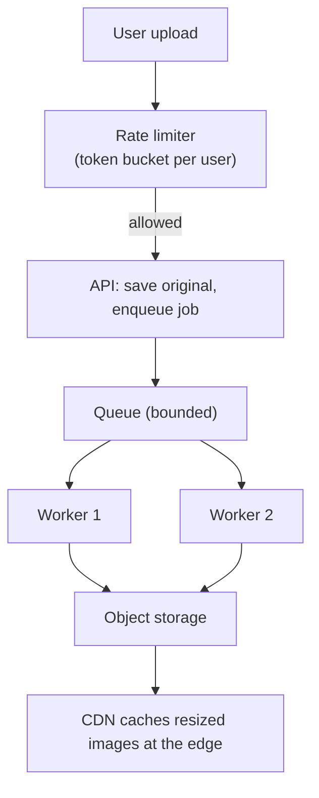

# Week 3: Caching, queues and the classic machine learning toolbox

This week is about speed and scale on the systems side, and about the algorithms that still power most production ML on the model side. On system design you learn how to avoid hitting the database at all (caching strategies, CDNs), how to decouple producers from consumers so a slow downstream service doesn't take down the whole system (message queues, Kafka, pub/sub, async jobs), and how to protect a service from being overwhelmed (rate limiting). On ML you move past the two linear models from Week 2 into the tree-based and kernel-based models that win most tabular-data competitions, plus the unsupervised techniques (k-means, PCA) and the practical hygiene (feature engineering, cross-validation) that make any of them trustworthy.

## Day 15: Caching strategies and decision trees

**System Design: Caching Strategies** (55 min)

A cache stores a copy of data that is expensive to compute or fetch, in a place that is cheap and fast to read (usually RAM, e.g. Redis or Memcached), trading a little staleness risk for a large latency win (recall Day 4: RAM is ~100,000x faster than a cross-datacenter round trip).

Three patterns for keeping cache and database in sync:
- **Cache-aside (lazy loading)**: the application checks the cache first; on a miss, it reads the database, then writes the result into the cache for next time. Simple and only caches what's actually requested, but the first request for any key always pays the full database latency (a "cold" cache miss), and there's a brief window where cache and database can disagree.
- **Write-through**: every write goes to the cache and the database together, synchronously. Cache is always fresh, but every write now pays the latency of both.
- **Write-back (write-behind)**: writes go to the cache immediately and are flushed to the database asynchronously later. Fast writes, but a cache crash before the flush loses data - a durability risk you must consciously accept.

**Eviction policies** decide what to remove when the cache is full: **LRU** (Least Recently Used - evict what hasn't been touched in the longest time, the most common default), **LFU** (Least Frequently Used), and **TTL-based** expiry (evict after a fixed time regardless of usage, good for data with a known freshness requirement).



**ML / GenAI: Decision Trees** (55 min)

A decision tree makes predictions by asking a sequence of yes/no questions about features, splitting the data at each node to make the resulting groups as "pure" as possible (each group dominated by one class, for classification, or having low variance, for regression). The standard split criteria are **Gini impurity** or **entropy** for classification, and **variance reduction** for regression. The tree keeps splitting until a stopping rule (max depth, minimum samples per leaf) is hit - without a stopping rule, a tree can grow until every leaf has exactly one training example, which is a textbook case of the overfitting you studied on Day 12.

```python
import numpy as np

def gini(labels):
    if len(labels) == 0:
        return 0
    _, counts = np.unique(labels, return_counts=True)
    p = counts / counts.sum()
    return 1 - np.sum(p ** 2)

def best_split(X_col, y):
    best_gain, best_thresh = -1, None
    parent_gini = gini(y)
    for thresh in np.unique(X_col):
        left_mask = X_col <= thresh
        right_mask = ~left_mask
        if left_mask.sum() == 0 or right_mask.sum() == 0:
            continue
        left_gini = gini(y[left_mask])
        right_gini = gini(y[right_mask])
        n = len(y)
        weighted_gini = (left_mask.sum() / n) * left_gini + (right_mask.sum() / n) * right_gini
        gain = parent_gini - weighted_gini
        if gain > best_gain:
            best_gain, best_thresh = gain, thresh
    return best_thresh, best_gain

# Toy data: hours studied -> pass/fail, find the single best splitting threshold
hours = np.array([1, 2, 3, 4, 5, 6, 7, 8])
passed = np.array([0, 0, 0, 1, 0, 1, 1, 1])

thresh, gain = best_split(hours, passed)
print(f"best split: hours <= {thresh} vs hours > {thresh}, gini gain = {gain:.3f}")
```

This is literally what `sklearn.tree.DecisionTreeClassifier` does at every node, just optimized in C and done recursively down to a stopping condition. A single tree is interpretable (you can read off the exact rule it used) but prone to high variance - small changes in training data can produce a very different tree, which is exactly the motivation for tomorrow's random forest.

**Recall** (10 min)
- What is the key risk of write-back caching that cache-aside and write-through don't have?
- Why does LRU work well as a default eviction policy?
- What does Gini impurity measure, and what value does it take for a perfectly pure group?
- Why is an unconstrained decision tree almost guaranteed to overfit?

**Go deeper**
- [course: Caching Strategies](../../../course/01-system-design/03-caching-and-queues.md#caching-strategies)
- [course: Eviction Policies](../../../course/01-system-design/03-caching-and-queues.md#eviction-policies)
- [course: Decision Trees](../../../course/04-ml-genai-agents/01-ml-fundamentals.md#decision-trees)

## Day 16: CDN, cache stampede and random forests

**System Design: CDN and Cache Stampede** (55 min)

A **CDN (Content Delivery Network)** is caching taken to a geographic extreme: copies of static (and sometimes dynamic) content sit on servers ("edge nodes" or "points of presence") physically close to users around the world, so a user in Mumbai gets a response from a nearby edge node instead of round-tripping to a server in Virginia (recall Day 4's ~150ms cross-continent latency number). CDNs are the default for images, videos, JS/CSS bundles, and increasingly for API responses via edge caching.

A **cache stampede** (thundering herd) happens when a popular cache key expires and a flood of concurrent requests all miss at once, all hit the database simultaneously, and can overload it - the exact failure a cache was supposed to prevent. Standard fixes:
- **Locking/mutex**: the first request to miss acquires a lock and repopulates the cache; others wait briefly and then read the now-fresh cache instead of all hitting the database.
- **Probabilistic early expiration**: refresh the cache slightly before the real TTL, with randomized jitter per key, so many keys with the same nominal TTL don't all expire in the same instant.
- **Stale-while-revalidate**: serve the slightly-stale cached value immediately while one request refreshes it in the background.



**ML / GenAI: Random Forest and Ensembles** (55 min)

A single decision tree has high variance (Day 15). **Bagging** (bootstrap aggregating) reduces variance by training many trees on different random subsets of the data (sampled with replacement, "bootstrap samples") and averaging their predictions (regression) or taking a majority vote (classification). A **random forest** adds one more trick: at each split, each tree only considers a random subset of features, which decorrelates the trees further - if one feature is very predictive, bagging alone would still let every tree lean on it and end up highly correlated; forcing feature subsets forces diversity.

Why averaging reduces variance: if each tree's error is somewhat random and independent, averaging `n` trees shrinks the variance of the average roughly by a factor of `n` (the same statistical idea behind why larger samples give tighter confidence intervals, from Week 1 Day 6).

```python
import numpy as np

rng = np.random.default_rng(3)

def bootstrap_sample(X, y):
    n = len(y)
    idx = rng.integers(0, n, size=n)  # sample with replacement
    return X[idx], y[idx]

# Simulate: 5 trees, each a crude "majority vote of a bootstrap sample" classifier
X = rng.uniform(0, 10, 50)
y = (X + rng.normal(0, 2, 50) > 5).astype(int)

def crude_tree_predict(X_train, y_train, x_query):
    # simplistic stand-in for a real tree: predict the label of the nearest training point
    nearest = X_train[np.argmin(np.abs(X_train - x_query))]
    return y_train[np.argmin(np.abs(X_train - x_query))]

query_point = 5.5
votes = []
for _ in range(5):
    Xb, yb = bootstrap_sample(X, y)
    votes.append(crude_tree_predict(Xb, yb, query_point))

majority_vote = int(np.round(np.mean(votes)))
print(f"individual tree votes: {votes}")
print(f"forest prediction (majority vote): {majority_vote}")
```

This toy loop captures the shape of a real random forest even though the "tree" here is a one-line stand-in - `sklearn.ensemble.RandomForestClassifier` does the same bootstrap-and-vote idea with real decision trees and random feature subsets at every split.

**Recall** (10 min)
- Name two concrete fixes for cache stampede and how each works.
- Why would an edge CDN node help a user in Mumbai specifically?
- What does bagging do to a model's variance, and why?
- What extra randomness does a random forest add beyond plain bagging, and why does it help?

**Go deeper**
- [course: CDN (Content Delivery Network)](../../../course/01-system-design/01-fundamentals.md#cdn-content-delivery-network)
- [course: Cache Stampede (Thundering Herd)](../../../course/01-system-design/03-caching-and-queues.md#cache-stampede-thundering-herd)
- [course: Ensembles](../../../course/04-ml-genai-agents/01-ml-fundamentals.md#ensembles)

## Day 17: Message queues, Kafka and gradient boosting

**System Design: Message Queues and Kafka vs RabbitMQ** (55 min)

A **message queue** decouples a producer (something that creates work) from a consumer (something that does the work), so the producer doesn't have to wait for the work to finish, and a burst of incoming requests gets smoothed out instead of overwhelming the consumer directly. This is the backbone of async processing: "send welcome email," "resize uploaded image," "recompute a user's recommendation feed" all belong in a queue, not in the critical path of the HTTP request that triggered them.

**RabbitMQ** is a traditional message broker: it implements flexible routing (exchanges, topic/fanout/direct routing), and once a message is consumed and acknowledged, it's gone - it's built around the idea of a message being "delivered and done."

**Kafka** is a distributed, append-only, partitioned log. Messages aren't deleted on consumption; they're retained for a configured period, and multiple independent consumer groups can each read the same stream of messages at their own pace, re-reading history if needed. This makes Kafka the default choice for event streaming (multiple services all caring about "an order was placed") and analytics pipelines, while RabbitMQ fits classic task-queue workloads (each job should be done exactly once, by one worker, then discarded).



Rule of thumb for interviews: pick a queue whenever you see "this doesn't need to happen before we respond to the user" - it is one of the highest-leverage system design moves because it converts a slow synchronous chain into a fast response plus background work.

**ML / GenAI: Gradient Boosting and XGBoost** (55 min)

Where random forest builds many independent trees and averages them, **gradient boosting** builds trees **sequentially**, and each new tree is trained to predict the **residual errors** of the trees built so far - it is explicitly trying to fix what the ensemble currently gets wrong, rather than being an independent vote.

The procedure: start with a simple prediction (e.g. the mean of `y`). Compute the residual (`y - current_prediction`) for every example. Fit a small tree to predict that residual. Add a scaled-down version of that tree's prediction to the running total (the scale factor is the **learning rate**, same concept as Day 11's gradient descent - a smaller learning rate needs more trees but generalizes better). Repeat.

```python
import numpy as np

rng = np.random.default_rng(5)
x = np.linspace(0, 10, 40)
y = np.sin(x) + rng.normal(0, 0.1, 40)

def stump_predict(x, threshold, left_val, right_val):
    return np.where(x <= threshold, left_val, right_val)

def fit_stump(x, residual):
    # the simplest possible "tree": one split that best reduces squared residual
    best_mse, best = np.inf, None
    for t in np.unique(x)[:-1]:
        left = residual[x <= t]
        right = residual[x > t]
        left_val, right_val = left.mean(), right.mean()
        pred = stump_predict(x, t, left_val, right_val)
        mse = np.mean((residual - pred) ** 2)
        if mse < best_mse:
            best_mse, best = mse, (t, left_val, right_val)
    return best

prediction = np.full_like(y, y.mean())  # start: predict the mean for everyone
lr = 0.3
for round_num in range(10):
    residual = y - prediction
    t, left_val, right_val = fit_stump(x, residual)
    prediction += lr * stump_predict(x, t, left_val, right_val)
    if round_num % 3 == 0:
        print(f"round {round_num}: MSE = {np.mean((y - prediction) ** 2):.4f}")

print(f"final MSE: {np.mean((y - prediction) ** 2):.4f}")
```

**XGBoost** (and LightGBM, CatBoost) industrialize this idea with second-order gradient information, built-in regularization, handling of missing values, and massively optimized tree-building - which is why gradient-boosted trees, not neural networks, still win most tabular-data Kaggle competitions and production fraud/ranking/credit-risk models.

**Recall** (10 min)
- What is the one-sentence reason to put work on a queue instead of doing it inline?
- When would you pick RabbitMQ over Kafka, and vice versa?
- What does a new tree in gradient boosting actually try to predict?
- How does boosting's learning rate relate to the learning rate in gradient descent from Day 11?

**Go deeper**
- [course: Message Queues](../../../course/01-system-design/03-caching-and-queues.md#message-queues)
- [course: Kafka vs RabbitMQ](../../../course/01-system-design/03-caching-and-queues.md#kafka-vs-rabbitmq)
- [XGBoost: Introduction to Boosted Trees](https://xgboost.readthedocs.io/en/stable/tutorials/model.html)

## Day 18: Kafka partitioning, pub/sub semantics and SVMs

**System Design: Kafka Partitioning and Delivery Semantics** (55 min)

A Kafka **topic** is split into **partitions**, and each partition is an ordered, append-only log. Kafka guarantees order *within* a partition only, not across the whole topic - this is why the **partition key** matters: if you need all events for a given user processed in order, you partition by user ID (`hash(user_id) % num_partitions`), which also gives you the Week 2 consistent-hashing idea again, now applied to message routing instead of data storage.

**Delivery semantics** describe what happens on failure:
- **At-most-once**: a message might be lost but never processed twice (commit the offset before processing - if processing crashes, that message is gone).
- **At-least-once**: a message is never lost but might be processed twice (commit the offset after processing - if the commit crashes after processing but before acknowledging, it gets redelivered).
- **Exactly-once**: never lost, never duplicated - the hardest and most expensive guarantee, usually achieved via idempotent writes on the consumer side (process the same message twice, get the same end state) rather than a magic "exactly once" transport.



In practice most systems choose **at-least-once delivery plus idempotent processing** (Week 4's topic) because it's far cheaper than true exactly-once transport and gives the same observable outcome.

**ML / GenAI: Support Vector Machines** (55 min)

An SVM finds the **maximum-margin hyperplane** separating two classes: among all the lines (or hyperplanes) that correctly separate the classes, pick the one with the largest distance (**margin**) to the nearest points of either class (the **support vectors** - only these points determine the boundary; the rest could be deleted without changing it). A larger margin tends to generalize better, which connects directly to Day 12's bias-variance idea: a boundary that barely squeezes between the classes is more sensitive to new data (higher variance) than one with breathing room.

For data that isn't linearly separable, the **kernel trick** implicitly maps data into a higher-dimensional space where it becomes separable, without ever computing the expensive high-dimensional coordinates explicitly - the RBF (Gaussian) kernel is the most common, controlled by a parameter that trades off how tightly the boundary wraps around individual points (again, a bias-variance knob).

```python
import numpy as np

# Linearly separable toy data: 2 classes, 2 features
rng = np.random.default_rng(2)
class_a = rng.normal(loc=[2, 2], scale=0.5, size=(10, 2))
class_b = rng.normal(loc=[6, 6], scale=0.5, size=(10, 2))
X = np.vstack([class_a, class_b])
y = np.array([0] * 10 + [1] * 10)

# A margin-maximizing line (found here by inspection, not optimization) and the
# margin to the nearest point of each class - this is what an SVM solver computes.
w = np.array([1.0, 1.0])
w = w / np.linalg.norm(w)
b = -8.0  # boundary: w . x + b = 0, roughly between the two clusters

def signed_distance(x):
    return (w @ x + b) / np.linalg.norm(w)

distances = np.array([signed_distance(x) for x in X])
margin_a = distances[y == 0].max()   # closest class-A point to the boundary (negative side)
margin_b = distances[y == 1].min()   # closest class-B point to the boundary (positive side)
print(f"distance of nearest class A point to boundary: {margin_a:.2f}")
print(f"distance of nearest class B point to boundary: {margin_b:.2f}")
print(f"margin width: {margin_b - margin_a:.2f}")
```

In real use you'd call `sklearn.svm.SVC(kernel='rbf')` and let the solver find `w`, `b`, and the support vectors automatically; this exercise is to build intuition for what "margin" concretely means as a distance.

**Recall** (10 min)
- Why does Kafka only guarantee ordering within a partition, not across a topic?
- What's the practical difference between at-least-once and exactly-once delivery, and which do most systems actually use?
- What is a "support vector," and why do only those points matter for the boundary?
- How does a larger margin relate to the bias-variance tradeoff?

**Go deeper**
- [course: Kafka Partitioning and Ordering](../../../course/01-system-design/03-caching-and-queues.md#kafka-partitioning-and-ordering)
- [course: Delivery Semantics](../../../course/01-system-design/03-caching-and-queues.md#delivery-semantics)
- [scikit-learn: SVM user guide](https://scikit-learn.org/stable/modules/svm.html)

## Day 19: Async jobs, backpressure, k-means and PCA

**System Design: Async Jobs and Backpressure** (55 min)

An **async job** is work explicitly deferred to run outside the request/response cycle, typically picked up by worker processes from a queue (Day 17). The pattern: the API handler validates the request, enqueues a job, and immediately returns (often with a job ID the client can poll, or a webhook/notification when done) instead of making the user wait for slow work like video transcoding or a batch report.

**Backpressure** is what happens when a consumer can't keep up with a producer. Without a plan, the queue grows unbounded, consuming more and more memory until the system falls over. Standard responses:
- **Bounded queues**: cap the queue size; once full, either reject new work (**load shedding**) or block the producer until there's room.
- **Rate limiting the producer**: slow down acceptance of new work at the edge (ties directly into Day 20).
- **Autoscaling consumers**: add more workers based on queue depth - effective but has a ramp-up delay, so it should be paired with a bounded queue as a safety net for the gap before new workers come online.



The interview-relevant insight: backpressure is not a failure mode to avoid, it's a deliberate design choice about *which* part of the system should feel the pain of overload first - usually you want it to be the least important or most easily retried caller, not the database or the whole system falling over.

**ML / GenAI: K-Means Clustering and PCA** (55 min)

**K-means** partitions data into `k` clusters by alternating two steps until convergence: (1) assign each point to its nearest cluster **centroid**, (2) move each centroid to the mean of the points now assigned to it. It requires choosing `k` upfront (common heuristics: the "elbow method," plotting within-cluster variance against `k` and looking for a bend) and is sensitive to the initial centroid positions (hence `k-means++` smarter initialization in practice).

**PCA (Principal Component Analysis)** finds the directions (**principal components**) along which data varies the most, and lets you project high-dimensional data onto just the top few of them while keeping most of the variance - a form of lossy compression used to visualize high-dimensional data in 2D/3D, speed up downstream models, or remove redundant correlated features (recall Day 6's point that highly correlated features are partly redundant - PCA is the systematic version of that observation).

```python
import numpy as np

rng = np.random.default_rng(4)
# Two visually separated clusters
c1 = rng.normal(loc=[0, 0], scale=0.7, size=(30, 2))
c2 = rng.normal(loc=[6, 6], scale=0.7, size=(30, 2))
X = np.vstack([c1, c2])

# --- K-means (k=2), a few iterations by hand ---
centroids = X[rng.choice(len(X), 2, replace=False)]
for _ in range(10):
    dists = np.linalg.norm(X[:, None, :] - centroids[None, :, :], axis=2)
    labels = dists.argmin(axis=1)
    centroids = np.array([X[labels == k].mean(axis=0) for k in range(2)])
print("final centroids:\n", centroids)

# --- PCA, from scratch via covariance + eigendecomposition ---
X_centered = X - X.mean(axis=0)
cov = np.cov(X_centered.T)
eigvals, eigvecs = np.linalg.eigh(cov)
order = np.argsort(eigvals)[::-1]          # largest variance first
top_component = eigvecs[:, order[0]]
projected_1d = X_centered @ top_component   # compress 2D -> 1D
print("variance explained by top component:", eigvals[order[0]] / eigvals.sum())
```

**Recall** (10 min)
- Why is a bounded queue combined with load shedding safer than an unbounded one?
- What is the "elbow method" used for in k-means?
- What do the two steps of k-means's loop actually do, in one sentence each?
- What does PCA's "top principal component" represent?

**Go deeper**
- [course: Backpressure](../../../course/01-system-design/03-caching-and-queues.md#backpressure)
- [course: K-Means Clustering](../../../course/04-ml-genai-agents/01-ml-fundamentals.md#k-means-clustering)
- [scikit-learn: PCA user guide](https://scikit-learn.org/stable/modules/decomposition.html#pca)

## Day 20: Rate limiting, feature engineering and cross-validation

**System Design: Rate Limiting Algorithms** (55 min)

Rate limiting protects a service from being overwhelmed - by a buggy client, a traffic spike, or a malicious actor - by capping how many requests a given key (user, IP, API key) can make in a window.

- **Token bucket**: a bucket holds up to `N` tokens, refilling at a steady rate; each request consumes one token, and requests are rejected when the bucket is empty. Naturally allows short bursts up to the bucket size while enforcing a steady average rate - the most commonly used algorithm in practice.
- **Leaky bucket**: similar bucket concept, but requests are processed at a fixed output rate regardless of burst size, smoothing traffic rather than allowing bursts.
- **Fixed window counter**: count requests in a fixed time window (e.g. per-minute); simple, but allows up to 2x the limit right at a window boundary (a burst at 0:59 and another at 1:00 both fit within their own windows).
- **Sliding window log/counter**: tracks request timestamps (or a weighted blend of the current and previous window) to avoid the boundary-burst problem at the cost of more memory or computation.



Rate limiting is usually enforced at the API gateway/edge (Week 4) rather than deep inside the application, specifically so that abusive traffic never reaches - and never costs compute time in - the expensive parts of the system.

**ML / GenAI: Feature Engineering and Cross-Validation** (55 min)

**Feature engineering** is transforming raw data into inputs that make patterns easier for a model to find: extracting `day_of_week` from a timestamp, computing a ratio instead of handing a model two raw columns separately, one-hot encoding a categorical variable, or log-transforming a skewed numeric column (recall Week 1 Day 6's skewed `spend` distribution) so a linear model sees something closer to normally distributed. The common thread: a model can only use the information you give it in a form it can exploit - a tree can split on a raw timestamp but can't "discover" that weekends behave differently unless you (or it, implicitly) extract that signal.

**Cross-validation** is the honest way to estimate how a model will perform on unseen data, improving on Week 2's single train/test split. **K-fold cross-validation** splits the data into `k` equal parts, trains on `k-1` of them and validates on the remaining one, repeats this `k` times rotating which fold is held out, and averages the `k` validation scores. This uses every example for both training and validation (across different rounds) and gives a variance estimate on the score itself (via the spread across folds), not just a single number from one lucky or unlucky split.

```python
import numpy as np

rng = np.random.default_rng(6)
n = 100
x = rng.uniform(0, 10, n)
y = (x + rng.normal(0, 2, n) > 5).astype(int)

def sigmoid(z):
    return 1 / (1 + np.exp(-z))

def train_logistic(x_train, y_train, epochs=300, lr=0.05):
    w, b = 0.0, 0.0
    for _ in range(epochs):
        p = sigmoid(w * x_train + b)
        error = p - y_train
        w -= lr * np.mean(error * x_train)
        b -= lr * np.mean(error)
    return w, b

k = 5
fold_size = n // k
indices = rng.permutation(n)
scores = []

for fold in range(k):
    val_idx = indices[fold * fold_size:(fold + 1) * fold_size]
    train_idx = np.setdiff1d(indices, val_idx)
    w, b = train_logistic(x[train_idx], y[train_idx])
    preds = (sigmoid(w * x[val_idx] + b) > 0.5).astype(int)
    acc = np.mean(preds == y[val_idx])
    scores.append(acc)

print("per-fold accuracy:", np.round(scores, 3))
print(f"mean accuracy: {np.mean(scores):.3f}  std across folds: {np.std(scores):.3f}")
```

A high standard deviation across folds is itself a signal worth acting on: it often means you don't have enough data, or the model's performance is unstable (high variance) rather than genuinely unreliable on average.

**Recall** (10 min)
- Why does token bucket allow bursts while leaky bucket smooths them out?
- What boundary problem does fixed-window counting have, and what fixes it?
- Give one concrete example of feature engineering that would help a tree-based model and explain why.
- What does a high standard deviation across k-fold scores suggest about your model or data?

**Go deeper**
- [course: Rate Limiting Algorithms](../../../course/01-system-design/05-scalability-patterns.md#rate-limiting-algorithms)
- [course: Feature Engineering](../../../course/04-ml-genai-agents/01-ml-fundamentals.md#5-feature-engineering)
- [course: Train/Validation/Test Split and Cross-Validation](../../../course/04-ml-genai-agents/01-ml-fundamentals.md#7-trainvalidationtest-split-and-cross-validation)

## Day 21: Revision and mini project

**System Design: Revision - design a rate-limited, async image-processing pipeline** (55 min)

Without looking back, sketch a system where users upload images that get resized asynchronously, with the upload endpoint itself rate-limited per user and protected from a cache-stampede-style thundering herd on the most popular images.



**Mini project**: write down, with reasoning:
1. Which rate-limiting algorithm you'd pick for the upload endpoint, and why token bucket's burst tolerance is or isn't appropriate here.
2. What happens to new uploads if the worker queue fills up - your explicit backpressure policy (reject vs block vs autoscale), and why.
3. Which caching strategy (cache-aside, write-through, write-back) fits "serve the resized image once it exists," and why a stampede-prevention mechanism matters once one image goes viral.
4. Whether you'd use Kafka or RabbitMQ for the resize job queue, and the one property of your workload that decided it.

**ML / GenAI: Revision - a tabular ML pipeline end to end** (55 min)

Build one script that chains this week's ML topics: engineer a feature, cross-validate a tree-based model, and compare it against the linear logistic regression baseline from Week 2 using the metrics from Day 13.

```python
import numpy as np

rng = np.random.default_rng(9)
n = 200
age = rng.uniform(18, 70, n)
income = rng.uniform(20_000, 150_000, n)
# Engineered feature: a ratio often more predictive than either raw column alone
debt = rng.uniform(0, 50_000, n)
debt_to_income = debt / income

# Label: a nonlinear-ish rule a single linear model struggles with, a tree handles naturally
default_risk = ((debt_to_income > 0.3) & (age < 40)).astype(int)

def gini(labels):
    if len(labels) == 0:
        return 0
    _, counts = np.unique(labels, return_counts=True)
    p = counts / counts.sum()
    return 1 - np.sum(p ** 2)

def stump_fit_predict(feature, labels, train_idx, test_idx):
    best_gain, best_t = -1, feature[train_idx].mean()
    parent = gini(labels[train_idx])
    for t in np.unique(feature[train_idx]):
        left = labels[train_idx][feature[train_idx] <= t]
        right = labels[train_idx][feature[train_idx] > t]
        if len(left) == 0 or len(right) == 0:
            continue
        w = (len(left) * gini(left) + len(right) * gini(right)) / len(train_idx)
        gain = parent - w
        if gain > best_gain:
            best_gain, best_t = gain, t
    left_label = int(np.round(labels[train_idx][feature[train_idx] <= best_t].mean()))
    right_label = int(np.round(labels[train_idx][feature[train_idx] > best_t].mean()))
    return np.where(feature[test_idx] <= best_t, left_label, right_label)

k = 5
indices = rng.permutation(n)
fold_size = n // k
tree_scores, baseline_scores = [], []

for fold in range(k):
    test_idx = indices[fold * fold_size:(fold + 1) * fold_size]
    train_idx = np.setdiff1d(indices, test_idx)

    tree_preds = stump_fit_predict(debt_to_income, default_risk, train_idx, test_idx)
    tree_scores.append(np.mean(tree_preds == default_risk[test_idx]))

    baseline_preds = np.full(len(test_idx), int(np.round(default_risk[train_idx].mean())))
    baseline_scores.append(np.mean(baseline_preds == default_risk[test_idx]))

print(f"decision stump cross-val accuracy: {np.mean(tree_scores):.3f} (+/- {np.std(tree_scores):.3f})")
print(f"majority-class baseline accuracy:  {np.mean(baseline_scores):.3f} (+/- {np.std(baseline_scores):.3f})")
```

The engineered `debt_to_income` ratio is doing real work here - try rerunning with raw `debt` and `income` as two separate features fed to the same stump logic and notice the split quality drops, which is feature engineering's value made concrete rather than asserted.

**Recall** (10 min)
- Without looking, name the three caching strategies and one risk of each.
- What three things does a k-fold cross-validation score tell you that a single train/test split does not?
- Why did the engineered debt-to-income ratio likely outperform the raw columns in the exercise?
- Which single topic from this week do you most want to revisit before Week 4's API design content builds on async/queue concepts again?

**Go deeper**
- [course: Caching and Queues README](../../../course/01-system-design/03-caching-and-queues.md)
- [course: Scalability Patterns - Rate Limiting Algorithms](../../../course/01-system-design/05-scalability-patterns.md#rate-limiting-algorithms)
- [course: ML / GenAI README](../../../course/04-ml-genai-agents/README.md)
