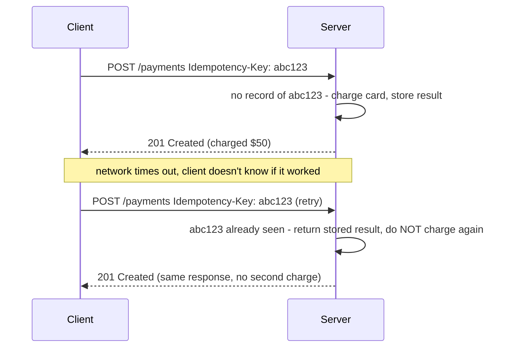
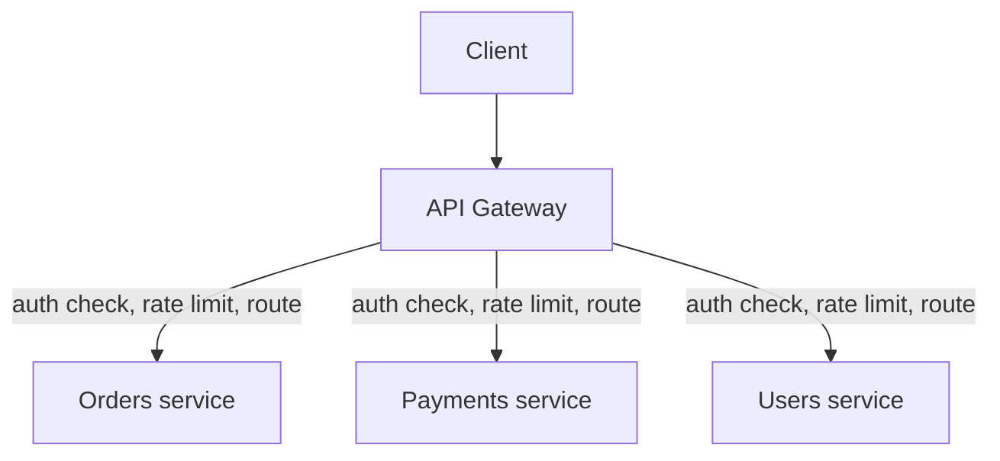
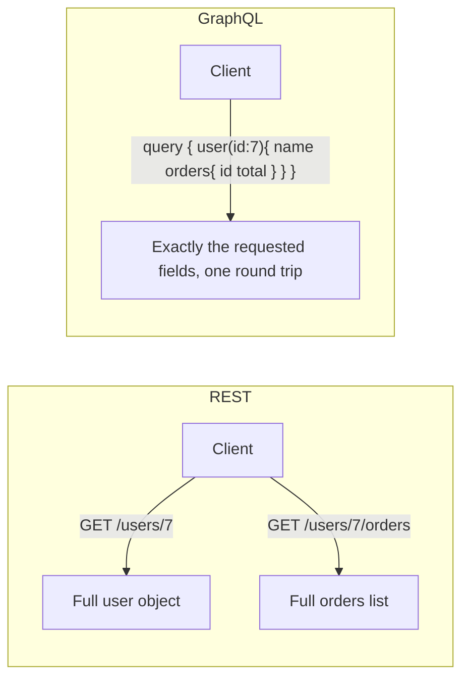
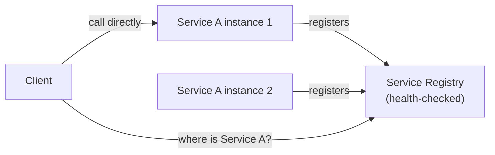
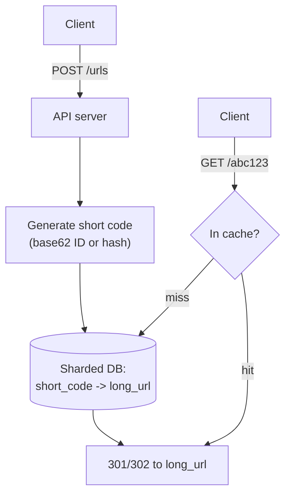
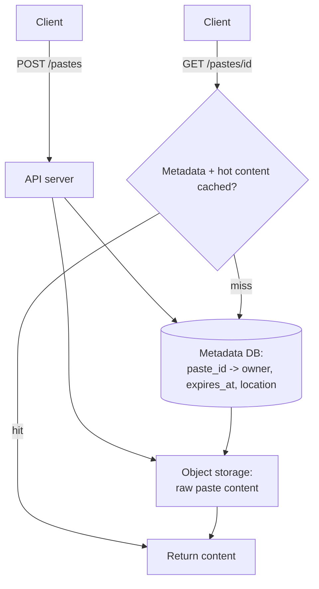
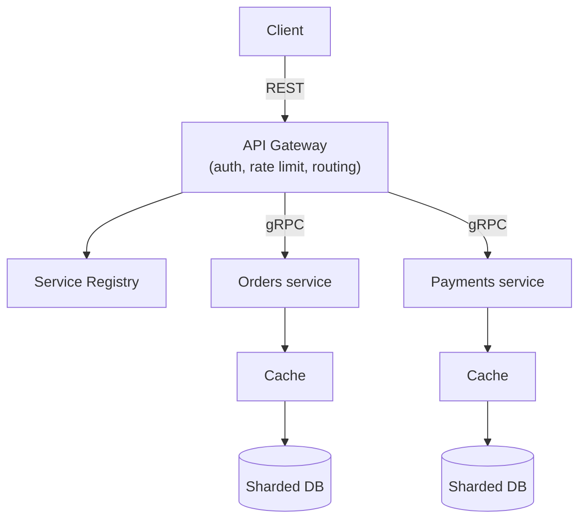

# Week 4: API design and the deep learning starting line

This week closes out the beginner phase. On system design you move from "how data is stored" to "how services talk to each other and to the outside world": REST, gRPC, and GraphQL as three different answers to "what does an API call look like," idempotency and pagination as the two most interview-tested API details, the API gateway as the front door for a system made of many services, and service discovery as how those services find each other. You apply all of it to two classic case studies, a URL shortener and a pastebin. On ML you take your first real step into deep learning: the perceptron, backpropagation, PyTorch, optimizers, regularization, and a first look at CNNs - the foundation everything from Week 5 onward (sequences, transformers, LLMs) builds directly on top of.

## Day 22: REST API design and idempotency

**System Design: REST API Design and Idempotency** (55 min)

**REST** (Representational State Transfer) models an API as operations on **resources** identified by URLs, using HTTP methods to say what you want to do: `GET /orders/42` (read), `POST /orders` (create), `PUT /orders/42` (replace), `PATCH /orders/42` (partial update), `DELETE /orders/42` (remove). Good REST design is consistent about this mapping, uses plural nouns for collections (`/orders`, not `/getOrders`), nests resources to show ownership (`/users/7/orders`), and returns the right status code (`201 Created` with a `Location` header for a successful POST, `404` for a missing resource, `409` for a conflict).

**Idempotency** means calling an operation multiple times has the same effect as calling it once. `GET`, `PUT`, and `DELETE` are idempotent by design (replacing a resource with the same data twice leaves it in the same state; deleting an already-deleted resource is still "deleted"). `POST` is **not** idempotent by default - calling "charge this credit card $50" twice charges $100, which is a real production bug, not a theoretical one, especially over a flaky network where a client can't tell if its first request actually succeeded before retrying.

The standard fix is an **idempotency key**: the client generates a unique key (a UUID) per logical operation and sends it in a header; the server stores "key X already produced result Y" and, on a retry with the same key, returns the stored result instead of repeating the side effect.



This single pattern - a client-generated key plus a server-side dedupe table - is the real-world version of the "exactly-once effect via idempotent processing" you studied on Day 18 for Kafka consumers; it is the same idea applied at the API layer instead of the message-queue layer.

**ML / GenAI: The Perceptron and Neural Network Basics** (55 min)

A **perceptron** is the simplest possible neural network unit: it computes `z = w . x + b` (exactly Day 9's linear regression formula) and passes `z` through an **activation function** to produce an output. With a step activation, this is a linear classifier; with no activation at all, it's just linear regression (Day 9) wearing a different name.

Stacking perceptrons into **layers**, where every unit in one layer connects to every unit in the next, gives you a **multi-layer perceptron (MLP)** - the simplest neural network architecture. The critical ingredient that makes this more powerful than a single linear model is a **non-linear activation function** (ReLU, sigmoid, tanh) between layers: without non-linearity, stacking any number of linear layers collapses algebraically back into one linear layer (`W2(W1x) = (W2 W1)x`, still just a linear function of `x`). With a non-linearity in between, the network can approximate arbitrarily complex functions - this is the **universal approximation** property that makes deep learning work at all.

```python
import numpy as np

def relu(z):
    return np.maximum(0, z)

def forward(x, W1, b1, W2, b2):
    h = relu(W1 @ x + b1)   # hidden layer: linear + non-linearity
    y = W2 @ h + b2          # output layer: linear (no activation, for a regression output)
    return y, h

rng = np.random.default_rng(0)
W1 = rng.normal(0, 0.5, size=(4, 2))   # 2 inputs -> 4 hidden units
b1 = np.zeros(4)
W2 = rng.normal(0, 0.5, size=(1, 4))   # 4 hidden units -> 1 output
b2 = np.zeros(1)

x = np.array([1.0, -2.0])
y, h = forward(x, W1, b1, W2, b2)
print("hidden activations (note the zeros from ReLU clipping negatives):", h)
print("output:", y)

# Demonstrate the collapse without non-linearity: two linear layers = one linear layer
W_combined = W2 @ W1
print("W2 @ W1 (the 'collapsed' single linear layer):", W_combined)
```

Notice some hidden activations are exactly 0 - ReLU zeroes out any negative pre-activation, which is what gives the network its piecewise-linear, non-linear shape. Tomorrow you learn how a network like this actually *learns* its weights: backpropagation.

**Recall** (10 min)
- Why is `POST` not idempotent by default, and what fixes that?
- What HTTP status code should a successful resource creation return, and what header should go with it?
- What does stacking linear layers without a non-linear activation collapse into?
- What does ReLU do to a negative input, and why does that matter for the network's expressive power?

**Go deeper**
- [course: REST API Design Principles](../../../course/03-fullstack-mern-kubernetes/01-nodejs-express.md#6-rest-api-design-principles)
- [course: What a Neural Network Actually Is](../../../course/04-ml-genai-agents/02-deep-learning.md#1-what-a-neural-network-actually-is)
- [Stripe docs: idempotent requests](https://stripe.com/docs/api/idempotent_requests)

## Day 23: Pagination, API gateways and backpropagation

**System Design: Pagination and the API Gateway** (55 min)

**Pagination** splits a large result set into pages so a single response doesn't try to serialize and transmit millions of rows. Two common approaches:
- **Offset-based** (`GET /orders?offset=100&limit=20`): simple and lets a client jump to any page, but gets slower as the offset grows (the database still has to scan and discard all the skipped rows) and can show duplicate or missing rows if data changes between page requests (a row inserted before your offset shifts everything after it).
- **Cursor-based** (`GET /orders?after=order_id_12345&limit=20`): the cursor is an opaque pointer to "where you left off" (often the last row's sort key), so the database can jump directly there with an indexed lookup instead of scanning - fast and stable even as data changes, at the cost of not being able to jump to an arbitrary page number. This is what virtually every large-scale API (Twitter, Stripe, GitHub) uses for anything beyond small, rarely-changing datasets.

An **API gateway** is a single entry point in front of a system built from many services (which Day 25's microservices material formalizes). It centralizes cross-cutting concerns so individual services don't each reimplement them: authentication/authorization, rate limiting (Day 20), request routing to the right backend service, response caching, and request/response logging for observability.



The gateway becomes a single point of failure and a potential bottleneck if not designed carefully, so production gateways are themselves deployed with the same redundancy and load-balancing ideas from Week 1 - it's infrastructure, and infrastructure needs its own availability plan.

**ML / GenAI: Backpropagation** (55 min)

Backpropagation is the **chain rule** applied systematically to compute the gradient of the loss with respect to every weight in a multi-layer network, so gradient descent (Day 11) can update all of them. The key insight: compute the network's output left to right (the **forward pass**), then compute how much each layer's output contributed to the final error by walking right to left (the **backward pass**), reusing each layer's gradient computation for the layer behind it instead of recomputing from scratch.

Concretely, for a two-layer network `h = relu(W1 x + b1)`, `y = W2 h + b2`, loss `L = (y - y_true)^2`: the gradient with respect to `W2` only needs `dL/dy` and `h`; the gradient with respect to `W1` needs `dL/dy`, `W2`, and the ReLU derivative - each step reuses the previous step's result, which is exactly why it's efficient (`O(network size)` instead of something exponentially worse).

```python
import numpy as np

def relu(z):
    return np.maximum(0, z)

def relu_grad(z):
    return (z > 0).astype(float)

rng = np.random.default_rng(1)
x = np.array([1.0, 2.0])
y_true = np.array([5.0])

W1 = rng.normal(0, 0.5, size=(3, 2))
b1 = np.zeros(3)
W2 = rng.normal(0, 0.5, size=(1, 3))
b2 = np.zeros(1)

# Forward pass
z1 = W1 @ x + b1
h = relu(z1)
y_pred = W2 @ h + b2
loss = np.mean((y_pred - y_true) ** 2)
print(f"forward: y_pred={y_pred}, loss={loss:.4f}")

# Backward pass - the chain rule, one layer at a time
dL_dy = 2 * (y_pred - y_true)              # dL/dy_pred
dL_dW2 = np.outer(dL_dy, h)                 # dL/dW2 = dL/dy * h
dL_db2 = dL_dy
dL_dh = W2.T @ dL_dy                        # push the gradient back through W2
dL_dz1 = dL_dh * relu_grad(z1)              # push it through the ReLU
dL_dW1 = np.outer(dL_dz1, x)                # dL/dW1 = dL/dz1 * x
dL_db1 = dL_dz1

print("gradient w.r.t. W2:\n", dL_dW2)
print("gradient w.r.t. W1:\n", dL_dW1)

# Sanity check one weight numerically (finite differences) against the analytic gradient
eps = 1e-5
W1_perturbed = W1.copy()
W1_perturbed[0, 0] += eps
h_p = relu(W1_perturbed @ x + b1)
y_p = W2 @ h_p + b2
loss_p = np.mean((y_p - y_true) ** 2)
numeric_grad = (loss_p - loss) / eps
print(f"analytic dL/dW1[0,0] = {dL_dW1[0,0]:.5f}, numeric check = {numeric_grad:.5f}")
```

That final numerical check - perturbing one weight slightly and seeing if the loss changes by the amount the analytic gradient predicts - is literally how you'd debug a suspected bug in a hand-written backward pass, and it's the exact reason the analytic and numeric values should match closely.

**Recall** (10 min)
- Why does offset-based pagination get slower as the offset grows, and what does cursor-based pagination fix?
- Name three cross-cutting concerns an API gateway centralizes.
- In your own words, what does the "backward pass" of backpropagation do that the forward pass doesn't?
- Why is comparing an analytic gradient to a numerical finite-difference gradient a good debugging technique?

**Go deeper**
- [course: REST API Design Principles (pagination context)](../../../course/03-fullstack-mern-kubernetes/01-nodejs-express.md#6-rest-api-design-principles)
- [course: Backpropagation - The Intuition](../../../course/04-ml-genai-agents/02-deep-learning.md#2-backpropagation--the-intuition)
- [Stripe docs: pagination](https://stripe.com/docs/api/pagination)

## Day 24: gRPC, GraphQL and PyTorch basics

**System Design: gRPC and GraphQL** (55 min)

**gRPC** is an RPC (Remote Procedure Call) framework: you define service methods and message types in a `.proto` file (Protocol Buffers), and gRPC generates client and server code in many languages from that single definition. Messages are serialized as compact binary (Protobuf), not JSON, and transport runs over HTTP/2, so gRPC supports true bidirectional streaming (either side can keep sending messages on one connection) in addition to simple request/response. This makes gRPC the common choice for internal service-to-service communication where performance matters and both ends are services you control (so generated strongly-typed clients are a win, not a burden).

**GraphQL** flips the API shape around: instead of the server defining fixed endpoints that return fixed shapes, the client sends a **query** describing exactly which fields it wants, possibly across what would be several REST resources, and gets back exactly that shape - no more, no less. This solves two classic REST pain points: **over-fetching** (a REST endpoint returns a full object when the client only needed two fields) and **under-fetching / N+1 requests** (the client needs data from several REST endpoints and has to make several round trips). The cost is more complexity on the server (a **resolver** per field, and care needed to avoid the N+1 *database* query problem showing up server-side instead of client-side) and less predictable caching (a REST GET on a fixed URL is trivially cacheable by a CDN; an arbitrary GraphQL query usually isn't, without extra machinery).



Interview framing: **REST** for public, cacheable, resource-oriented APIs; **gRPC** for internal, high-performance, strongly-typed service-to-service calls; **GraphQL** when clients (especially many different frontend clients - web, iOS, Android - each needing different slices of the same data) need flexible, precise queries and round trips are the bottleneck you're solving for.

**ML / GenAI: PyTorch Basics** (55 min)

PyTorch's core object is the **tensor** - like a NumPy array, but it can track **gradients** automatically and can live on a GPU. The feature that replaces your hand-written backward pass from yesterday is **autograd**: set `requires_grad=True` on a tensor, do any sequence of operations, call `.backward()`, and PyTorch walks the computation graph backward applying the chain rule for you - exactly what you did by hand on Day 23, generalized to any computation and any depth of network.

```python
import torch

# Tensors look like NumPy arrays but can track gradients
x = torch.tensor([1.0, 2.0], requires_grad=False)
y_true = torch.tensor([5.0])

W1 = torch.randn(3, 2, requires_grad=True)
b1 = torch.zeros(3, requires_grad=True)
W2 = torch.randn(1, 3, requires_grad=True)
b2 = torch.zeros(1, requires_grad=True)

# Forward pass - identical structure to yesterday's NumPy version
h = torch.relu(W1 @ x + b1)
y_pred = W2 @ h + b2
loss = torch.mean((y_pred - y_true) ** 2)
print(f"loss: {loss.item():.4f}")

# Autograd computes every gradient in one call - this replaces yesterday's hand-derived chain rule
loss.backward()
print("gradient w.r.t. W1 (autograd):\n", W1.grad)
print("gradient w.r.t. W2 (autograd):\n", W2.grad)

# One manual gradient-descent step, to show what an optimizer (tomorrow) automates
lr = 0.01
with torch.no_grad():
    W1 -= lr * W1.grad
    W2 -= lr * W2.grad
W1.grad.zero_()
W2.grad.zero_()
print("W1 updated, gradients cleared for the next step")
```

Run this alongside yesterday's NumPy backprop exercise with the same `W1`/`W2` values and the gradients should match - autograd is not a different algorithm, it's the same chain rule, applied automatically instead of by hand. `with torch.no_grad():` matters: it tells PyTorch "don't track this operation for gradients," which you need during the weight *update* itself (you're not differentiating through the update step).

**Recall** (10 min)
- What two REST pain points does GraphQL's client-specified query shape solve?
- When would you reach for gRPC over REST for a given API?
- What does `requires_grad=True` do, and what does `.backward()` do once you've set it?
- Why is `torch.no_grad()` needed around the weight update step specifically?

**Go deeper**
- [grpc.io: Introduction to gRPC](https://grpc.io/docs/what-is-grpc/introduction/)
- [GraphQL: official introduction](https://graphql.org/learn/)
- [PyTorch: autograd tutorial](https://pytorch.org/tutorials/beginner/blitz/autograd_tutorial.html)

## Day 25: Microservices, service discovery and optimizers

**System Design: Microservices vs Monolith and Service Discovery** (55 min)

A **monolith** is one deployable application containing all functionality; a **microservices** architecture splits functionality into many small, independently deployable services, each usually owning its own data store. Microservices let different teams deploy independently, scale the specific services under load without scaling everything, and use different tech stacks per service - at the cost of real complexity: network calls replace in-process function calls (slower, and now fallible - see Week 6's circuit breakers), data consistency across services can't rely on a single database transaction anymore (Day 13's ACID guarantees don't span services, which is why patterns like sagas exist, a Week 5 topic), and you need infrastructure (service discovery, an API gateway, distributed tracing) that a monolith simply doesn't need.

The standard advice, worth having ready for an interview: **start with a well-structured monolith**, and split into microservices when a specific, demonstrated need (independent scaling of one hot path, or organizational scaling across many teams) justifies the added operational complexity - not by default.

**Service discovery** answers "given a service name, where (which IP:port) is a healthy instance of it right now?" - necessary because in a dynamic, auto-scaled, container-orchestrated environment, instances come and go constantly, so hardcoded IPs break immediately.

- **Client-side discovery**: the client queries a **service registry** (e.g. Consul, etcd, or Kubernetes' built-in DNS-based discovery) directly and picks an instance itself.
- **Server-side discovery**: the client always calls a stable endpoint (often the API gateway or a load balancer), which looks up the registry and routes the request - the client never needs to know discovery is happening at all.



This directly connects back to Day 6's load-balancer health checks: service discovery is "health-checked load balancing," generalized to a dynamic set of many different services instead of one fixed fleet behind one LB.

**ML / GenAI: Optimizers - SGD and Adam** (55 min)

Plain SGD (Day 11's update rule, `w -= lr * grad`) has a real weakness: it treats every parameter with the same learning rate and takes no account of the gradient's recent history, which makes it slow on "ravine"-shaped loss surfaces (steep in one direction, shallow in another - common in real networks) and sensitive to a poorly chosen learning rate.

**Momentum** fixes part of this by accumulating a running average of past gradients, so the optimizer builds up speed in a consistently-downhill direction and damps oscillation in a direction that keeps flipping sign (like a ball rolling downhill gathering momentum rather than a particle that can only react to the instantaneous slope).

**Adam** (Adaptive Moment Estimation) combines momentum with a *per-parameter* adaptive learning rate, derived from a running average of the squared gradients - parameters that have been receiving large, consistent gradients get a smaller effective step; parameters with tiny, infrequent gradients get a relatively larger one. This adaptivity is why Adam is the default optimizer for most deep learning work today, needing far less learning-rate tuning than plain SGD to get reasonable results.

```python
import torch

torch.manual_seed(0)
x = torch.randn(100, 2)
true_w = torch.tensor([3.0, -2.0])
y = x @ true_w + 1.0 + torch.randn(100) * 0.1

w = torch.zeros(2, requires_grad=True)
b = torch.zeros(1, requires_grad=True)

optimizer = torch.optim.Adam([w, b], lr=0.1)

for epoch in range(100):
    optimizer.zero_grad()           # clear gradients from the previous step
    y_pred = x @ w + b
    loss = torch.mean((y_pred - y) ** 2)
    loss.backward()                  # autograd fills in w.grad and b.grad
    optimizer.step()                 # Adam uses those gradients to update w and b
    if epoch % 25 == 0:
        print(f"epoch {epoch}: loss={loss.item():.4f}")

print(f"learned w={w.detach().numpy()}, true w={true_w.numpy()}")
print(f"learned b={b.item():.3f}, true b=1.0")
```

Try swapping `torch.optim.Adam` for `torch.optim.SGD` with the same `lr=0.1` and compare convergence speed - this is the cleanest way to feel, not just read about, why Adam is the default in practice.

**Recall** (10 min)
- What is the standard advice for when to split a monolith into microservices, and why?
- What problem does service discovery solve that a hardcoded list of IPs cannot?
- What does momentum add to plain SGD, intuitively?
- Why does Adam typically need less learning-rate tuning than plain SGD?

**Go deeper**
- [course: Microservices vs Monolith](../../../course/01-system-design/05-scalability-patterns.md#microservices-vs-monolith)
- [course: Optimizers](../../../course/04-ml-genai-agents/02-deep-learning.md#3-optimizers)
- [PyTorch: optim module docs](https://pytorch.org/docs/stable/optim.html)

## Day 26: Case study - URL shortener, and regularization

**System Design: Case Study - URL Shortener** (55 min)

This case study pulls together nearly everything from Weeks 1-4. **Requirements**: given a long URL, return a short one; given the short one, redirect to the original; links expire optionally; read-heavy (recall Week 1 Day 7's estimation: reads vastly outnumber writes).

**API** (applying today's REST and idempotency lessons): `POST /urls` with `{ "long_url": "...", "idempotency_key": "..." }` returns `{ "short_url": "..." }`; `GET /{short_code}` returns a `301`/`302` redirect to the long URL.

**Data model**: a simple table, `short_code (primary key) -> long_url, created_at, expires_at`. At the scale from Day 7's estimate (~90 TB over 5 years), this needs Week 2's partitioning - shard by `hash(short_code)`.

**Generating the short code** has two common approaches: (1) **base62 encode an auto-incrementing ID** (guarantees uniqueness trivially, but a centralized ID generator can become a bottleneck or a single point of failure unless it's itself designed for high availability - e.g. pre-allocating ID ranges to each server); (2) **hash the long URL** (e.g. first 7 characters of an MD5/SHA hash) and handle the rare collision by appending a counter or salt - no coordination needed between servers, at the cost of occasionally needing a retry.



**Bottlenecks and trade-offs**: because reads dominate so heavily, a cache-aside layer (Day 15) in front of the database is close to mandatory, not optional; a CDN (Day 16) can even cache the redirect response itself for very popular links; and because a short code is immutable once created, there's no cache-invalidation problem to solve (unlike most cache-aside systems) - an easy, deliberate design win worth calling out explicitly in an interview.

**ML / GenAI: Regularization in Neural Networks** (55 min)

Regularization fights the overfitting (high variance) side of Day 12's bias-variance tradeoff, specifically for neural networks:

- **L2 weight decay**: add a penalty proportional to the sum of squared weights to the loss, which discourages any single weight from growing very large - large weights are usually a symptom of the network memorizing specific training examples rather than learning general patterns.
- **Dropout**: during training, randomly zero out a fraction (e.g. 20-50%) of a layer's activations on each forward pass. This prevents units from becoming overly co-dependent on specific other units (a form of forced redundancy, conceptually similar to why random forests force feature subsets on Day 16) and is disabled at inference time (the network uses all its units for a real prediction).
- **Early stopping**: monitor validation loss during training and stop once it starts rising even as training loss keeps falling - the exact moment the model crosses from learning general patterns into memorizing training-set noise.

```python
import torch
import torch.nn as nn

torch.manual_seed(0)
n = 60
x = torch.randn(n, 1)
y = 3 * x.squeeze() + 1.0 + torch.randn(n) * 0.3   # simple underlying relationship

split = 40
x_train, x_val = x[:split], x[split:]
y_train, y_val = y[:split], y[split:]

model = nn.Sequential(
    nn.Linear(1, 50), nn.ReLU(),
    nn.Dropout(p=0.3),          # regularization: randomly drop 30% of hidden units
    nn.Linear(50, 1),
)
# weight_decay adds L2 regularization directly inside the optimizer
optimizer = torch.optim.Adam(model.parameters(), lr=0.01, weight_decay=1e-3)
loss_fn = nn.MSELoss()

best_val_loss = float("inf")
for epoch in range(200):
    model.train()                 # dropout is ACTIVE during training
    optimizer.zero_grad()
    pred = model(x_train).squeeze()
    loss = loss_fn(pred, y_train)
    loss.backward()
    optimizer.step()

    model.eval()                   # dropout is OFF during evaluation
    with torch.no_grad():
        val_pred = model(x_val).squeeze()
        val_loss = loss_fn(val_pred, y_val)
    if val_loss.item() < best_val_loss:
        best_val_loss = val_loss.item()
    if epoch % 50 == 0:
        print(f"epoch {epoch}: train_loss={loss.item():.4f}, val_loss={val_loss.item():.4f}")

print(f"best validation loss seen: {best_val_loss:.4f}")
```

The `model.train()` / `model.eval()` switch is not a formality - forgetting it is one of the most common real-world PyTorch bugs, since dropout silently staying active at inference time makes predictions noisy and non-reproducible for no obvious reason.

**Recall** (10 min)
- Why doesn't the URL shortener need a cache-invalidation strategy, unlike most cached systems?
- Name the two short-code generation strategies and the trade-off between them.
- What does dropout do during training, and why is it turned off at inference time?
- What is early stopping actually watching for, and why does training loss alone not tell you when to stop?

**Go deeper**
- [course: Case Studies - URL Shortener](../../../course/01-system-design/07-case-studies.md#1-url-shortener-like-bitly)
- [course: Case Studies - Deep Dive: Generating Short Codes](../../../course/01-system-design/07-case-studies.md#deep-dive-generating-short-codes)
- [course: Overfitting Remedies (Neural-Net-Specific)](../../../course/04-ml-genai-agents/02-deep-learning.md#4-overfitting-remedies-neural-net-specific)

## Day 27: Case study - pastebin, and CNN basics

**System Design: Case Study - Pastebin** (55 min)

A pastebin (share a block of text/code, get a shareable link) looks like the URL shortener's sibling, but the differences are the interesting part of this case study. **Requirements**: store an arbitrary-size text blob (not just a URL), return a shareable short link, optionally support expiration, optionally support "burn after reading" or view limits, optionally support syntax highlighting by language.

**API**, applying this week's idempotency and pagination lessons: `POST /pastes` with `{ "content": "...", "idempotency_key": "...", "expires_in": 3600 }` returns `{ "paste_id": "...", "url": "..." }`; `GET /pastes/{id}` returns the content; `GET /users/{id}/pastes?after={cursor}&limit=20` lists a user's own pastes with cursor-based pagination (Day 23) rather than offset, since a user's paste list can grow large and keeps changing.

**The key design difference from the URL shortener**: a paste's *content* can be large (kilobytes to low megabytes), while a URL shortener's payload is always a short string. This pushes the data model toward splitting metadata from content: a small row in the primary database (`paste_id, owner, created_at, expires_at, content_location`) plus the actual text content in cheaper **object storage** (like S3), not inline in the database - the same split used by real systems (e.g. an email service stores message metadata in a database and attachments in object storage). It also means the cache-aside layer caches *metadata plus small/popular pastes*, not everything indiscriminately, since caching megabyte-sized blobs for every paste would be wasteful.



**Bottlenecks and trade-offs**: expiration needs a background job (a scheduled sweep, or a TTL feature on the object storage/database itself) to actually delete expired content - unlike the URL shortener, where an "expired" link can just be checked and rejected lazily on read without reclaiming any real space, because the payload here is large enough that leaving it around indefinitely has a real storage cost. "Burn after reading" needs the delete to happen atomically with the read (a transaction, Day 13) to avoid a race where two concurrent reads both see the content before either delete fires.

**ML / GenAI: Convolutional Neural Network Basics** (55 min)

A fully-connected (dense) layer treats every pixel independently, with no notion that nearby pixels are related - which throws away the most useful structure in an image. A **convolutional layer** instead slides a small learned filter (e.g. 3x3) across the image, computing a dot product at each position, producing a **feature map** that highlights where a particular pattern (an edge, a texture) appears. The same filter is reused at every position (**parameter sharing**), which both drastically reduces the number of weights compared to a dense layer and gives the network **translation invariance** - a cat-ear detector that works in the top-left of an image works the same way in the bottom-right, without needing to learn that pattern separately for every position.

**Pooling** (commonly max-pooling) downsamples a feature map by keeping only the strongest activation in each small region, reducing the spatial size layer by layer and making the network progressively more robust to small shifts in exactly where a feature appears. Stacking several conv+pool blocks builds up a hierarchy: early layers detect edges and simple textures, later layers combine those into increasingly complex shapes and eventually whole objects.

```python
import torch
import torch.nn as nn

torch.manual_seed(0)
# A tiny "image": 1 channel, 8x8 pixels, batch of 4
images = torch.randn(4, 1, 8, 8)

conv = nn.Conv2d(in_channels=1, out_channels=4, kernel_size=3, padding=1)
pool = nn.MaxPool2d(kernel_size=2)

feature_maps = conv(images)
print("after conv:", feature_maps.shape)   # (4, 4, 8, 8) - 4 filters, same spatial size (padding=1)

pooled = pool(torch.relu(feature_maps))
print("after relu + maxpool:", pooled.shape)  # (4, 4, 4, 4) - halved spatial size

# A minimal CNN classifier (e.g. for 8x8 grayscale images, 3 classes)
cnn = nn.Sequential(
    nn.Conv2d(1, 4, kernel_size=3, padding=1), nn.ReLU(), nn.MaxPool2d(2),
    nn.Conv2d(4, 8, kernel_size=3, padding=1), nn.ReLU(), nn.MaxPool2d(2),
    nn.Flatten(),
    nn.Linear(8 * 2 * 2, 3),
)
logits = cnn(images)
print("final logits shape:", logits.shape)  # (4, 3) - one score per class, per image
```

Trace the shapes line by line: `Conv2d(1, 4, ...)` turns 1 input channel into 4 feature maps while keeping 8x8 spatial size (because `padding=1` compensates for the 3x3 kernel); each `MaxPool2d(2)` halves height and width; by the time you `Flatten()`, you have `8 channels x 2 x 2 = 32` numbers per image feeding into a final `Linear(32, 3)` classifier. Getting this shape arithmetic right by hand is the single most common place beginners get stuck when building their first CNN.

**Recall** (10 min)
- What's the key data-modeling difference between a pastebin and a URL shortener, and why does it exist?
- Why does "burn after reading" need a transaction rather than a plain read-then-delete?
- What does parameter sharing in a convolutional layer save you, and what property does it give the network?
- Why does max-pooling make a CNN more robust to small shifts in where a feature appears?

**Go deeper**
- [course: Case Studies - URL Shortener (as a structural comparison)](../../../course/01-system-design/07-case-studies.md#1-url-shortener-like-bitly)
- [course: Convolutional Neural Networks (CNNs)](../../../course/04-ml-genai-agents/02-deep-learning.md#5-convolutional-neural-networks-cnns)
- [PyTorch: CIFAR-10 CNN tutorial](https://pytorch.org/tutorials/beginner/blitz/cifar10_tutorial.html)

## Day 28: Revision and mini project

**System Design: Revision - design an API gateway in front of a small microservices system** (55 min)

Without looking back, redraw this month's full picture: a client hitting an API gateway, which routes via service discovery to one of several microservices, each owning its own sharded, replicated, cached datastore, communicating with each other over gRPC internally while exposing REST (or GraphQL) externally.



**Mini project**: design a REST API spec (endpoints, methods, status codes) for a minimal pastebin-like service, explicitly covering:
1. One endpoint that needs an idempotency key, and why.
2. One endpoint that needs cursor-based pagination, and why offset-based would be the wrong choice there.
3. Whether this system is better built as a monolith or split into microservices at launch, with your reasoning.
4. One place you would add a cache, and one place you would deliberately not cache, with the reason for each.

**ML / GenAI: Revision and mini project - a small PyTorch classifier with regularization** (55 min)

Build a complete, small training loop: an MLP (or the CNN shape from Day 27) trained with Adam, dropout, weight decay, and early stopping, mirroring nearly every topic from this week's ML track.

```python
import torch
import torch.nn as nn

torch.manual_seed(0)

# Synthetic binary classification data: two interleaved clusters, not linearly separable
n = 300
theta = torch.rand(n) * 2 * 3.14159
r = torch.rand(n) * 2 + (torch.arange(n) % 2) * 2.5  # two classes at different radii
x = torch.stack([r * torch.cos(theta), r * torch.sin(theta)], dim=1)
y = (torch.arange(n) % 2).float()

split = 240
x_train, x_val = x[:split], x[split:]
y_train, y_val = y[:split], y[split:]

model = nn.Sequential(
    nn.Linear(2, 32), nn.ReLU(),
    nn.Dropout(0.3),
    nn.Linear(32, 16), nn.ReLU(),
    nn.Linear(16, 1),
)
optimizer = torch.optim.Adam(model.parameters(), lr=0.01, weight_decay=1e-4)
loss_fn = nn.BCEWithLogitsLoss()  # combines sigmoid + binary cross-entropy (Day 10), numerically stable

best_val_loss, patience, bad_epochs = float("inf"), 15, 0

for epoch in range(300):
    model.train()
    optimizer.zero_grad()
    logits = model(x_train).squeeze()
    loss = loss_fn(logits, y_train)
    loss.backward()
    optimizer.step()

    model.eval()
    with torch.no_grad():
        val_logits = model(x_val).squeeze()
        val_loss = loss_fn(val_logits, y_val).item()
        val_acc = ((val_logits > 0) == y_val.bool()).float().mean().item()

    if val_loss < best_val_loss:
        best_val_loss, bad_epochs = val_loss, 0
    else:
        bad_epochs += 1
    if bad_epochs >= patience:
        print(f"early stopping at epoch {epoch}, best val_loss={best_val_loss:.4f}")
        break
    if epoch % 50 == 0:
        print(f"epoch {epoch}: train_loss={loss.item():.4f}, val_loss={val_loss:.4f}, val_acc={val_acc:.2f}")

print(f"final validation accuracy: {val_acc:.2f}")
```

This closes the loop on four weeks of material in one script: Day 22's non-linear network, Day 23's backprop (done for you by autograd), Day 24's PyTorch tensors, Day 25's Adam optimizer, Day 26's dropout and weight decay, and Day 10's cross-entropy loss, all training on data that - notice - is not linearly separable, so Day 18's SVM-with-a-linear-boundary intuition would fail here exactly where a non-linear network succeeds.

**Recall** (10 min)
- Walk through your API spec from memory: which endpoint is idempotent, which is paginated, and why.
- What would have gone wrong if this exercise's two-cluster data had been fed to a plain linear or logistic regression model instead?
- Why does `BCEWithLogitsLoss` combine sigmoid and cross-entropy into one function instead of applying them separately?
- Looking back across all 28 days: which single topic do you most want to revisit before Week 5's distributed systems and NLP material builds on this foundation?

**Go deeper**
- [course: System Design README](../../../course/01-system-design/README.md)
- [course: ML / GenAI README](../../../course/04-ml-genai-agents/README.md)
- [PyTorch: a 60 minute blitz (full overview)](https://pytorch.org/tutorials/beginner/blitz/)
