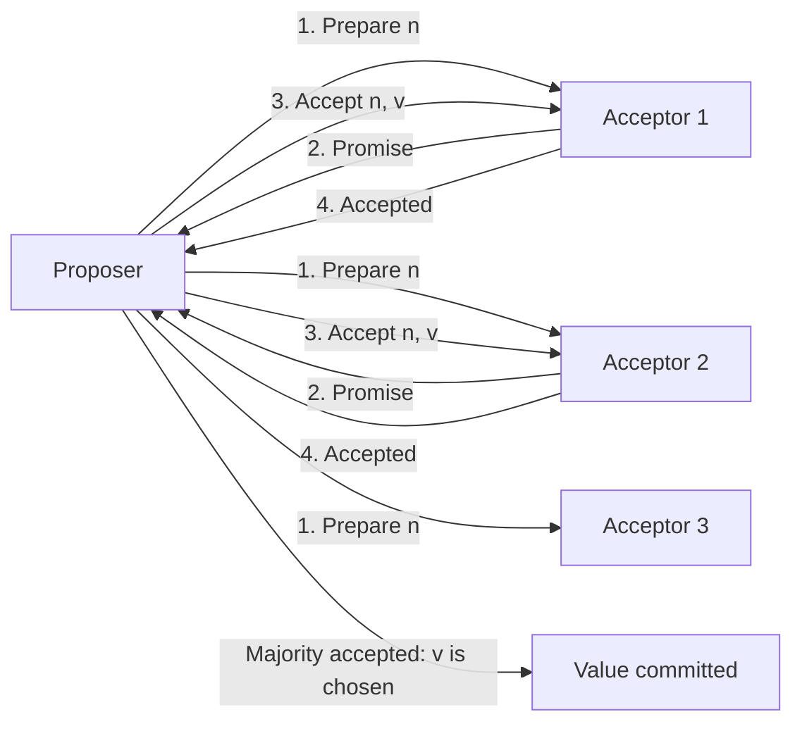
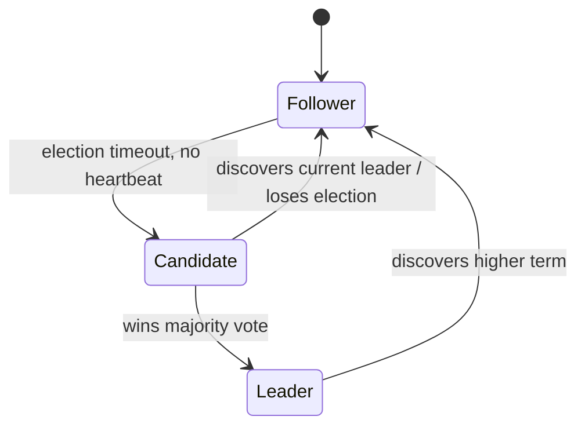
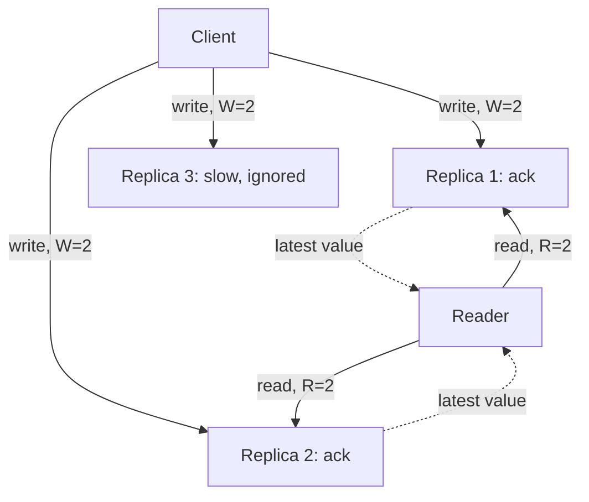
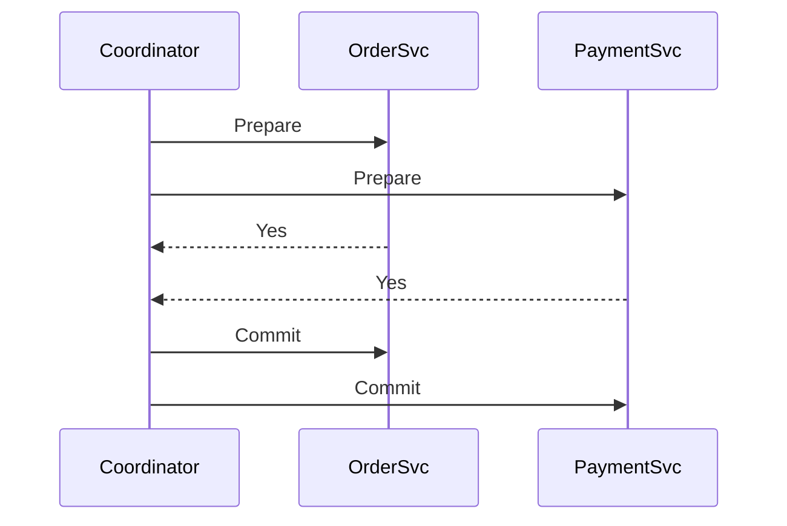
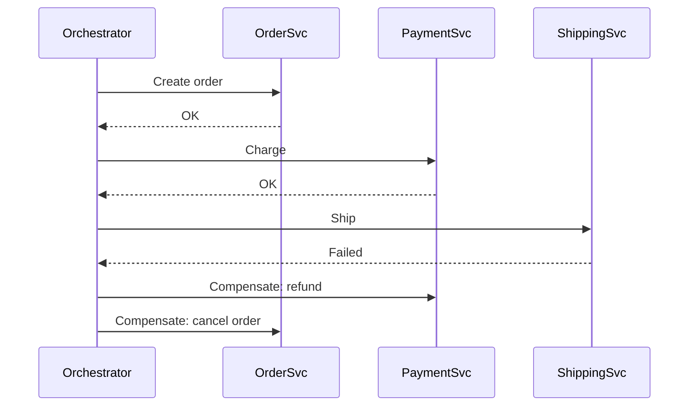
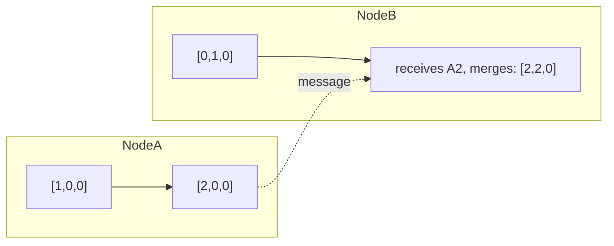
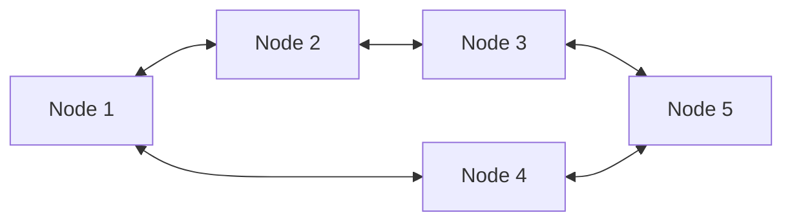
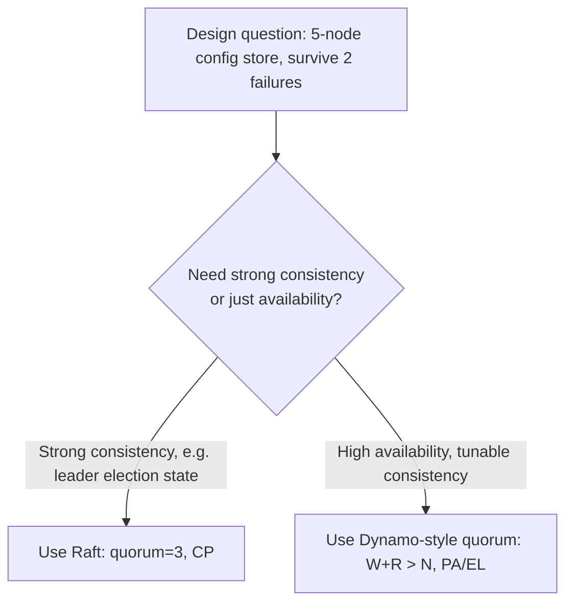

# Week 5: Distributed Systems Consensus and the Road to Attention

This week leaves single-machine reliability behind and tackles the problem that defines distributed systems: how do independent nodes agree on one truth when any of them can crash, lag, or get partitioned from the rest? On the ML side we leave tabular deep learning and start working with sequences — tokenization, embeddings, and the recurrent architectures that attention was eventually invented to replace. By Day 35 you will have sketched a leader election by hand and written a byte-pair-encoding tokenizer from scratch.

## Day 29: Consensus Fundamentals: Paxos and the Case for Raft

**System Design: Distributed consensus** (55 min)
A single database can just use a mutex. A distributed system cannot — there is no shared memory, messages can be delayed or lost, and nodes can crash. Consensus is the problem of getting a majority of nodes to agree on a single value (who is the leader, what the next log entry is) despite that. The FLP impossibility result says you cannot guarantee consensus in a fully asynchronous network with even one faulty node and no time bound on messages — in practice, real systems sidestep this with timeouts (a practical, if theoretically "unsafe," escape hatch).

Paxos solves it with two phases: **Prepare/Promise**, where a proposer asks a majority of acceptors if it may propose a value and learns about any value already in flight, and **Accept/Accepted**, where the proposer sends the value and it is committed once a majority accept it. Paxos is provably correct but famously hard to extend to a replicated log, which is exactly why Raft exists: it is designed from the ground up to be understandable, splitting the problem into leader election, log replication, and safety.

The key invariant in both: **you need a majority (quorum)**, not all nodes, which is why production clusters use odd sizes (3, 5, 7) — a 5-node cluster tolerates 2 failures while 3 nodes can still form a majority.



Trade-off: Paxos is more flexible (any acceptor can propose), Raft trades that flexibility for a single leader at a time, which is simpler to reason about but adds a leader-election step whenever the leader fails.

**ML / GenAI: Tokenization (Byte-Pair Encoding)** (55 min)
LLMs don't read words or characters — they read tokens, subword units learned from a corpus. Byte-Pair Encoding (BPE) starts with every character as its own token, then repeatedly merges the most frequent adjacent pair into a new token, until a target vocabulary size is reached. Frequent words like "the" collapse to one token; rare words like "unbelievable" stay split into pieces ("un", "believ", "able"). This gives a fixed, finite vocabulary that can still represent any string, including typos and new words — and token count is literally what you pay for and what counts against the context window.

```python
from collections import Counter

def get_pairs(word_freqs):
    pairs = Counter()
    for word, freq in word_freqs.items():
        symbols = word.split()
        for i in range(len(symbols) - 1):
            pairs[(symbols[i], symbols[i + 1])] += freq
    return pairs

def merge_pair(pair, word_freqs):
    merged = {}
    bigram = " ".join(pair)
    replacement = "".join(pair)
    for word, freq in word_freqs.items():
        merged[word.replace(bigram, replacement)] = freq
    return merged

corpus = ["low", "lower", "lowest", "newest", "widest"]
word_freqs = Counter(" ".join(list(w)) + " </w>" for w in corpus)

num_merges = 8
merges = []
for _ in range(num_merges):
    pairs = get_pairs(word_freqs)
    if not pairs:
        break
    best = max(pairs, key=pairs.get)
    merges.append(best)
    word_freqs = merge_pair(best, word_freqs)

print("Learned merges:", merges)
print("Final vocab fragments:", set(" ".join(word_freqs).split()))
```

Run it and watch "e", "s", "t" merge into "est" after a few iterations — that is exactly how real BPE tokenizers (GPT-2's, for example) build their vocabulary.

**Recall** (10 min)
- Why does Raft need a majority rather than all nodes to commit an entry?
- What does the FLP result actually say, and why don't real systems give up because of it?
- What problem does BPE solve that whole-word tokenization doesn't?
- Why would a sequential, auto-increment-style ID leak information if used directly as a token or key?

**Go deeper**
- [Lamport, "Paxos Made Simple" (1998 note version)](https://lamport.azurewebsites.net/pubs/paxos-simple.pdf)
- [Ongaro & Ousterhout, "In Search of an Understandable Consensus Algorithm (Extended Version)"](https://raft.github.io/raft.pdf)
- [Sennrich, Haddow, Birch, "Neural Machine Translation of Rare Words with Subword Units" (BPE for NLP)](https://arxiv.org/abs/1508.07909)
- [Distributed Systems — Advanced](../../../course/01-system-design/04-distributed-systems-advanced.md)

## Day 30: Raft in Detail: Leader Election and Log Replication

**System Design: Raft** (55 min)
Raft splits consensus into three understandable parts. **Leader election**: every node starts a follower; if a follower hears no heartbeat from a leader within a randomized timeout, it becomes a candidate, increments its term number, and requests votes; whoever wins a majority becomes leader for that term. The randomized timeout is the trick that avoids repeated split votes. **Log replication**: the leader appends client commands to its own log, then replicates them to followers; an entry is committed once a majority of nodes have durably stored it, at which point the leader applies it and acknowledges the client. **Safety**: a leader never overwrites a committed entry, and a candidate can only win a vote if its log is at least as up to date as the voter's — this prevents a stale, lagging node from becoming leader and silently discarding committed data.



Estimation angle: for a 5-node Raft cluster replicating writes, every write needs at least 3 round trips (leader to 2 other nodes) before it is committed — this is the latency tax you pay for strong consistency, and it is why systems that don't need linearizable writes (e.g., most caches) avoid consensus entirely.

Trade-off: Raft gives you a single source of truth and strong consistency for the replicated log, at the cost of write latency bound by the slowest node in the quorum and a brief unavailability window during leader election.

**ML / GenAI: Word embeddings and word2vec** (55 min)
Before a token can be processed mathematically it needs a dense vector representation — an embedding — where semantically similar words end up close together in vector space. word2vec learns these by training a shallow network to predict context from a word (Skip-gram) or a word from its context (CBOW), using nothing but raw text and a sliding window; the byproduct of that training — the learned weight matrix — becomes the embedding table. The famous property that emerges is that vector arithmetic captures relationships: `vector("king") - vector("man") + vector("woman") ≈ vector("queen")`.

```python
import numpy as np

np.random.seed(0)
vocab = ["king", "queen", "man", "woman", "apple", "orange"]
# Toy embeddings standing in for a trained word2vec table
emb = {
    "king":   np.array([0.9, 0.8, 0.1]),
    "queen":  np.array([0.9, 0.2, 0.1]),
    "man":    np.array([0.85, 0.75, 0.05]),
    "woman":  np.array([0.85, 0.15, 0.05]),
    "apple":  np.array([0.1, 0.1, 0.9]),
    "orange": np.array([0.15, 0.1, 0.85]),
}

def cosine_sim(a, b):
    return np.dot(a, b) / (np.linalg.norm(a) * np.linalg.norm(b))

analogy = emb["king"] - emb["man"] + emb["woman"]
scores = {w: cosine_sim(analogy, v) for w, v in emb.items()}
for word, score in sorted(scores.items(), key=lambda kv: -kv[1]):
    print(f"{word:8s} {score:.3f}")
```

With real trained vectors, "queen" would score highest — this toy version is rigged to show the shape of the idea; the point to internalize is that embeddings turn discrete tokens into a continuous space where distance and direction are meaningful.

**Recall** (10 min)
- Why does Raft require a randomized election timeout instead of a fixed one?
- What invariant stops a stale node from becoming leader and losing committed writes?
- What is the difference between Skip-gram and CBOW?
- Why can't you compare embeddings produced by two different embedding models?

**Go deeper**
- [Raft paper (same as Day 29)](https://raft.github.io/raft.pdf)
- [Mikolov et al., "Efficient Estimation of Word Representations in Vector Space" (word2vec)](https://arxiv.org/abs/1301.3781)
- [The Raft visualization](https://thesecretlivesofdata.com/raft/)
- [Distributed Systems — Advanced](../../../course/01-system-design/04-distributed-systems-advanced.md)

## Day 31: Quorums and Dynamo-Style Read/Write Consistency

**System Design: Quorums** (55 min)
A quorum system lets you tune consistency vs. availability per-operation instead of globally. In a system with N replicas, you define W (write quorum) and R (read quorum): a write succeeds once W replicas acknowledge it, a read succeeds once R replicas respond and you return the most recent value among them. If `W + R > N`, every read quorum overlaps every write quorum, guaranteeing a read sees the latest committed write — this is the core trick behind Dynamo-style databases (Cassandra, Riak, DynamoDB's older model).

Common configurations with N=3: `W=3, R=1` (fast reads, slow/less available writes), `W=1, R=3` (fast writes, slow reads), `W=2, R=2` (balanced, `W+R=4 > N=3`, strongly consistent). Choosing `W=1, R=1` is fastest but gives no consistency guarantee at all — a read can miss the latest write.



Estimation: with N=3 and W=2, a write survives one replica failure outright and is durable on a majority; tail latency is bounded by the second-fastest replica, not the slowest, since you only wait for W acks.

Trade-off: quorums let every client choose its own consistency/latency point on the same cluster, but version conflicts are still possible when two writes race with `W < N` — you need version vectors or last-write-wins to resolve them, foreshadowing vector clocks later this week.

**ML / GenAI: Recurrent Neural Networks (RNN)** (55 min)
An RNN processes a sequence one step at a time, carrying a hidden state vector forward as memory: `h_t = tanh(W_x · x_t + W_h · h_{t-1} + b)`. Unlike a feedforward network, the same weights are reused at every timestep, which is what lets an RNN handle variable-length sequences — but it also means information from early timesteps has to survive being repeatedly multiplied through the same weight matrix, which is exactly what causes the vanishing/exploding gradient problem over long sequences (tomorrow's topic).

```python
import numpy as np

np.random.seed(0)
input_size, hidden_size = 4, 3
Wx = np.random.randn(hidden_size, input_size) * 0.1
Wh = np.random.randn(hidden_size, hidden_size) * 0.1
b = np.zeros(hidden_size)

def rnn_step(x_t, h_prev):
    return np.tanh(Wx @ x_t + Wh @ h_prev + b)

sequence = [np.random.randn(input_size) for _ in range(6)]
h = np.zeros(hidden_size)
for t, x_t in enumerate(sequence):
    h = rnn_step(x_t, h)
    print(f"t={t} hidden state norm = {np.linalg.norm(h):.3f}")
```

Notice the hidden state norm tends to stabilize (because of the `tanh` squashing) rather than explode — but with poorly scaled weights or a longer sequence, it can still saturate near +-1, which is where gradients through `tanh` go flat and learning on long-range dependencies stalls.

**Recall** (10 min)
- With N=3, what `W`/`R` combinations guarantee read-your-writes consistency, and why?
- Why is `W=1, R=1` the fastest but weakest option?
- Write out the RNN hidden-state recurrence in your own words without looking.
- Why does reusing the same weight matrix at every timestep cause problems over long sequences?

**Go deeper**
- [DeCandia et al., "Dynamo: Amazon's Highly Available Key-value Store"](https://www.allthingsdistributed.com/files/amazon-dynamo-sosp2007.pdf)
- [Olah, "Understanding LSTM Networks" (RNN background section)](https://colah.github.io/posts/2015-08-Understanding-LSTMs/)
- [Distributed Systems — Advanced](../../../course/01-system-design/04-distributed-systems-advanced.md)

## Day 32: Two-Phase Commit vs the Saga Pattern

**System Design: 2PC and Sagas** (55 min)
Two-Phase Commit (2PC) gives atomic commit across multiple services via a coordinator: in the **Prepare** phase every participant locks its resources and votes yes/no; if all vote yes, the coordinator sends **Commit** to everyone, otherwise it sends **Abort**. The fatal flaw: if the coordinator crashes after Prepare but before telling anyone the outcome, every participant is stuck holding locks indefinitely, blocked and unavailable until the coordinator recovers.



The **Saga pattern** avoids the blocking problem by giving up atomicity for availability: break the transaction into a sequence of local transactions, each with a **compensating action** that undoes it if a later step fails. An order-payment-shipping saga commits Order, then Payment; if Shipping fails, you run compensations in reverse (refund Payment, cancel Order) instead of rolling back a distributed lock.



Trade-off: 2PC gives true ACID atomicity but couples services tightly and sacrifices availability during coordinator failure — rarely acceptable across independently-deployed microservices. Sagas keep every service autonomous and available, but you must design a compensating action for every step, and intermediate states (an order that exists with no payment yet) are visible to the rest of the system, which the application has to tolerate.

**ML / GenAI: LSTM gates and the vanishing gradient problem** (55 min)
A plain RNN's gradient, backpropagated through many timesteps, is a product of many Jacobians; if those Jacobians have eigenvalues consistently below 1 (common with `tanh` saturating), the gradient shrinks toward zero — the network effectively "forgets" how to learn from anything more than a few steps back. LSTM fixes this with a separate **cell state** that information can flow through almost unchanged, controlled by three gates: the **forget gate** decides what to drop from the cell state, the **input gate** decides what new information to add, and the **output gate** decides what to expose as the hidden state. Because the cell-state update is additive (not a repeated matrix multiply), gradients can flow through many steps without vanishing as aggressively.

```python
import numpy as np

def sigmoid(x):
    return 1 / (1 + np.exp(-x))

def lstm_step(x, h_prev, c_prev, params):
    z = np.concatenate([x, h_prev])
    f = sigmoid(params["Wf"] @ z)   # forget gate
    i = sigmoid(params["Wi"] @ z)   # input gate
    o = sigmoid(params["Wo"] @ z)   # output gate
    c_hat = np.tanh(params["Wc"] @ z)
    c = f * c_prev + i * c_hat      # additive cell-state update
    h = o * np.tanh(c)
    return h, c

np.random.seed(0)
in_sz, hid_sz = 3, 2
z_sz = in_sz + hid_sz
params = {k: np.random.randn(hid_sz, z_sz) * 0.1 for k in ["Wf", "Wi", "Wo", "Wc"]}

h, c = np.zeros(hid_sz), np.zeros(hid_sz)
for t in range(5):
    x_t = np.random.randn(in_sz)
    h, c = lstm_step(x_t, h, c, params)
    print(f"t={t} |c|={np.linalg.norm(c):.3f} |h|={np.linalg.norm(h):.3f}")
```

**Recall** (10 min)
- Why does a coordinator crash between Prepare and Commit leave 2PC participants stuck?
- What must every step of a saga have that a 2PC participant does not need?
- Which LSTM gate controls what gets removed from the cell state?
- Why is an additive cell-state update more resistant to vanishing gradients than repeated matrix multiplication?

**Go deeper**
- [Hochreiter & Schmidhuber, "Long Short-Term Memory" (1997)](https://www.bioinf.jku.at/publications/older/2604.pdf)
- [Richardson, "Pattern: Saga"](https://microservices.io/patterns/data/saga.html)
- [Distributed Systems — Advanced](../../../course/01-system-design/04-distributed-systems-advanced.md)

## Day 33: Logical Clocks: Lamport Timestamps and Vector Clocks

**System Design: Lamport timestamps and vector clocks** (55 min)
Physical clocks on different machines drift and can never be perfectly synchronized, so distributed systems that need to order events use **logical clocks** instead. A **Lamport timestamp** is a simple counter: each node increments its own counter before every event, and when sending a message it attaches its counter; the receiver sets its counter to `max(own, received) + 1`. This gives a total order consistent with causality (if A happened-before B, A's timestamp is less than B's) but it cannot tell you whether two events are causally related or just coincidentally concurrent — two unrelated events can get the same relative ordering by luck.

**Vector clocks** fix that by giving every node a full vector of counters, one slot per node, incremented on its own events and merged (element-wise max) on receipt. Comparing two vector clocks tells you one of three things: one happened strictly before the other, the other happened before it, or they are **concurrent** (neither vector dominates the other) — which is precisely the signal Dynamo-style databases use to detect a write conflict that needs application-level resolution.



Trade-off: Lamport clocks are cheap (one integer) but lossy about concurrency; vector clocks are precise about causality but grow linearly with the number of nodes, which is why large clusters often use pruned or hybrid approaches (e.g., dotted version vectors) instead of raw vector clocks.

**ML / GenAI: The attention idea — the seq2seq bottleneck and Bahdanau attention** (55 min)
Before transformers, machine translation used an encoder-decoder RNN: the encoder reads the whole source sentence and compresses it into one fixed-size vector, and the decoder generates the output sentence from that single vector. The problem is obvious once sentences get long: a single vector is a bottleneck that cannot hold every detail of a 40-word sentence. Bahdanau's 2014 attention mechanism fixed this by letting the decoder, at every output step, look back at *all* encoder hidden states and compute a weighted combination of them — the weights (an "alignment") are learned and change per output word, so the decoder can "attend" to the relevant source words when generating each target word (e.g., looking at "chat" when producing "cat").

```python
import numpy as np

def softmax(x):
    e = np.exp(x - np.max(x))
    return e / e.sum()

np.random.seed(0)
encoder_states = np.random.randn(5, 4)   # 5 source-word hidden states, dim 4
decoder_state = np.random.randn(4)       # current decoder hidden state

# Bahdanau-style alignment scores via a simple dot product (simplified)
scores = encoder_states @ decoder_state
weights = softmax(scores)
context = weights @ encoder_states       # weighted sum of encoder states

print("Alignment weights:", np.round(weights, 3))
print("Context vector:", np.round(context, 3))
```

This is the direct conceptual ancestor of self-attention: instead of one fixed context vector for the whole sentence, you get a *different* context vector, recomputed with different weights, for every output step — exactly the flexibility that Transformers (Week 6) generalize into every token attending to every other token.

**Recall** (10 min)
- Why can a Lamport timestamp not distinguish "caused" from "coincidentally ordered the same way"?
- What does it mean for two vector clocks to be "concurrent," and why does that matter for Dynamo-style writes?
- What was the fixed-size-vector bottleneck in classic seq2seq translation?
- What changes about the context vector at every decoder step once you add attention?

**Go deeper**
- [Lamport, "Time, Clocks, and the Ordering of Events in a Distributed System" (1978)](https://lamport.azurewebsites.net/pubs/time-clocks.pdf)
- [Bahdanau, Cho, Bengio, "Neural Machine Translation by Jointly Learning to Align and Translate"](https://arxiv.org/abs/1409.0473)
- [Distributed Systems — Advanced](../../../course/01-system-design/04-distributed-systems-advanced.md)
- [Transformers and Large Language Models](../../../course/04-ml-genai-agents/03-transformers-and-llms.md)

## Day 34: Gossip Protocols and CAP/PACELC Revisited

**System Design: Gossip protocols** (55 min)
Gossip (epidemic) protocols spread information through a cluster without any central coordinator: each node periodically picks a few random peers and exchanges state with them, and over a logarithmic number of rounds the information reaches every node with high probability — the same mathematical pattern as a rumor or a virus spreading through a population. Cassandra uses gossip for cluster membership and failure detection (nodes periodically exchange "who's alive and what version are they on"); this is what lets the cluster keep functioning correctly as nodes join, leave, or fail without anyone needing a single source of truth about membership.



Trade-off: gossip is extremely resilient (no single point of failure, scales well) but eventually consistent by nature — information takes a few rounds to propagate, so a node can briefly have a stale view of membership. That is an acceptable trade for membership/failure detection, where being eventually right is fine, but it's the wrong tool for anything needing strong consistency.

Revisiting **CAP**: during a network partition you must choose Consistency or Availability, not both. **PACELC** extends this with the case where there is *no* partition: even then you must choose between Latency and Consistency, because synchronous replication for consistency always costs latency. A system like DynamoDB is PA/EL (available and low-latency, both under partition and normally); a system like a Raft-backed config store is PC/EC (consistent, accepting latency and reduced availability, both under partition and normally). Naming a real system's PACELC classification, not just its CAP classification, is the detail that separates a junior answer from a senior one in interviews.

**ML / GenAI: Encoder-decoder architectures with attention** (55 min)
Combine yesterday's attention mechanism with a full encoder-decoder RNN and you get the architecture that dominated machine translation from 2015-2017, right before Transformers replaced the recurrence entirely. The encoder is a (bidirectional) RNN/LSTM that produces one hidden state per source token. The decoder is another RNN that, at every step, computes attention weights over *all* encoder hidden states, forms a context vector, concatenates it with its own hidden state, and uses that to predict the next output token (and feeds that token back in as input for the next step — "teacher forcing" during training, its own previous prediction at inference time).

```python
import numpy as np

def softmax(x):
    e = np.exp(x - np.max(x))
    return e / e.sum()

np.random.seed(1)
src_len, hid = 6, 4
encoder_states = np.random.randn(src_len, hid)
W_out = np.random.randn(5, hid * 2) * 0.1   # projects [context; decoder_h] -> vocab logits (toy vocab=5)

decoder_h = np.zeros(hid)
generated = []
for step in range(3):
    scores = encoder_states @ decoder_h
    weights = softmax(scores)
    context = weights @ encoder_states
    logits = W_out @ np.concatenate([context, decoder_h])
    next_token = int(np.argmax(logits))
    generated.append(next_token)
    decoder_h = 0.5 * decoder_h + 0.1 * context  # toy recurrence update

print("Generated token ids:", generated)
```

Notice attention is recomputed from scratch every decoding step against the *same* fixed encoder states — this per-step re-weighting is exactly what a fixed context vector couldn't do, and it is the direct precursor to the self-attention you'll build next week.

**Recall** (10 min)
- Why is gossip a good fit for cluster membership but a bad fit for a bank balance?
- Classify a system you've used (or a case study from Week 4) as AP, CP, or PA/EL/PC/EC under PACELC and justify it in one sentence.
- What does the decoder recompute at every single output step that the encoder does not?
- What problem does "teacher forcing" solve during training, and what changes at inference time?

**Go deeper**
- [Demers et al., "Epidemic Algorithms for Replicated Database Maintenance" (gossip origin paper)](https://dl.acm.org/doi/10.1145/41840.41841)
- [Abadi, "Consistency Tradeoffs in Modern Distributed Database System Design" (PACELC)](https://www.cs.umd.edu/~abadi/papers/abadi-pacelc.pdf)
- [Distributed Systems — Advanced](../../../course/01-system-design/04-distributed-systems-advanced.md)
- [Transformers and Large Language Models](../../../course/04-ml-genai-agents/03-transformers-and-llms.md)

## Day 35: Revision + Mini Project

**System Design: Revision — consensus and distributed transactions** (55 min)
Re-derive, from memory and without notes, the three parts of Raft (election, log replication, safety) and sketch the sequence diagram for a leader failing mid-write. Then re-derive 2PC's blocking failure mode and the saga alternative. Mini project: on paper or in a text file, design the replication strategy for a hypothetical 5-node configuration store that must survive 2 node failures without losing a committed write. Specify: quorum size, what happens during a network partition (which side, if any, stays writable), and whether you'd use Raft or a Dynamo-style quorum, with one sentence justifying the choice against the CAP trade-off it implies.



**ML / GenAI: Revision + mini project — a tokenizer and an attention toy** (55 min)
Re-derive the BPE merge loop from memory and explain, out loud, why token count affects both cost and context-window usage. Then re-derive the attention formula `softmax(scores) · V` and explain what each of the three ingredients (Query/alignment scores, Keys/encoder states, Values) stands for in the Bahdanau version you built on Day 33.

Mini project: extend the Day 29 BPE tokenizer to encode a *new* sentence (not in the training corpus) using the learned merges, and extend the Day 33/34 attention demo to print, for one decoding step, which source position got the highest attention weight — the kind of inspection real attention-visualization tools (e.g., BertViz) are built on.

```python
# Encode a new string using merges learned on Day 29 (merges: list[tuple[str, str]])
def encode(word, merges):
    symbols = list(word) + ["</w>"]
    for pair in merges:
        i = 0
        while i < len(symbols) - 1:
            if (symbols[i], symbols[i + 1]) == pair:
                symbols[i:i + 2] = ["".join(pair)]
            else:
                i += 1
    return symbols

# Example: merges = [("e", "s"), ("es", "t"), ...] from Day 29's run
# print(encode("lowest", merges))
```

**Recall** (10 min)
- Without looking: list, in order, the three parts of Raft and one failure mode each part guards against.
- Without looking: write the quorum inequality that guarantees read-your-writes consistency.
- Without looking: write the attention formula and name what Q, K, V stand for.
- What is the single biggest conceptual limitation of RNN/LSTM-based seq2seq that next week's Transformer removes entirely?

**Go deeper**
- [Raft paper (re-read the safety proof section)](https://raft.github.io/raft.pdf)
- [Tudor, "What happens when a leader fails mid-commit" (Raft visualization replay)](https://thesecretlivesofdata.com/raft/)
- [Distributed Systems — Advanced](../../../course/01-system-design/04-distributed-systems-advanced.md)
- [Transformers and Large Language Models](../../../course/04-ml-genai-agents/03-transformers-and-llms.md)
