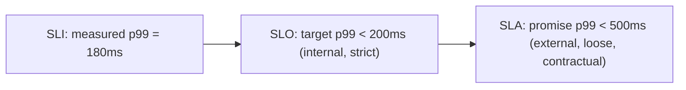
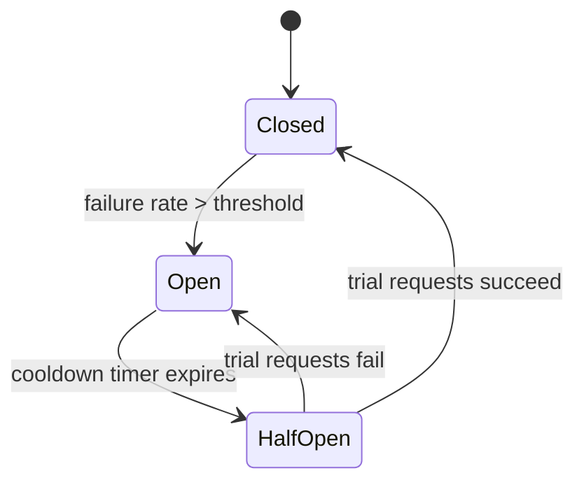
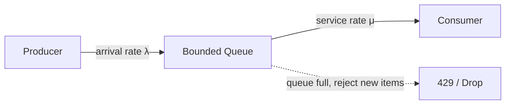
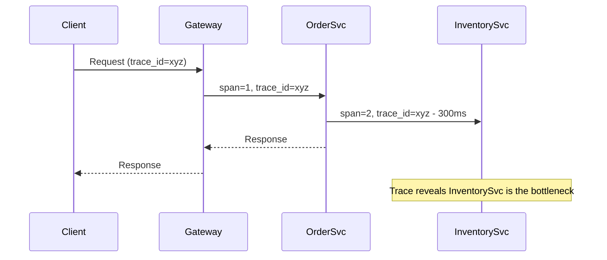
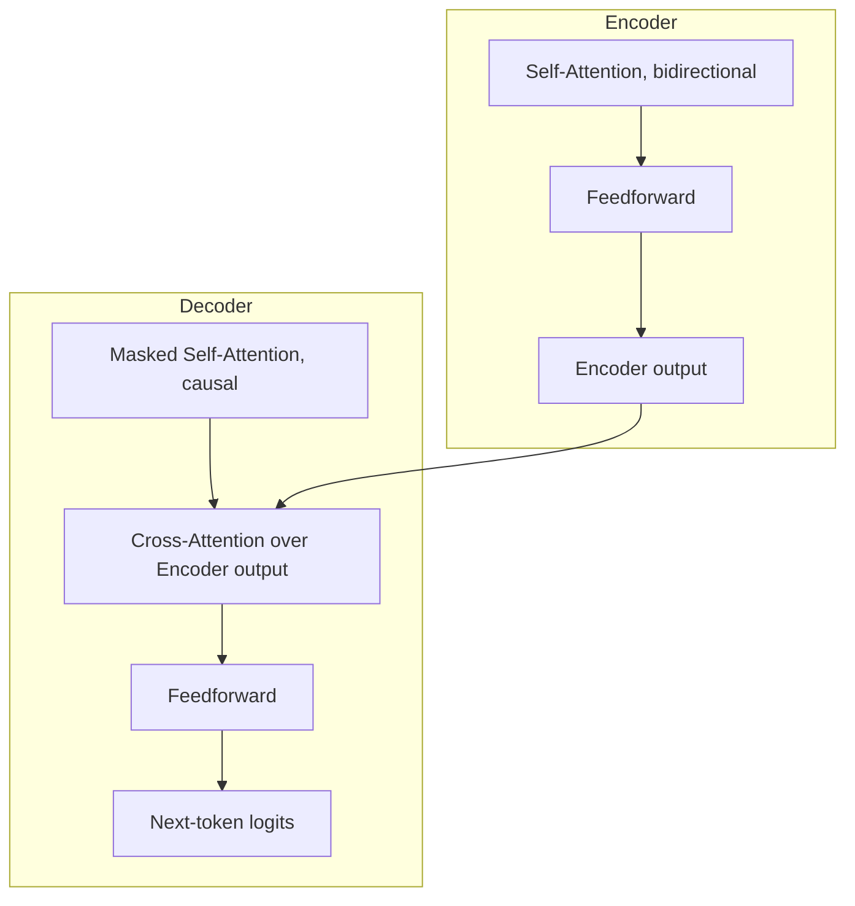
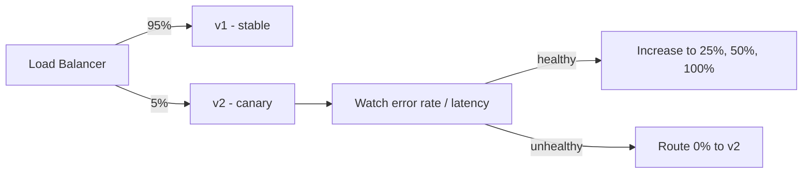
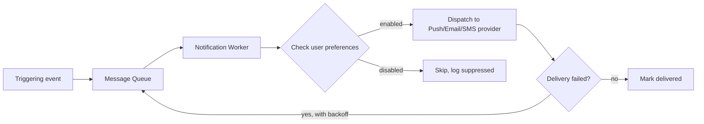
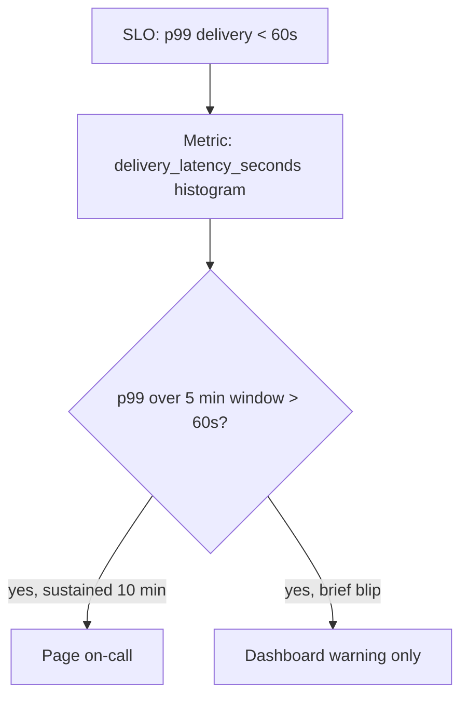

# Week 6: Reliability, Observability, and the Transformer

This week asks a question most system design practice skips: how do you know your system is actually healthy in production, and how do you keep it healthy when parts of it fail? On the ML side, this is the big one — you derive self-attention from first principles and build a tiny GPT-style transformer from scratch, token by token. By Day 42 you'll have a working mini language model and a notification-system design on paper.

## Day 36: SLI/SLO/Error Budgets

**System Design: SLI, SLO, SLA, and error budgets** (55 min)
Three terms that get used loosely outside interviews but signal real experience when used precisely. An **SLI** (Service Level Indicator) is a measured metric — "percentage of requests served under 200ms." An **SLO** (Service Level Objective) is your internal target for that SLI — "99.9% of requests under 200ms, rolling 30 days." An **SLA** (Service Level Agreement) is the external, often contractual, commitment to customers, deliberately looser than the SLO so you have buffer to detect and fix problems before breaching a paying customer's contract.



If your SLO is 99.9% availability, your **error budget** is the remaining 0.1% — about 43 minutes of downtime per month. This reframes reliability from "zero defects" (impossible, wasteful) into "we have this much budget to spend on risk," which gives you a concrete, numeric answer to "should we ship this risky feature now or wait" — if the budget is already spent this month, you freeze risky deploys.

Estimation exercise: for a service doing 50M requests/month with an SLO of 99.95% success rate, compute the error budget in absolute failed requests (50,000,000 × 0.0005 = 25,000 allowed failures/month) and in minutes of full downtime (0.05% of 30 days ≈ 21.6 minutes) — both numbers are useful depending on whether you're reasoning about discrete failures or continuous outages.

Trade-off: a stricter SLO buys customer trust and headroom but costs more engineering effort (more redundancy, more testing, slower feature velocity) for diminishing returns — going from 99.9% to 99.99% is often a much bigger investment than going from 99% to 99.9%.

**ML / GenAI: Self-attention — the math behind Q, K, V** (55 min)
Self-attention lets every token in a sequence look at every other token and decide how much to weigh it when building its own new representation — this is the mechanism that replaces the RNN's step-by-step recurrence entirely. For every token, three vectors are computed by multiplying its embedding by three learned weight matrices: **Query** (what am I looking for), **Key** (what do I offer), **Value** (what information I pass along if selected).

```
Attention(Q, K, V) = softmax( (Q · K^T) / sqrt(d_k) ) · V
```

`Q · K^T` gives a raw similarity score between every pair of tokens; dividing by `sqrt(d_k)` (the key dimension) keeps those scores from growing too large and making softmax too peaked, which would starve the gradient; softmax turns scores into weights summing to 1; multiplying by V blends every token's Value, weighted by relevance.

```python
import numpy as np

def softmax(x, axis=-1):
    e = np.exp(x - np.max(x, axis=axis, keepdims=True))
    return e / e.sum(axis=axis, keepdims=True)

np.random.seed(0)
seq_len, d_model, d_k = 4, 8, 8
X = np.random.randn(seq_len, d_model)
Wq, Wk, Wv = (np.random.randn(d_model, d_k) * 0.1 for _ in range(3))

Q, K, V = X @ Wq, X @ Wk, X @ Wv
scores = (Q @ K.T) / np.sqrt(d_k)
weights = softmax(scores)
output = weights @ V

print("Attention weight matrix (rows sum to 1):\n", np.round(weights, 2))
print("Output shape:", output.shape)
```

Every row of `weights` sums to 1 — that row is one token's attention distribution over the whole sequence, and unlike the RNN, every token computes this in one shot against every other token, in parallel, with no recurrence at all.

**Recall** (10 min)
- Compute, in your head, the error budget in minutes/month for an SLO of 99.9% availability.
- Why should an SLO always be stricter than the SLA?
- What are Q, K, and V in plain English, without the formula?
- Why does dividing by `sqrt(d_k)` matter before the softmax?

**Go deeper**
- [Vaswani et al., "Attention Is All You Need"](https://arxiv.org/abs/1706.03762)
- [Google SRE Book, "Service Level Objectives" chapter](https://sre.google/sre-book/service-level-objectives/)
- [Observability, Reliability, and Capacity Estimation](../../../course/01-system-design/06-observability-and-reliability.md)
- [Transformers and Large Language Models](../../../course/04-ml-genai-agents/03-transformers-and-llms.md)

## Day 37: Retries, Backoff, and Circuit Breakers

**System Design: Retries with backoff and circuit breakers** (55 min)
A naive retry on failure can turn a brief hiccup into an outage: if every client retries immediately, you get a thundering herd that keeps a recovering service down. **Exponential backoff with jitter** fixes this — wait `base * 2^attempt` plus a random jitter before each retry, so retries spread out instead of synchronizing. Always cap the number of retries and the max wait, and only retry **idempotent** operations (or ones protected by an idempotency key) — retrying a non-idempotent payment charge without one can double-charge a customer.

A **circuit breaker** sits in front of a dependency and tracks its failure rate; once failures cross a threshold, it "opens" and fails fast locally for a cooldown period instead of continuing to hammer (and wait on) a struggling dependency, which both protects the caller's own latency and gives the dependency room to recover. After the cooldown it moves to "half-open," lets a few trial requests through, and either closes (dependency recovered) or re-opens (still broken).



Estimation: if a downstream service is fully down and 10,000 req/s hit it with no circuit breaker and a naive 3-retry policy, you've just turned 10,000 req/s into up to 40,000 req/s against a service that is already failing — exactly the opposite of what you want during an incident.

Trade-off: circuit breakers add a failure mode of their own (false positives — a brief blip can trip the breaker and block otherwise-healthy traffic), so thresholds need tuning per dependency; too sensitive and you lose availability unnecessarily, too lax and you don't protect against real outages.

**ML / GenAI: Multi-head attention** (55 min)
Running self-attention once forces the model to use one fixed notion of "relevance" for everything. **Multi-head attention** runs several attention operations in parallel, each with its own learned Q/K/V projections — one head might learn to track subject-verb agreement, another coreference, another local word order — then concatenates all heads' outputs and projects them back to the model dimension with one more learned matrix.

```python
import numpy as np

def softmax(x, axis=-1):
    e = np.exp(x - np.max(x, axis=axis, keepdims=True))
    return e / e.sum(axis=axis, keepdims=True)

def multi_head_attention(X, num_heads, d_model):
    d_k = d_model // num_heads
    outputs = []
    for h in range(num_heads):
        Wq, Wk, Wv = (np.random.randn(d_model, d_k) * 0.1 for _ in range(3))
        Q, K, V = X @ Wq, X @ Wk, X @ Wv
        scores = (Q @ K.T) / np.sqrt(d_k)
        weights = softmax(scores)
        outputs.append(weights @ V)
    concat = np.concatenate(outputs, axis=-1)
    Wo = np.random.randn(d_model, d_model) * 0.1
    return concat @ Wo

np.random.seed(0)
X = np.random.randn(5, 8)       # seq_len=5, d_model=8
out = multi_head_attention(X, num_heads=4, d_model=8)
print("Multi-head output shape:", out.shape)
```

`d_model` must be divisible by `num_heads` because each head gets an equal slice (`d_k = d_model / num_heads`) — the total compute is roughly the same as one big attention operation, but split into independent subspaces that can specialize.

**Recall** (10 min)
- Why is jitter added on top of exponential backoff, not just exponential delay alone?
- What problem does a circuit breaker's "half-open" state solve that going straight from Open to Closed wouldn't?
- Why run 8 attention heads with `d_k = d_model/8` instead of 1 head with the full `d_model`?
- What is the output of multi-head attention before the final linear projection `Wo`?

**Go deeper**
- [Nygard, "Release It!" — circuit breaker pattern origin](https://pragprog.com/titles/mnee2/release-it-second-edition/)
- [AWS Builders' Library, "Timeouts, retries, and backoff with jitter"](https://aws.amazon.com/builders-library/timeouts-retries-and-backoff-with-jitter/)
- [Observability, Reliability, and Capacity Estimation](../../../course/01-system-design/06-observability-and-reliability.md)
- [Transformers and Large Language Models](../../../course/04-ml-genai-agents/03-transformers-and-llms.md)

## Day 38: Backpressure and Queueing Basics

**System Design: Backpressure and queueing** (55 min)
Backpressure is what happens when a consumer can't keep up with a producer, and the system needs an explicit strategy instead of silently buffering forever until it runs out of memory. Options, roughly from most to least aggressive: **drop** new requests once a queue is full (shed load, protect the system, sacrifice fairness), **block/slow the producer** (TCP-style flow control — tell upstream to slow down), **buffer with a bounded queue** and reject once full (bounded memory, explicit backpressure signal), or **load shed by priority** (drop low-priority requests first, keep critical ones flowing).

Little's Law gives you the queueing math: `L = λ * W` — the average number of items in a system (L) equals the arrival rate (λ) times the average time an item spends in the system (W). If your service processes requests at rate μ and requests arrive at rate λ, with λ approaching μ, queueing delay grows without bound (utilization approaching 100% is the classic trap — queueing theory says latency degrades sharply well before you hit "full" capacity, not right at it).



Estimation: a service with μ = 1000 req/s capacity running at λ = 950 req/s (95% utilization) will have dramatically higher queueing delay than one running at λ = 700 req/s (70% utilization) — this is why capacity planning targets headroom (often 60-70% peak utilization) rather than planning to run at the edge of capacity.

Trade-off: dropping requests under backpressure protects system health but sacrifices availability for those requests; the right choice depends on whether a dropped request can be safely retried by the caller (idempotent, retryable) or represents real lost work.

**ML / GenAI: Positional encodings** (55 min)
Self-attention has no inherent notion of order — the formula from Day 36 treats the sequence as a bag of tokens unless you inject position information explicitly. The original Transformer paper uses **sinusoidal positional encodings**: for position `pos` and dimension index `i`, `PE(pos, 2i) = sin(pos / 10000^(2i/d_model))` and `PE(pos, 2i+1) = cos(pos / 10000^(2i/d_model))`, added directly to the token embedding before the first attention layer. Different dimensions oscillate at different frequencies, which gives the model a way to learn relative position relationships (because `sin`/`cos` of a sum can be expressed in terms of `sin`/`cos` of the parts) without needing a learned position embedding per absolute position (which wouldn't generalize to sequence lengths longer than seen in training).

```python
import numpy as np

def positional_encoding(seq_len, d_model):
    pos = np.arange(seq_len)[:, None]
    i = np.arange(d_model)[None, :]
    angle_rates = 1 / np.power(10000, (2 * (i // 2)) / d_model)
    angles = pos * angle_rates
    pe = np.zeros((seq_len, d_model))
    pe[:, 0::2] = np.sin(angles[:, 0::2])
    pe[:, 1::2] = np.cos(angles[:, 1::2])
    return pe

pe = positional_encoding(seq_len=6, d_model=8)
print(np.round(pe, 2))
```

Modern models (Llama, GPT-NeoX-style) often use **RoPE (Rotary Position Embeddings)** instead, which rotates Q and K vectors by an angle proportional to position rather than adding a fixed vector — this tends to generalize better to longer contexts than the original sinusoidal scheme, which is part of why nearly every current open-weight LLM uses RoPE.

**Recall** (10 min)
- State Little's Law and apply it: if L=50 requests are in flight on average and W=0.5s average latency, what is λ?
- Why does running near 100% utilization cause latency to blow up disproportionately?
- Why can't self-attention alone distinguish "token A before token B" from "token B before token A"?
- What is one practical advantage of RoPE over fixed sinusoidal positional encoding?

**Go deeper**
- [Vaswani et al., "Attention Is All You Need" (positional encoding section)](https://arxiv.org/abs/1706.03762)
- [Su et al., "RoFormer: Enhanced Transformer with Rotary Position Embedding"](https://arxiv.org/abs/2104.09864)
- [Observability, Reliability, and Capacity Estimation](../../../course/01-system-design/06-observability-and-reliability.md)

## Day 39: The Three Pillars — Metrics, Logs, Traces

**System Design: Metrics, logs, and distributed tracing** (55 min)
**Metrics** are cheap, aggregated numeric time series (counters, gauges, histograms) — good for dashboards and alerting (Prometheus + Grafana), but you lose per-request detail: a spike in error rate doesn't tell you *which* request failed or why. **Logs** are detailed per-event records with context, essential for understanding exactly what happened to one specific request, but expensive at full volume and slow to search without a good index (Elasticsearch, Loki). **Distributed tracing** follows a single request across every service it touches, recording timing per hop (Jaeger, Zipkin, OpenTelemetry) — essential for answering "which of these 6 microservice hops added the extra 400ms."



The thread that ties all three together is a single **trace/correlation ID** propagated through every service call for a given request — without it, you cannot join a slow metric spike to the specific logs and trace spans that explain it.

Alerting principle: alert on **symptoms** (user-facing SLI breaches — elevated p99 latency, error rate) rather than **causes** (CPU at 80%) whenever possible; high CPU that doesn't move user-facing latency or error rate often doesn't deserve a page. Every page should demand action — alerts that fire with nothing to do train people to ignore pages, which is exactly how real incidents get missed at 3am.

Trade-off: full-fidelity logging and 100% trace sampling give maximum debuggability but cost real money and storage at scale; most production systems sample traces (e.g., 1-10% of requests, or 100% of error requests) to balance cost against the ability to diagnose rare issues.

**ML / GenAI: Transformer encoder-decoder architecture** (55 min)
A full Transformer block stacks: multi-head self-attention, a residual connection + layer normalization, a position-wise feedforward network (two linear layers with a nonlinearity between them), another residual + layer norm. The **encoder** stack (used in BERT-style models) applies this to the whole input bidirectionally — every token can see every other token, including ones after it. The **decoder** stack (used for generation) adds a causal mask to self-attention so a token can only attend to itself and earlier tokens (you cannot let the model "cheat" by looking at the answer it's about to generate), plus a second cross-attention layer where decoder queries attend over encoder outputs — the direct generalization of the Bahdanau attention from Week 5.



GPT-style models drop the encoder entirely and use only the decoder stack (causal self-attention + feedforward, repeated N times) — which is exactly what you'll build over the next two days.

**Recall** (10 min)
- Which of metrics/logs/traces would you reach for first to find *which* microservice hop added 400ms?
- Why alert on symptoms rather than causes?
- What does the causal mask in a decoder prevent, mechanically?
- Why does a decoder-only architecture (like GPT) not need cross-attention?

**Go deeper**
- [Vaswani et al., "Attention Is All You Need" (full architecture figure)](https://arxiv.org/abs/1706.03762)
- [OpenTelemetry docs, "Traces"](https://opentelemetry.io/docs/concepts/signals/traces/)
- [Observability, Reliability, and Capacity Estimation](../../../course/01-system-design/06-observability-and-reliability.md)
- [Transformers and Large Language Models](../../../course/04-ml-genai-agents/03-transformers-and-llms.md)

## Day 40: Building a Mini GPT, Part 1 — Tokenizer and Attention Block

**System Design: Deployment strategies** (55 min)
Shipping a new version safely is its own design problem. **Blue-green deployment** runs two full environments (blue = current, green = new); you switch traffic over (often instantly, via load balancer or DNS) once green is verified, and can switch back instantly if something is wrong — fast rollback, but you pay for two full environments simultaneously. **Rolling deployment** replaces instances gradually, a few at a time, reusing the same fleet — cheaper, no double infrastructure, but rollback is slower (you have to roll the replacement back out) and you briefly run a mix of old and new versions, which requires both versions to be compatible with the same data/API contracts. **Canary deployment** routes a small percentage of real traffic (e.g., 5%) to the new version, watches error rate/latency, and ramps up gradually — the best tool for catching a bad deploy with minimal blast radius, at the cost of needing good traffic-splitting infrastructure and metrics to watch.



Trade-off: canary gives the smallest blast radius for a bad deploy but is the slowest to fully roll out and needs real-time metrics/automation to be safe; blue-green gives instant rollback but doubles infrastructure cost during the transition; rolling is the cheapest default but mixes versions longest and rolls back slowest.

**ML / GenAI: Building a mini GPT, part 1 — tokenizer and attention block** (55 min)
Today you assemble the two pieces from this week into one causal self-attention block over a tiny character-level vocabulary — the first building block of a nanoGPT-style model.

```python
import numpy as np

def softmax(x, axis=-1):
    e = np.exp(x - np.max(x, axis=axis, keepdims=True))
    return e / e.sum(axis=axis, keepdims=True)

text = "hello world"
chars = sorted(set(text))
stoi = {c: i for i, c in enumerate(chars)}
vocab_size = len(chars)

def encode(s):
    return [stoi[c] for c in s]

np.random.seed(0)
d_model = 8
embed = np.random.randn(vocab_size, d_model) * 0.1

def causal_self_attention(X, Wq, Wk, Wv):
    seq_len = X.shape[0]
    Q, K, V = X @ Wq, X @ Wk, X @ Wv
    scores = (Q @ K.T) / np.sqrt(d_model)
    mask = np.triu(np.ones((seq_len, seq_len)), k=1).astype(bool)
    scores[mask] = -np.inf           # causal mask: no looking ahead
    weights = softmax(scores)
    return weights @ V

ids = encode("hello")
X = embed[ids]
Wq, Wk, Wv = (np.random.randn(d_model, d_model) * 0.1 for _ in range(3))
out = causal_self_attention(X, Wq, Wk, Wv)
print("Causal attention output shape:", out.shape)
```

Compare this to Day 39's encoder self-attention: the only structural difference is the `mask` line, which sets future positions' scores to `-inf` before softmax so they get zero weight — that single mask is the entire mechanical difference between "bidirectional encoder" and "causal decoder."

**Recall** (10 min)
- When would you choose canary over blue-green, and why?
- What is the main cost of blue-green that rolling deployment avoids?
- What single change turns Day 36's bidirectional self-attention into causal self-attention?
- Why must future positions get `-inf` (not just 0) before the softmax in a causal mask?

**Go deeper**
- [Karpathy, "Let's build GPT: from scratch, in code, spelled out" (video + nanoGPT repo)](https://github.com/karpathy/nanoGPT)
- [Google Cloud, "Canary deployments"](https://cloud.google.com/architecture/application-deployment-and-testing-strategies)
- [Observability, Reliability, and Capacity Estimation](../../../course/01-system-design/06-observability-and-reliability.md)
- [Transformers and Large Language Models](../../../course/04-ml-genai-agents/03-transformers-and-llms.md)

## Day 41: Case Studies and Mini GPT, Part 2

**System Design: Rate limiter and notification system case studies** (55 min)
**Rate limiter**: functional requirement is limiting requests per client to N per window and returning remaining quota; non-functional is adding well under 1ms per check even at very high QPS. Use the sliding-window-counter algorithm in Redis via an atomic Lua script (avoids the race between a separate GET and SET), or for extreme throughput, an approximate token bucket local to each gateway node that periodically syncs to a central Redis — trading perfect global accuracy for no network round trip per request, the same AP-leaning trade-off as CAP.

**Notification system**: functional requirement is sending push/email/SMS notifications triggered by events, with per-user preferences and delivery tracking; non-functional is high throughput, at-least-once delivery, and not spamming users during an incident replay. Data model: `notifications(id, user_id, channel, template_id, status, created_at, sent_at)`, `user_preferences(user_id, channel, enabled)`.



Estimation: at 10M notifications/day (≈ 116/sec average, but bursty around events — plan for 10x peak, ≈ 1,160/sec), a single queue consumer group with a handful of workers easily keeps up; the real design pressure is idempotency (don't double-send on retry) and provider rate limits (a push provider API may cap you well below your internal throughput, forcing you to queue and backoff on the provider side too).

Trade-off: at-least-once delivery (simple, uses a queue + retry) can double-send on a crash between "sent" and "marked sent" — acceptable for most notifications, but you need a dedup key (notification_id) if exactly-once semantics matter for a specific channel.

**ML / GenAI: Building a mini GPT, part 2 — training loop and generation** (55 min)
Extend yesterday's causal attention block into a tiny trainable language model: embedding lookup, one causal self-attention block, a linear output head to vocabulary logits, trained with cross-entropy loss to predict the next character.

```python
import numpy as np

text = "hello world hello world hello"
chars = sorted(set(text))
stoi = {c: i for i, c in enumerate(chars)}
itos = {i: c for c, i in stoi.items()}
vocab_size = len(chars)
data = [stoi[c] for c in text]

d_model = 16
np.random.seed(0)
embed = np.random.randn(vocab_size, d_model) * 0.1
Wq, Wk, Wv = (np.random.randn(d_model, d_model) * 0.1 for _ in range(3))
Whead = np.random.randn(d_model, vocab_size) * 0.1

def softmax(x, axis=-1):
    e = np.exp(x - np.max(x, axis=axis, keepdims=True))
    return e / e.sum(axis=axis, keepdims=True)

def forward(ids):
    X = embed[ids]
    seq_len = len(ids)
    Q, K, V = X @ Wq, X @ Wk, X @ Wv
    scores = (Q @ K.T) / np.sqrt(d_model)
    mask = np.triu(np.ones((seq_len, seq_len)), k=1).astype(bool)
    scores[mask] = -np.inf
    weights = softmax(scores)
    attn_out = weights @ V
    logits = attn_out @ Whead
    return logits

def generate(seed, length):
    ids = [stoi[c] for c in seed]
    for _ in range(length):
        logits = forward(ids)
        probs = softmax(logits[-1])
        next_id = int(np.argmax(probs))   # greedy decoding
        ids.append(next_id)
    return "".join(itos[i] for i in ids)

# With real (untrained) random weights this generates nonsense -
# it's the training loop (gradient descent on cross-entropy loss, Day 4 optimizers)
# that would make this converge toward predicting "hello world" repeating.
print(generate("he", 5))
```

The forward pass is complete and real; what's missing (left as a follow-up exercise if you want to go further than this plan requires) is backpropagating cross-entropy loss through this forward pass and updating `Wq, Wk, Wv, Whead, embed` with Adam — exactly the training loop from Week 4's PyTorch basics, just applied to this architecture.

**Recall** (10 min)
- Why does a notification system need an idempotency/dedup key if it uses at-least-once delivery?
- What is the AP-leaning trade-off made by a local, approximate token bucket in a rate limiter?
- What are the four weight matrices this mini GPT needs to learn?
- Why does greedy decoding (`argmax`) on an untrained model produce nonsense regardless of architecture?

**Go deeper**
- [Karpathy, nanoGPT repository and video walkthrough](https://github.com/karpathy/nanoGPT)
- [Case Studies](../../../course/01-system-design/07-case-studies.md)
- [Observability, Reliability, and Capacity Estimation](../../../course/01-system-design/06-observability-and-reliability.md)
- [Transformers and Large Language Models](../../../course/04-ml-genai-agents/03-transformers-and-llms.md)

## Day 42: Revision + Mini Project

**System Design: Revision — reliability and finish the notification system design** (55 min)
Without notes, re-derive: the SLI/SLO/SLA stack and the error budget formula, exponential backoff with jitter and why jitter matters, the circuit breaker state machine, and when you'd pick canary vs. blue-green vs. rolling. Mini project: take the Day 41 notification system design and extend it with an SLO (e.g., "99% of notifications delivered within 60 seconds of the triggering event") and design the specific alert you'd configure to catch an SLO breach — name the metric, the threshold, and whether it should page immediately or just show on a dashboard.



**ML / GenAI: Revision + mini project — finish and extend the mini GPT** (55 min)
Without notes, re-derive the self-attention formula, explain multi-head attention's purpose in one sentence, explain what positional encoding adds that attention alone lacks, and explain the single-line difference between encoder and decoder self-attention. Mini project: extend Day 41's `generate` function to support **temperature-scaled sampling** instead of greedy argmax (divide logits by a temperature before softmax, then sample from the resulting distribution instead of taking the max) — this is both a genuinely useful mini-GPT improvement and a preview of Week 7's decoding strategies.

```python
import numpy as np

def softmax(x):
    e = np.exp(x - np.max(x))
    return e / e.sum()

def sample_with_temperature(logits, temperature=1.0, rng=None):
    rng = rng or np.random.default_rng()
    scaled = logits / max(temperature, 1e-8)
    probs = softmax(scaled)
    return int(rng.choice(len(probs), p=probs))

# Low temperature (e.g. 0.3) -> close to greedy, more repetitive/safe.
# High temperature (e.g. 1.5) -> flatter distribution, more random/creative.
logits = np.array([2.0, 1.0, 0.1, 0.1])
rng = np.random.default_rng(0)
print([sample_with_temperature(logits, 0.3, rng) for _ in range(10)])
print([sample_with_temperature(logits, 1.5, rng) for _ in range(10)])
```

**Recall** (10 min)
- Without looking: write the error-budget-in-minutes formula and apply it to a 99.95% SLO.
- Without looking: name the four circuit breaker states (there are three, trick question — Closed, Open, Half-Open) and the transition that takes you out of each.
- Without looking: write the self-attention formula and say what `sqrt(d_k)` is for.
- Why does lowering the temperature in sampling make output more repetitive rather than more "correct"?

**Go deeper**
- [Google SRE Book](https://sre.google/sre-book/table-of-contents/)
- [Vaswani et al., "Attention Is All You Need"](https://arxiv.org/abs/1706.03762)
- [Observability, Reliability, and Capacity Estimation](../../../course/01-system-design/06-observability-and-reliability.md)
- [Case Studies](../../../course/01-system-design/07-case-studies.md)
- [Transformers and Large Language Models](../../../course/04-ml-genai-agents/03-transformers-and-llms.md)
