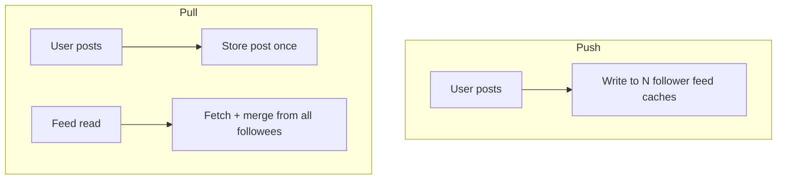
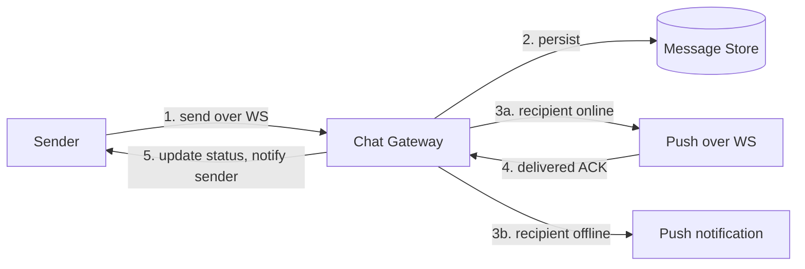
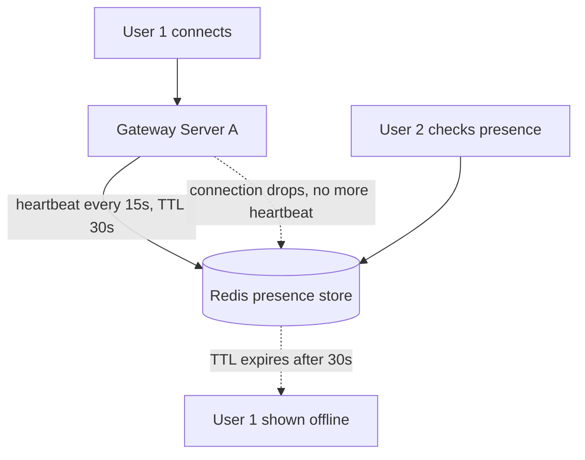
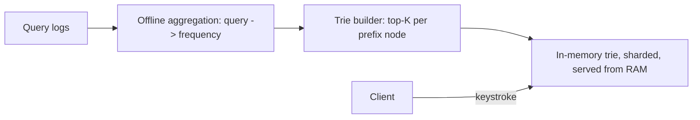
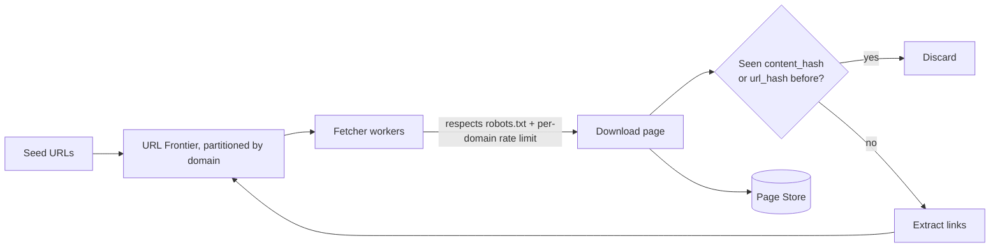
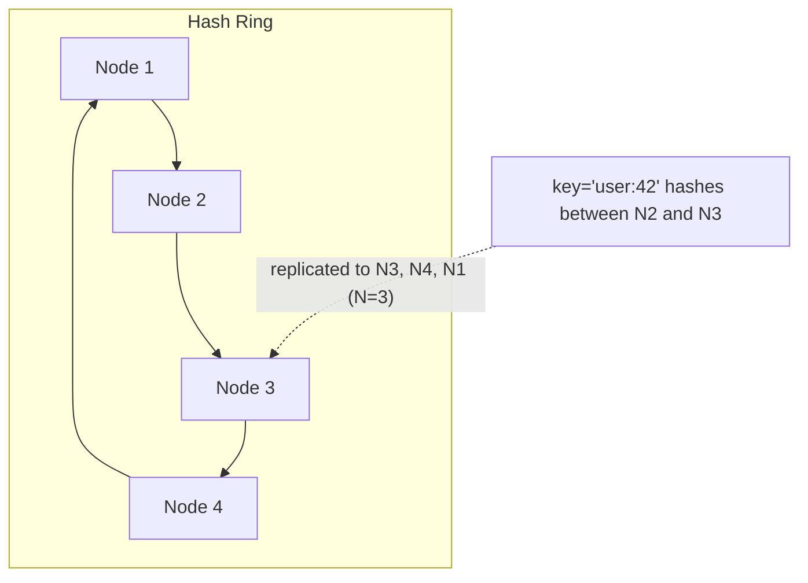
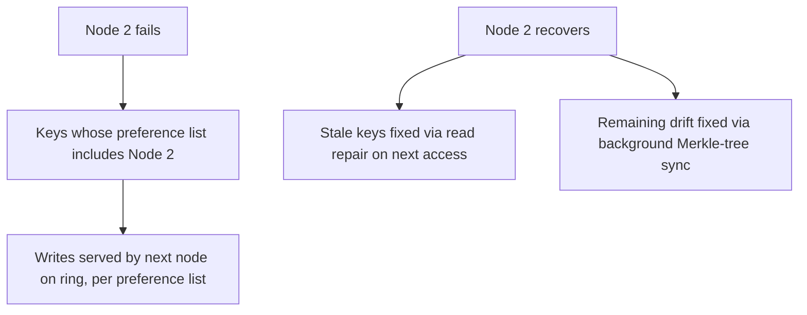

# Week 7: Classic Case Studies and the LLM Stack

This week is where System Design practice shifts from building blocks to full, interview-style designs — news feed, chat, autocomplete, a crawler, and a distributed key-value store, each worked through requirements, API, data model, and trade-offs. On the ML side you move from "how a transformer works" to "how an LLM is actually built and run": pretraining at scale, how it decides what word to say next, and the engineering tricks (KV cache, MoE, long context) that make serving one fast and affordable.

## Day 43: News Feed Design: Fanout and Ranking

**System Design: News feed** (55 min)
Requirements: functional — users follow other users/pages and see a reverse-chronological or ranked feed of their posts; non-functional — low read latency (feed loads fast), eventual consistency is acceptable (a new post appearing a few seconds late is fine), and the system must handle users with very different follower counts (a regular user with 200 followers vs. a celebrity with 50M).

API:
```
POST /posts {user_id, content} -> {post_id}
GET  /feed?user_id={id}&cursor={cursor} -> {posts[], next_cursor}
```

Data model: `posts(post_id, author_id, content, created_at)`, `follows(follower_id, followee_id)`, `feed_cache(user_id, post_id, score, inserted_at)` as a precomputed per-user feed.

Two fanout strategies. **Fanout-on-write (push)**: when a user posts, immediately write the post into every follower's precomputed feed — reads are then just one lookup, extremely fast, but a celebrity with 50M followers triggers 50M writes per post (the "celebrity problem"). **Fanout-on-read (pull)**: store only the post itself; at read time, fetch recent posts from everyone the user follows and merge them — no celebrity write amplification, but reads become expensive (fan-in across hundreds of follows) and latency-sensitive.



The standard production answer is **hybrid**: fanout-on-write for normal users (fast reads, bounded write cost), fanout-on-read (or a separate "celebrity merge" step at read time) for accounts above a follower-count threshold — Twitter's well-documented real design.

Estimation: 200M daily active users, average 100 posts read per feed load, 500 followers average -> fanout-on-write for a typical post costs 500 writes; a celebrity post (50M followers) would cost 50M writes, which at even modest per-write latency would take unacceptably long — exactly why the threshold-based hybrid exists.

Trade-off: push optimizes reads at the cost of write amplification and wasted storage (most feed-cache entries are never scrolled to); pull optimizes writes at the cost of read latency and fan-in complexity — ranking (relevance over strict recency) layers on top of either approach and is a separate scoring/ML problem.

**ML / GenAI: LLM pretraining and scaling laws** (55 min)
Pretraining is the (enormously expensive) first stage: train a decoder-only transformer on next-token prediction over a huge, broad text corpus (web text, books, code), with no task-specific labels — the "label" at every position is just the actual next token in the real text. This single objective, at sufficient scale, produces a model that has implicitly learned grammar, facts, reasoning patterns, and code, simply because predicting the next token well requires all of that.

**Scaling laws** (Kaplan et al., later refined by Chinchilla/Hoffmann et al.) found that model loss follows a predictable power-law relationship with three things: model size (parameters N), dataset size (tokens D), and compute (C ≈ 6ND in FLOPs for training). Critically, the Chinchilla paper showed many earlier large models were **undertrained relative to their size** — for a fixed compute budget, there is an optimal balance between N and D, and several contemporary huge models would have performed better as smaller models trained on proportionally more tokens.

```python
# Toy illustration of scaling-law-style loss decay (not the real fitted constants)
import numpy as np

def toy_loss(num_params, num_tokens):
    # L ~ A / N^alpha + B / D^beta + L_irreducible  (Chinchilla-style form, toy constants)
    A, B, alpha, beta, L_inf = 400.0, 400.0, 0.34, 0.28, 1.5
    return A / (num_params ** alpha) + B / (num_tokens ** beta) + L_inf

for n_params in [1e8, 1e9, 1e10, 1e11]:
    for n_tokens in [1e10, 1e11, 1e12]:
        print(f"N={n_params:.0e} D={n_tokens:.0e} -> loss~{toy_loss(n_params, n_tokens):.3f}")
```

Practical takeaway for interviews: compute budget, model size, and data size are three knobs that trade off against each other in a quantified, predictable way — "just make it bigger" is not automatically the best use of a fixed compute budget.

**Recall** (10 min)
- Why does fanout-on-write break down for celebrity accounts specifically?
- What is the hybrid fix, and what threshold decides which strategy applies to a given account?
- What is the actual training label at each position during LLM pretraining?
- What did the Chinchilla paper find was wrong about several earlier large models?

**Go deeper**
- [Kaplan et al., "Scaling Laws for Neural Language Models"](https://arxiv.org/abs/2001.08361)
- [Hoffmann et al., "Training Compute-Optimal Large Language Models" (Chinchilla)](https://arxiv.org/abs/2203.15556)
- [Case Studies](../../../course/01-system-design/07-case-studies.md)
- [Transformers and Large Language Models](../../../course/04-ml-genai-agents/03-transformers-and-llms.md)

## Day 44: Chat System (WhatsApp), Part 1 — Messaging and Delivery Guarantees

**System Design: 1:1 chat and delivery guarantees** (55 min)
Requirements: functional — send/receive messages in near real time, show delivery status (sent, delivered, read), support offline recipients (message delivered when they come back online); non-functional — low latency for online users, durability (a message must never be silently lost), and the system should work at WhatsApp's scale (billions of messages/day).

API (over a persistent connection, typically WebSocket, with HTTP fallback for sending):
```
WS send: {to_user_id, client_msg_id, content} -> server assigns message_id, timestamp
WS receive: {message_id, from_user_id, content, timestamp}
ACK: {message_id, status: delivered|read}
```

Data model: `messages(message_id, conversation_id, sender_id, content, created_at, status)`, `conversations(conversation_id, participant_ids[])`, `client_msg_id` on the message for client-side dedup (the client generates it before sending, so a retried send after a dropped ACK doesn't create a duplicate message).



Each user holds a persistent connection to one of many **chat gateway servers**; a connection-routing layer (often backed by a service like the one from Day 30's leader-election-adjacent membership problem) tracks which gateway server holds which user's connection, so a message for an offline-to-that-gateway user gets routed correctly, or falls back to a push notification if the user is fully offline.

Estimation: 2B users, 100B messages/day -> roughly 1.16M messages/sec average, bursty around peak hours (plan 3-5x average for peak, ~4-6M/sec) — this single number drives nearly every other decision: message store partitioning (shard by conversation_id, not globally), gateway server count, and connection-routing lookup throughput.

Trade-off: at-least-once delivery (retry until ACKed) is simpler and the safe default for "never lose a message," but requires the `client_msg_id` dedup key to avoid duplicate messages on the receiving end when a retry and the original both eventually land.

**ML / GenAI: Decoding strategies — greedy, top-k, top-p, temperature** (55 min)
An LLM outputs a probability distribution over the vocabulary at each step; how you turn that distribution into an actual next token is the decoding strategy, and it matters as much as the model itself for output quality. **Greedy** always picks the single highest-probability token — deterministic, but prone to repetitive, bland output, and one locally-optimal-but-globally-poor choice can lock in a bad continuation. **Temperature** scales the logits before softmax (`logits / T`): T<1 sharpens the distribution (more confident, more repetitive), T>1 flattens it (more diverse, more risk of incoherence). **Top-k** restricts sampling to the k highest-probability tokens, discarding the long unreliable tail. **Top-p (nucleus sampling)** instead keeps the smallest set of tokens whose cumulative probability exceeds p (e.g., 0.9), which adapts the cutoff per step — a very confident distribution keeps few tokens, a very uncertain one keeps more.

```python
import numpy as np

def softmax(x):
    e = np.exp(x - np.max(x))
    return e / e.sum()

def top_p_sample(logits, p=0.9, temperature=1.0, rng=None):
    rng = rng or np.random.default_rng()
    probs = softmax(logits / temperature)
    order = np.argsort(-probs)
    sorted_probs = probs[order]
    cumulative = np.cumsum(sorted_probs)
    cutoff = np.searchsorted(cumulative, p) + 1
    nucleus = order[:cutoff]
    nucleus_probs = probs[nucleus] / probs[nucleus].sum()
    return int(rng.choice(nucleus, p=nucleus_probs))

logits = np.array([3.0, 2.5, 1.0, 0.5, 0.1, -1.0])
rng = np.random.default_rng(0)
samples = [top_p_sample(logits, p=0.9, rng=rng) for _ in range(10)]
print(samples)
```

Production chat/completion APIs (OpenAI, Anthropic, etc.) typically expose `temperature` and `top_p` as request parameters precisely so callers can trade determinism for creativity per use case — low temperature for code generation or extraction, higher for creative writing.

**Recall** (10 min)
- Why does `client_msg_id` need to be generated by the client, not the server?
- What single number (messages/sec) should you compute first in a chat system design, and why does it drive sharding?
- Why does greedy decoding tend to produce repetitive output?
- How does top-p's cutoff differ from top-k's, mechanically?

**Go deeper**
- [Holtzman et al., "The Curious Case of Neural Text Degeneration" (nucleus sampling / top-p)](https://arxiv.org/abs/1904.09751)
- [WhatsApp Engineering, "The WhatsApp architecture Facebook bought for $19 billion" (historical overview)](https://highscalability.com/the-whatsapp-architecture-facebook-bought-for-19-billion/)
- [Case Studies](../../../course/01-system-design/07-case-studies.md)
- [Transformers and Large Language Models](../../../course/04-ml-genai-agents/03-transformers-and-llms.md)

## Day 45: Chat System, Part 2 — Group Chat, Presence, and Media

**System Design: Group chat, presence, and media** (55 min)
Group chat changes the fanout math from Day 44's 1:1 case: a message to a 200-person group must be delivered to up to 200 recipients, which is a miniature version of Day 43's fanout problem. The standard approach is fanout-on-write at the gateway layer — the sender's message is persisted once, then the gateway layer looks up which of the group's members are currently connected (and to which gateway server) and pushes to each, falling back to push notifications for offline members; this bounds fanout cost to group size (typically capped, e.g., 256 members) rather than the unbounded celebrity-follower case.

**Presence** ("online," "last seen") is its own small distributed problem: each gateway server tracks locally-connected users and periodically publishes a heartbeat to a shared presence store (often Redis with a short TTL per user — if the heartbeat stops, the TTL expires and the user flips to offline automatically, no explicit disconnect handling required). This is a deliberately **eventually consistent, best-effort** signal — nobody expects presence to be linearizable, and a few seconds of staleness is an acceptable trade-off for not needing a strongly consistent store for something this cheap.



**Media** (images, video, voice notes) is never sent inline through the chat gateway — the client uploads the file directly to object storage (via a pre-signed URL, avoiding routing large binary payloads through the stateful chat-gateway tier) and the chat message itself just carries a reference (media_id/URL); this keeps the latency-sensitive message path small and fast while media transfer happens on a separate, horizontally-scalable path.

Trade-off: capping group size bounds fanout cost predictably, but any cap eventually frustrates some use case (large broadcast channels) — at genuinely unbounded scale, large broadcast-style groups need a fundamentally different model (closer to the news feed's fanout-on-read) rather than true per-member push.

**ML / GenAI: The KV cache** (55 min)
Generating text autoregressively means computing attention at every step over an ever-growing sequence. Naively, that means recomputing Key and Value projections for *every* previous token at *every* new decoding step — wasteful, since those tokens' K and V vectors never change once computed (only the new token's Q changes what it attends to). The **KV cache** stores every previous token's K and V vectors after they're computed once, so each new decoding step only computes Q, K, V for the *single new token*, attends over the cached K/V plus its own, and appends its own K/V to the cache for the next step. This turns per-step attention cost from growing with the square of sequence length (recomputing everything) into growing linearly (only the new token's work, against a cache that just grows).

```python
import numpy as np

def softmax(x):
    e = np.exp(x - np.max(x))
    return e / e.sum()

d_model = 8
np.random.seed(0)
Wq, Wk, Wv = (np.random.randn(d_model, d_model) * 0.1 for _ in range(3))

kv_cache_k, kv_cache_v = [], []

def decode_step(token_embedding):
    q = token_embedding @ Wq
    k = token_embedding @ Wk
    v = token_embedding @ Wv
    kv_cache_k.append(k)
    kv_cache_v.append(v)
    K = np.stack(kv_cache_k)
    V = np.stack(kv_cache_v)
    scores = (K @ q) / np.sqrt(d_model)
    weights = softmax(scores)
    return weights @ V

tokens = [np.random.randn(d_model) for _ in range(5)]
for step, tok in enumerate(tokens):
    out = decode_step(tok)
    print(f"step {step}: cache size={len(kv_cache_k)}, output norm={np.linalg.norm(out):.3f}")
```

The cost of this speedup is memory: the KV cache grows with sequence length times number of layers times number of heads, which is exactly why long-context serving is memory-bound, not compute-bound, and why techniques like multi-query/grouped-query attention (sharing K/V across heads) exist specifically to shrink the cache.

**Recall** (10 min)
- Why does group chat fanout get bounded in a way that celebrity-follower fanout does not?
- Why is presence allowed to be eventually consistent when message delivery is not?
- What exactly does the KV cache avoid recomputing at each decoding step?
- Why does a bigger KV cache translate directly into a memory cost, not just a compute cost?

**Go deeper**
- [Pope et al., "Efficiently Scaling Transformer Inference" (KV cache and serving)](https://arxiv.org/abs/2211.05102)
- [Ainslie et al., "GQA: Training Generalized Multi-Query Transformer Models"](https://arxiv.org/abs/2305.13245)
- [Case Studies](../../../course/01-system-design/07-case-studies.md)
- [Transformers and Large Language Models](../../../course/04-ml-genai-agents/03-transformers-and-llms.md)

## Day 46: Typeahead / Autocomplete

**System Design: Typeahead / autocomplete** (55 min)
Requirements: functional — as a user types, return the top-K most likely completions within tens of milliseconds; non-functional — extremely low latency (every keystroke triggers a request), the suggestion list should reflect real popularity/trends (not just alphabetical order), and new popular queries should surface quickly (freshness).

API:
```
GET /autocomplete?prefix={text} -> {suggestions: [string, ...]}  (top K, e.g. K=10)
```

The classic data structure is a **Trie** (prefix tree) where each node caches its own top-K most frequent completions, precomputed offline, so a lookup is just a trie-descent to the prefix node followed by reading its cached list — O(prefix length) with no runtime aggregation needed.

```mermaid
flowchart TB
    Root --> C[c]
    C --> CA[ca]
    CA --> CAT[cat: top-k=['cat','category','catalog']]
    CA --> CAR[car: top-k=['car','card','care']]
```

Data pipeline: query logs are aggregated offline (e.g., hourly/daily batch job, or a streaming aggregation) into (query, frequency) pairs; a builder job walks all queries, inserts them into the trie, and at each prefix node keeps the top-K descendant queries by frequency, using a small heap per node. The built trie is then pushed to serving nodes, often sharded by first character(s) of the prefix to keep any one trie shard in memory.



Estimation: for a search engine with 1B distinct historical queries and average query length 20 characters, a naive trie has up to 20B nodes in the worst case — in practice shared prefixes collapse this enormously, but it is still large enough that the trie must be sharded across many machines and kept entirely in RAM (disk-backed lookups would blow the latency budget).

Trade-off: precomputing top-K per node gives O(prefix length) lookup with no runtime ranking cost, but freshness suffers — a suddenly-trending new query doesn't appear until the next rebuild. Production systems mitigate this with a small, frequently-refreshed "trending" overlay merged with the (less frequently rebuilt) base trie at query time.

**ML / GenAI: Context windows and long-context tricks** (55 min)
The context window is the maximum number of tokens (input + generated) a model can attend over in one call, bounded by both what it was trained/extended to handle and the KV cache memory it would take to serve. Plain self-attention costs O(n^2) in both compute and memory with sequence length n, which is why naively scaling context length is expensive — doubling context roughly quadruples attention cost. Several techniques push past this: **sparse/local attention** (only attend to a window or a learned subset of positions instead of every token), **sliding window attention** (each token attends only to the last W tokens, used in models like Mistral for long-context efficiency), and **position interpolation / extrapolation** (RoPE-based tricks that let a model trained at one context length generalize to longer sequences at inference time without retraining).

```python
import numpy as np

def full_attention_cost(n, d):
    return n * n * d  # O(n^2 * d)

def sliding_window_cost(n, window, d):
    return n * window * d  # O(n * window * d)

for n in [512, 2048, 8192, 32768]:
    print(f"n={n:6d}  full={full_attention_cost(n, 64):>14,}  "
          f"sliding(w=256)={sliding_window_cost(n, 256, 64):>14,}")
```

Run this and the gap grows dramatically as `n` increases — at n=32768, sliding window attention does roughly 128x less work than full attention, which is the whole motivation: real-world long-context serving almost always trades some amount of full-sequence attention fidelity for a tractable compute/memory budget.

**Recall** (10 min)
- Why does each trie node cache its own top-K list instead of computing it at query time?
- What is the specific freshness problem with a precomputed trie, and what's the common fix?
- Why does doubling context length roughly quadruple plain self-attention's cost?
- What does sliding window attention give up compared to full attention, and what does it gain?

**Go deeper**
- [Beltagy, Peters, Cohan, "Longformer: The Long-Document Transformer" (sparse attention)](https://arxiv.org/abs/2004.05150)
- [Jiang et al., "Mistral 7B" (sliding window attention)](https://arxiv.org/abs/2310.06825)
- [Case Studies](../../../course/01-system-design/07-case-studies.md)
- [Transformers and Large Language Models](../../../course/04-ml-genai-agents/03-transformers-and-llms.md)

## Day 47: Web Crawler Design

**System Design: Web crawler** (55 min)
Requirements: functional — given seed URLs, discover and download web pages, extract links, and recursively crawl; non-functional — scale to billions of pages, be polite (respect robots.txt and per-domain rate limits), avoid infinite loops/duplicate work, and be resumable after a crash.

API/internal interface: `enqueue(url)`, `dequeue() -> url`, `fetch(url) -> html`, `extract_links(html) -> [url, ...]`.

Data model: `frontier` (the queue of URLs to crawl, often partitioned by domain), `visited(url_hash, last_crawled_at)` (dedup — compute a hash of the normalized URL to check/mark seen), `pages(url, content_hash, fetched_at, html_location)`.



The frontier is deliberately **partitioned by domain** (not a single global FIFO queue) for two reasons: politeness (you must not hammer one domain with many parallel fetchers at once — a per-domain rate limit is naturally enforced by giving each domain its own queue with controlled concurrency) and so slow or unresponsive domains don't starve the crawl of other domains' work. Deduplication needs two levels: URL-level (don't re-crawl the exact same normalized URL repeatedly) and content-level (two different URLs sometimes serve identical content — hash the fetched content and skip re-processing a page body you've already seen, even from a new URL).

Estimation: crawling 1B pages at an average page size of 100KB means ~100TB of raw HTML storage before any compression; if the full crawl must complete in 30 days, that's roughly 1B / (30 × 86,400) ≈ 386 pages/sec sustained across the whole fleet — distributed across thousands of domains and many fetcher workers, each individually rate-limited per domain well below that aggregate number.

Trade-off: being strictly polite (low per-domain concurrency, respecting crawl-delay in robots.txt) slows down crawling any single large site but is non-negotiable in production — an impolite crawler gets IP-banned, which is a worse outcome than a slower crawl.

**ML / GenAI: Mixture of Experts (MoE)** (55 min)
A dense transformer activates every parameter for every token — bigger model, proportionally more compute per token, always. **Mixture of Experts** replaces the single feedforward block in each transformer layer with multiple "expert" feedforward networks plus a small learned **router/gating network** that, for each token, picks a small subset (commonly top-1 or top-2) of experts to actually run. Total parameter count can be enormous (many experts), but compute per token stays close to a much smaller dense model's, because only the chosen experts' weights are used for any given token — this is the mechanism behind models like Mixtral and GPT-4's rumored architecture.

```python
import numpy as np

def softmax(x):
    e = np.exp(x - np.max(x))
    return e / e.sum()

np.random.seed(0)
d_model, num_experts, top_k = 8, 4, 2
router_W = np.random.randn(d_model, num_experts) * 0.1
expert_W = [np.random.randn(d_model, d_model) * 0.1 for _ in range(num_experts)]

def moe_layer(x):
    router_logits = x @ router_W
    router_probs = softmax(router_logits)
    chosen = np.argsort(-router_probs)[:top_k]
    output = np.zeros(d_model)
    for expert_idx in chosen:
        weight = router_probs[expert_idx]
        output += weight * (x @ expert_W[expert_idx])
    return output, chosen

x = np.random.randn(d_model)
out, chosen_experts = moe_layer(x)
print("Chosen experts for this token:", chosen_experts)
print("Output norm:", np.linalg.norm(out))
```

The practical catch is **load balancing**: without an auxiliary loss encouraging an even distribution, the router can collapse to always picking the same one or two experts, wasting the rest of the model's capacity — most MoE training adds an explicit load-balancing loss term to keep usage spread across experts.

**Recall** (10 min)
- Why must the crawl frontier be partitioned by domain instead of one global queue?
- What are the two separate levels of deduplication a crawler needs, and why isn't one enough?
- Why does MoE let you scale total parameters without scaling compute-per-token proportionally?
- What failure mode does a load-balancing loss in MoE training prevent?

**Go deeper**
- [Fiedler, "Google's original web crawler design notes" (Brin & Page, "The Anatomy of a Large-Scale Hypertextual Web Search Engine")](http://infolab.stanford.edu/pub/papers/google.pdf)
- [Fedus, Zoph, Shazeer, "Switch Transformers" (large-scale MoE)](https://arxiv.org/abs/2101.03961)
- [Case Studies](../../../course/01-system-design/07-case-studies.md)
- [Transformers and Large Language Models](../../../course/04-ml-genai-agents/03-transformers-and-llms.md)

## Day 48: Distributed Key-Value Store (Dynamo-Style)

**System Design: Distributed key-value store** (55 min)
Requirements: functional — simple `put(key, value)` / `get(key)` API with no complex queries; non-functional — always writable (availability over strict consistency during a partition — this is explicitly an AP system), horizontally scalable, and tolerant of node failure with no single point of failure.

API:
```
PUT /keys/{key} {value} -> {version}
GET /keys/{key} -> {value, version}
```

Data is spread across nodes using **consistent hashing** (Week 2/4 concept, revisited here as the backbone): each node owns a range of the hash ring, and each key is replicated to the N nodes clockwise from its position on the ring (its "preference list"). This means adding or removing a node only reshuffles keys for the adjacent section of the ring, not the whole dataset.



Reads/writes use the quorum model from Week 5 Day 31 (`W`, `R`, `N`) to tune consistency vs. latency per operation, and conflicting concurrent writes (detected via vector clocks, also from Week 5) are resolved either by last-write-wins (simple, loses data silently) or by returning all conflicting versions to the application to merge (Dynamo's original approach — e.g., a shopping cart union-merges conflicting versions instead of picking one arbitrarily). **Anti-entropy** (background Merkle-tree comparison between replicas) and **read repair** (fixing a stale replica discovered during a read, in the background, before replying) keep replicas converging toward consistency even without a dedicated repair process.

Estimation: N=3 replication factor with 1000 nodes means each node holds roughly 3/1000 of the keyspace's data (not 1/1000) — replication factor directly multiplies total storage cost across the cluster, a number interviewers expect you to compute, not hand-wave.

Trade-off: choosing AP (Dynamo) over CP (a Raft-backed store) means you accept the possibility of serving a stale read or needing application-level conflict resolution, in exchange for the store always accepting writes even during a partition — the right choice depends entirely on whether the data genuinely needs linearizability (a bank ledger: no) or can tolerate eventual consistency with conflict resolution (a shopping cart, a session store: yes).

**ML / GenAI: Reasoning models** (55 min)
A "reasoning model" (OpenAI's o-series, DeepSeek-R1, and similar) is trained — typically via reinforcement learning on tasks with a verifiable correct answer (math, code that passes tests) — to generate an extended internal chain of thought before producing a final answer, rather than relying on prompt-level "let's think step by step" tricks (Week 4/Day 44's decoding happens the same way, but the *content* being decoded is now deliberately long and exploratory). The key shift from standard instruction-tuned chat models: more test-time compute (longer generation, effectively "thinking longer") measurably improves accuracy on hard reasoning/math/coding tasks, in a way that simply scaling model size at fixed inference length does not — this is often called "inference-time scaling" or "test-time compute," a second scaling axis alongside the pretraining scaling laws from Day 43.

```python
# Toy illustration: accuracy improving with more "thinking" tokens (illustrative, not real data)
import numpy as np

def toy_accuracy(thinking_tokens):
    # Diminishing-returns curve: more reasoning helps, then plateaus
    return 1 - np.exp(-thinking_tokens / 500)

for tokens in [0, 100, 500, 1000, 3000, 8000]:
    print(f"thinking_tokens={tokens:5d}  toy_accuracy={toy_accuracy(tokens):.3f}")
```

Practical implication for building on top of these models: the reasoning trace is often long and costs real tokens/latency/money, so production systems need to decide per-request whether a task actually needs deep reasoning (a hard multi-step math or planning problem) or whether a fast, non-reasoning model call is sufficient — routing between a cheap model and a reasoning model based on task difficulty is itself becoming a system design problem (previewed again in Week 10's inference gateway topic).

**Recall** (10 min)
- Why does adding one node to a consistent-hashing ring only reshuffle a fraction of the keyspace instead of all of it?
- What two mechanisms keep replicas converging without a dedicated "repair" service?
- Why is this key-value store firmly on the AP side of CAP, not CP?
- What is "test-time compute," and why is it described as a second scaling axis alongside pretraining scaling laws?

**Go deeper**
- [DeCandia et al., "Dynamo: Amazon's Highly Available Key-value Store"](https://www.allthingsdistributed.com/files/amazon-dynamo-sosp2007.pdf)
- [DeepSeek-AI, "DeepSeek-R1: Incentivizing Reasoning Capability in LLMs via Reinforcement Learning"](https://arxiv.org/abs/2501.12948)
- [Case Studies](../../../course/01-system-design/07-case-studies.md)
- [Distributed Systems — Advanced](../../../course/01-system-design/04-distributed-systems-advanced.md)
- [Transformers and Large Language Models](../../../course/04-ml-genai-agents/03-transformers-and-llms.md)

## Day 49: Revision + Mini Project

**System Design: Revision — deep dive on the distributed key-value store** (55 min)
Without notes, re-derive: how consistent hashing places a key and its replicas on the ring, the quorum inequality for read-your-writes consistency, and the difference between last-write-wins and application-level conflict resolution for concurrent writes. Mini project: extend Day 48's design with a concrete failure scenario — node 2 of a 5-node, N=3, W=2, R=2 cluster goes down for 10 minutes. Write out, step by step: which keys are affected, how writes to those keys are still served (by which other nodes, per the preference list), what happens to node 2's missed writes when it comes back (hint: read repair and anti-entropy), and whether any client could have observed a stale read during the outage window.



**ML / GenAI: Revision + mini project — compare decoding strategies head to head** (55 min)
Without notes, re-derive: the three concerns pretraining scaling laws trade off (model size, data size, compute), what the KV cache caches and why it matters, how MoE keeps compute roughly constant while scaling total parameters, and what "test-time compute" means for reasoning models. Mini project: take the `top_p_sample` function from Day 44 and the `sample_with_temperature` function from Day 42, and run both against the same logits at a few different settings, printing the resulting token-frequency distribution over 200 samples each — observe concretely how temperature changes concentration and how top-p changes the *set* of candidate tokens versus just reweighting all of them.

```python
import numpy as np
from collections import Counter

def softmax(x):
    e = np.exp(x - np.max(x))
    return e / e.sum()

def top_p_sample(logits, p, temperature, rng):
    probs = softmax(logits / temperature)
    order = np.argsort(-probs)
    cumulative = np.cumsum(probs[order])
    cutoff = np.searchsorted(cumulative, p) + 1
    nucleus = order[:cutoff]
    nucleus_probs = probs[nucleus] / probs[nucleus].sum()
    return int(rng.choice(nucleus, p=nucleus_probs))

logits = np.array([3.0, 2.5, 1.0, 0.5, 0.1, -1.0])
rng = np.random.default_rng(0)

for p, temp in [(0.5, 1.0), (0.9, 1.0), (0.9, 1.5)]:
    counts = Counter(top_p_sample(logits, p, temp, rng) for _ in range(200))
    print(f"p={p}, T={temp} -> {dict(sorted(counts.items()))}")
```

**Recall** (10 min)
- Without looking: list the preference list for a key on a 5-node ring with N=3, given which node it hashes to.
- Without looking: name the two mechanisms a Dynamo-style store uses to converge replicas without blocking writes.
- Without looking: state why a bigger `top_p` value tends to include more candidate tokens, mechanically, not just intuitively.
- What is the single biggest design question this week's case studies kept coming back to (hint: it rhymes with "consistency vs. availability")?

**Go deeper**
- [DeCandia et al., "Dynamo: Amazon's Highly Available Key-value Store"](https://www.allthingsdistributed.com/files/amazon-dynamo-sosp2007.pdf)
- [Holtzman et al., "The Curious Case of Neural Text Degeneration"](https://arxiv.org/abs/1904.09751)
- [Case Studies](../../../course/01-system-design/07-case-studies.md)
- [Distributed Systems — Advanced](../../../course/01-system-design/04-distributed-systems-advanced.md)
