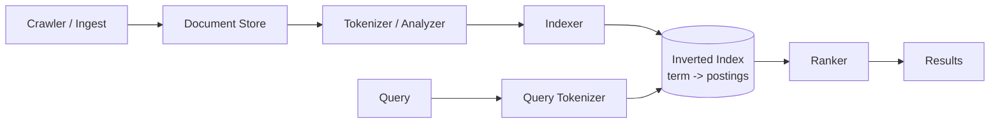
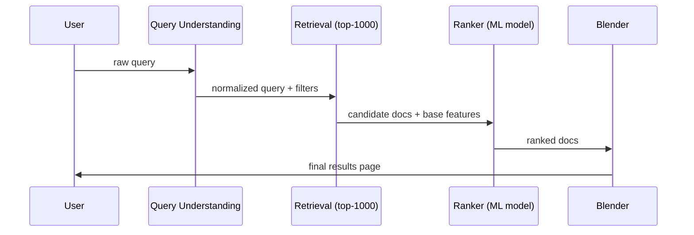
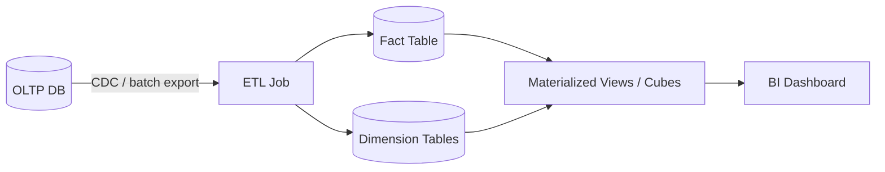
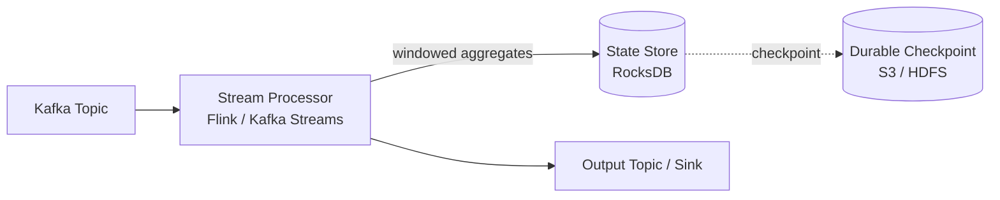
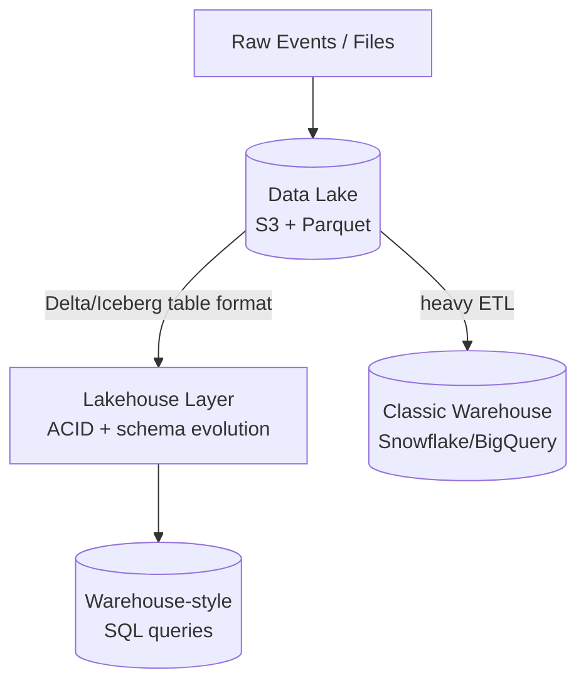
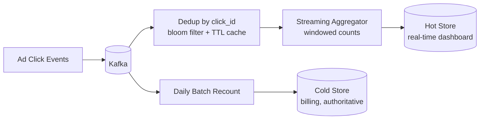

# Week 9: Search, Data Systems, and Advanced RAG/Agents

Days 57-63. The HLD side moves from "how do I store data" (weeks 2-3) to "how do I make huge
data searchable and analyzable": inverted indexes, OLAP pipelines, stream processing, and the
lake/warehouse split. The ML side goes past basic RAG (week 8) into the techniques that
separate a toy RAG demo from a production one, then opens the agents track: ReAct, MCP, and
multi-agent design. Day 63 is revision plus a mini project that ties both halves together.

## Day 57: Inverted Indexes and Search Engine Architecture

**System Design: Search Engine / Inverted Index** (55 min)
A search engine answers "which documents contain these terms, ranked by relevance" at
sub-100ms latency over billions of documents. The core data structure is the **inverted
index**: a map from term to a sorted list (postings list) of document IDs that contain it,
usually with term frequency and position stored alongside for ranking and phrase queries.

Pipeline: crawler/ingestion -> document store -> **tokenizer/analyzer** (lowercase, stem,
remove stopwords) -> indexer builds postings lists -> query time: tokenize the query the same
way, fetch postings lists for each term, intersect/union them, score and rank.

Estimation: 1B documents, average 1KB each after tokenization -> raw text ~1TB. A postings
list entry (doc ID + term freq, delta-encoded) is a few bytes, so even with ~10K unique terms
per document the index is typically 10-30% of raw corpus size after compression
(variable-byte or Elias-Fano encoding of doc ID deltas). At this size the index is sharded by
document range or by term, with a broker fanning queries out and merging ranked results
(scatter-gather).

Trade-offs: shard by **term** (each shard owns a subset of the vocabulary) concentrates load
on popular terms but keeps a query cheap (few shards touched); shard by **document** spreads
load evenly but every query touches every shard. Most engines (Elasticsearch/Lucene) shard by
document for this reason, accepting the scatter-gather cost.

**ML / GenAI: Hybrid Search and Reranking** (55 min)
Pure vector (dense embedding) search misses exact keyword matches (product codes, names);
pure keyword (BM25/sparse) search misses semantic paraphrase. **Hybrid search** runs both and
fuses the result sets, usually with **Reciprocal Rank Fusion (RRF)**: `score(d) = sum over
retrievers of 1/(k + rank_r(d))`, k≈60. The fused top-N then goes through a **cross-encoder
reranker** (a small model that scores the full query-document pair jointly, more accurate but
too slow to run over the whole corpus) to pick the final top-k for the LLM's context.

Exercise: implement RRF fusion by hand in Python over two toy ranked lists (BM25 order,
embedding-cosine order) for 10 documents and verify the fused order changes versus either
list alone.

**Recall** (10 min)
- Why does sharding an inverted index by document ID require scatter-gather, while sharding by term does not?
- What does a reranker see that a first-stage retriever (BM25 or dense) does not?
- What is RRF fusing, and why use rank instead of raw scores from two different retrievers?

**Go deeper**
- [Practical BM25, Elastic](https://www.elastic.co/blog/practical-bm25-part-2-the-bm25-algorithm-and-its-variables)
- [RAG deep dive](../../../course/04-ml-genai-agents/05-rag.md)
- [Lucene scoring and segment merging](https://lucene.apache.org/core/9_10_0/core/org/apache/lucene/search/package-summary.html)

## Day 58: Search Ranking, Query Processing, and GraphRAG

**System Design: Ranking and Query Processing** (55 min)
Beyond the inverted index lookup, a real search stack layers: **query understanding**
(spell correction, synonym expansion, intent classification) -> **retrieval** (fetch a
candidate set, often top 1000 by a cheap score like BM25) -> **ranking** (a learned model,
often gradient-boosted trees or a small neural net, scores the candidate set on dozens of
features: text match, freshness, click-through rate, personalization) -> **blending** (mix
in ads, knowledge panels, etc.).

Data model for a ranking feature store: `(query_id, doc_id) -> feature_vector`, computed
online for the candidate set only (never the whole corpus) because feature computation is
the expensive step, not scoring.

Trade-off: a two-stage retrieve-then-rank funnel exists because the ranking model is too
expensive to run over billions of documents; the cheap retrieval stage's recall caps the
whole system's quality ("can't rank what you didn't retrieve"), which is why retrieval recall
is tracked as its own metric separate from final ranking NDCG.

**ML / GenAI: Query Rewriting and GraphRAG** (55 min)
**Query rewriting** turns a raw user question into one or more retrieval-friendly queries
before hitting the vector store: decompose multi-part questions, expand acronyms, or
generate several paraphrases and retrieve for each (query fan-out), then dedupe. This fixes
the common RAG failure where the user's phrasing doesn't lexically or semantically match the
source documents.

**GraphRAG** builds a knowledge graph (entities + relationships) from the corpus offline
(via LLM extraction), then at query time retrieves a relevant subgraph plus community
summaries instead of (or alongside) flat text chunks. It shines on "global" questions that
need synthesis across many documents ("what are the main themes across all reports"), where
flat chunk retrieval only ever surfaces local, disconnected snippets.

Exercise: write a query-rewriting prompt that takes "compare the pricing and onboarding time
of vendor A and vendor B" and decomposes it into 2 focused sub-queries; run both against any
toy retriever and manually merge the retrieved snippets.

**Recall** (10 min)
- Why does retrieval recall put a hard ceiling on final ranking quality?
- Give one query type where GraphRAG beats flat chunk retrieval, and why.
- What problem does query fan-out solve that a single rewritten query does not?

**Go deeper**
- [GraphRAG paper, Microsoft Research](https://arxiv.org/abs/2404.16130)
- [Agents and tool use](../../../course/04-ml-genai-agents/06-agents-and-tool-use.md)

## Day 59: Analytics Pipelines, OLAP, and RAGAS

**System Design: Analytics Pipelines** (55 min)
Analytics systems answer aggregate questions over historical data ("revenue by region by
day") rather than point lookups. The classic design: OLTP databases emit change events ->
batch or streaming **ETL** transforms and loads them into a column-oriented warehouse
modeled as a **star schema** (one fact table of events + several dimension tables for
lookups like user, product, region) -> a query engine (columnar scan, often with
pre-aggregated cubes or materialized views) serves dashboards.

Estimation: 10M events/day, 500 bytes/row (narrow fact rows) -> 5GB/day raw, ~1.8TB/year
before compression; columnar storage with dictionary + run-length encoding on low-cardinality
dimension columns typically gets 5-10x compression, so realistically ~200-350GB/year on disk.

Trade-off: pre-aggregating into cubes makes common dashboard queries near-instant but freezes
the set of answerable slice-and-dice combinations; ad-hoc columnar scan over raw fact rows
answers any question but costs more per query. Most warehouses do both: raw fact table for
flexibility, materialized views for the top-N known dashboards.

**ML / GenAI: Evaluating RAG with RAGAS** (55 min)
RAGAS scores a RAG pipeline on four axes without needing human-labeled ground truth for every
question: **faithfulness** (is the answer's content actually supported by the retrieved
context, measured by breaking the answer into claims and checking each against context),
**answer relevance** (does the answer address the question, measured by generating candidate
questions from the answer and comparing to the original), **context precision** (are the
retrieved chunks actually relevant, not just padding), and **context recall** (did retrieval
surface everything needed, requires a reference answer).

Exercise: pick 5 question/answer pairs from any RAG app you have, and manually score
faithfulness by hand (does every sentence in the answer trace to a specific retrieved
sentence?) before trying the `ragas` library -- this builds the intuition the automated judge
is approximating.

**Recall** (10 min)
- Which RAGAS metric needs a reference/ground-truth answer, and which three don't?
- Why can an answer be "relevant" but not "faithful"?
- What's the difference between context precision and context recall?

**Go deeper**
- [RAGAS documentation](https://docs.ragas.io/)
- [RAG deep dive](../../../course/04-ml-genai-agents/05-rag.md)

## Day 60: Stream Processing (Flink / Kafka Streams) and ReAct Agents

**System Design: Stream Processing** (55 min)
Stream processors transform unbounded event streams continuously, instead of waiting for a
batch window. Core concepts: **windowing** (tumbling, sliding, session windows group events
for aggregation), **watermarks** (a heuristic for "no more events older than time T will
arrive," needed because events arrive out of order over the network), and **exactly-once
processing** (achieved via checkpointing the processor's state plus transactional writes to
the sink, so a replay after a crash doesn't double-count).

Estimation: 100K events/sec, 200 bytes each -> 20MB/sec -> keeping even 1 hour of in-flight
state for a sliding window at this rate is ~72GB, which is why state stores like RocksDB
(local disk-backed) rather than pure in-memory structures back large stateful streaming jobs.

Trade-off: Kafka Streams embeds the processing logic in your own application (no separate
cluster, simpler ops, scales with your app's partitions) while Flink runs as its own cluster
with a dedicated job manager (more operational surface, but better support for complex
event-time semantics, large state, and exactly-once across multiple sinks). Pick Kafka
Streams for simpler per-service stream transforms; pick Flink for large shared stateful
pipelines.

**ML / GenAI: The ReAct Loop and Tool Use** (55 min)
ReAct interleaves **reasoning** (a free-text "Thought") with **acting** (a tool call) and
**observing** (the tool's result), repeating until the model emits a final answer. This beats
single-shot prompting on tasks that need external information or multi-step computation,
because the model can course-correct after seeing each observation instead of committing to
one plan upfront.

Failure modes to guard against: infinite loops (cap max steps, e.g., 6-10), tool
hallucination (calling a tool with malformed or invented arguments -- validate against a
JSON schema before executing), and context bloat (every observation adds to the prompt;
summarize or drop stale observations after a few turns).

Exercise: write a minimal ReAct loop in ~30 lines of Python: a `tools` dict of 2 callables
(e.g., a calculator and a fake "search"), a system prompt describing the Thought/Action/
Observation format, and a loop that parses the model's Action line, executes the matching
tool, and feeds the Observation back in.

**Recall** (10 min)
- What does a watermark approximate, and why do streaming systems need it at all?
- Why does Flink typically need a separate cluster while Kafka Streams doesn't?
- What two things does ReAct interleave that single-shot prompting can't?

**Go deeper**
- [ReAct paper](https://arxiv.org/abs/2210.03629)
- [Kafka Streams documentation](https://kafka.apache.org/documentation/streams/)
- [Agents and tool use](../../../course/04-ml-genai-agents/06-agents-and-tool-use.md)

## Day 61: Data Lakes, Warehouses, Lakehouses, and MCP

**System Design: Data Lake vs. Data Warehouse vs. Lakehouse** (55 min)
A **data lake** stores raw files (Parquet/JSON/CSV) in cheap object storage (S3) with
schema-on-read: flexible, cheap, but queries are slower and correctness depends on every
consumer parsing the schema consistently. A **data warehouse** (Snowflake, BigQuery) stores
structured, schema-on-write columnar data with fast SQL and strong consistency, at higher
storage cost and less flexibility for unstructured data. A **lakehouse** (Delta Lake,
Iceberg, Hudi) adds a transactional metadata layer (ACID commits, schema evolution, time
travel) on top of lake storage, aiming to get warehouse-like guarantees at lake-like cost.

Trade-off: a pure warehouse is simpler to operate and faster for known BI workloads but locks
you into its proprietary storage and compute coupling (you pay for compute even for simple
scans); a lakehouse decouples storage from compute (any engine -- Spark, Trino, DuckDB -- can
read the same Parquet files) at the cost of more moving parts and a younger ecosystem for
some guarantees (e.g., concurrent writer conflict resolution).

**ML / GenAI: The Model Context Protocol (MCP)** (55 min)
MCP standardizes how an LLM application discovers and calls external tools/resources,
replacing bespoke per-integration glue code with one client-server protocol. An **MCP
server** exposes **tools** (callable functions with a JSON schema), **resources** (readable
data like files or API results), and **prompts** (reusable templates); an **MCP client**
(the agent host) discovers what's available via a `list_tools`/`list_resources` handshake and
calls them over a transport (stdio for local processes, HTTP/SSE for remote servers). This
means a tool built once as an MCP server works with any MCP-compatible agent host, instead of
being hand-wired into one specific agent framework.

Exercise: read the schema of one existing MCP tool definition (name, description, input
JSON schema) and write a second tool definition by hand for a hypothetical "get_weather"
tool, including the schema an LLM would need to call it correctly with no further
clarification.

**Recall** (10 min)
- What guarantee does a lakehouse table format (Delta/Iceberg) add that a plain Parquet lake lacks?
- Why does decoupling storage from compute matter for cost?
- What three things does an MCP server expose, and what problem does standardizing them solve?

**Go deeper**
- [MCP specification](https://modelcontextprotocol.io/)
- [Delta Lake documentation](https://docs.delta.io/latest/delta-intro.html)
- [Agents and tool use](../../../course/04-ml-genai-agents/06-agents-and-tool-use.md)

## Day 62: Ad-Click Aggregation and Multi-Agent Patterns

**System Design: Ad-Click Aggregation System** (55 min)
Classic case study combining today's topics: count ad clicks/impressions in near-real-time
for billing and reporting, correctly, at scale, despite duplicate and out-of-order events.

Requirements: dedupe clicks (a user double-clicking or a retry shouldn't double-bill an
advertiser), aggregate by `(ad_id, time_window)`, support both a near-real-time dashboard
(seconds-to-minutes staleness) and exact billing numbers (eventually consistent, reconciled
daily).

Estimation: 1M clicks/sec peak for a large network, 100 bytes/event -> 100MB/sec into Kafka;
deduping at this rate needs an approximate structure (bloom filter sized for the TTL window,
false-positive rate ~0.1%) rather than an exact set, because an exact set over a sliding
window at this volume won't fit cheaply in memory.

Trade-off: the real-time path is approximate and fast (bloom filter dedup, in-memory
aggregation, small chance of over/under-counting); the batch path recomputes exact counts
from the immutable log nightly and is the source of truth for billing. This "speed layer +
batch layer" split (Lambda architecture) trades a short window of dashboard inaccuracy for
not having to make the real-time path perfectly correct.

**ML / GenAI: Multi-Agent Patterns** (55 min)
Single-agent ReAct loops struggle when a task needs distinct skill sets or when context would
overflow one agent's window. Common multi-agent patterns: **orchestrator-worker** (a lead
agent decomposes the task and dispatches subtasks to specialized worker agents, then
synthesizes their results -- scales well, but the orchestrator's decomposition quality caps
overall quality), **debate/critique** (two agents argue or one critiques another's output,
useful for catching errors a single pass misses), and **pipeline** (fixed sequence of
specialized agents, e.g., researcher -> writer -> fact-checker, simplest to reason about but
least flexible).

The main failure mode across all patterns is **compounding error**: each agent-to-agent
handoff is a chance to lose or distort information, so multi-agent systems need explicit,
structured handoff formats (not free-text summaries) and a budget on total steps/cost across
the whole system, not just per agent.

Exercise: sketch (on paper, no code needed) an orchestrator-worker design for "research a
company and write a one-page brief": what does the orchestrator pass to each worker, and what
structured format does each worker return so the orchestrator can merge results reliably?

**Recall** (10 min)
- Why does the ad-click system need both a fast approximate path and a slow exact path?
- What does a bloom filter trade away to dedupe at 1M events/sec?
- What is the main failure mode in multi-agent systems, and what mitigates it?

**Go deeper**
- [Anthropic: how we built our multi-agent research system](https://www.anthropic.com/engineering/built-multi-agent-research-system)
- [Agents and tool use](../../../course/04-ml-genai-agents/06-agents-and-tool-use.md)
- [Case studies](../../../course/01-system-design/07-case-studies.md)

## Day 63: Revision and Mini Project

Today is revision, not new material. Spend the two hours as follows.

**Revision (40 min).** Without opening notes, write down from memory: the inverted-index
query path (Day 57), the retrieve-then-rank funnel (Day 58), the star schema and Lambda
architecture idea (Days 59, 62), tumbling vs. sliding windows and watermarks (Day 60), the
lake/warehouse/lakehouse distinction (Day 61), RRF and RAGAS's four metrics (Days 57, 59),
and the three multi-agent patterns (Day 62). For anything you can't reconstruct, that's your
signal for what to re-read.

**Mini project (70 min).** Build a tiny hybrid-search-and-eval pipeline over 10-20 short text
documents you write yourself (a few sentences each, on any topic):
1. Index them two ways: a BM25-style keyword score (even a crude term-overlap count is fine)
   and a dense embedding similarity (use any small embedding model or API you have access
   to).
2. Fuse the two rankings with RRF for 3 test queries.
3. For one query, manually apply the RAGAS faithfulness check by hand: write a one-sentence
   "answer" using only the top-3 fused documents, then verify every claim in your answer
   traces back to a specific retrieved sentence.
4. Write 5 lines in your notes: what hybrid search caught that pure keyword or pure vector
   search alone would have missed, and where your by-hand "answer" would have failed the
   faithfulness check if you'd been sloppier.

**Recall** (10 min)
- State the retrieve-then-rank funnel in one sentence, and why the funnel shape exists.
- What's the one-line difference between a data lake and a lakehouse?
- Name the three multi-agent patterns from Day 62 and one failure mode each is prone to.

**Go deeper**
- [RAG deep dive](../../../course/04-ml-genai-agents/05-rag.md)
- [Evaluation and harness](../../../course/04-ml-genai-agents/07-evaluation-and-harness.md)
