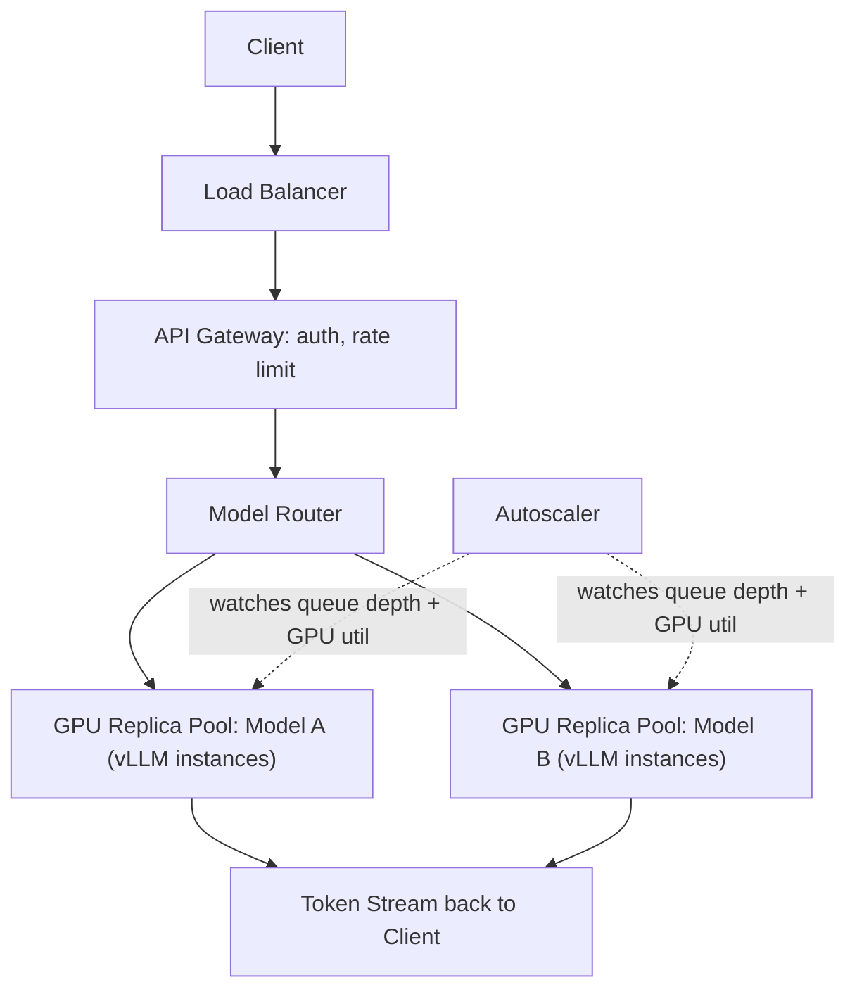
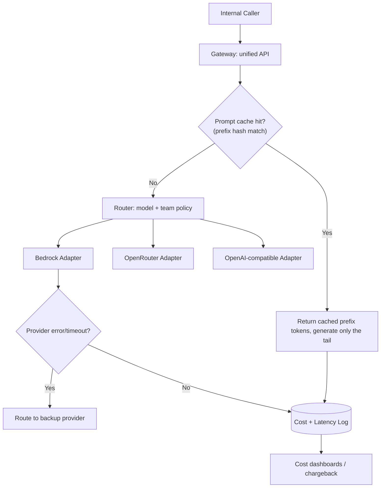
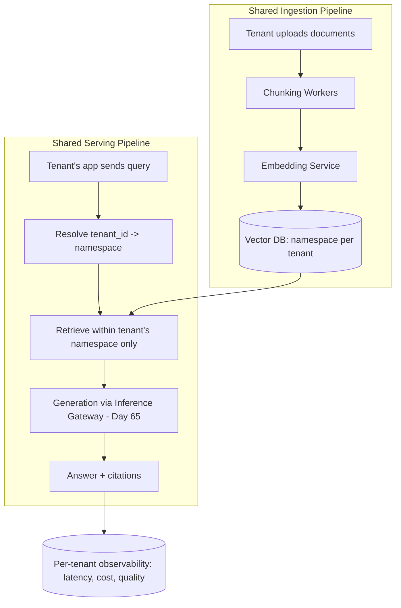
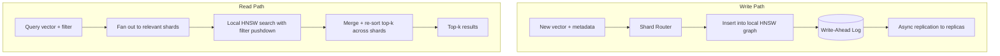
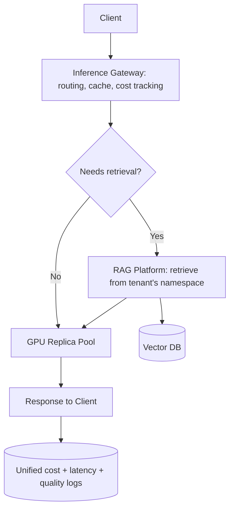

# Week 10: AI System Design 1 — Serving, Gateways, and Evaluation Rigor

This week is where the course's architecture content and your own production experience overlap most directly: LLM serving infrastructure, inference gateways with routing/caching/cost tracking, RAG platforms, and vector database internals on the system-design side; LLM-as-judge, judge councils, benchmarks, eval harnesses, red-teaming, and guardrails on the ML side. Several days below call out explicit "Connect to your work" notes tying the material to the LiteLLM sidecar gateway, three-judge council, WildClawBench-based eval harness, drift injection, and Docker-sandboxed multi-agent runs you've already built. Day 70 is revision plus a mini project.

## Day 64: LLM Serving at Scale

**System Design: LLM Serving at Scale** (55 min)

Requirements: serve a chat-completion API to tens of thousands of concurrent users; functional — accept a prompt, stream tokens back incrementally; non-functional — p50 time-to-first-token under 300ms, support 10K concurrent generating sessions, scale elastically with demand, survive a single-region outage.

Data model: a request queue entry `(request_id, model, prompt, max_tokens, priority, arrival_ts)`; conversation history lives in an external store outside the hot serving path, not inside the inference service itself.

API: `POST /v1/chat/completions` with `{model, messages, stream: true}`, responding with a token stream (SSE or chunked HTTP).



Estimation: with continuous batching (file 08's vLLM), a single GPU running a mid-size model can serve roughly 40-60 concurrent generations at acceptable per-token latency; supporting 10K concurrent sessions therefore needs on the order of 200 GPU replicas, with autoscaling headroom above that for bursts.

Trade-off: running every model in every region minimizes latency and gives full regional failover, but multiplies GPU fleet cost and forces you to keep model weights/versions in sync across regions. A common middle ground is running the flagship model centrally in 1-2 regions (acceptable latency hit, lower cost) while serving a smaller/distilled model at the edge for latency-sensitive, lower-stakes requests.

**ML / GenAI: LLM-as-Judge and Its Biases** (55 min)

Review and sharpen: an LLM-as-judge grades another model's output against a rubric instead of (or alongside) human review, because recognizing a good answer is usually easier for a model than generating one from scratch. The three biases worth having cold: **position bias** (favors whichever answer is shown first in a side-by-side comparison — fix by randomizing order or scoring independently), **verbosity bias** (rates longer answers as better regardless of quality — fix by explicitly penalizing unnecessary length in the rubric), and **self-preference bias** (a model favors its own family's outputs — fix by judging with a different, ideally stronger, model).

Exercise — demonstrate position bias directly:

```python
def judge_prompt(question, answer_a, answer_b):
    return f"""Question: {question}
Answer A: {answer_a}
Answer B: {answer_b}
Which answer is better? Respond with "A" or "B" only."""

# Run judge_prompt(q, good_answer, bad_answer) AND
# judge_prompt(q, bad_answer, good_answer) through your LLM.
# If the judge flips its preference just because the order swapped,
# you've reproduced position bias directly -- this is why production
# judges randomize order or score each answer independently instead
# of doing a single side-by-side call.
```

**Recall** (10 min)
- Why does continuous batching change how many GPUs you need for a given concurrency target?
- What's the cost/latency trade-off of running every model in every region?
- Name the three LLM-judge biases and one fix for each.
- Why is grading often easier for an LLM than generating the original answer?

**Go deeper**
- [vLLM PagedAttention paper, Kwon et al. 2023](https://arxiv.org/abs/2309.06180)
- [LLM-as-judge survey/paper reference, Zheng et al. 2023 ("Judging LLM-as-a-Judge")](https://arxiv.org/abs/2306.05685)
- [Evaluation and harness chapter](../../../course/04-ml-genai-agents/07-evaluation-and-harness.md)

## Day 65: Inference Gateway Design (LiteLLM-Style Routing, Caching, Cost Tracking)

**System Design: Inference Gateway Design** (55 min)

*Connect to your work: this day's system is essentially the LiteLLM sidecar gateway you built with Bedrock and OpenRouter — the design decisions below (provider adapters, prefix-hash prompt caching, per-team cost attribution) are the ones you already made in that project. Use this day to put precise vocabulary on choices you made by instinct.*

Requirements: present one unified chat-completion API to internal callers while routing to multiple backend providers (Bedrock, OpenRouter, OpenAI-compatible), apply prompt caching to cut cost on repeated prefixes, track and attribute cost per request/team, and fail over to a backup provider when the primary errors or times out.

API: callers always hit the same `POST /v1/chat/completions` shape; the gateway translates to each provider's native request/response format internally, so switching providers never requires a caller-side code change.

Data model: `provider_config(provider, model_aliases[], api_key_ref, rate_limit, priority)`; `request_log(request_id, team_id, model, input_tokens, output_tokens, cached_tokens, cost_usd, latency_ms, provider, status)` — this log is what makes chargeback and cost dashboards possible.



Estimation: at 500 requests/sec average with an 800-byte log entry per request, the logging path is trivial storage (~35GB/day); the real design constraint is making sure the cost-tracking write never blocks the response path — log asynchronously, never synchronously on the critical request path.

Trade-off: a proxy/sidecar gateway adds one extra network hop (roughly 5-20ms) to every call, but it centralizes retries, failover, prompt caching, and cost attribution in exactly one place instead of reimplementing that logic in every service that calls an LLM. That overhead is easily worth it once you have more than a couple of call sites — which is exactly the point at which a hand-rolled per-service client stops making sense.

**ML / GenAI: Judge Councils and Multi-Judge Evaluation** (55 min)

*Connect to your work: this is the three-judge LLM council pattern you built — the aggregation logic below is the generalized version of what you already implemented.*

A single LLM judge inherits all of yesterday's biases plus whatever blind spots that specific model has. A **judge council** runs the same output through multiple judges — different models, or the same model with different prompts/temperatures — and aggregates: majority vote for categorical verdicts, averaging for numeric scores, or flagging for human review when judges disagree sharply. Disagreement itself is a useful signal: a question where three judges split 2-1 is probably more ambiguous or harder to grade than one where all three agree, and that disagreement rate is worth tracking as its own metric over time.

Exercise — a minimal council aggregator with a disagreement flag:

```python
def council_verdict(scores: list[int], disagreement_threshold=2):
    # scores: one 1-5 rating per judge
    avg = sum(scores) / len(scores)
    spread = max(scores) - min(scores)
    needs_human_review = spread >= disagreement_threshold
    return {"score": avg, "spread": spread, "needs_human_review": needs_human_review}

print(council_verdict([5, 4, 2]))  # wide spread -> flagged for human review
print(council_verdict([4, 5, 4]))  # tight agreement -> trusted automatically
```

**Recall** (10 min)
- Why does a unified gateway API let you swap providers without touching caller code?
- Why must cost/latency logging happen asynchronously rather than on the critical request path?
- What does judge disagreement (spread) tell you that a single averaged score doesn't?
- Why use a different model as judge than the one being evaluated?

**Go deeper**
- [LiteLLM documentation (provider routing, caching, cost tracking)](https://docs.litellm.ai/)
- ["Judging LLM-as-a-Judge" (multi-judge framing), Zheng et al. 2023](https://arxiv.org/abs/2306.05685)
- [Evaluation and harness chapter](../../../course/04-ml-genai-agents/07-evaluation-and-harness.md)

## Day 66: RAG Platform Architecture

**System Design: RAG Platform Architecture** (55 min)

Requirements: build a multi-tenant *platform* that many internal teams can use to stand up their own RAG application, rather than one single RAG pipeline — each tenant brings its own documents and gets an isolated index, with the platform handling ingestion, embedding, retrieval, and observability as shared infrastructure.

Data model: `tenant(tenant_id, namespace, embedding_model, quota)`; `document(doc_id, tenant_id, source, status)`; chunks are stored in the vector database under a per-tenant namespace so one tenant's queries can never retrieve another tenant's content.



Estimation: if each of 50 internal tenants has ~100K documents averaging 2KB chunks, that's roughly 5M chunks/tenant x 50 tenants = 250M vectors platform-wide — large enough that per-tenant namespace isolation inside one shared vector cluster (Day 67) is far more operationally tractable than 50 separate vector DB deployments.

Trade-off: a shared vector database with per-tenant namespaces is cheaper to operate and scales better than one dedicated instance per tenant, but it concentrates risk — a bug in namespace isolation or a noisy tenant's query load can affect every other tenant on the same cluster. Dedicated per-tenant instances cost more and are harder to manage at scale, but contain the blast radius of any single tenant's failure or data leak to just that tenant.

**ML / GenAI: Benchmarks and Their Limits** (55 min)

Review and sharpen for interviews: public benchmarks are useful for shortlisting a base model's general capability, but benchmark contamination (test questions leaking into newer models' training data) can inflate scores without real capability gains, and a benchmark score says nothing about performance on *your* specific domain. The senior answer is always: "benchmarks narrow the field; the final decision comes from our own golden dataset eval."

Exercise — write a short decision memo (3-4 sentences) for a real scenario: your team is choosing between two LLMs that score within 2 points of each other on a public leaderboard. What do you actually measure before deciding, and why doesn't the leaderboard gap settle it?

**Recall** (10 min)
- Why does per-tenant namespace isolation matter more as tenant count grows?
- What's the operational trade-off between a shared vector cluster and per-tenant instances?
- Why can't a public benchmark score alone justify a production model choice?
- What is benchmark contamination and why does it inflate scores?

**Go deeper**
- [Pinecone/Weaviate multi-tenancy design docs](https://docs.pinecone.io/guides/indexes/implement-multitenancy)
- [RAG pipeline chapter (ingestion/retrieval detail)](../../../course/04-ml-genai-agents/05-rag.md)
- [ML/GenAI system design chapter (production RAG chatbot)](../../../course/04-ml-genai-agents/09-ml-system-design.md)

## Day 67: Vector Database Design (Internals)

**System Design: Vector Database Design** (55 min)

*Connect to your work: the eval harness you built (WildClawBench fork, pytest grading, drift injection over 101 FastAPI mock services) depends on the same cheap-filter-then-precise-check pattern as a vector DB's index — today's ML block makes that connection explicit.*

Requirements: index billions of high-dimensional vectors, support combined vector-similarity + metadata-filter queries ("find similar documents, but only from the last 6 months"), p99 query latency under 50ms.



HNSW (Hierarchical Navigable Small World) builds a multi-layer graph where higher layers have fewer, longer-range links for fast coarse navigation, and lower layers have denser, short-range links for fine-grained search — a query descends layer by layer, narrowing toward the true nearest neighbors without ever scanning the full dataset.

Estimation: 1 billion vectors at 768 dimensions x 4 bytes/float = ~3TB of raw vector data; HNSW's graph structure (storing links between nodes) typically adds 20-50% memory overhead on top of that, so to keep the whole index in RAM for fast search you'd shard across roughly 40-60 nodes with 64-100GB each.

Trade-off: HNSW gives very fast approximate search but inserting into a dense graph is relatively expensive and repeated inserts/deletes can gradually degrade graph quality, usually requiring periodic rebuilds. IVF (Inverted File index) clusters vectors into buckets and only searches the nearest buckets, which supports cheaper incremental updates at a modest recall cost — pick HNSW for read-heavy, rarely-changing corpora and IVF-family approaches when writes are frequent relative to reads.

**ML / GenAI: Building Eval Harnesses** (55 min)

*Connect to your work: this is a direct description of what you already built — the WildClawBench fork, pytest-style grading, and drift injection across 101 FastAPI mock services are a production instance of exactly this pattern.*

A real eval harness combines three layers: a **golden dataset** of (input, expected behavior) pairs built from real production cases and deliberately-included adversarial/edge cases; **automated grading** — pytest-style assertions where the expected behavior is checkable in code (e.g., "did the agent call the right tool," "is the output valid JSON matching this schema") — faster and cheaper than LLM-judge calls and should be preferred whenever correctness is mechanically checkable; and **LLM-judge scoring** reserved for genuinely subjective dimensions (helpfulness, tone) that code can't check directly. **Drift injection** deliberately perturbs inputs (corrupted data, unexpected formats, injected adversarial text) to verify the system degrades gracefully rather than failing silently.

Exercise — a minimal pytest-style grading function combining mechanical checks with an LLM-judge fallback:

```python
import json

def grade_agent_output(output: str, expected_tool_call: str) -> dict:
    try:
        parsed = json.loads(output)
    except json.JSONDecodeError:
        return {"pass": False, "reason": "output is not valid JSON"}
    if parsed.get("tool") != expected_tool_call:
        return {"pass": False, "reason": f"expected tool {expected_tool_call}, got {parsed.get('tool')}"}
    return {"pass": True, "reason": "mechanical checks passed"}

# Mechanical checks (schema, tool name) run first and are cheap/deterministic.
# Only route to an LLM judge for the subset that passes mechanical checks
# but still needs a subjective quality score -- this mirrors retrieve-then-
# rerank: cheap filter first, expensive precise check only on what remains.
```

**Recall** (10 min)
- Why do higher layers of an HNSW graph have fewer, longer-range links?
- When would you prefer IVF over HNSW for a vector index?
- Why should mechanical/pytest-style grading run before an LLM judge, not instead of it?
- What does drift injection test for that a static golden dataset doesn't?

**Go deeper**
- [HNSW paper, Malkov & Yashunin 2016](https://arxiv.org/abs/1603.09320)
- [RAGAS library (automated RAG eval harness)](https://github.com/explodinggradients/ragas)
- [Evaluation and harness chapter](../../../course/04-ml-genai-agents/07-evaluation-and-harness.md)

## Day 68: Case Study — A Full LLM Platform

**System Design: Case Study — A Full LLM Platform** (55 min)

Combine Days 64-67 into one coherent platform: client traffic enters through the inference gateway (Day 65), which routes to either direct generation (Day 64's GPU pool) or a RAG-augmented path (Day 66's platform, backed by Day 67's vector DB) depending on the request type.



The key architectural insight tying these together: every layer (gateway routing, vector DB sharding, GPU autoscaling) independently applies the same "cheap filter, then expensive precise step" pattern seen across this course — the gateway cheaply checks the prompt cache before paying for generation, the vector DB cheaply narrows via HNSW before any reranking, and the autoscaler cheaply checks queue depth before provisioning new (expensive) GPU replicas.

Failure isolation: a GPU pool outage in one region should degrade to routing through the gateway's failover path (Day 65) rather than cascading into RAG platform errors; a vector DB shard failure should degrade to serving a direct-generation answer without retrieval (graceful degradation) rather than failing the whole request.

Trade-off: building this as one integrated platform (shared gateway, shared vector DB, shared GPU pool) is far more operationally efficient than letting every team build its own stack, but it means an incident in shared infrastructure now has blast radius across every team using the platform — which is exactly why failure isolation and per-tenant resource quotas (Day 66) matter so much at the platform level.

**ML / GenAI: Red-Teaming LLM Systems** (55 min)

*Connect to your work: drift injection over your 101 mock services is a form of automated red-teaming — deliberately feeding adversarial or malformed inputs to verify the system fails safely rather than silently.*

Red-teaming means deliberately trying to break your system before real attackers or unhappy users do: adversarial prompt testing (jailbreak attempts, prompt injection, extraction attempts), and for agentic systems specifically, testing tool misuse (can the agent be tricked into calling a sensitive tool it shouldn't?) and data exfiltration attempts — not just bad text output. Automated red-teaming (another LLM generating adversarial prompts at scale) is cheaper and more exhaustive than manual human red-teaming, but can miss creative, human-specific attack strategies, so production teams use both.

Exercise: write 3 adversarial test cases for an agent that has a "send_email" tool — one testing prompt injection via a retrieved document, one testing whether the agent can be tricked into calling send_email with an unintended recipient, and one testing whether malformed/truncated tool output causes a silent failure instead of a clear error.

**Recall** (10 min)
- Why does graceful degradation (serving without retrieval) beat a hard failure when a vector DB shard goes down?
- Where does the "cheap filter, then expensive precise step" pattern show up across this platform?
- What's the trade-off between automated and manual red-teaming?
- Why does red-teaming an agentic system need to test tool misuse, not just bad text output?

**Go deeper**
- [OWASP Top 10 for LLM Applications (prompt injection, excessive agency)](https://owasp.org/www-project-top-10-for-large-language-model-applications/)
- [Agents and tool use chapter (failure modes and guardrails)](../../../course/04-ml-genai-agents/06-agents-and-tool-use.md)
- [ML/GenAI system design chapter (AI agent platform section)](../../../course/04-ml-genai-agents/09-ml-system-design.md)

## Day 69: Case Study — Scaling the Platform 10x

**System Design: Case Study — Scaling the Platform 10x** (55 min)

Starting from Day 68's platform, walk through what breaks first at 10x traffic and why, out loud, the way an interviewer would probe it: the inference gateway's synchronous cost-logging path (if it wasn't already async) becomes a bottleneck first, since every request now waits on a write; the GPU pool's autoscaler reaction time (minutes to provision new replicas) can't keep up with traffic spikes that happen in seconds, so you need a pre-warmed buffer pool rather than pure reactive autoscaling; and the vector DB's shared cluster starts showing noisy-neighbor effects as the busiest tenants' query volume grows disproportionately.

Fixes in order of how a senior candidate would prioritize them: make cost logging fully asynchronous (cheap, immediate win), add a pre-warmed GPU buffer sized to historical peak-minus-current-load (addresses the autoscaler lag directly), and introduce per-tenant rate limiting at the gateway (Day 65) so one noisy tenant can't degrade the vector DB for everyone else.

Trade-off: pre-warming GPU capacity ahead of demand costs money for idle capacity most of the time, but reactive-only autoscaling means real users experience queueing or dropped requests during the minutes it takes new replicas to spin up — for a customer-facing product, that latency-vs-cost trade almost always favors paying for some idle buffer.

**ML / GenAI: Safety and Guardrails** (55 min)

*Connect to your work: the Docker sandboxes you used for bounded multi-agent runs are themselves a safety guardrail — containing what a misbehaving or compromised agent can actually do to the host system, independent of whether its reasoning was correct.*

Review the layered defense model: content moderation (classifier models screening input/output separately from the main generation model), refusal calibration (avoiding both under-refusal and over-refusal), least-privilege tool access, and sandboxing destructive or irreversible actions. Sandboxing specifically addresses a different failure class than prompt-level guardrails: even a perfectly-reasoned, non-malicious agent can call a tool with an unexpected side effect (deleting the wrong file, hitting an unexpected API endpoint) — a sandbox limits the *blast radius* of that mistake regardless of why it happened, which is a strictly different and complementary guarantee from "the model reasoned correctly."

Exercise: list the specific capabilities your Docker sandbox denied by default for your bounded multi-agent runs (network access, filesystem scope, process limits), and for each one, name the failure mode it would have prevented if the agent's reasoning had gone wrong in that specific way.

**Recall** (10 min)
- Why does pre-warmed GPU capacity address a problem that reactive autoscaling structurally cannot?
- What specific noisy-neighbor risk grows with tenant query volume on a shared vector cluster?
- Why is sandboxing a different kind of guardrail than a prompt-level safety instruction?
- Name one failure mode a Docker sandbox prevents regardless of whether the agent's reasoning was correct.

**Go deeper**
- [Docker security documentation (namespaces, seccomp, resource limits)](https://docs.docker.com/engine/security/)
- [Fine-tuning and LLMOps chapter (safety and alignment basics)](../../../course/04-ml-genai-agents/08-fine-tuning-and-llmops.md)
- [Agents and tool use chapter (failure modes and guardrails)](../../../course/04-ml-genai-agents/06-agents-and-tool-use.md)

## Day 70: Revision + Mini Project

**System Design: Week 10 Revision** (55 min)

Re-derive from memory: why continuous batching changes your GPU count math; the inference gateway's provider-adapter + async-logging architecture; the shared-namespace vs. dedicated-instance vector DB trade-off; HNSW vs. IVF; and the three fixes you'd apply first when scaling the platform 10x. Write one sentence per topic, then check against the day's notes.

**Mini project**: write a one-page HLD for "add a new LLM provider to the gateway without downtime" — cover the adapter interface contract, how you'd canary a small percentage of traffic to the new provider, what you'd watch in the cost/latency logs before expanding rollout, and your rollback plan if the new provider's outputs look wrong. This is a direct abstraction of the provider-onboarding work behind your LiteLLM gateway.

**ML / GenAI: Week 10 Revision** (55 min)

Re-derive: the three LLM-judge biases and their fixes; how a judge council aggregates and when disagreement itself is signal; why benchmark scores alone can't justify a production model choice; the mechanical-check-before-LLM-judge ordering in an eval harness; what drift injection and red-teaming each test for; and the distinct guarantee sandboxing provides versus prompt-level guardrails.

**Mini project**: extend Day 67's grading function into a tiny eval harness with 5 test cases (a mix of normal inputs, one malformed/drift-injected input, and one adversarial/red-team input) run against a toy agent function, reporting pass/fail plus which layer (mechanical check, judge, or sandbox) would have caught each failure. This mirrors the shape of your production harness at a scale you can finish in one sitting.

**Recall** (10 min)
- State, from memory, the three layers of a production eval harness and when each one is used.
- What's the one-sentence case for pre-warmed GPU buffer capacity over pure reactive autoscaling?
- Name the three provider-adapter design decisions your LiteLLM gateway already embodies.

**Go deeper**
- Re-read any day above whose recall questions you missed.
- [Evaluation and harness chapter for a second pass](../../../course/04-ml-genai-agents/07-evaluation-and-harness.md)
- [ML/GenAI system design chapter for a second pass](../../../course/04-ml-genai-agents/09-ml-system-design.md)
