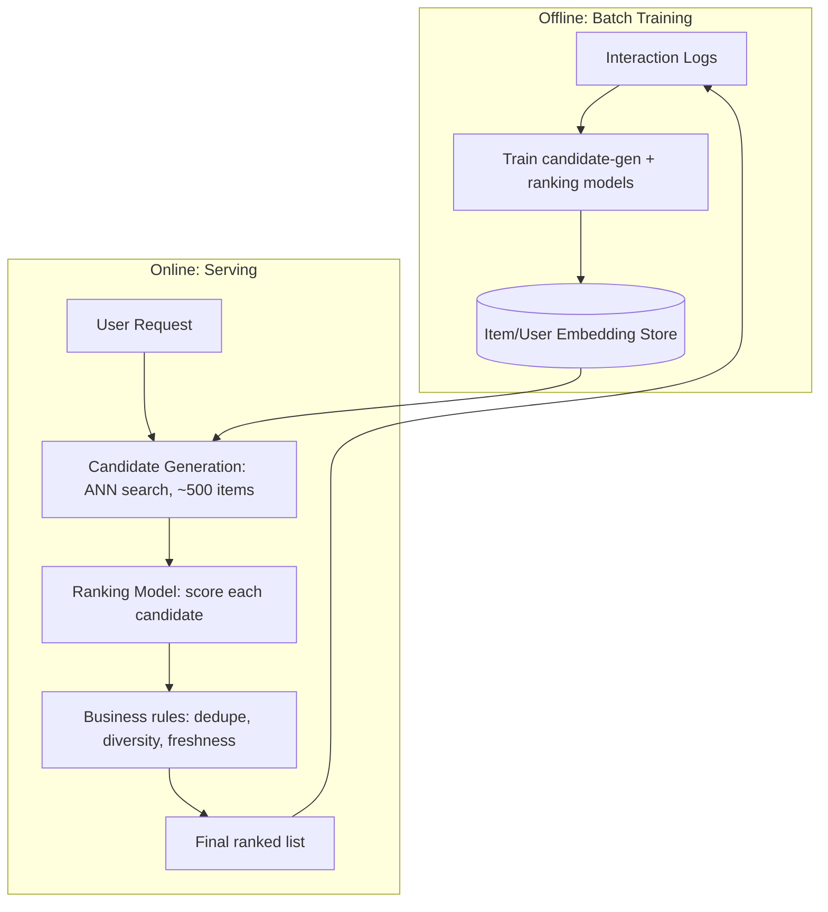
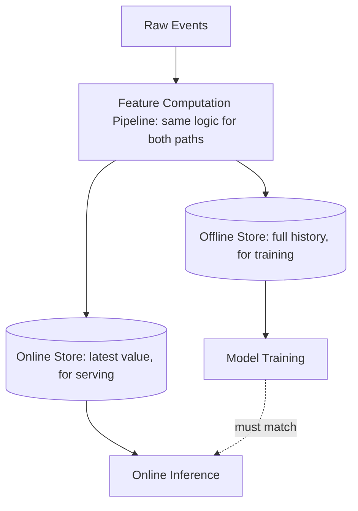
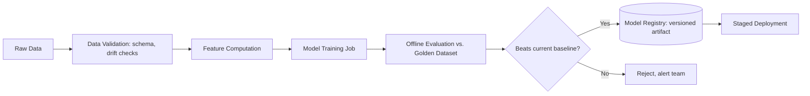
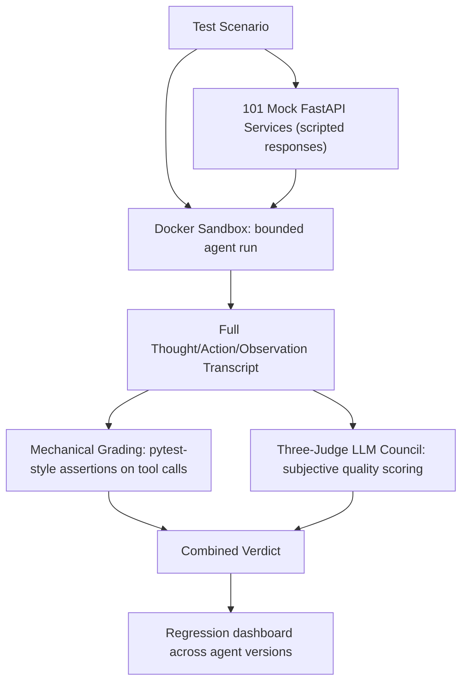
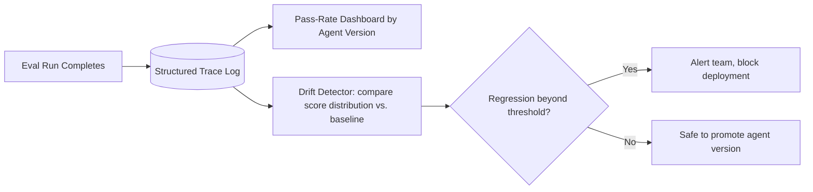

# Week 11: AI/ML System Design 2 — Recommendation, Training Pipelines, and Agent Evaluation Platforms

This week pairs classic ML infrastructure (recommendation systems, feature stores, training pipelines, online evaluation/A/B testing) with the model-customization and operations side of GenAI (SFT, LoRA/QLoRA, RLHF, DPO, GRPO, distillation, quantization, vLLM serving, monitoring, and drift). Day 75's agent evaluation platform and Day 76's monitoring/drift content map directly onto the eval harness and drift-injection work you've already built, with explicit "Connect to your work" notes. Day 77 is revision plus a mini project.

## Day 71: Recommendation System Design

**System Design: Recommendation System Design** (55 min)

Requirements: recommend items to users ranked by predicted engagement; functional — serve a ranked list for a user's homepage; non-functional — p99 latency under 150ms, handle cold-start for new users/items, scale to millions of items and users.

Data model: `user_features(user_id, embedding, recent_interactions[])`; `item_features(item_id, embedding, category, popularity_score)`; `interaction_log(user_id, item_id, action, timestamp)` feeding both offline training and online feature freshness.



Estimation: 10M daily active users requesting a feed refresh every ~5 minutes of active session time gives roughly 2,000-5,000 ranking requests/sec at peak; each request scores ~500 candidates, so the ranking model needs to handle ~1-2.5M scoring calls/sec in aggregate, which is why the candidate-generation stage exists — scoring the full catalog per request would be far more than that.

Trade-off: retraining the ranking model daily keeps recommendations fresh but costs significant compute; many production systems retrain the heavy ranking model on a slower cadence (daily/hourly) while updating item embeddings and the candidate index more incrementally, accepting slightly stale rankings in exchange for much lower retraining cost.

**ML / GenAI: SFT and LoRA/QLoRA** (55 min)

Review and sharpen: supervised fine-tuning (SFT) trains on curated (instruction, response) pairs to turn a base pretrained model into an assistant-like model — this is the first of the three LLM training stages (pretraining → SFT → preference alignment). LoRA freezes the base model and learns two small low-rank matrices `A, B` such that `W + BA` approximates the full fine-tuning update, using far less memory since only `A` and `B` need gradients/optimizer state. QLoRA adds 4-bit quantization of the frozen base weights on top of LoRA, making it possible to fine-tune large models on a single consumer/mid-range GPU.

Exercise — compute the memory savings LoRA gives you for a toy weight matrix:

```python
# Full fine-tuning: must train the whole matrix W (d_out x d_in)
d_out, d_in, rank = 4096, 4096, 16

full_params = d_out * d_in
lora_params = d_out * rank + rank * d_in  # A and B

print(f"Full fine-tuning params: {full_params:,}")
print(f"LoRA params (rank={rank}): {lora_params:,}")
print(f"Reduction: {full_params / lora_params:.0f}x fewer trainable params")
```

**Recall** (10 min)
- Why does candidate generation exist instead of scoring the full catalog per request?
- What's the trade-off of retraining the ranking model daily vs. less frequently?
- What does LoRA freeze, and what does it train instead?
- What does QLoRA add on top of LoRA, and why does that matter for hardware requirements?

**Go deeper**
- [LoRA paper, Hu et al. 2021](https://arxiv.org/abs/2106.09685)
- [QLoRA paper, Dettmers et al. 2023](https://arxiv.org/abs/2305.14314)
- [Fine-tuning and LLMOps chapter](../../../course/04-ml-genai-agents/08-fine-tuning-and-llmops.md)

## Day 72: Feature Store Design

**System Design: Feature Store Design** (55 min)

Requirements: provide a single source of truth for ML features usable both offline (training, where joins over historical data are fine) and online (serving, where a single feature lookup must return in single-digit milliseconds); avoid **training-serving skew** — the same feature computed differently in training versus serving silently breaks model accuracy in production.

Data model: `feature_definition(name, entity_type, computation_logic, owner)`; offline store (columnar, e.g. a data warehouse) holds full historical feature values for training; online store (key-value, e.g. Redis/DynamoDB) holds only the latest value per entity for low-latency serving.



The critical design decision: compute features through **one shared pipeline** that writes to both stores, rather than writing separate offline and online computation logic — this is the single most effective way to eliminate training-serving skew, since any divergence between two independently-written implementations is exactly how skew creeps in.

Estimation: for 50M users with 200 features each, the online store needs ~10B key-value entries; at an average feature vector of 2KB, that's ~20TB, which drives the choice toward a horizontally-shardable key-value store rather than a single-node cache.

Trade-off: point-in-time correctness (ensuring training data only uses feature values that were actually available *at that historical moment*, not values computed later with future information) adds real pipeline complexity, but skipping it causes **data leakage** that makes offline model accuracy look better than it will ever be in production — this is one of the most common and hardest-to-detect ML system bugs, so it's worth the added complexity every time.

**ML / GenAI: RLHF and DPO** (55 min)

Review and connect: RLHF trains a separate reward model from human preference rankings, then uses RL (typically PPO) to optimize the LLM against that reward model, with a KL-divergence penalty limiting how far the policy drifts from the original model. DPO skips the separate reward model and RL loop entirely, directly optimizing the LLM on (chosen, rejected) preference pairs using a closed-form loss derived from the same underlying preference model RLHF uses — simpler to implement and more stable to train, which is why many teams reach for DPO before RLHF today.

Exercise — write the DPO loss intuition in code (not a full trainable implementation, just the core comparison):

```python
import math

def dpo_loss_intuition(logp_chosen, logp_rejected, logp_chosen_ref, logp_rejected_ref, beta=0.1):
    # DPO rewards the policy for increasing the margin between chosen and
    # rejected relative to the frozen reference model's margin.
    policy_margin = logp_chosen - logp_rejected
    ref_margin = logp_chosen_ref - logp_rejected_ref
    logits = beta * (policy_margin - ref_margin)
    loss = -math.log(1 / (1 + math.exp(-logits)))  # -log(sigmoid(logits))
    return loss

print(dpo_loss_intuition(logp_chosen=-2.0, logp_rejected=-5.0, logp_chosen_ref=-2.5, logp_rejected_ref=-3.0))
```

**Recall** (10 min)
- Why must features be computed through one shared pipeline instead of separate offline/online logic?
- What is point-in-time correctness and why does skipping it cause data leakage?
- What does RLHF's reward model do that DPO skips entirely?
- Why is DPO generally more stable to train than RLHF?

**Go deeper**
- [DPO paper, Rafailov et al. 2023](https://arxiv.org/abs/2305.18290)
- [InstructGPT/RLHF paper, Ouyang et al. 2022](https://arxiv.org/abs/2203.02155)
- [Feast feature store documentation](https://docs.feast.dev/)
- [Fine-tuning and LLMOps chapter](../../../course/04-ml-genai-agents/08-fine-tuning-and-llmops.md)

## Day 73: Training Pipeline Design

**System Design: Training Pipeline Design** (55 min)

Requirements: reproducibly train and version ML models from raw data to a deployable artifact; functional — data validation, feature computation, training, evaluation gating, model registration; non-functional — full reproducibility (same inputs always produce a comparable model), auditability of what data/code/hyperparameters produced a given model version.



Versioning everything — data snapshot, feature computation code, training code, hyperparameters, and the resulting model artifact — is what makes a training pipeline auditable; without it, "why did model v12 behave differently from v11" becomes nearly impossible to answer months later.

Estimation: a daily retraining job over 500GB of feature data on a cluster that processes ~50GB/hour needs roughly 10 hours of pipeline time, which needs to comfortably fit within your retraining cadence (daily) with margin for data validation and evaluation gating steps on either side.

Trade-off: gating deployment on "must beat current baseline on the golden dataset" is simple and safe, but it can block a model that's better on the metric that matters most while being marginally worse on a less important secondary metric — real pipelines often use multiple gating thresholds (a hard floor on critical metrics, a softer bar on secondary ones) rather than one single pass/fail number.

**ML / GenAI: GRPO and Distillation** (55 min)

GRPO (Group Relative Policy Optimization) removes the separate value/critic model that PPO-based RLHF needs: instead of estimating an absolute value for each state, it samples a *group* of candidate responses to the same prompt, computes a reward for each, and uses the group's mean reward as the baseline — comparing each response's reward against that group average rather than against a learned value function. This is cheaper (no separate critic model to train) and was the core technique behind DeepSeek-R1's reasoning training.

**Distillation** trains a smaller "student" model to mimic a larger "teacher" model's outputs (or, in some variants, its internal probability distributions), transferring much of the teacher's capability into a model that's far cheaper to serve. The trade-off: distillation typically can't fully close the capability gap to the teacher, so it's best suited for narrower tasks where the student only needs to match the teacher within a specific domain, not match it universally.

Exercise: write 3 sentences comparing GRPO and distillation on what each optimizes for — GRPO improves a model's own policy using relative rewards within sampled groups; distillation transfers capability from one already-trained model into a smaller one. When would a team use both in the same pipeline (e.g., train a strong reasoning model with GRPO, then distill it down for cheap production serving)?

**Recall** (10 min)
- Why is auditability (versioning data, code, hyperparameters) critical for a training pipeline?
- What's the trade-off of a single hard pass/fail evaluation gate vs. multiple thresholds?
- What does GRPO's group-relative baseline replace, and why is that cheaper?
- Why can't distillation fully close the capability gap between student and teacher in general?

**Go deeper**
- [DeepSeekMath / GRPO paper, Shao et al. 2024](https://arxiv.org/abs/2402.03300)
- [Knowledge distillation paper, Hinton et al. 2015](https://arxiv.org/abs/1503.02531)
- [MLflow documentation (training pipeline tracking/registry)](https://mlflow.org/docs/latest/index.html)

## Day 74: Online Evaluation and A/B Testing

**System Design: Online Evaluation and A/B Testing Infrastructure** (55 min)

Requirements: route a defined percentage of real traffic to a new model/prompt/pipeline version, measure impact on a primary business metric with statistical rigor, and guarantee guardrail metrics (latency, cost, safety violations) don't silently regress even if the primary metric improves.

Data model: `experiment(experiment_id, variants[], allocation_pct, primary_metric, guardrail_metrics[], start_ts, min_sample_size)`; `assignment(user_id, experiment_id, variant, assigned_ts)` — assignment must be sticky (same user always sees the same variant) to avoid contaminating results.

```mermaid
flowchart TB
    Req[Incoming Request] --> Assign["Assignment Service: hash(user_id, experiment_id) -> variant"]
    Assign --> VariantA[Control: current model]
    Assign --> VariantB[Treatment: new model]
    VariantA --> Metrics[(Metrics Pipeline)]
    VariantB --> Metrics
    Metrics --> Stats["Statistical Significance Testing"]
    Stats --> Decision{Guardrails OK AND primary metric wins?}
    Decision -->|Yes| Ramp[Ramp to 100%]
    Decision -->|No| Rollback[Roll back to control]
```



Estimation: detecting a 2% relative lift in a metric with a baseline conversion rate of 10% at standard statistical power requires roughly tens of thousands of users per variant — compute the required sample size *before* launching the experiment, not after, since underpowered experiments produce noisy, unreliable reads that waste the traffic spent on them.

Trade-off: a short experiment duration gets you an answer faster but risks day-of-week effects (weekday vs. weekend behavior differs) contaminating the result; running for at least one full week, ideally two, is the standard mitigation, trading speed for a more trustworthy result.

**ML / GenAI: Quantization** (55 min)

Quantization reduces weight/activation numerical precision (commonly FP16 → INT8 or INT4) to shrink memory footprint and speed up inference, at a usually-small accuracy cost. Post-training quantization (GPTQ, AWQ) quantizes an already-trained model without further training, fast and simple but can lose more accuracy on sensitive layers; quantization-aware training incorporates the precision reduction during training itself, usually preserving more accuracy at the cost of a more complex training setup.

Exercise — quantify the memory savings of INT4 vs FP16 for a 7B parameter model:

```python
params = 7_000_000_000
fp16_bytes_per_param = 2
int4_bytes_per_param = 0.5  # 4 bits = 0.5 bytes

fp16_size_gb = params * fp16_bytes_per_param / 1e9
int4_size_gb = params * int4_bytes_per_param / 1e9

print(f"FP16: {fp16_size_gb:.1f} GB")
print(f"INT4: {int4_size_gb:.1f} GB")
print(f"Reduction: {fp16_size_gb / int4_size_gb:.0f}x")
# This is why a 7B model that needs ~14GB in FP16 can run on much
# smaller GPUs (or alongside other models on the same GPU) at INT4.
```

**Recall** (10 min)
- Why must assignment to an experiment variant be sticky per user?
- Why compute required sample size before launching an experiment, not after?
- What's the trade-off between a short and a long experiment duration?
- What's the difference between post-training quantization and quantization-aware training?

**Go deeper**
- [GPTQ paper, Frantar et al. 2022](https://arxiv.org/abs/2210.17323)
- ["Trustworthy Online Controlled Experiments" (Kohavi et al.)](https://www.cambridge.org/core/books/trustworthy-online-controlled-experiments/)
- [Evaluation and harness chapter (A/B testing section)](../../../course/04-ml-genai-agents/07-evaluation-and-harness.md)

## Day 75: Agent Evaluation Platform

**System Design: Agent Evaluation Platform** (55 min)

*Connect to your work: this case study is close to a direct description of what you've already built — the bounded multi-agent runs against 101 FastAPI mock services, the three-judge council, and Docker-sandboxed execution are production answers to the exact design questions below.*

Requirements: run an AI agent against a suite of test scenarios (mock services, scripted tool responses), grade its behavior (did it call the right tools, in a reasonable order, with correct arguments, and reach a correct final outcome), inject drift/adversarial conditions to test robustness, and do all of this safely — the agent must never be able to affect anything outside its sandboxed test environment.

Data model: `scenario(scenario_id, mock_service_configs[], expected_tool_sequence, grading_rubric)`; `run(run_id, scenario_id, agent_version, transcript, verdict, judge_scores[], sandboxed: bool)`.



Estimation: 101 mock services x an average of 5 scenarios each x 3 judge calls per subjective-grading scenario = several thousand LLM calls per full regression run; if each judge call costs ~$0.01 and takes ~2 seconds, a full run costs tens of dollars and takes minutes to hours depending on parallelism — which is exactly why mechanical grading (free, instant) should filter out the bulk of clearly-passing or clearly-failing runs before any judge call happens.

Trade-off: running every scenario against every agent version on every commit gives maximum regression coverage but can become prohibitively slow/expensive as the scenario suite grows; a common mitigation is running the full suite nightly while running a fast, representative subset on every commit — trading some regression-detection latency for a tight feedback loop during active development.

**ML / GenAI: vLLM Serving Deep Dive** (55 min)

Review and connect: PagedAttention manages KV cache memory in fixed-size, non-contiguous pages (like OS virtual memory), eliminating the fragmentation that comes from pre-allocating one large contiguous block per sequence — this lets a server pack far more concurrent sequences into the same GPU memory. Continuous batching dynamically adds new requests to and removes finished ones from the active GPU batch as they arrive/complete, rather than waiting for a fixed batch to fill, dramatically improving utilization when requests have highly variable output lengths (exactly the case for agent transcripts, where some tool calls finish quickly and some multi-step reasoning chains run long).

Exercise: for your bounded multi-agent evaluation runs, list two reasons continuous batching specifically helps when serving the model powering the agents under test (hint: think about how uneven agent run lengths are compared to typical chat requests, and how many parallel scenarios you want to evaluate per regression run).

**Recall** (10 min)
- Why does mechanical grading need to run before judge-council scoring in an agent eval platform?
- What's the trade-off between full-suite-every-commit and full-suite-nightly-plus-fast-subset?
- Why does an agent eval platform need sandboxing specifically, beyond just correctness grading?
- Why does continuous batching help more for agent transcripts than for typical short chat requests?

**Go deeper**
- [vLLM PagedAttention paper, Kwon et al. 2023](https://arxiv.org/abs/2309.06180)
- [Agents and tool use chapter (failure modes and guardrails)](../../../course/04-ml-genai-agents/06-agents-and-tool-use.md)
- [ML/GenAI system design chapter (AI agent platform section)](../../../course/04-ml-genai-agents/09-ml-system-design.md)

## Day 76: Case Study — Monitoring and Drift at Platform Scale

**System Design: Case Study — Monitoring the Agent Evaluation Platform** (55 min)

Extend Day 75's platform with the observability layer it needs in continuous production use: every run logs structured traces (per Day 65/68's tracing pattern), regression dashboards track pass-rate trends per agent version over time, and alerting fires when a new agent version's pass rate drops below the previous version's by more than a defined threshold on the nightly full-suite run.



Trade-off: a fixed regression threshold (e.g., "pass rate must not drop by more than 3 points") is simple to reason about but can either be too sensitive (flagging noise from inherent LLM non-determinism as a false regression) or too lax (missing a real but small regression); a more robust approach runs each scenario multiple times per agent version and compares score *distributions*, not single point estimates, before deciding whether a drop is statistically meaningful or just run-to-run noise.

**ML / GenAI: Monitoring and Drift** (55 min)

*Connect to your work: your drift injection work over 101 mock services is the adversarial-testing half of drift monitoring; this block covers the complementary passive-monitoring half — detecting drift that happens naturally in production, without you injecting it.*

Production LLM/agent systems drift for reasons you don't control: the underlying provider silently updates a model version, user query patterns shift, or retrieved document content changes over time. Monitoring for this requires continuously sampling live traffic for LLM-judge scoring (not just evaluating at deploy time), tracking the distribution of judge scores and key metrics (latency, cost, tool-call success rate) over time, and alerting on sudden shifts rather than only comparing against a single historical baseline. The distinction worth being precise about in an interview: **injected drift** (your red-teaming/drift-injection tests) proactively probes robustness against known perturbation types before they occur naturally; **passive drift monitoring** catches degradation that happens on its own in production, which injected tests can't predict in advance because real-world drift doesn't always match your injected test cases.

Exercise: for your 101-mock-service drift injection setup, write 2-3 sentences on what passive monitoring you'd add *in addition* to it if this agent were deployed against real (non-mocked) services in production — what signal would tell you the real services started behaving differently than your mocks assumed?

**Recall** (10 min)
- Why compare score distributions across repeated runs instead of single point estimates for regression detection?
- What specifically can cause an LLM-based system to drift in production without any code change on your side?
- What's the precise difference between injected drift testing and passive drift monitoring?
- Why can't injected drift tests alone guarantee you'll catch every real-world drift pattern?

**Go deeper**
- [Evaluation and harness chapter (observability and tracing section)](../../../course/04-ml-genai-agents/07-evaluation-and-harness.md)
- [Fine-tuning and LLMOps chapter (LLMOps lifecycle section)](../../../course/04-ml-genai-agents/08-fine-tuning-and-llmops.md)
- [Latest AI trends chapter (agent failure modes, production gap)](../../../course/04-ml-genai-agents/11-latest-ai-trends.md)

## Day 77: Revision + Mini Project

**System Design: Week 11 Revision** (55 min)

Re-derive from memory: why candidate generation exists in recommendation systems; why one shared feature-computation pipeline eliminates training-serving skew; why training pipelines need full versioning/auditability; why experiment sample size must be computed before launch; and the agent evaluation platform's mechanical-grading-before-judge-council ordering plus its sandboxing requirement.

**Mini project**: write a one-page HLD for "add drift-distribution-based regression detection to the agent evaluation platform" — define the data model for storing per-scenario score history across agent versions, the statistical test you'd use to decide if a drop is meaningful versus noise, and what happens automatically (block deploy, alert, or just log) when a real regression is detected.

**ML / GenAI: Week 11 Revision** (55 min)

Re-derive: the LoRA/QLoRA memory-savings mechanism; what RLHF's reward model does that DPO skips; GRPO's group-relative baseline; distillation's capability-gap limitation; the FP16 vs INT4 memory trade-off; and the precise difference between injected drift testing and passive drift monitoring.

**Mini project**: extend Day 75's agent eval data model with a `drift_type` field on each scenario (e.g., `malformed_response`, `latency_spike`, `adversarial_injection`) and write a short report format (3-4 fields) that would let someone skim a failed run and immediately know whether the failure was a real agent bug or an expected response to an injected drift condition — this is the kind of triage structure that keeps a growing eval suite usable instead of becoming noise nobody reads.

**Recall** (10 min)
- State, from memory, the three stages of LLM training (pretraining, SFT, preference alignment) and where LoRA and DPO each fit in.
- What's the one-sentence case for running mechanical checks before any LLM-judge call in an eval harness?
- Why does an agent evaluation platform need both injected drift tests and passive production monitoring?

**Go deeper**
- Re-read any day above whose recall questions you missed.
- [Fine-tuning and LLMOps chapter for a second pass](../../../course/04-ml-genai-agents/08-fine-tuning-and-llmops.md)
- [ML/GenAI system design chapter for a second pass](../../../course/04-ml-genai-agents/09-ml-system-design.md)
