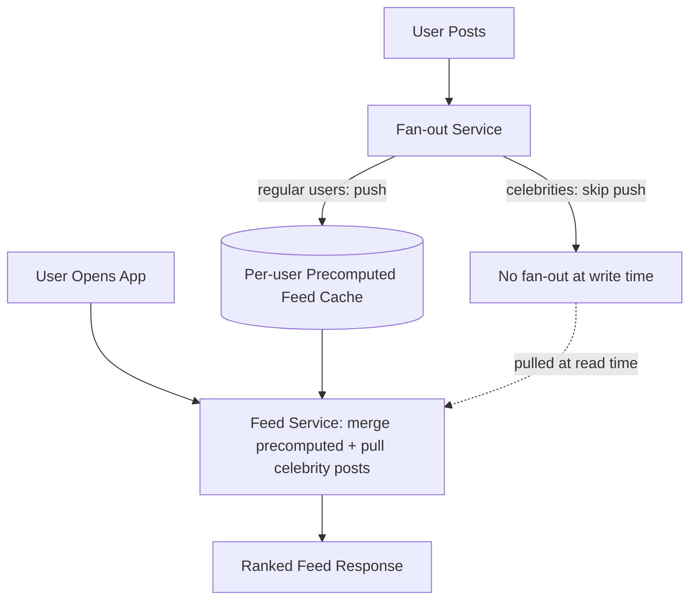
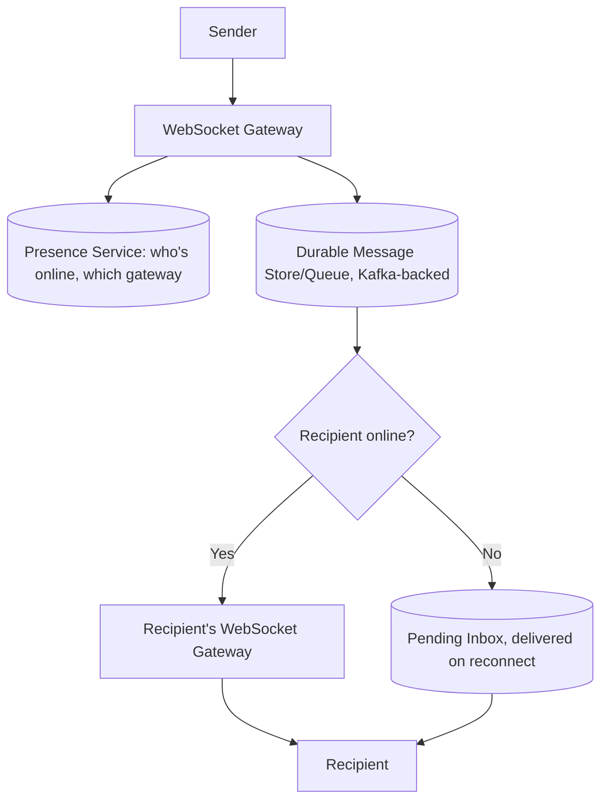
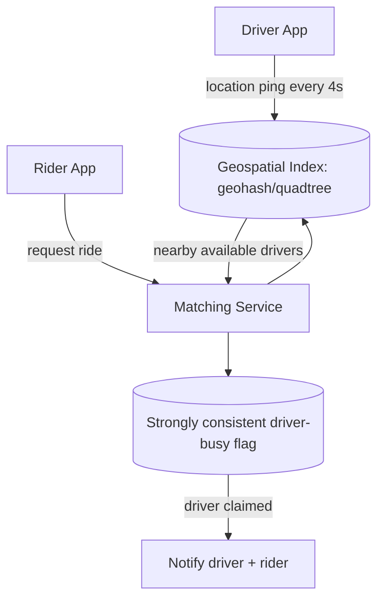
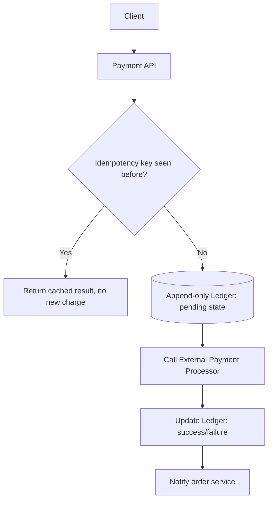
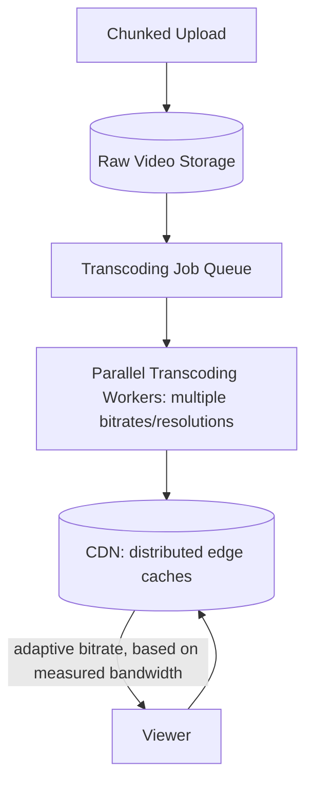
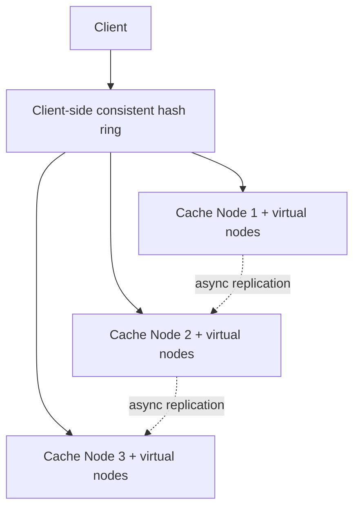

# Week 12: Interview Mastery and the Production GenAI Frontier

This week shifts from learning new material to performing under a clock. The system-design block runs six timed mock interviews (Days 78-83), each a transcript walking the 4-step framework from the interview-framework chapter against a fresh case study, so you can see exactly what a strong timed answer sounds like, not just read about one. The ML/GenAI block covers the production frontier: multimodal, long context, agentic coding, guardrails, cost/latency optimization, and how to keep reading papers efficiently once this plan ends. Day 84 is revision plus a mini project.

## Day 78: Framework Drill 1 — News Feed, and the Trade-off Vocabulary Cheat Sheet

**System Design: Framework Drill 1 — News Feed (Twitter/Instagram)** (55 min)

Before the first drill, fix the trade-off vocabulary you'll reuse all week — the specific phrasing that separates a senior answer from a feature list:

| Instead of saying... | Say... |
|---|---|
| "This needs to scale" | "At X requests/sec, a single node can't keep up, so I'd shard by Y" |
| "I'll use a queue" | "I need multiple independent consumers to replay the stream, so Kafka over RabbitMQ" |
| "It might fail" | "This call needs a circuit breaker, because a slow dependency would block every request thread" |
| "I think this is fine" | "I'm consciously not solving exact-once delivery here — idempotency keys give the same effect more cheaply" |
| "Let me reconsider" | "Actually, thinking about this more, X would make range queries expensive here — I'd switch to Y" |

Set a 45-minute timer and run the drill below like the real thing: read the prompt, produce your own requirements/estimation/HLD/deep-dive, and only then compare against the transcript.

**Prompt**: "Design a news feed like Twitter or Instagram's home timeline."

**[0-5 min] Requirements**: Functional — users post content, followers see posts in reverse-chronological or ranked order. Non-functional — read-heavy (often 100:1 read:write), p99 feed load under 300ms, eventual consistency acceptable (a post appearing 1-2s late for a follower is fine). Explicitly out of scope: comments, like-based ranking signals, ads.

**[5-10 min] Estimation**: Assume 200M DAU, 5 posts/day/active writer with a much smaller writer fraction (roughly 1:50 read:write skew), ~200 average followers/user, with a tail of celebrity accounts at 50M+ followers. Writes land around 230/sec average; reads around 23K/sec average, bursting well above that at peak hours.

**[10-25 min] High-Level Design**:



**[25-45 min] Deep dive — celebrity fan-out**: Fan-out-on-write (push a new post into every follower's precomputed feed cache immediately) keeps reads fast but costs one write per follower — fine for a 200-follower account, catastrophic for a 50M-follower celebrity posting once. Fan-out-on-read (pull celebrity posts and merge at read time) avoids that write storm but adds read-time merge cost to every follower's feed load. The senior move is a hybrid: a follower-count threshold decides which path a given author uses, and the merge happens transparently at read time so the client never needs to know which path served which post.

**ML / GenAI: Multimodal AI** (55 min)

Modern multimodal LLMs extend the transformer (file 03) by converting non-text inputs into the same token-embedding space the model already operates in. For images, a vision encoder (often a ViT — Vision Transformer) splits the image into patches, embeds each patch, and projects those embeddings into the LLM's token space, so image patches become "tokens" interleaved with text tokens in one sequence — self-attention then treats them uniformly. This is why multimodal capability mostly requires a new *encoder*, not a new decoder architecture.

Practical interview framing: image tokens are expensive — a single high-resolution image can cost hundreds to low thousands of tokens depending on the provider's tiling scheme, which directly affects cost and context budget (Week 10's cost optimization) for any multimodal RAG or agent system processing screenshots, scanned documents, or video frames.

Exercise — estimate a multimodal request's token cost:

```python
def estimate_image_tokens(width, height, tile_size=512, tokens_per_tile=170):
    tiles_x = (width + tile_size - 1) // tile_size
    tiles_y = (height + tile_size - 1) // tile_size
    return tiles_x * tiles_y * tokens_per_tile

cost = estimate_image_tokens(1920, 1080)
print(f"Estimated tokens for a 1920x1080 image: {cost}")
# Compare this to a typical 500-token text chunk -- a single screenshot
# can cost as much context budget as several retrieved RAG chunks.
```

**Recall** (10 min)
- Why does hybrid fan-out need a follower-count threshold instead of one fixed strategy for everyone?
- Pick one trade-off vocabulary phrase from today's table and state when you'd use it.
- Why does multimodal capability mainly require a new encoder, not a new decoder architecture?
- Why does image token cost matter specifically for multimodal RAG or agent systems?

**Go deeper**
- [CLIP paper (vision-language joint embedding), Radford et al. 2021](https://arxiv.org/abs/2103.00020)
- [Flamingo paper (interleaved multimodal few-shot learning), Alayrac et al. 2022](https://arxiv.org/abs/2204.14198)
- [Interview framework chapter](../../../course/01-system-design/08-interview-framework-and-questions.md)

## Day 79: Framework Drill 2 — Chat System (WhatsApp)

**System Design: Framework Drill 2 — Chat System** (55 min)

Set a 45-minute timer.

**Prompt**: "Design a one-on-one and group chat system like WhatsApp."

**[0-5 min] Requirements**: Functional — send/receive messages 1:1 and in groups, show delivery/read receipts, support offline delivery (message waits until recipient reconnects). Non-functional — at-least-once delivery (never silently drop a message), ordering preserved within a conversation, p99 send-to-delivery latency under 200ms when both parties are online. Out of scope: voice/video calls, end-to-end encryption key exchange details.

**[5-10 min] Estimation**: 500M DAU, 40 messages/user/day average -> ~230K messages/sec average, bursting several times higher around regional evening peaks. At 200 bytes/message, raw throughput is under 50MB/s — the real constraint is connection count (hundreds of millions of concurrent WebSocket connections), not message bandwidth.

**[10-25 min] High-Level Design**:



**[25-45 min] Deep dive — ordering and delivery guarantees**: Within one conversation, assign each message a monotonically increasing sequence number at write time, so even if messages arrive at the recipient out of network order, the client can reorder them before rendering. True exactly-once delivery across an unreliable network is impossible to guarantee (a sender timeout can't distinguish "delivered, ack lost" from "never delivered"), so the system targets at-least-once delivery with client-side deduplication by message ID — functionally equivalent to exactly-once from the user's perspective, without the impossible guarantee. For groups, fan-out happens at the message-store layer (one durable copy per recipient's pending inbox), the same push-vs-pull tension as yesterday's news feed, but here correctness (never silently dropping a message) matters more than read latency, so large groups still fan out on write rather than deferring to read time.

**ML / GenAI: Long Context** (55 min)

Context windows have grown from a few thousand tokens to over a million in frontier models, but a bigger window doesn't mean uniformly good use of it. The **"lost in the middle"** effect: models tend to attend more reliably to information near the start and end of a long context than to information buried in the middle, so simply stuffing more documents into context doesn't guarantee the model will actually use the relevant one if it lands in the middle of a huge prompt. Architecturally, scaling context cheaply requires moving beyond naive full self-attention (which costs quadratically in sequence length): **RoPE scaling** extends positional encodings to work at lengths beyond training, and **Ring Attention** distributes the attention computation across multiple devices so no single device needs to hold the full quadratic attention matrix in memory.

Practical implication for RAG (file 05): a bigger context window is not a substitute for good retrieval — placing the most relevant retrieved chunk first or last in the prompt, rather than trusting the model to find it wherever it lands, measurably improves answer quality on long-context tasks.

Exercise: write a 3-sentence answer to "a stakeholder wants to skip RAG entirely now that models support 1M-token context — what do you tell them?" using the lost-in-the-middle effect and cost-per-token scaling as your two concrete reasons.

**Recall** (10 min)
- Why does per-conversation sequence numbering solve ordering without requiring strict network-level in-order delivery?
- Why is true exactly-once delivery impossible, and what do real systems do instead?
- What is the "lost in the middle" effect, and why does it matter even with a huge context window?
- Name one architectural technique that makes very long context computationally feasible.

**Go deeper**
- ["Lost in the Middle" paper, Liu et al. 2023](https://arxiv.org/abs/2307.03172)
- [Ring Attention paper, Liu et al. 2023](https://arxiv.org/abs/2310.01889)
- [RAG chapter (retrieval still matters at any context length)](../../../course/04-ml-genai-agents/05-rag.md)

## Day 80: Framework Drill 3 — Ride-Sharing (Uber)

**System Design: Framework Drill 3 — Ride-Sharing** (55 min)

Set a 45-minute timer.

**Prompt**: "Design a ride-matching system like Uber."

**[0-5 min] Requirements**: Functional — riders request a ride, system matches to a nearby available driver, both parties track the ride in real time. Non-functional — match latency under 5 seconds, driver location updates every few seconds, strong consistency on "is this driver available" (never double-book a driver), eventual consistency acceptable for location pings.

**[5-10 min] Estimation**: 5M concurrent active drivers globally, each pinging location every 4 seconds -> ~1.25M location writes/sec; ride requests are far rarer (~2K/sec at peak), so the system's dominant write load is location pings, not matches — this should drive the architecture, not the (less frequent but higher-stakes) matching logic.

**[10-25 min] High-Level Design**:



**[25-45 min] Deep dive — mixed consistency**: Location pings are high-volume and tolerate staleness (a driver's position being 2 seconds old doesn't break matching) — these go through an eventually consistent geospatial index for cheap, fast writes. The driver-busy flag is the opposite: two riders simultaneously matched to the same driver is a real product failure, so that specific flag needs strong consistency (a single atomic claim operation, e.g., a conditional write or short-lived distributed lock), even though almost everything else in the system runs eventually consistent. This is the senior answer to "is this system eventually or strongly consistent" — it's neither uniformly; you pick consistency per data type based on what a violation actually costs.

**ML / GenAI: Agentic Coding** (55 min)

By 2025-2026, a meaningful share of code pull requests are agent-generated rather than hand-written, and SWE-bench (a benchmark of real GitHub issues an agent must resolve end-to-end — understand the codebase, write a fix, pass the test suite) has gone from ~60% to near-human-baseline success in roughly a year. The engineering shift this creates: the valuable human skill moves from writing code line-by-line to **task decomposition** (breaking a feature into agent-sized units of work), **review at scale** ("agentic quality control" — using a second AI pass, or your own three-judge-council pattern from Week 10, to review agent-written code before a human looks at it), and **architecture decisions** that agents aren't yet trusted to make unsupervised.

Failure modes specific to agentic coding worth naming in an interview: an agent can pass the given test suite while subtly breaking untested behavior (overfitting to the visible tests rather than the actual requirement), and multi-hour autonomous coding runs compound small early mistakes the same way any long agent loop does (file 06's error-cascade failure mode).

Exercise: write 3 sentences on how you'd design a review gate for agent-generated PRs in your own codebase — what would you require passing (test coverage delta, a second-model review pass, human approval for certain file paths) before merge.

**Recall** (10 min)
- Why does mixed consistency (strong for the busy flag, eventual for location) make more sense than one uniform consistency model?
- Why should location-ping volume drive this system's architecture more than ride-matching volume?
- What does SWE-bench actually measure, and why is "passes the given tests" not the same as "correctly solves the issue"?
- Name one failure mode specific to long-running autonomous agentic coding sessions.

**Go deeper**
- [SWE-bench paper, Jimenez et al. 2023](https://arxiv.org/abs/2310.06770)
- [Latest AI trends chapter (agentic coding section 2.3)](../../../course/04-ml-genai-agents/11-latest-ai-trends.md)
- [Agents and tool use chapter (failure modes)](../../../course/04-ml-genai-agents/06-agents-and-tool-use.md)

## Day 81: Framework Drill 4 — Payment System

**System Design: Framework Drill 4 — Payment System** (55 min)

Set a 45-minute timer.

**Prompt**: "Design a payment processing system that charges a customer's card and updates their order status."

**[0-5 min] Requirements**: Functional — accept a charge request, call an external payment processor, record the outcome, never double-charge even on retry. Non-functional — strong durability (a recorded payment must never be lost), idempotency under client/network retries, auditability (every state transition traceable).

**[5-10 min] Estimation**: 50K payments/minute at peak (~830/sec); each payment requires one external API call to the processor, which is the latency and reliability bottleneck, not the internal system — external call latency (100-500ms) dominates the end-to-end budget.

**[10-25 min] High-Level Design**:



**[25-45 min] Deep dive — idempotency and the append-only ledger**: A client retry (due to a timeout, not knowing whether the first request succeeded) must never result in a second real charge. The fix is an idempotency key supplied by the client, stored before the external call is made — a retry with the same key returns the already-recorded result instead of calling the processor again. The ledger itself is append-only (never update-in-place) because every state transition (pending -> charged -> refunded) must be auditable after the fact, and because reconciling with the external processor's own records requires a full history, not just a current snapshot. Two-phase commit across your service and the external processor is not an option (file 01-system-design/04, 2PC requires both participants to be co-operatively available, and you don't control the processor's internals) — so the design accepts a brief window of uncertainty (payment initiated but outcome unknown) and resolves it with a reconciliation job that polls the processor for any payment stuck in "pending" past a timeout, rather than trying to force synchronous certainty that the architecture can't actually provide.

**ML / GenAI: Guardrails in Production** (55 min)

Review and sharpen the layered-defense model for production GenAI safety: content moderation classifiers (e.g., Llama Guard-style models) screen both input and output *separately* from the main generation model, so moderation doesn't depend on the generating model choosing to refuse on its own; refusal calibration targets both under-refusal (harmful content slipping through) and over-refusal (declining benign requests, which is itself a quality failure, Week 9's harness discussion); and tool-use guardrails (least-privilege scoping, human-in-the-loop for irreversible actions, file 06) apply specifically to agentic systems. No single layer is a complete solution — this is the same defense-in-depth philosophy as prompt injection defenses and payment idempotency above: accept that no single mechanism gives a hard guarantee, and compose several imperfect but independent checks.

Exercise: for a customer support agent with a `send_refund` tool, list the specific guardrail you'd apply at each of three layers — input (before the request reaches the model), model (system prompt / refusal behavior), and tool-execution (before `send_refund` actually runs) — and state what each layer catches that the others don't.

**Recall** (10 min)
- Why must an idempotency key be stored before the external processor call, not after?
- Why is 2PC not viable for coordinating with an external payment processor?
- Why should a content moderation classifier run separately from the generation model rather than relying on the model's own refusal behavior?
- Why is over-refusal considered a real failure mode, not just extra caution?

**Go deeper**
- [Llama Guard paper, Inan et al. 2023](https://arxiv.org/abs/2312.06674)
- [Fine-tuning and LLMOps chapter (safety and alignment section)](../../../course/04-ml-genai-agents/08-fine-tuning-and-llmops.md)
- [Agents and tool use chapter (failure modes and guardrails table)](../../../course/04-ml-genai-agents/06-agents-and-tool-use.md)

## Day 82: Framework Drill 5 — Video Streaming (YouTube)

**System Design: Framework Drill 5 — Video Streaming** (55 min)

Set a 45-minute timer.

**Prompt**: "Design a video streaming platform like YouTube: upload, process, and play back video."

**[0-5 min] Requirements**: Functional — upload a video, transcode it into multiple qualities, stream playback that adapts to viewer bandwidth. Non-functional — upload supports large files (multi-GB) without failing on network blips, playback starts within ~2 seconds, serve a global audience with low latency.

**[5-10 min] Estimation**: 500 hours of video uploaded per minute globally (a real published YouTube-scale figure to anchor estimation); transcoding one hour of source video into 5 quality tiers takes meaningfully more compute than the video's own runtime, so transcoding is a parallelizable batch workload, not something done inline during upload.

**[10-25 min] High-Level Design**:



**[25-45 min] Deep dive — chunked upload and adaptive bitrate**: Uploads are split into chunks so a network interruption only requires resending the failed chunk, not restarting a multi-GB upload from zero — the client tracks which chunks succeeded and resumes from there. Transcoding runs as parallel batch jobs (split the source into segments, transcode segments concurrently across workers, reassemble) rather than one sequential job, since transcode time scales with the source video's length and quality tiers needed. Playback uses adaptive bitrate streaming (HLS/DASH): the video is pre-encoded into multiple quality levels split into short segments, and the player continuously measures available bandwidth and switches segment quality level in real time — this is why playback can start fast (begin at a low quality) and improve, rather than waiting to determine the "right" quality upfront.

**ML / GenAI: Cost and Latency Optimization in Practice** (55 min)

Pull together this course's cost levers into one decision flow: **model routing/cascading** sends simple requests to a small/cheap model and only escalates to a larger model when needed (Week 10's gateway); **prompt caching** avoids re-paying for a repeated prompt prefix (system prompts, long document context); **quantization** (Week 11) shrinks memory/cost per request for self-hosted models; and **speculative decoding** speeds up generation itself — a small draft model proposes several candidate next tokens, the large target model verifies all of them in one parallel pass, accepting matches and rejecting the rest, which is nearly as cheap as generating one token but produces several, since parallel verification is much cheaper than sequential generation.

Exercise: for a customer-facing chat product with a $0.02/request cost budget, write the order in which you'd apply these four levers (routing, caching, quantization, speculative decoding) and justify the order — which gives the biggest win for the least engineering effort first.

**Recall** (10 min)
- Why does chunking uploads make large-file uploads resilient to network interruptions?
- Why does adaptive bitrate streaming let playback start fast without knowing the "right" quality upfront?
- Why is speculative decoding's parallel verification step cheaper than generating the same number of tokens sequentially?
- Which cost lever would you reach for first for a product with a strict per-request cost budget, and why?

**Go deeper**
- [Speculative decoding paper, Leviathan et al. 2022](https://arxiv.org/abs/2211.17192)
- [Fine-tuning and LLMOps chapter (cost optimization section)](../../../course/04-ml-genai-agents/08-fine-tuning-and-llmops.md)
- [Case studies chapter (video platform case study)](../../../course/01-system-design/07-case-studies.md)

## Day 83: Framework Drill 6 — Distributed Cache, and Leading the Interview

**System Design: Framework Drill 6 — Distributed Cache, and How to Lead the Interview** (55 min)

Set a 45-minute timer for the drill, then read the leading-the-interview notes below.

**Prompt**: "Design a distributed in-memory cache, like building Redis or Memcached at the system level."

**[0-5 min] Requirements**: Functional — get/set/delete by key, support expiration (TTL). Non-functional — sub-millisecond reads, horizontal scalability, tolerate node failure without losing more than a small window of recent writes.

**[5-10 min] Estimation**: 10M keys, average value 1KB -> ~10GB total data; well within a single beefy node's RAM, so the case for sharding here comes from request throughput (millions of ops/sec) and fault tolerance, not raw data volume alone — worth stating explicitly, since it's a common interview trap to shard purely because the data "sounds big."

**[10-25 min] High-Level Design**:



**[25-45 min] Deep dive — hot keys**: Consistent hashing with virtual nodes spreads each physical node's data across many ring positions, so when a node fails its load redistributes evenly across many survivors instead of dumping onto one unlucky neighbor. But consistent hashing alone doesn't fix a **hot key** — one key (a viral post's cache entry, say) receiving disproportionate traffic regardless of which node owns it. Mitigation: replicate that specific key across multiple nodes with client-side random selection among replicas, or add a small local in-process cache layer in front of the shared cluster for the hottest few keys, detected via per-key access-rate monitoring.

**Leading the interview**: the six drills this week should have made one pattern automatic — state assumptions out loud, narrow scope proactively, name failure modes before being asked, and visibly revise when you spot a problem with your own earlier choice. The behavioral-leadership track's ownership and "disagree and commit" framing applies directly here: an interviewer respects a candidate who says "actually, I want to revise my sharding key" far more than one who silently defends a choice that's visibly not working. Treat the 45 minutes as a collaboration you're steering, not an interrogation you're surviving — propose the next step rather than waiting to be asked what's next.

**ML / GenAI: Reading Papers Efficiently** (55 min)

You'll keep encountering new papers after this plan ends, so build the habit now. A practical three-pass method: **Pass 1** (5 min) — read the abstract, skim figures/tables, read the conclusion; decide if the paper is relevant enough to continue. **Pass 2** (15-20 min) — read the method section for the core idea and read the experiments section for what was actually measured, skip proof details; you should be able to explain the idea to a colleague after this pass. **Pass 3** (only for papers that directly affect a design decision you're making) — work through derivations/proofs and check the related-work section for what the paper is positioned against.

Interview-usable habit loop from the trends chapter: skim daily headlines (10 min), read one paper or lab blog post weekly (30 min), skim a survey monthly (1 hour) — this is a sustainable cadence, not a one-time cram, and it's exactly what lets you answer "how do you stay current" with a real, specific number rather than a vague claim.

Exercise: pick one paper linked anywhere in this course that you haven't fully read, and run Pass 1 and Pass 2 on it in the time remaining — write 3 sentences summarizing the core idea as if explaining it to a colleague who hasn't read it.

**Recall** (10 min)
- Why doesn't 10GB of total data alone justify sharding a cache — what does?
- What's the difference between consistent hashing's failure-redistribution benefit and hot-key mitigation, and why does one not solve the other?
- Name one concrete behavior from this week's drills that signals "leading the interview" rather than just answering questions.
- What should you be able to do after Pass 2 of reading a paper, before ever attempting Pass 3?

**Go deeper**
- ["How to Read a Paper," Keshav 2007 (the three-pass method)](https://blizzard.cs.uwaterloo.ca/keshav/home/Papers/data/07/paper-reading.pdf)
- [Leadership principles chapter (ownership, disagree and commit)](../../../course/05-behavioral-leadership/02-leadership-principles-and-company-guides.md)
- [Latest AI trends chapter (staying current habit loop)](../../../course/04-ml-genai-agents/11-latest-ai-trends.md)

## Day 84: Revision + Mini Project

**System Design: Week 12 Revision** (55 min)

Re-derive from memory, without looking back: the fan-out trade-off from Day 78 and the different consistency requirements from Days 79-80 (ordering/delivery vs. mixed consistency); the idempotency and append-only-ledger reasoning from Day 81; chunked upload and adaptive bitrate from Day 82; and hot-key mitigation from Day 83. For each, write one sentence from memory, then check it.

**Mini project**: pick one case study from the interview-framework chapter's 30-question list that wasn't drilled this week (e.g., URL shortener, notification system, or search autocomplete) and run the full 45-minute timed drill on it cold, writing out your own requirements/estimation/HLD/deep-dive before checking the chapter's answer outline.

**ML / GenAI: Week 12 Revision** (55 min)

Re-derive: why image tokens are expensive and what that means for multimodal RAG cost; the lost-in-the-middle effect and why huge context doesn't replace retrieval; what SWE-bench measures and agentic coding's specific failure modes; the three-layer guardrail model and why over-refusal is a real failure; the cost/latency lever stack (routing, caching, quantization, speculative decoding) and the order you'd apply them; and the three-pass paper-reading method.

**Mini project**: run the three-pass reading method (Day 83) on one paper you haven't yet read from this week's links, and write a 5-sentence summary suitable for explaining the paper's core idea in an interview setting — practice compressing a full paper into an interview-length answer, which is a skill distinct from understanding the paper itself.

**Recall** (10 min)
- State, from memory, the four cost/latency levers from Day 82 in the order you'd apply them.
- What's the one-sentence difference between fan-out-on-write and fan-out-on-read, and when does each win?
- Name one specific behavior that signals you're leading an interview rather than just surviving it.

**Go deeper**
- Re-read any day above whose recall questions you missed.
- [Interview framework chapter for a full second pass](../../../course/01-system-design/08-interview-framework-and-questions.md)
- [Case studies chapter for the questions not yet drilled](../../../course/01-system-design/07-case-studies.md)
