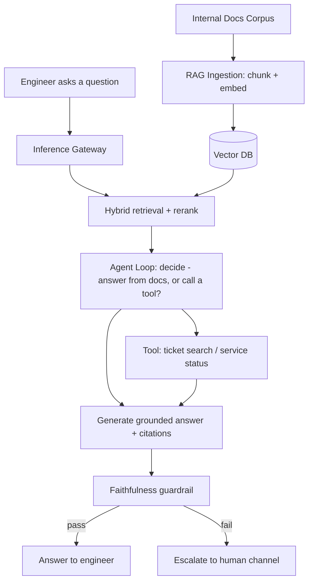

# Week 13: Capstone and Final Mock Interviews

The last six days of the plan. The system-design side specs, designs, and deep-dives one end-to-end AI product, then runs two fresh full-length mock HLD interviews. The ML/GenAI side builds and evaluates a small real RAG + agent application end to end — ingestion, agent loop, eval harness, and a write-up — then closes with a final mock ML/GenAI interview. There is no separate revision day this week; the capstone itself is the integration exercise.

## Day 85: Capstone Kickoff — Spec the Product, Scope the App

**System Design: Capstone Product Spec** (55 min)

Pick one concrete end-to-end AI product to spec, design, and deep-dive across the next three days. Use this one unless you have a stronger personal example: **"DocuMentor" — an internal engineering-docs Q&A and troubleshooting agent** that answers questions grounded in a company's internal documentation and runbooks, and can call tools (search a ticket system, check a service's current status) when a question needs live information rather than static docs.

Write a one-page spec with four sections. **Problem statement**: engineers waste time searching scattered docs/runbooks/Slack history for answers that already exist somewhere. **Users**: internal engineers, on-call responders. **Functional requirements**: answer questions grounded in indexed docs with citations; when a question needs live data (service status, recent incidents), call the appropriate internal tool instead of guessing; escalate to a human channel when confidence is low. **Non-functional requirements**: p99 answer latency under 5 seconds for the retrieval+generation path (tool-calling paths may run longer), answers must be faithful to retrieved/tool-returned content (no fabricated runbook steps), support at least 500 internal documents and grow over time. **Explicitly out of scope** for this capstone: fine-tuning a custom model, multi-region deployment, SSO integration — name these out loud the way a senior candidate narrows scope in a live interview.

**ML / GenAI: Capstone App Scoping** (55 min)

Scope the actual small app you will build and evaluate over the next five days — this should be runnable on your own machine in a single sitting per day, not the full platform from the spec above. Concretely: a document corpus of 10-30 real files you already have access to (this course's own `course/` markdown files are a convenient, ready-made corpus), a simple chunking + embedding + retrieval pipeline, an agent loop with at least one real tool (e.g., a function that searches a small mock "ticket" list, or reads a local file), and a handful of hand-written test questions with expected answers.

Write your scope down as a short checklist now, since the next four days build directly on it: (1) corpus identified, (2) 8-10 test questions written with expected answers/behaviors, (3) at least one tool defined beyond pure retrieval, (4) a clear definition of "pass" for each test question (a citation present, a specific fact correct, a specific tool called).

**Recall** (10 min)
- Why does explicitly naming out-of-scope items matter as much as naming in-scope requirements?
- What makes "faithful to retrieved content" a testable non-functional requirement rather than a vague goal?
- Why does the capstone app need at least one real tool beyond retrieval, not just a RAG pipeline?
- Why write expected answers for test questions now, before building anything?

**Go deeper**
- [ML/GenAI system design chapter (production RAG chatbot section, the closest template to DocuMentor)](../../../course/04-ml-genai-agents/09-ml-system-design.md)
- [Interview framework chapter (requirements step)](../../../course/01-system-design/08-interview-framework-and-questions.md)

## Day 86: Capstone HLD, and Building the RAG Ingestion Pipeline

**System Design: Capstone High-Level Design** (55 min)

Draw the full HLD for DocuMentor, reusing components from Weeks 10-11 by name rather than reinventing them: an inference gateway (Day 65) in front of generation calls for routing/caching/cost tracking; a RAG platform (Day 66) for ingestion and retrieval over the docs corpus; an agent loop (file 06) layered on top for tool-calling questions; and an eval harness (Day 67/75) running continuously against a golden dataset built from real engineer questions.



State the component choices with one-sentence justifications tied to yesterday's requirements, exactly as the framework drills practiced: "I'd put a faithfulness guardrail before the response because an internal runbook agent giving a confidently wrong fix step is worse than it saying 'I don't have enough information.'"

**ML / GenAI: Build the RAG Ingestion Pipeline** (55 min)

Implement the actual ingestion pipeline for your scoped corpus: chunk the documents, embed each chunk, and store them for retrieval. Keep it runnable in one sitting — a local embedding model or a single API's embedding endpoint, and an in-memory or lightweight local vector store (Chroma, or even a plain list with cosine similarity for a corpus this small) are all fine; the goal is a working pipeline, not production infrastructure.

```python
import os
from pathlib import Path

def chunk_text(text, chunk_size=500, overlap=50):
    chunks, start = [], 0
    while start < len(text):
        end = start + chunk_size
        chunks.append(text[start:end])
        start = end - overlap
    return chunks

def ingest_corpus(corpus_dir):
    records = []
    for path in Path(corpus_dir).rglob("*.md"):
        text = path.read_text(errors="ignore")
        for i, chunk in enumerate(chunk_text(text)):
            records.append({"source": str(path), "chunk_id": i, "text": chunk})
    return records

# records = ingest_corpus("course/")
# print(f"Ingested {len(records)} chunks from the corpus")
# Next: embed each record["text"] and store (vector, record) pairs for retrieval.
```

Run this against your chosen corpus today and confirm you get a sensible chunk count — this is the foundation every later capstone day builds on, so verify it now rather than discovering a bug on Day 88 while debugging the eval harness.

**Recall** (10 min)
- Why does the capstone HLD reuse named components from Weeks 10-11 rather than designing fresh ones?
- Why does the faithfulness guardrail sit before the response is returned, not after?
- Why is overlap used between consecutive chunks in the ingestion pipeline?
- Why verify the ingestion pipeline's output today rather than waiting until the eval harness is built?

**Go deeper**
- [RAG chapter (chunking strategies section)](../../../course/04-ml-genai-agents/05-rag.md)
- [RAG platform architecture (Day 66, Week 10's inference gateway chapter)](../../../course/04-ml-genai-agents/08-fine-tuning-and-llmops.md)

## Day 87: Capstone Deep Dives, and the Agent Loop

**System Design: Capstone Deep Dives** (55 min)

Pick two deep dives, the same way an interviewer would steer you into the hardest parts of DocuMentor.

**Deep dive 1 — cost isolation if this becomes multi-tenant**: if other internal teams want their own doc corpus on the same platform, apply Day 66's per-tenant namespace pattern — isolate each team's vectors and track cost per tenant through the gateway's logging (Day 65), so one team's heavy usage doesn't silently inflate another team's bill or degrade their retrieval latency via noisy-neighbor effects on a shared vector cluster.

**Deep dive 2 — scaling to 10x question volume**: if DocuMentor goes from a pilot with 50 engineers to company-wide adoption, the first bottleneck is almost always the generation step's GPU/API capacity, not retrieval (vector search stays cheap even at 10x query volume) — so the fix is model routing (send simple lookup-style questions to a cheaper/faster model, escalate only genuinely complex troubleshooting questions to a stronger model) rather than naively scaling every request path uniformly.

Write two or three sentences per deep dive stating the trade-off explicitly, the way Day 83's "leading the interview" notes described — name the alternative you didn't pick and why.

**ML / GenAI: Build the Agent Loop** (55 min)

Implement a minimal ReAct-style loop (Day 61's skeleton, extended) for DocuMentor: given a question, the agent decides whether to answer directly from retrieved chunks or call a tool first (e.g., a mock "check ticket status" function), then generates a final grounded answer.

```python
def mock_ticket_lookup(ticket_id: str) -> dict:
    tickets = {"T-101": {"status": "open", "summary": "DB connection pool exhaustion"}}
    return tickets.get(ticket_id, {"status": "not_found"})

TOOLS = {"ticket_lookup": mock_ticket_lookup}

def run_docu_agent(question, retrieved_chunks, max_steps=4):
    history = []
    for step in range(max_steps):
        decision = llm_decide(question, retrieved_chunks, history)  # your LLM call
        if decision["action"] == "call_tool":
            result = TOOLS[decision["tool"]](**decision["args"])
            history.append((decision, result))
        elif decision["action"] == "final_answer":
            return decision["answer"]
    return "Could not resolve within step limit -- escalating to human."
```

Run this against 2-3 of your Day 85 test questions today, including at least one that should trigger the tool call and one that should be answered purely from retrieved chunks — confirming the branch logic works before Day 88's eval harness needs to grade it at scale.

**Recall** (10 min)
- Why does cost isolation for a multi-tenant DocuMentor need per-tenant tracking, not just a shared cost total?
- Why is model routing the right first fix for 10x question volume, rather than scaling every path uniformly?
- Why test both a tool-triggering question and a retrieval-only question today, not just one?
- What would happen to this agent loop without the `max_steps` limit?

**Go deeper**
- [Agents and tool use chapter (ReAct loop and failure modes)](../../../course/04-ml-genai-agents/06-agents-and-tool-use.md)
- [ML/GenAI system design chapter (AI agent platform section)](../../../course/04-ml-genai-agents/09-ml-system-design.md)

## Day 88: Mock HLD Interview #1, and Building the Eval Harness

**System Design: Mock HLD Interview #1 — Collaborative Document Editor** (55 min)

Set a 45-minute timer. This prompt hasn't appeared anywhere else in the plan — treat it as a real interview.

**Prompt**: "Design a collaborative document editor like Google Docs, where multiple users can edit the same document simultaneously and see each other's changes in real time."

Run the full framework yourself before reading further: requirements (functional — concurrent multi-user editing, real-time updates, conflict-free merging of simultaneous edits; non-functional — edits visible to other users within ~100ms, no lost edits even under simultaneous conflicting changes), estimation (state your own assumptions about concurrent editors per document and documents per org), high-level design (a diagram with a WebSocket layer for real-time sync, a document service, and persistent storage), and a deep dive you choose yourself.

The deep dive almost every strong candidate reaches here is **conflict resolution for simultaneous edits**: Operational Transformation (OT) or CRDTs (Conflict-free Replicated Data Types) let multiple clients apply concurrent edits and converge to the same final document state without a central lock serializing every keystroke — CRDTs are generally preferred in newer systems because they don't require a central server to resolve ordering, trading some memory overhead (metadata per edit) for simpler, server-optional convergence guarantees. State which one you'd pick and why, the same way you've practiced trade-off vocabulary all week.

**ML / GenAI: Build the Capstone Eval Harness** (55 min)

Build the eval harness for DocuMentor using Week 10's layered pattern: mechanical checks first (does the answer cite a source? did the right tool get called for tool-requiring questions?), then an LLM-judge pass for subjective quality (is the answer actually helpful and faithful to the retrieved/tool content?) only on cases that pass the mechanical layer.

```python
def grade_docu_response(question, answer, expected, retrieved_chunks, tool_called):
    checks = {
        "has_citation": any(src in answer for src in [c["source"] for c in retrieved_chunks]),
        "correct_tool": tool_called == expected.get("expected_tool"),
    }
    mechanical_pass = all(checks.values()) if expected.get("expected_tool") else checks["has_citation"]
    if not mechanical_pass:
        return {"pass": False, "layer": "mechanical", "checks": checks}
    # Only reaches judge scoring if mechanical checks pass -- same cost
    # discipline as Week 10's gateway/eval-harness pattern.
    judge_score = judge_faithfulness(answer, retrieved_chunks)  # your LLM-judge call
    return {"pass": judge_score >= 4, "layer": "judge", "score": judge_score}
```

Run this against all 8-10 test questions from Day 85 and record the pass rate — this is your capstone's first real result.

**Recall** (10 min)
- Why do CRDTs trade metadata overhead for not needing a central server to resolve edit ordering?
- What specific signal told you to deep-dive on conflict resolution rather than, say, storage design, for this prompt?
- Why must mechanical checks run before the judge call in the DocuMentor harness, not after?
- What does today's pass-rate number actually tell you about the capstone app so far?

**Go deeper**
- [CRDT survey (Shapiro et al., foundational CRDT paper)](https://hal.inria.fr/inria-00555588/document)
- [Evaluation and harness chapter](../../../course/04-ml-genai-agents/07-evaluation-and-harness.md)

## Day 89: Mock HLD Interview #2, and Running the Eval

**System Design: Mock HLD Interview #2 — Distributed Job Scheduler** (55 min)

Set a 45-minute timer. Another fresh prompt.

**Prompt**: "Design a distributed job scheduler, like a system that lets internal teams submit jobs (one-off or recurring, like a cron job) to run on a shared compute cluster."

Run the full framework: requirements (functional — submit one-off and recurring jobs, track job status, retry failed jobs; non-functional — no job silently lost, no job run twice for an at-most-once job type, support thousands of concurrent jobs), estimation (jobs/sec submitted, average job runtime, cluster size needed), high-level design (a diagram with a scheduler service, a worker pool, and a job state store), and your own deep dive choice.

A strong deep dive here is **leader election for the scheduler itself** — if you run multiple scheduler instances for availability, only one should actively be assigning jobs to workers at a time, or you risk the same job being dispatched twice. This ties directly back to Week 5's consensus/leader-election material: use a consensus protocol (Raft) or a distributed lock (e.g., via a strongly consistent coordination service) to elect a single active scheduler, with the others on standby ready to take over if the leader fails — naming this unprompted, while drawing the diagram, is exactly the "naming failure modes before being asked" signal from the interview framework chapter.

**ML / GenAI: Run the Eval and Iterate** (55 min)

Look at Day 88's eval results. For every failing test question, classify the failure the way Day 76's drift-triage structure suggested: was it a retrieval failure (the right chunk never got retrieved — fix chunking or embedding), a tool-calling failure (wrong tool or wrong arguments — fix the agent's tool-selection prompt), or a generation/faithfulness failure (right content retrieved but the answer ignored or misused it — fix the generation prompt's grounding instructions).

Make one targeted fix based on your most common failure category, rerun the eval harness, and record whether the pass rate improved. Write a short before/after note: what you changed, what moved, and what's still failing — this before/after record is the single most interview-usable artifact from the whole capstone, since "I built X" is a weaker story than "I built X, measured it, found Y was broken, fixed it, and improved the pass rate from A to B."

**Recall** (10 min)
- Why does a multi-instance scheduler need leader election rather than letting every instance assign jobs independently?
- Which consensus concept from Week 5 does scheduler leader election reuse directly?
- Why classify a failing eval case by which pipeline stage caused it, rather than just re-trying with a different prompt blindly?
- Why is a before/after measurement more valuable in an interview than a simple "I built an agent" claim?

**Go deeper**
- [Distributed systems advanced chapter (consensus and leader election)](../../../course/01-system-design/04-distributed-systems-advanced.md)
- [RAG chapter (debugging retrieval vs. generation failures)](../../../course/04-ml-genai-agents/05-rag.md)

## Day 90: Capstone Write-Up, and the Final Mock ML/GenAI Interview

**System Design: Capstone Write-Up and Plan Close** (55 min)

Consolidate Days 85-89 into one short document with four sections: the product spec (Day 85), the HLD diagram and component justifications (Day 86), your two deep dives with their trade-offs stated explicitly (Day 87), and a one-paragraph retrospective on what you'd do differently if you rebuilt DocuMentor's design today. This write-up, plus your performance on the two fresh mock interviews (Days 88-89), is the concrete evidence that the HLD framework from Day 78 has become automatic rather than something you're still consciously assembling step by step.

Close the system-design side of the plan by skimming back through the interview framework chapter's "How a 10-12 Year Candidate Signals Seniority" section one final time — every signal it names (trade-off language, naming failure modes unprompted, quantified reasoning, acknowledging what you're not solving, visibly correcting course, operational awareness) should now map to a specific moment from one of this week's six drills or two mock interviews, not feel like abstract advice.

**ML / GenAI: Final Mock ML/GenAI Interview** (55 min)

Set a 30-minute timer and answer, out loud, without looking at the source material, a mixed set of 8 questions pulled from across the ML/GenAI interview question drill: pick 2 from ML fundamentals, 2 from LLMs/transformers, 2 from RAG/agents, and 2 from the scenario/system-design section. Say each answer out loud before checking it against the drill file — this rehearsal, not re-reading, is what makes an answer retrievable under real interview pressure, the same lesson Week 12's behavioral-leadership material gave for story-bank questions.

Finish by writing a 4-6 sentence conclusion for your capstone write-up: what DocuMentor's eval pass rate ended at, the single biggest lesson from building and evaluating it (likely something about retrieval quality mattering more than prompt tuning, or about how much eval-harness design shapes what bugs you actually catch), and one concrete next step you'd take if you kept building it past this plan. This closes the loop the plan opened on Day 1: you now have a real, measured, built-and-evaluated project to speak from in any future interview, not just memorized definitions.

**Recall** (10 min)
- Pick one seniority signal from the interview framework chapter and name the specific moment this week where you demonstrated it.
- Why does saying your answer out loud, rather than re-reading it, matter for interview readiness?
- What's your capstone's single biggest lesson, stated in one sentence?

**Go deeper**
- [Interview question drill (the full 60+ Q&A bank you pulled from today)](../../../course/04-ml-genai-agents/10-interview-questions.md)
- [Senior/staff question bank (for the behavioral round that typically follows a technical loop)](../../../course/05-behavioral-leadership/03-senior-staff-questions-and-negotiation.md)
