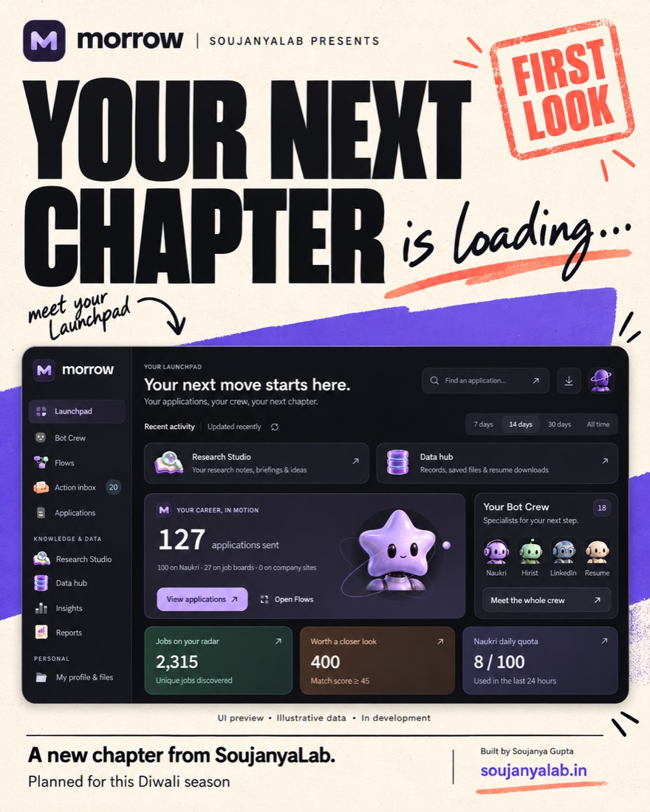
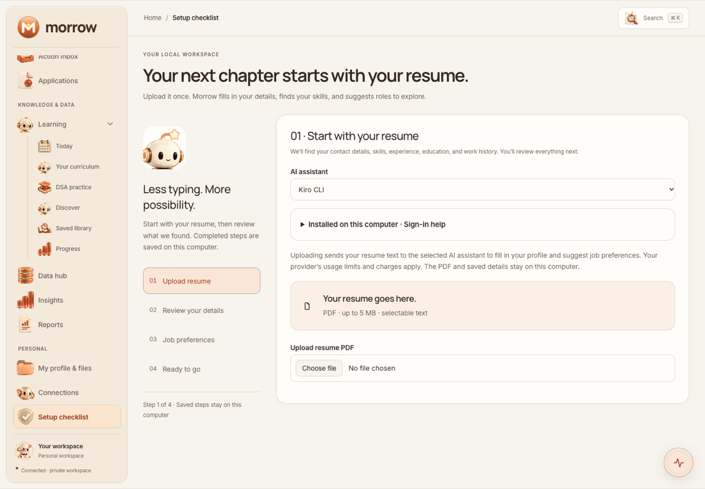
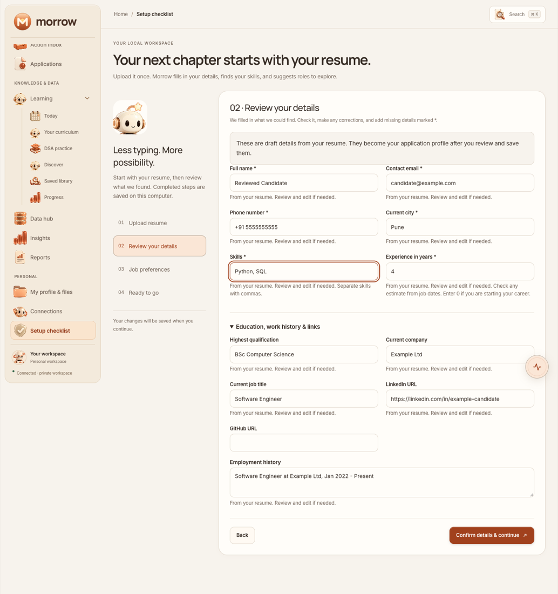
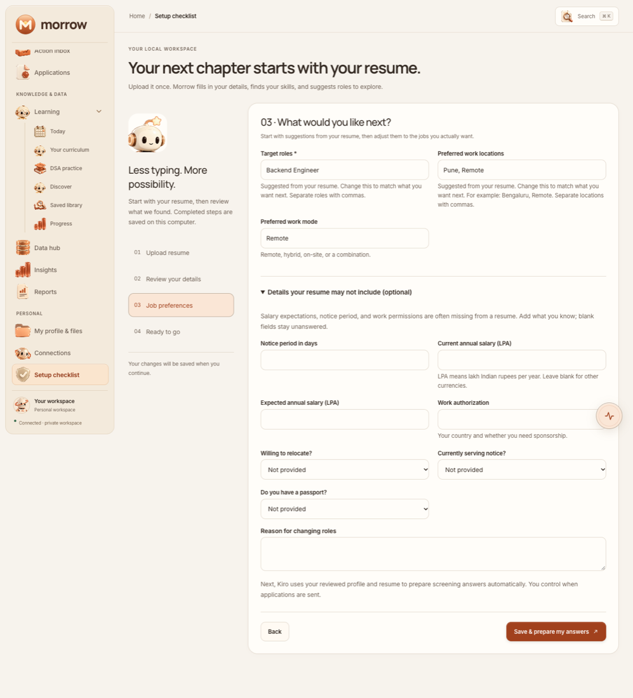
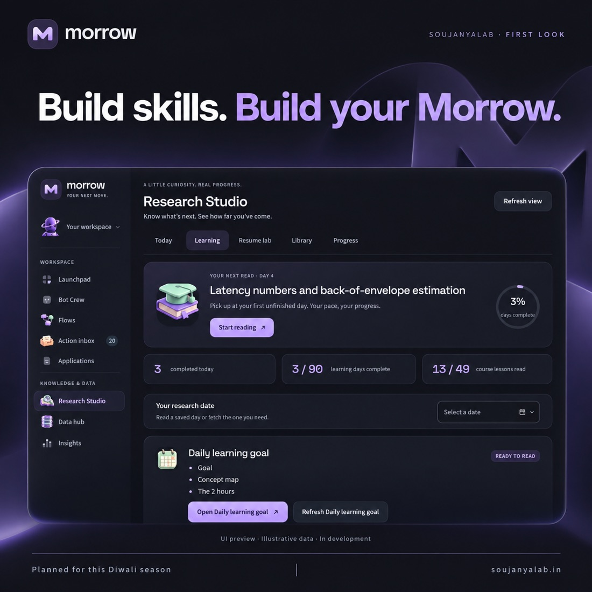
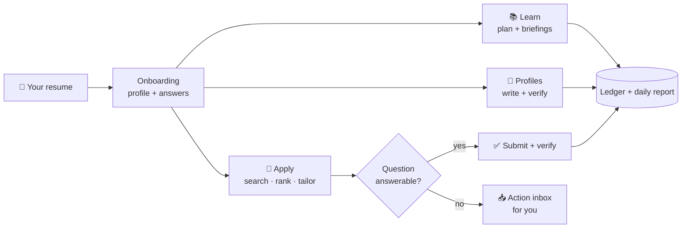

<div align="center">

# Morrow

### Your career workspace that studies with you, tailors your resume and applies for you, all on your own computer

[](https://github.com/GuptaSoujanya/Morrow/releases/tag/v1.0.0)
[](https://python.org)
[](#-quick-start)
[](#-verify-it-works)
[](LICENSE)

**[Quick start](#-quick-start)** · **[Screenshots](#-a-look-inside)** · **[What it does](#-what-it-does)** · **[How it works](#-how-it-works)** · **[Full guide](GUIDE.md)** · **[SoujanyaLab](https://www.soujanyalab.in/)**

<br/>



</div>

<br/>

> [!NOTE]
> **The beta is free.** There's no account, subscription or payment. Your data stays on your machine; it only goes out through the browsers you sign in to and the AI CLI you already use (Claude Code or Kiro).

## ✨ Why Morrow

<table>
<tr>
<td width="33%" valign="top">

### ✅ Checked on the page
Morrow only reports a login, application, profile save or post as done after it has checked the page and seen it there.

</td>
<td width="33%" valign="top">

### 🔒 Nothing made up
Answers come only from your resume, your facts and what you've told it. When it doesn't know, it asks you in the **Action inbox** instead of guessing.

</td>
<td width="33%" valign="top">

### 🧾 Every run is recorded
Each run writes to an SQLite ledger and a daily report with links, keeps its full log, and saves the exact resume each recruiter received.

</td>
</tr>
</table>

---

## 🚀 Quick start

```bash
git clone --recurse-submodules https://github.com/GuptaSoujanya/Morrow.git
cd Morrow
bash setup.sh
```

That's it. `setup.sh` does the following, in order:

| Step | What happens |
|:---:|---|
| 1️⃣ | Installs Python 3.11+, Node.js, Poppler and Chrome if they're missing |
| 2️⃣ | Creates `venv/` and installs the locked Python and dashboard packages |
| 3️⃣ | Signs you in to **Claude Code** or **Kiro CLI** |
| 4️⃣ | Installs the `morrow` command and starts the dashboard |
| 5️⃣ | Opens **http://127.0.0.1:8100/#/onboarding**, where you upload your resume and confirm your details |

<details>
<summary><b>setup.sh flags</b></summary>

| Flag | Effect |
|---|---|
| `--provider claude\|kiro` | choose the AI CLI without being asked |
| `--skip-login` | skip the AI CLI sign-in step |
| `--no-start` | install everything, but don't start the dashboard |
| `--no-open` | start the dashboard, but don't open the browser |
| `--check` | only report what's installed and what's missing |

</details>

<details>
<summary><b>Prefer to set it up by hand?</b></summary>

```bash
python3 -m venv venv && source venv/bin/activate
pip install -r requirements.lock
./scripts/setup_user.sh          # your private data repo -> user/, and .env
python3 -m pipeline onboard      # resume + facts -> user/inputs/
python3 -m naukri_bot --dry-run  # see what it would apply to; clicks nothing
scripts/morrow install && morrow start
```

</details>

### Day to day

| Command | Does |
|---|---|
| `morrow start` | start the dashboard on http://127.0.0.1:8100 |
| `morrow stop` | stop it |
| `morrow status` | check whether it's running |
| `morrow logs` | follow the dashboard log |
| `python3 -m pipeline` | run the whole morning: study, profiles, applications, briefings (picks up where it stopped) |

> [!TIP]
> The first real run on each site opens a visible Chrome window so you can enter the OTP. After that the session is saved under `user/browser/` and later runs sign in on their own.

---

## 📸 A look inside

<table>
<tr>
<td width="50%"><p align="center"><b>1 · Upload your resume</b></p></td>
<td width="50%"><p align="center"><b>2 · Review what Morrow found</b></p></td>
</tr>
<tr>
<td width="50%"><p align="center"><b>3 · Pick the jobs you want</b></p></td>
<td width="50%"><p align="center"><b>Learn every day in Research Studio</b></p></td>
</tr>
</table>

<sub>The screenshots use example data.</sub>

---

## 🧩 What it does

| | Feature | Highlights |
|---|---|---|
| 📚 | **Learn** | 90-day interview plan, daily AI-researched briefings, DSA practice with a code runner, streaks, XP and badges |
| 👤 | **Profile** | Writes one profile plan from your resume to Naukri, LinkedIn, Hirist, Instahyre, Cutshort and Wellfound, then checks each one |
| 📄 | **Resume** | Compiles your LaTeX resume and tailors it for each job by reordering what's already there, never adding to it |
| 🎯 | **Apply** | Naukri, Hirist, Instahyre, Cutshort, Wellfound and company career sites (Greenhouse, Lever, Workday and more), ranked by an LLM against your resume |
| 💬 | **Answer** | Fills in screening questions from your answers, your profile and quotes from your resume. If none of them has the answer, it asks you |
| ✉️ | **Outreach** | Writes cold-email drafts to recruiters and one LinkedIn post a day, in your voice |
| 📊 | **Report** | One daily report with what was applied, what was tried, what's left for you, and every run's log |
| 🖥️ | **Dashboard** | Every bot as a button, live logs, a live view of each bot's browser, a Stop button, the application ledger and insights |

### Supported job boards


---

## ⚙️ How it works



Each site runs in its own process with its own Chrome profile. You can also run each one in its own Docker container and watch its screen in your browser.

---

## 🧰 Requirements

| Tool | Why |
|---|---|
| **macOS** (Linux works for the bots) | launchd schedules are macOS-only |
| **Python 3.11+**, **Node 22.19+** | the bots and the dashboard |
| **Google Chrome** | every bot drives a real browser |
| **Claude Code** or **Kiro CLI**, signed in | ranking, answers, briefings, writing (no API key needed) |
| **tectonic** *(optional)* | compiling and tailoring a LaTeX resume |
| **Docker** *(optional)* | one container per site |

`setup.sh` installs the required ones for you.

---

## ✅ Verify it works

```bash
venv/bin/python -m pytest -q tests   # ~2 minutes
python3 -m pipeline status           # today's progress (read-only)
morrow status                        # is the dashboard up?
```

<details>
<summary><b>Common problems</b></summary>

| Problem | Fix |
|---|---|
| `ModuleNotFoundError` | `pip install -r requirements.lock` inside the venv |
| Exit code 2, "needs a human" | run with a visible window and finish the OTP in Chrome |
| Dashboard port busy | `morrow start --port 8116`, or stop the process `morrow start` names |
| A board says "signed out" | sign in again from the dashboard's **Connections** page |
| Tailoring fails | needs a `.tex` resume and `brew install tectonic` |

More in the [full guide](GUIDE.md#troubleshooting).

</details>

---

## 📖 Learn more

| Document | What's in it |
|---|---|
| **[GUIDE.md](GUIDE.md)** | every feature, command, dashboard page and `.env` key in detail |
| [froned-dashbord/README.md](froned-dashbord/README.md) | the dashboard, plus the optional accounts mode |
| [morrow-api/README.md](morrow-api/README.md) | the account API |
| [CONTRIBUTING.md](CONTRIBUTING.md) | how to help |
| [.env.example](.env.example) | every setting and its default |

---

> [!WARNING]
> Use Morrow responsibly and within each site's terms. LinkedIn's User Agreement forbids automated access, and Naukri and the other boards may restrict accounts that automate. Start with dry runs and low limits, and read the daily report. Morrow is provided for educational use.

<div align="center">

Built by **Soujanya Gupta** at [SoujanyaLab](https://www.soujanyalab.in/) · Released under the [MIT license](LICENSE)

</div>
