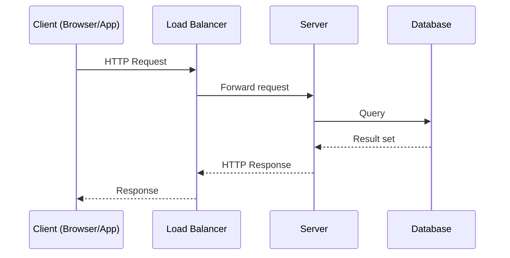
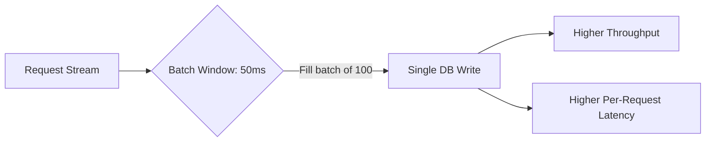
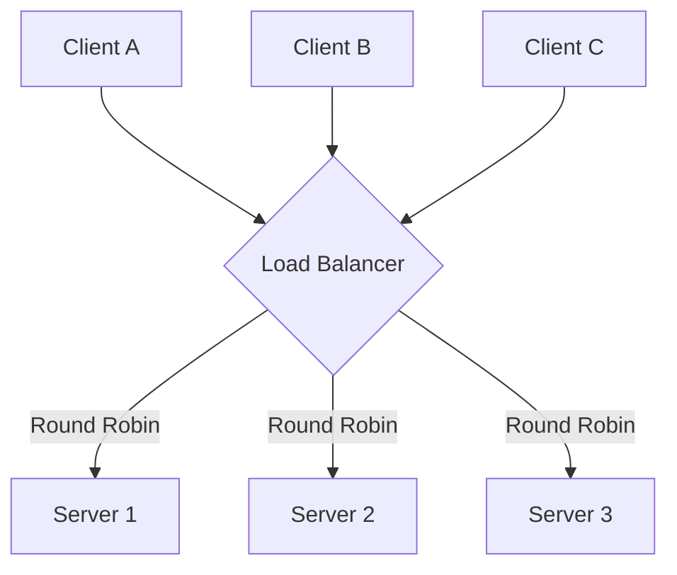
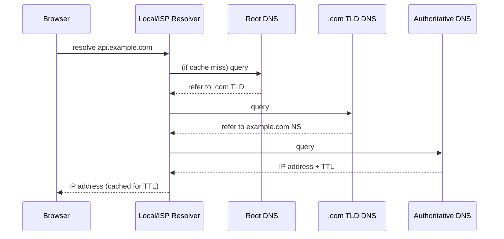
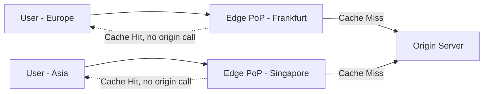
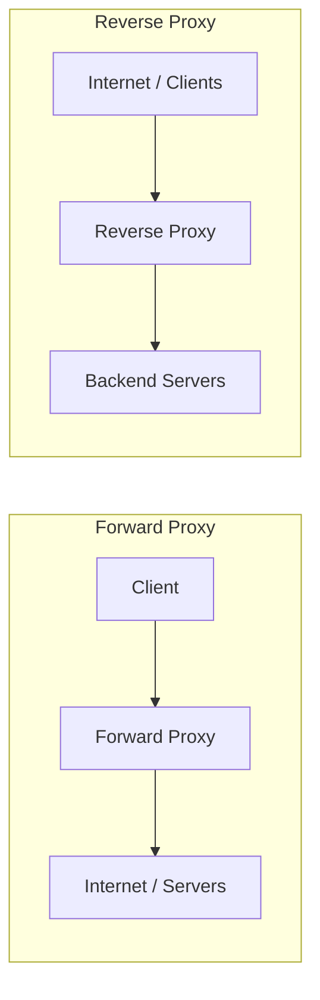

# 01. Fundamentals

These are the building blocks every system design answer rests on. At the 10-12 year level, the interviewer is not testing whether you know what a load balancer is. They are testing whether you reach for the right tool automatically, state its limits, and move on without being prompted.

## Client-Server Model

The client-server model splits an application into two roles: the client initiates requests, the server processes them and returns a response. Almost everything in distributed systems is a variation on this: browser to web server, service to service, app to database.

Key properties interviewers expect you to name:
- **Statelessness**: servers should not hold session state in memory if you want to scale horizontally. Push session state to a shared store (Redis, DB) or encode it in a token (JWT).
- **Idempotency**: a client retry (on timeout) should not cause duplicate side effects. This matters constantly in distributed systems and resurfaces in payments, messaging, and APIs.
- **Timeouts and retries**: every network call needs a timeout. Without one, a single slow dependency can exhaust your thread pool and take down the whole service (cascading failure).

## Latency vs Throughput

These two metrics are often confused, and conflating them is a signal of inexperience.

- **Latency**: time to complete a single request (e.g., 50 ms p50, 300 ms p99).
- **Throughput**: number of requests the system handles per unit time (e.g., 10,000 requests/sec).

You can increase throughput while latency stays the same (more parallel workers). You can also increase throughput at the cost of latency (batching requests together before processing). A classic example: a message queue consumer that batches 100 messages before writing to DB increases throughput (fewer DB round trips) but increases latency for any individual message (it waits for the batch to fill).

Always talk about latency in percentiles, not averages. p50 (median) hides the tail. p99 and p999 are what users actually experience when things go wrong, and what pages someone at 3 AM. A system with 50 ms average latency but 5 second p99 has a bug, usually GC pauses, lock contention, or a slow downstream dependency.

## Vertical vs Horizontal Scaling

**Vertical scaling (scale up)**: add more CPU, RAM, disk to a single machine. Simple, no architectural change needed, but has a hard ceiling (biggest instance type available) and a single point of failure.

**Horizontal scaling (scale out)**: add more machines and distribute load across them. No hard ceiling, better fault tolerance, but requires the application to be stateless or to partition state, and introduces coordination problems (consistency, load balancing, network partitions).

| Aspect | Vertical | Horizontal |
|---|---|---|
| Complexity | Low | Higher (needs LB, partitioning) |
| Ceiling | Hardware limit | Near-unlimited |
| Fault tolerance | Single point of failure | Can survive node loss |
| Cost curve | Non-linear, gets expensive fast | Roughly linear |
| Good for | Early stage, relational DB writes | Stateless services, read replicas |

A senior answer: "I'd start with vertical scaling for the primary database because resharding is expensive, but design the application tier to scale horizontally from day one because that's cheap to do early and expensive to retrofit."

## Load Balancers

A load balancer distributes incoming traffic across a pool of backend servers. It solves availability (route around a dead server) and scalability (spread load).

### Layer 4 vs Layer 7

- **L4 (transport layer)**: operates on IP and TCP/UDP info only. Fast, protocol-agnostic, cannot inspect HTTP headers or payload. Example: AWS NLB, IPVS.
- **L7 (application layer)**: understands HTTP. Can route based on path, host header, cookies; can do SSL termination, compression, A/B routing. Slightly higher latency and CPU cost. Example: AWS ALB, NGINX, Envoy, HAProxy in HTTP mode.

Use L4 when you need raw throughput and simple TCP routing (e.g., a gaming server). Use L7 when you need content-based routing, e.g., `/api/v1/*` to one service and `/static/*` to a CDN origin.

### Load Balancing Algorithms

- **Round robin**: cycle through servers in order. Simple, ignores server load.
- **Weighted round robin**: give more powerful servers a higher share.
- **Least connections**: send to the server with fewest active connections. Good when request processing times vary a lot.
- **IP hash / consistent hashing**: route based on a hash of the client IP (or another key) so the same client always lands on the same server — useful for sticky sessions without a shared session store.
- **Least response time**: combines active connections and average response time; adaptive but more overhead to compute.

### Health Checks and Failover

Load balancers poll backend servers (e.g., `GET /health` every 5s) and remove unhealthy ones from rotation. Distinguish liveness (process is up) from readiness (process can serve traffic right now, e.g., DB connection pool warmed up). A server can be alive but not ready during startup or a GC pause.

For high availability, load balancers themselves need redundancy. Cloud providers give you managed, horizontally-scaled LBs (ALB, GCLB) so you rarely build your own, but you should know the pattern: active-passive pair with a floating IP, or DNS-based failover.

## DNS

DNS translates a domain name to an IP address. It is the very first hop in almost every system design answer, and it's also a scaling and resilience tool, not just a naming service.

Key points interviewers probe:
- **TTL trade-off**: a low TTL (e.g., 30s) lets you fail over or re-route quickly but increases DNS query load and adds latency on cache misses. A high TTL (e.g., 24h) is efficient but means changes propagate slowly, hurting disaster recovery.
- **GeoDNS / latency-based routing**: return different IPs depending on the requester's location, used to route users to the nearest regional data center.
- **DNS-based load balancing**: round-robin DNS gives crude load distribution across multiple IPs for a single name, but has no health-check awareness — a dead server stays in rotation until TTL expires and ops manually fix it.

## CDN (Content Delivery Network)

A CDN caches content at edge locations geographically close to users, cutting latency and offloading origin servers. Originally for static assets (images, JS, CSS, video), now also used for dynamic content via edge compute (Cloudflare Workers, Lambda@Edge).

- **Push CDN**: you upload content to the CDN proactively. Good for content that changes rarely and you want pre-warmed (e.g., release of a new app version's assets).
- **Pull CDN**: the CDN fetches from your origin on first request (cache miss) and caches it for subsequent requests. Simpler to operate, but the first requester in each region pays a latency penalty.

Cache invalidation at a CDN is a real operational problem: versioned file names (e.g., `app.a1b2c3.js`) sidestep the problem entirely because a new deploy is a new URL, no invalidation needed. For content that must be invalidated (news article edit), you pay with explicit purge API calls, which are eventually consistent across edge nodes.

## Forward Proxy vs Reverse Proxy

- **Forward proxy**: sits in front of clients, hides client identity from the server, used for outbound filtering, caching, and access control (e.g., a corporate proxy that all employee traffic goes through).
- **Reverse proxy**: sits in front of servers, hides server identity from the client, used for load balancing, SSL termination, caching, and routing (e.g., NGINX in front of an app server fleet).

A reverse proxy is the piece that shows up in nearly every architecture diagram you'll draw in an interview: it's the box between "Client" and "Load Balancer / App Servers," and it's where you mention SSL termination, request buffering, and gzip compression to keep that logic out of your application servers.

## Practice Questions

1. **Why can't you just keep vertically scaling a database forever?**
   Hardware has a ceiling (largest instance types top out), cost grows non-linearly near that ceiling, and a single machine is a single point of failure regardless of its size.

2. **When would you choose L4 over L7 load balancing?**
   When you need raw packet-level throughput, don't need content-based routing, or are load balancing a non-HTTP protocol (e.g., a custom TCP or UDP-based game server protocol).

3. **What's the risk of a very high DNS TTL during an incident?**
   If you need to redirect traffic away from a failing region, clients with a cached old IP won't see the change until the TTL expires, which could be hours, prolonging the outage for part of your user base.

4. **Why does a reverse proxy help with SSL termination?**
   It lets you decrypt TLS once at the edge and talk plaintext (or re-encrypted) internally, centralizing certificate management and offloading CPU-intensive crypto from every application server.

5. **Give an example where increasing throughput increases latency.**
   Batching writes: collecting 500 events before flushing to a database increases the system's writes/sec but means an individual event's data isn't durable until the batch fills, increasing its effective latency.

## Senior-Level Probes

At 10-12 years, interviewers stop asking "what is a load balancer" and start asking:
- "Your load balancer's health check says a node is healthy, but it's actually failing 10% of requests under heavy GC pauses. How do you detect and handle that?" (Expects: p99 latency-based health checks, outlier ejection, not just binary up/down.)
- "You have a hot key in your consistent-hash-based routing causing one server to get 5x traffic. Walk me through how you'd detect and mitigate it." (Expects: per-key metrics, request sharding/salting, or dedicated caching for the hot key.)
- "Design a DNS failover strategy that doesn't force you to choose between fast failover and query load." (Expects: discussion of health-check-integrated DNS like Route 53, combined with client-side retry/circuit breaking so you're not solely reliant on DNS TTL.)
- "Why might a reverse proxy itself become the bottleneck, and how do you scale it?" (Expects: proxy pools behind a cloud LB, connection limits, keep-alive tuning.)
