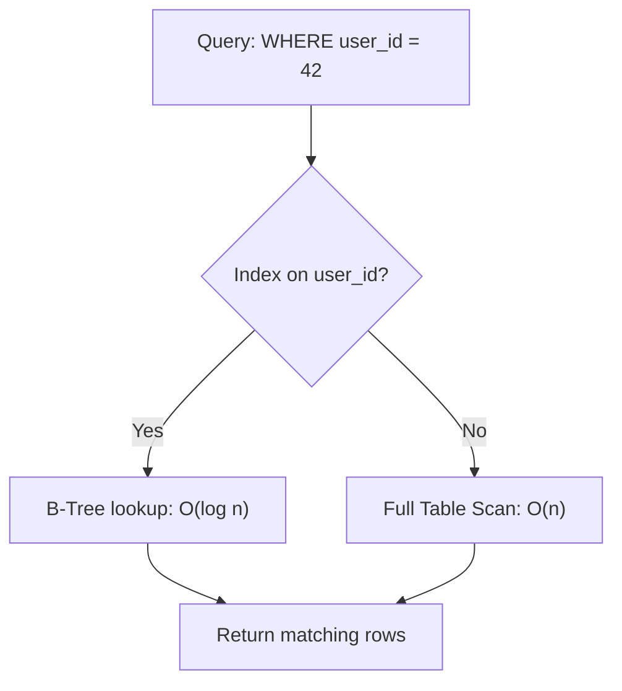
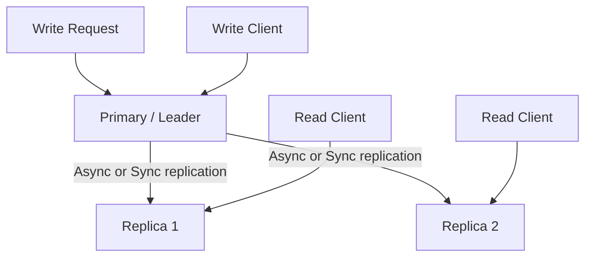
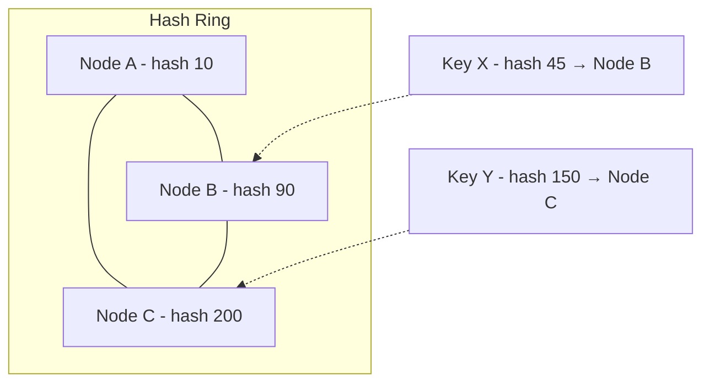
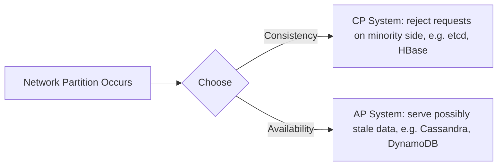
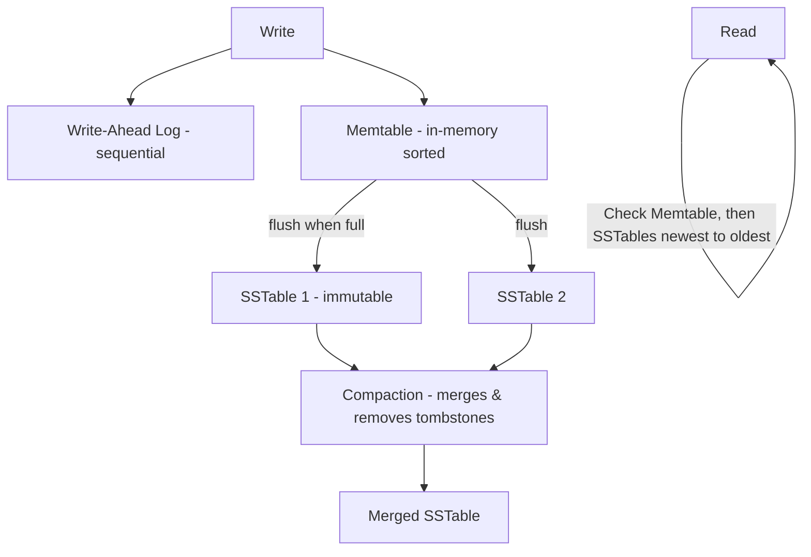

# 02. Storage and Databases

Database choice and data layout decisions carry the most weight in a system design interview, because they're the hardest to change after launch. A wrong load balancer choice costs you an afternoon of migration. A wrong partitioning scheme costs you months.

## SQL vs NoSQL

This is not "SQL is old, NoSQL is new." It's a trade-off between strong consistency/rich queries and flexible scale.

| Dimension | SQL (RDBMS) | NoSQL |
|---|---|---|
| Schema | Fixed, enforced | Flexible / schema-less |
| Transactions | Strong ACID, multi-row | Often limited to single document/partition |
| Query flexibility | Joins, aggregations, ad hoc queries | Key-based lookups, limited joins |
| Horizontal scaling | Hard (needs sharding layer) | Built-in (e.g., DynamoDB, Cassandra) |
| Consistency | Strong by default | Tunable, often eventual |
| Examples | PostgreSQL, MySQL, Aurora | DynamoDB, Cassandra, MongoDB, Redis |
| Best for | Financial ledgers, inventory, anything needing joins/transactions | High write throughput, massive scale, flexible schema, time series |

NoSQL itself splits into families, and naming the right one signals depth:
- **Key-value**: Redis, DynamoDB. O(1) lookups by key.
- **Document**: MongoDB. JSON-like documents, secondary indexes.
- **Column-family / wide-column**: Cassandra, HBase. Great for write-heavy time-series and wide sparse data.
- **Graph**: Neo4j. Relationship-heavy traversals (social graphs, fraud detection).

A senior answer frames this as: "For the orders table I need multi-row transactions (debit inventory, create order, charge payment) so I'd use a relational store. For the activity feed, I need to write millions of events per second with no cross-row transactions, so I'd use a wide-column store like Cassandra."

## Indexing

An index is a data structure (usually a B-tree or a hash table) that lets the database find rows without scanning the whole table.

- **Primary index**: on the primary key, usually clustered (data physically stored in this order).
- **Secondary index**: on a non-key column, points back to the primary key or row location. Speeds up reads on that column but slows down writes (every insert/update touches every index) and uses extra storage.
- **Composite index**: on multiple columns, e.g., `(user_id, created_at)`. Order matters — a composite index on `(a, b)` helps queries filtering on `a` alone or `a AND b`, but not on `b` alone.
- **Covering index**: includes all columns a query needs, so the DB never touches the main table (index-only scan).

The cost of an index is real: every write now updates N index structures, and indexes consume RAM/disk. A table with 10 indexes on a write-heavy workload is a common real-world performance bug. Senior candidates should proactively say "I'd add an index on `(status, created_at)` to speed up the dashboard query, but I'd watch write latency on this table since it already has 6 indexes."

## Replication

Replication copies data across multiple nodes for availability and read scalability.

- **Leader-follower (primary-replica)**: all writes go to the leader; followers replicate and serve reads. Simple, but the leader is a write bottleneck and single point of failure until failover completes.
- **Multi-leader**: multiple nodes accept writes, replicate to each other. Useful for multi-region writes, but conflict resolution (two regions write the same key simultaneously) becomes your problem — last-write-wins, vector clocks, or CRDTs.
- **Leaderless (quorum-based)**: any node accepts reads/writes; a quorum of nodes must agree (used by Dynamo, Cassandra). Resilient to node failure, tunable consistency via read/write quorum sizes (see Quorum in file 04).

**Synchronous vs asynchronous replication**: sync guarantees the replica has the data before acknowledging the write (no data loss on leader failure, but higher write latency, and the leader blocks if a replica is slow/down). Async is fast but risks losing the last few writes if the leader dies before replicating (replication lag).

## Sharding and Partitioning

Sharding splits a dataset across multiple machines because no single machine can hold it all or handle its write load.

### Partitioning Strategies

- **Range-based**: partition by a key range (e.g., user IDs 1-1M on shard A, 1M-2M on shard B). Simple, supports range queries efficiently, but can create hot shards if keys aren't uniformly accessed (e.g., all new users go to the last shard).
- **Hash-based**: hash the key, mod by shard count. Distributes load evenly, but resharding (changing shard count) requires rehashing almost everything, and range queries become inefficient (scattered across shards).
- **Directory-based**: a lookup service maps keys to shards explicitly. Flexible (can rebalance individual keys) but adds a dependency and potential bottleneck/single point of failure at the lookup service.
- **Geo-based**: partition by region (EU users on EU shard). Helps with data residency laws (GDPR) and latency, complicates cross-region queries.

### Consistent Hashing

The classic fix for the "adding/removing a node reshuffles everything" problem with plain hash-mod-N. Nodes and keys are placed on a hash ring; a key belongs to the first node clockwise from its hash position. Adding or removing a node only affects the keys in its immediate neighborhood on the ring, not the entire dataset.

Real systems (Cassandra, DynamoDB) use **virtual nodes**: each physical node owns many points on the ring, which smooths out load distribution and makes rebalancing after a node failure spread evenly across the rest of the cluster instead of dumping all load on one neighbor.

## CAP Theorem and PACELC

**CAP theorem**: during a network partition, a distributed system must choose between Consistency (every read sees the latest write) and Availability (every request gets a response). You cannot have both during a partition. Note: CAP only applies *during a partition* — the rest of the time, you can have both C and A.

**PACELC** extends this: even without a Partition (P), you still face a trade-off between Latency (L) and Consistency (C) in normal operation (Else). A system that replicates synchronously gets strong consistency but pays latency; async replication is fast but can serve stale reads. This is the more practically useful framing in interviews because partitions are rare, but the latency/consistency trade-off happens on every single request.

A senior-level framing: "For the inventory count I'd pick a CP-leaning system because overselling is worse than a slow response. For the news feed, AP is fine — showing a slightly stale feed for a few seconds is an acceptable trade-off for low latency and high availability."

## Isolation Levels

Isolation levels define how much one transaction can see of another transaction's in-progress changes.

| Level | Dirty Read | Non-Repeatable Read | Phantom Read | Notes |
|---|---|---|---|---|
| Read Uncommitted | Possible | Possible | Possible | Rarely used |
| Read Committed | Prevented | Possible | Possible | PostgreSQL default |
| Repeatable Read | Prevented | Prevented | Possible (varies) | MySQL InnoDB default |
| Serializable | Prevented | Prevented | Prevented | Strongest, lowest concurrency |

Higher isolation = more correctness guarantees but more locking/blocking and lower throughput. Most production systems run at Read Committed and handle the remaining edge cases explicitly (optimistic locking with version columns, `SELECT ... FOR UPDATE`, or application-level idempotency) rather than paying for Serializable everywhere.

## LSM Trees vs B-Trees

This is the storage-engine-level question that separates candidates who've read docs from candidates who've debugged a database.

**B-Trees** (used by PostgreSQL, MySQL InnoDB): balanced tree structure, data stored in sorted order on disk. Reads are fast (O(log n) direct lookup). Writes require finding the right page and updating it in place, which means random disk I/O — fine on SSDs, but each write is relatively expensive.

**LSM Trees (Log-Structured Merge Trees)** (used by Cassandra, RocksDB, LevelDB, HBase): writes go to an in-memory structure (memtable) and an append-only log (WAL) first — purely sequential I/O, very fast. Periodically, memtables flush to disk as immutable sorted files (SSTables). A background **compaction** process merges SSTables, removing deleted/overwritten entries.

| Aspect | B-Tree | LSM Tree |
|---|---|---|
| Write pattern | Random I/O, in-place update | Sequential I/O, append-only |
| Write throughput | Lower | Much higher |
| Read pattern | Direct, single lookup | May check memtable + multiple SSTables (mitigated by Bloom filters) |
| Space amplification | Lower | Higher until compaction runs |
| Write amplification | Lower | Higher (compaction rewrites data) |
| Good for | Read-heavy, OLTP | Write-heavy, time-series, logging |

The trade-off in one sentence: LSM trees trade read complexity and background compaction overhead for dramatically better write throughput, because writes never need to seek — they just append. This is why Cassandra and RocksDB power systems that need to ingest millions of writes/sec (metrics, logs, event streams), while PostgreSQL/MySQL remain the default for OLTP workloads where reads dominate and strong transactional guarantees matter.

## Practice Questions

1. **Why does adding a secondary index slow down writes?**
   Every insert/update/delete must also update the index's data structure, so each index adds extra I/O and CPU work per write; with enough indexes, write latency can dominate.

2. **What's the practical problem with hash-based sharding when you need to add a shard?**
   Changing the shard count changes almost every key's hash-mod-N result, forcing a massive data migration; consistent hashing avoids this by only remapping a small fraction of keys.

3. **Give a concrete example of choosing AP over CP.**
   A "likes" counter on a social post: it's fine if two regions briefly disagree on the exact count, and users expect the like button to respond instantly, so you'd choose availability and eventual consistency over blocking for global agreement.

4. **Why do LSM trees need compaction, and what's the cost of skipping it?**
   Writes and deletes accumulate as separate, possibly overlapping SSTable files; without compaction, reads must check more and more files (worse read latency) and deleted data (tombstones) keeps consuming disk space.

5. **What isolation level would you pick for a bank transfer, and why?**
   At minimum Repeatable Read, often Serializable for the transfer transaction itself, because a non-repeatable read or phantom row during a balance check-and-update could let two concurrent transfers overdraw an account.

## Senior-Level Probes

- "Your hash-sharded database has a celebrity user generating 1000x normal traffic on one shard. Consistent hashing didn't help because it's the same key. What now?" (Expects: splitting the hot key's data further, e.g., sub-sharding by a secondary dimension, or moving that specific key to dedicated capacity.)
- "Walk me through what happens end-to-end when a replica falls behind the primary by 30 seconds and a user reads their own just-written data from that replica." (Expects: read-your-writes consistency techniques — sticky sessions to primary, read-after-write routing, or client-side version tracking.)
- "You chose Cassandra for write throughput. Six months later, product wants ad hoc analytical queries across all users. What do you do?" (Expects: recognizing that LSM/wide-column stores are poor at ad hoc queries, proposing a CDC pipeline into a data warehouse rather than forcing the operational store to do analytics.)
- "Explain why PACELC is more useful day-to-day than CAP." (Expects: CAP only governs rare partition events; PACELC describes the constant trade-off you make on every write via your replication/consistency settings.)
