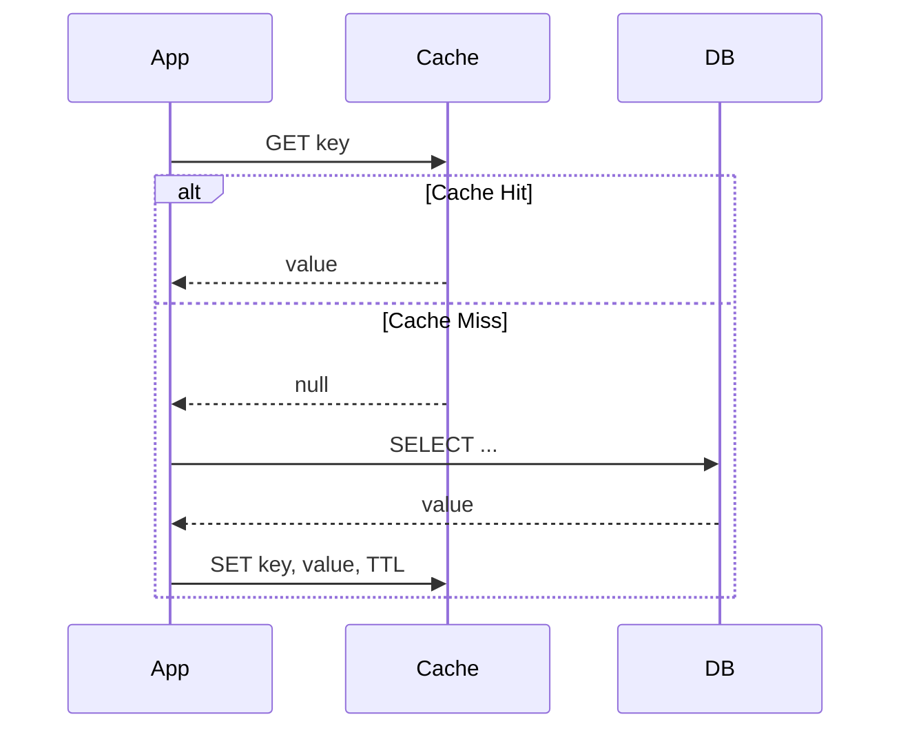
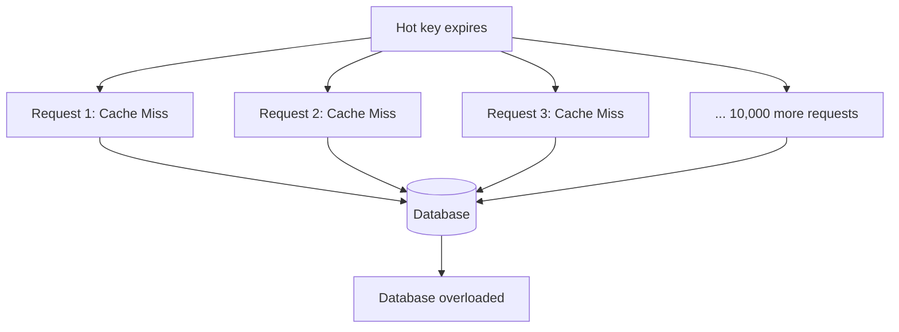
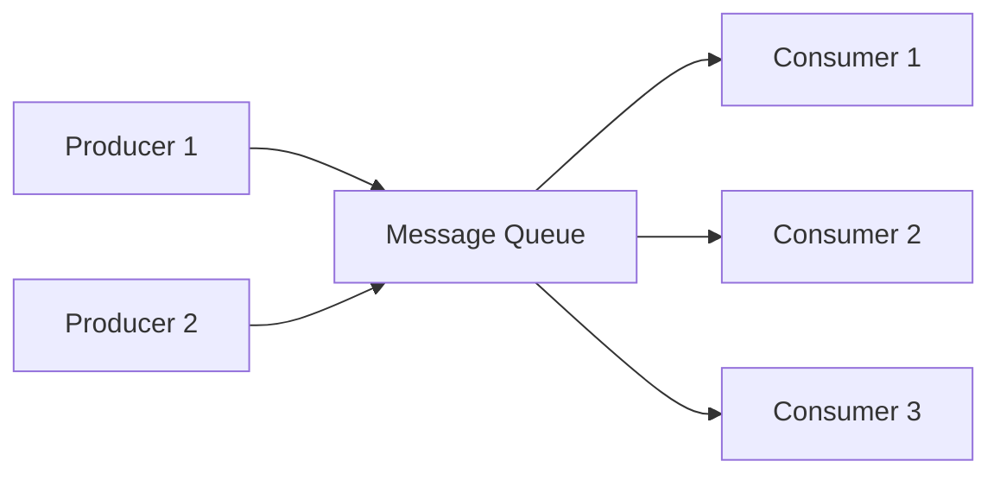
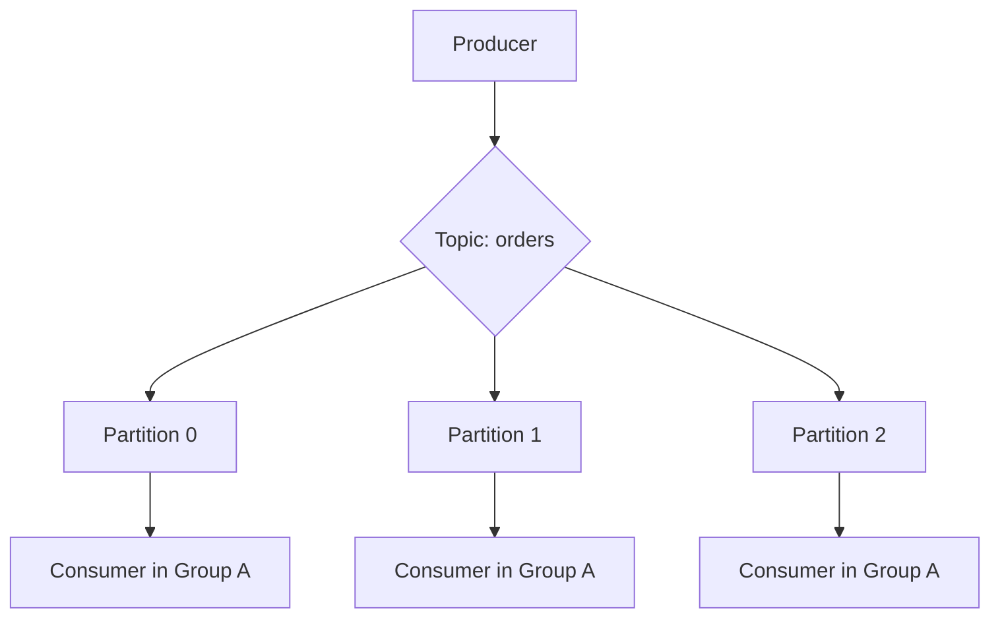
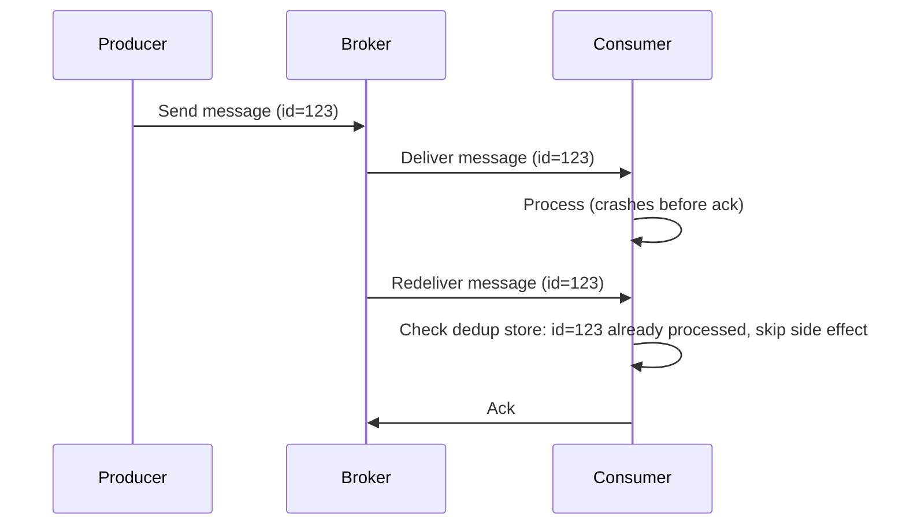
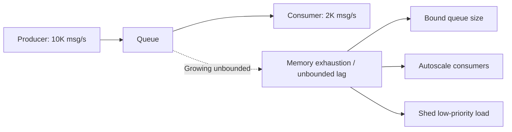

# 03. Caching and Queues

Caching and queues are the two tools you reach for most often once "add a database" stops being enough. Caching cuts latency and database load for reads. Queues decouple producers from consumers and absorb bursts. Both introduce their own failure modes that interviewers love to probe.

## Caching Strategies

### Cache-Aside (Lazy Loading)

The application checks the cache first; on a miss, it reads from the database and populates the cache.

Most common pattern. Only requested data gets cached (efficient memory use). Downside: first request after a miss always pays full DB latency, and if the cache goes down, every request falls through to the DB (thundering herd risk).

### Write-Through

Every write goes to the cache and the database synchronously, in the same request path.

Keeps cache always consistent with the DB. Downside: every write pays the latency of two systems, and data you never read still gets cached (wasted memory) unless combined with a TTL.

### Write-Back (Write-Behind)

Writes go to the cache first and are asynchronously flushed to the database later.

Very fast writes, can batch/coalesce multiple updates to the same key before hitting the DB. Downside: risk of data loss if the cache node crashes before flushing — only acceptable when some data loss is tolerable (metrics, counters) or when the cache itself is durable (e.g., backed by a WAL).

| Strategy | Write Latency | Read-after-write consistency | Data loss risk | Use case |
|---|---|---|---|---|
| Cache-aside | N/A (write bypasses cache) | Stale until next read-miss or TTL | None | General purpose, default choice |
| Write-through | Higher (2 systems) | Strong | None | Data that must always be fresh in cache |
| Write-back | Lowest | Strong (reads hit cache) | Possible | High write throughput, tolerant of some loss |

### Eviction Policies

When the cache is full, something has to go:
- **LRU (Least Recently Used)**: evict the item not accessed for the longest time. Good default, assumes recent access predicts future access.
- **LFU (Least Frequently Used)**: evict the item accessed least often overall. Better for workloads with a stable "hot set" that shouldn't be evicted just because of a temporary lull.
- **TTL-based**: items expire after a fixed time regardless of access pattern. Simple, used for data with a natural freshness window (session tokens, prices).
- **FIFO**: evict oldest-inserted item. Rarely optimal, cheap to implement.

## Cache Stampede (Thundering Herd)

When a popular key expires, many concurrent requests simultaneously miss the cache and hammer the database at once, sometimes enough to take it down.

Mitigations:
- **Mutex / locking**: first request to miss acquires a lock and repopulates the cache; others wait or serve stale data briefly.
- **Probabilistic early expiration**: refresh the cache slightly before actual expiry, with a random jitter so not all keys expire at once.
- **Request coalescing**: deduplicate identical in-flight requests at the application layer so only one actually reaches the DB.
- **Stale-while-revalidate**: serve the expired value immediately while refreshing it in the background — favors availability over freshness.

## Redis Patterns

Redis is the default in-memory store interviewers expect you to know beyond "it's a cache":
- **Rate limiting**: `INCR` with `EXPIRE`, or sorted sets for sliding windows (see file 05 for algorithms).
- **Distributed locks**: `SET key value NX PX ttl` (set-if-not-exists with expiry) implements a simple lock; Redlock extends this across multiple Redis nodes for higher safety, though it has known debated edge cases around clock drift.
- **Leaderboards**: sorted sets (`ZADD`, `ZRANGE`) give O(log n) ranked inserts and range queries.
- **Pub/Sub**: lightweight fan-out messaging, but not durable — a disconnected subscriber loses messages, so it's unsuitable as a message queue replacement.
- **Session store**: fast key-value with TTL, natural fit for stateless app servers.

Know Redis's limits too: single-threaded command execution (so one slow command, like a large `KEYS *` or unbounded `SORT`, blocks everything), and data loss risk without persistence (RDB snapshots or AOF logs) configured.

## Message Queues

Queues decouple producers from consumers, smooth out traffic bursts, and enable asynchronous processing.

### Kafka vs RabbitMQ

| Aspect | Kafka | RabbitMQ |
|---|---|---|
| Model | Distributed log (partitioned, append-only) | Traditional broker with queues/exchanges |
| Message retention | Retained for a configured time regardless of consumption | Deleted once acknowledged/consumed |
| Ordering | Guaranteed within a partition | Guaranteed within a single queue, no partition concept |
| Throughput | Very high (millions/sec) | High, but generally lower than Kafka |
| Consumer model | Pull-based, consumer tracks its own offset | Push-based, broker tracks delivery |
| Replay | Yes — reset consumer offset, re-read history | No — once consumed and acked, it's gone |
| Routing flexibility | Topic/partition based, simpler routing | Rich routing (direct, topic, fanout, headers exchanges) |
| Best for | Event streaming, log aggregation, event sourcing, high-throughput pipelines | Task queues, RPC-style messaging, complex routing logic |

A senior answer: "If I need an audit trail or multiple independent consumers replaying the same event stream (e.g., analytics and fraud detection both reading order events), I'd pick Kafka because of retention and replay. If I need a classic work queue — one task, one worker, complex routing rules, lower throughput — RabbitMQ's model fits more naturally and has less operational overhead."

### Kafka Partitioning and Ordering

Kafka only guarantees ordering *within a partition*, not across the whole topic. Producers typically key messages (e.g., by `order_id`) so all events for the same entity land on the same partition and process in order. Consumers within a consumer group each own a disjoint set of partitions, which is how Kafka parallelizes consumption while preserving per-key ordering.

## Delivery Semantics

| Semantic | Guarantee | Cost | Typical mechanism |
|---|---|---|---|
| At-most-once | Message delivered 0 or 1 times, never retried after failure | Lowest latency, data loss possible | Fire-and-forget, no ack tracking |
| At-least-once | Message delivered 1 or more times, retried until acked | May duplicate | Producer retries, consumer acks after processing |
| Exactly-once | Message delivered and processed exactly once | Highest complexity/cost | Idempotent consumers + transactional writes, or dedup keys |

In practice, true exactly-once delivery across a network is extremely hard (it requires coordinating the message broker and the consumer's side effect atomically). Most "exactly-once" systems actually provide **at-least-once delivery plus idempotent processing** — the consumer deduplicates by a message ID so processing the same message twice has no additional effect. This is the answer interviewers want to hear instead of "the system guarantees exactly-once" taken at face value.

## Backpressure

Backpressure is what happens when a consumer can't keep up with a producer. Without handling it, queues grow unbounded, memory exhausts, and the system crashes.

Mitigations:
- **Bounded queues**: reject or block new messages once a queue hits capacity, forcing the producer to slow down or fail fast.
- **Rate limiting producers**: cap how fast producers can enqueue (token bucket at the ingress point).
- **Autoscaling consumers**: add consumer instances based on queue depth (e.g., Kafka consumer lag metric drives a horizontal pod autoscaler).
- **Load shedding**: drop lower-priority messages first when overloaded rather than failing indiscriminately.
- **Pull-based over push-based**: a pull model (Kafka) naturally lets consumers control their own pace; push-based brokers need explicit flow control (RabbitMQ's prefetch/QoS settings).

## Practice Questions

1. **Why is cache-aside the most commonly used strategy despite the first-request penalty?**
   It only caches what's actually requested (memory efficient), it's simple to reason about, and the cache can fail independently without breaking writes — the app just falls back to hitting the DB directly.

2. **How would you prevent a cache stampede on your most popular product page?**
   Use a short-lived lock so only one request repopulates the cache on expiry while others wait briefly or get stale data, combined with jittered TTLs so popular keys don't all expire in the same instant.

3. **Why can't Redis Pub/Sub replace a message queue like Kafka or RabbitMQ?**
   Pub/Sub has no persistence or durability — if a subscriber is disconnected when a message is published, it's lost forever, whereas a real queue/broker retains messages until they're consumed (or for a retention window).

4. **Explain why "exactly-once" delivery is usually a marketing simplification.**
   Guaranteeing a message is delivered and its side effect applied exactly once across a network requires atomically coordinating two separate systems; in practice, systems achieve this effect via at-least-once delivery combined with idempotent, deduplicated processing on the consumer side.

5. **A Kafka consumer group's lag is growing continuously. What are your first two diagnostic steps?**
   Check whether the consumer is actually falling behind due to slow processing (profile the consumer) versus the producer rate spiking beyond total consumer throughput, then check partition count — too few partitions caps how many consumers in the group can work in parallel.

## Senior-Level Probes

- "How does Kafka guarantee ordering, and what breaks that guarantee if you're not careful?" (Expects: ordering is per-partition only; if you don't key messages consistently, or if you increase partition count later, you silently lose per-entity ordering.)
- "Your write-back cache node crashed before flushing. What data did you lose, and how do you bound the blast radius?" (Expects: naming the flush interval as the max data-loss window, discussing durable write-ahead logs or accepting the risk only for non-critical data.)
- "Design for 10x growth: your current RabbitMQ setup is hitting a throughput ceiling. Do you scale RabbitMQ or migrate to Kafka?" (Expects: a trade-off discussion — operational cost of migration vs. RabbitMQ clustering/sharding limits — not an automatic "move to Kafka.")
- "A hot key is getting cached, but updates to it are so frequent that the cache is nearly always stale by the time it's read. How do you handle this?" (Expects: recognizing some keys shouldn't be cached at all, or need write-through with very short TTL, or should bypass cache for strongly consistent reads.)
