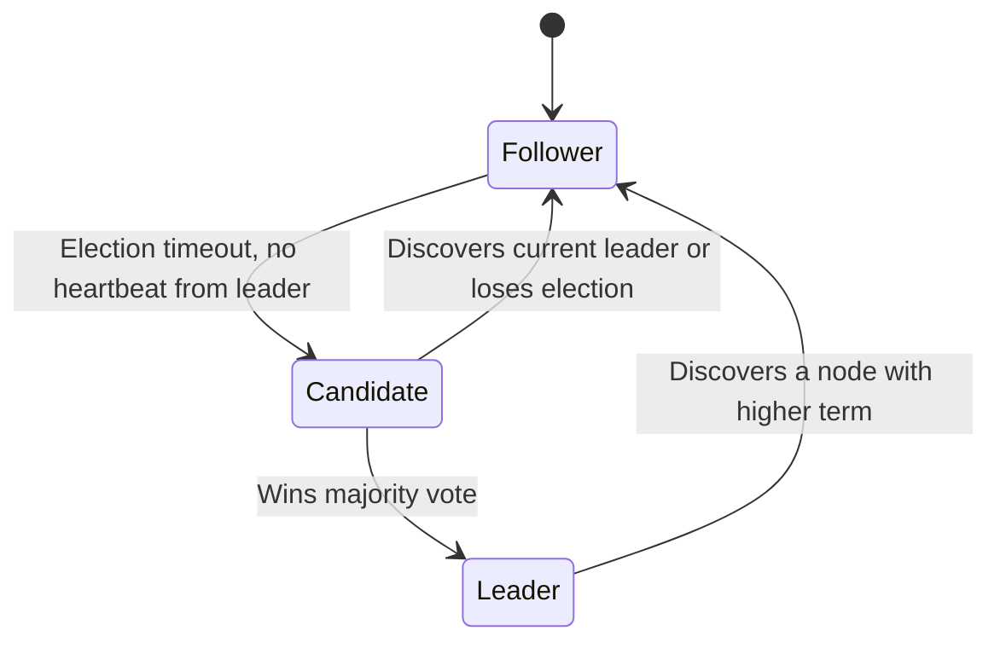
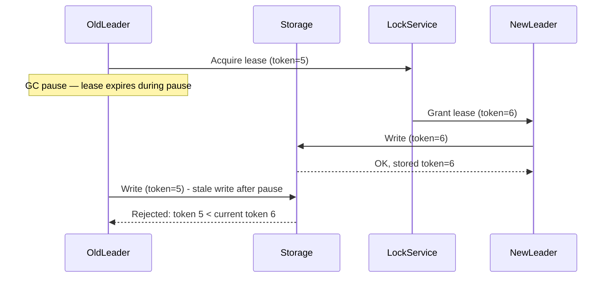
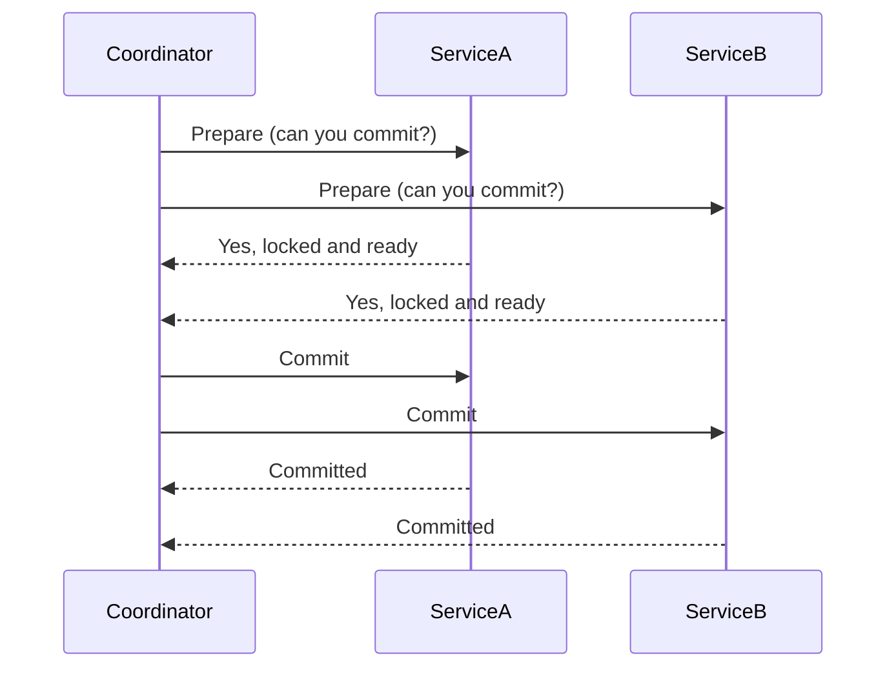
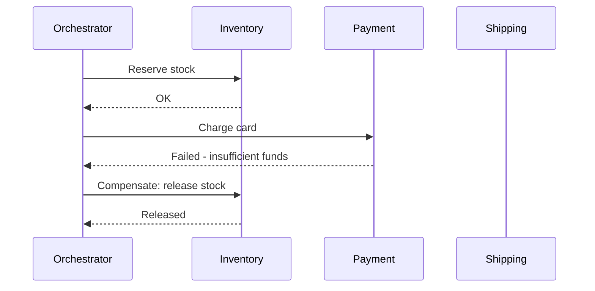
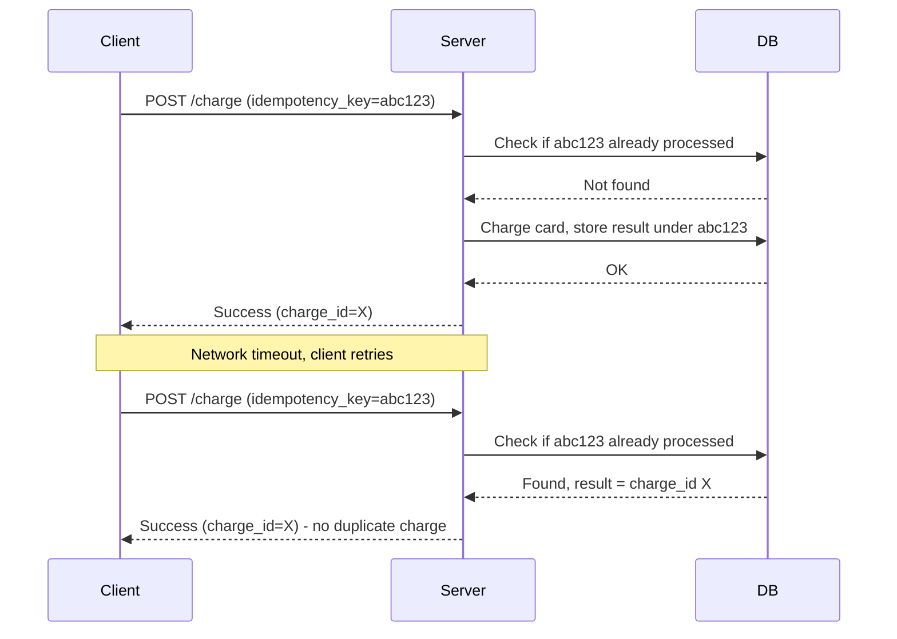
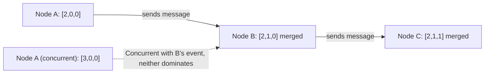
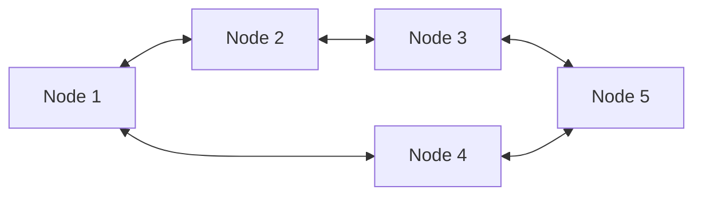
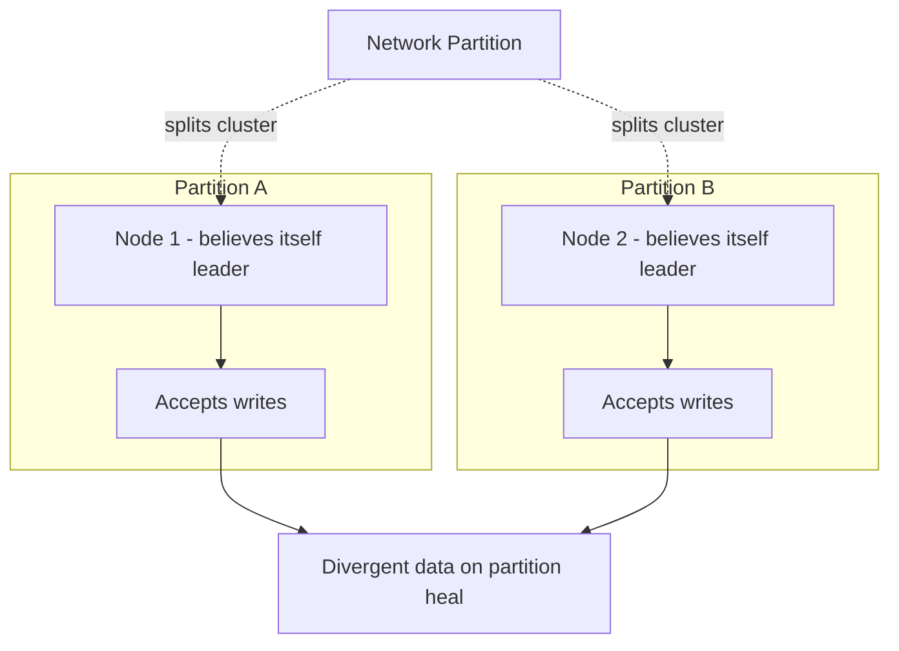

# 04. Distributed Systems — Advanced

This is where staff-level interviews separate candidates. Anyone can draw boxes and arrows. Fewer people can explain why a leader election can split-brain, or why idempotency keys matter more than retry logic itself.

## Consensus: Raft and Paxos

Consensus algorithms let a group of nodes agree on a single value (e.g., "who is the leader" or "what is the next log entry") even when some nodes fail or messages are delayed, as long as a majority are up and can communicate.

### Paxos (the original, famously hard to understand)

Paxos works in two phases: **Prepare/Promise** (a proposer asks a majority of acceptors if it can propose a value, learning about any prior proposals) and **Accept/Accepted** (the proposer sends the value, and once a majority accepts it, it's committed). Paxos is correct but notoriously difficult to implement correctly and extend (e.g., for a replicated log), which is why Raft exists.

### Raft (designed for understandability)

Raft achieves the same guarantee but structures the problem explicitly around leader election and log replication, which is why nearly every modern system (etcd, Consul, CockroachDB, Kafka's KRaft mode) uses it instead of raw Paxos.

Raft in three parts:
1. **Leader election**: nodes start as followers. If a follower doesn't hear a heartbeat from a leader within a timeout, it becomes a candidate, increments a "term" number, and requests votes. Whoever gets a majority becomes leader for that term.
2. **Log replication**: the leader appends client commands to its log and replicates them to followers. An entry is **committed** once a majority of nodes have it durably stored.
3. **Safety**: a leader never overwrites committed entries; a node only votes for a candidate whose log is at least as up to date as its own, preventing a stale node from becoming leader and losing committed data.

The majority requirement (quorum) is why Raft/Paxos clusters are typically deployed with odd numbers of nodes (3, 5, 7) — it maximizes fault tolerance per node added. A 5-node cluster tolerates 2 failures while still reaching majority (3).

## Leader Election in Practice

Beyond Raft's internal mechanism, leader election shows up as a building block you use directly: a primary database needs a new leader after a crash, a distributed cron job needs exactly one active scheduler, a Kafka partition needs exactly one active consumer per partition within a group.

Common implementations:
- **Using a consensus store**: acquire a lease/lock in etcd or ZooKeeper (`CreateEphemeralNode` + watch); the lease holder is the leader, and if its session dies (no heartbeat), the lease expires and another node wins it.
- **Bully algorithm**: nodes have IDs; the node with the highest ID among currently reachable nodes declares itself leader. Simple but vulnerable to a flapping network causing repeated elections.

The subtlety interviewers probe: a lease-based leader can still act as leader for a brief window *after* its lease has technically expired, if its clock has drifted or a GC pause delayed it from noticing. This is why critical operations should use **fencing tokens** — a monotonically increasing number issued with each leadership term, so a downstream system (like storage) can reject a stale leader's write even if that leader doesn't yet know it lost leadership.

## Distributed Transactions

### Two-Phase Commit (2PC)

A coordinator ensures all participants in a distributed transaction either all commit or all abort.

2PC gives strong atomicity across services but has a serious flaw: if the coordinator crashes after the Prepare phase but before sending Commit, participants are left **blocked**, holding locks indefinitely while waiting to find out the outcome. This makes 2PC a poor fit for most microservice architectures — it couples services tightly and tanks availability during coordinator failure. It's still used inside single systems with reliable coordinators (e.g., some distributed databases internally), but rarely recommended across independently-deployed services.

### Saga Pattern

Instead of one atomic transaction, break the operation into a sequence of local transactions, each with a **compensating action** that undoes it if a later step fails.

Two coordination styles:
- **Orchestration**: a central orchestrator explicitly calls each step and triggers compensations — easier to reason about and debug, but the orchestrator is a central piece of logic to maintain.
- **Choreography**: each service reacts to events from the previous step and emits its own event — more decoupled, but harder to trace the overall flow and easier to end up with implicit, scattered business logic.

Sagas trade strong atomicity for availability: there's a window where the system is in an intermediate state (inventory reserved but payment not yet confirmed), which is why sagas require the system to tolerate **eventual consistency** and the application to explicitly handle compensations, not just assume rollback happens for free like in a local DB transaction.

| Aspect | 2PC | Saga |
|---|---|---|
| Atomicity | Strong, all-or-nothing | Eventual, via compensation |
| Availability during failure | Poor (blocking) | Better (compensations run async) |
| Complexity | Protocol complexity, coordinator | Business logic complexity (writing compensations) |
| Coupling | Tight (all participants must support 2PC protocol) | Looser (each service just needs an API + compensating API) |
| Best for | Single-system / same-datacenter transactions | Cross-service, microservices workflows |

## Idempotency

An idempotent operation produces the same result no matter how many times it's applied. This matters constantly in distributed systems because **retries are unavoidable** — a client times out and retries, not knowing if the original request actually succeeded on the server.

The standard pattern: the client generates a unique **idempotency key** (e.g., a UUID) per logical operation and sends it with every attempt (including retries). The server stores processed keys (with their result) and, on seeing a repeated key, returns the stored result instead of re-executing the side effect.

Without this, a retried payment request could charge a customer twice. This is a near-guaranteed interview probe for any payments or order-related design.

## Clocks and Ordering

Physical clocks across machines drift and are never perfectly synchronized (even with NTP, drift of tens of milliseconds is normal), so you can't reliably use timestamps alone to order events across machines.

### Lamport Clocks

A simple logical counter: each node increments its own counter on every event, and when sending a message, attaches its counter value; the receiver sets its counter to `max(local, received) + 1`. This gives a **partial order** — if event A happened-before event B causally, A's Lamport timestamp is guaranteed smaller. But it cannot tell you whether two events with the same or incomparable timestamps are truly concurrent or causally related.

### Vector Clocks

Extends Lamport clocks by having each node track a vector of counters, one per node in the system, incrementing its own slot on each event and merging (taking the max of each slot) on message receipt. This lets you detect true concurrency: if neither vector dominates the other, the events are concurrent (e.g., two users editing the same document offline, then syncing). Dynamo-style systems use vector clocks to detect and surface write conflicts that need resolution instead of silently picking a winner.

The cost: vector clocks grow with the number of nodes, which is a real operational concern at scale (hence approaches like dotted version vectors that prune old entries).

## Quorum

A quorum is the minimum number of nodes that must participate in an operation for it to be considered successful, used to balance consistency and availability in leaderless/replicated systems.

The standard formula: with `N` replicas, `W` nodes required to acknowledge a write, and `R` nodes required to acknowledge a read, if `W + R > N`, every read is guaranteed to see the most recent write (strong consistency), because the read and write quorums must overlap by at least one node.

Common configurations:
- `N=3, W=2, R=2`: `W+R=4 > N=3` → strong consistency, tolerates 1 node down for either operation.
- `N=3, W=1, R=1`: fast, highly available, but reads can return stale data (no guaranteed overlap).
- `N=3, W=3, R=1`: every write must reach all nodes (slow, less available), but reads are always fast and always fresh since any single replica is up to date.

This is a direct, tunable version of the PACELC trade-off from file 02 — you're deciding per-operation how much consistency to trade for latency/availability.

## Gossip Protocols

Instead of a central coordinator distributing membership/state info, nodes periodically exchange state with a few random peers, and information spreads epidemically through the cluster — similar to how a rumor spreads through a population. Used by Cassandra and Consul for cluster membership and failure detection.

Gossip is highly resilient (no single point of failure, scales to large clusters) but has **eventual** convergence — information takes a probabilistic, logarithmic number of rounds to reach all nodes, so there's always a brief window of inconsistent cluster-wide view.

## Split-Brain

Split-brain occurs when a network partition causes two sides of a cluster to each believe they are the sole leader/authority, both accepting writes independently — leading to data divergence and corruption when the partition heals.

Prevention relies on the quorum requirement baked into consensus protocols: a leader is only valid if it holds a majority of votes/leases. In a partition, at most one side can have a majority (assuming an odd total node count), so the minority side correctly refuses to accept writes rather than electing its own leader. This is exactly why quorum-based systems insist on majority, not just "any responding node" — majority mathematically guarantees at most one side of any partition can proceed.

## Practice Questions

1. **Why do Raft/Paxos clusters typically use an odd number of nodes?**
   Fault tolerance per added node is maximized — a 5-node cluster tolerates 2 failures just like a 6-node cluster would, so adding the 6th node (making it even) buys no extra fault tolerance while adding cost.

2. **What specifically goes wrong if the 2PC coordinator crashes mid-protocol?**
   Participants that already received "Prepare" and responded "yes" are left holding locks indefinitely, unable to commit or abort on their own, since only the coordinator knows the final decision — this blocks resources and hurts availability.

3. **Why can't you rely on wall-clock timestamps to order events across two machines?**
   Clocks on different machines drift relative to each other even with NTP synchronization, so comparing raw timestamps can give the wrong causal order, especially for events that happen close together in time.

4. **When would W=1, R=1 quorum settings be an acceptable choice?**
   For data where staleness is tolerable and latency/availability matter more than strict freshness, such as view counters or non-critical analytics events, where losing or briefly misreporting a value has low cost.

5. **How does a fencing token prevent a "zombie" former leader from corrupting data?**
   The downstream storage system rejects any write carrying an older token than the highest token it has already seen, so even if a demoted leader doesn't yet realize it lost leadership and sends a stale write, storage refuses it.

## Senior-Level Probes

- "Explain the difference between Lamport clocks and vector clocks, and when you'd actually need vector clocks in production." (Expects: the concurrency-detection distinction, and a real example like Dynamo-style conflict detection for multi-region writes.)
- "You're designing a Saga for an e-commerce checkout. The payment step succeeds, but your compensating action for inventory release times out and fails. What now?" (Expects: discussion of retry-with-backoff for compensations, dead-letter queues, and manual intervention/alerting as the last resort — compensations aren't guaranteed either.)
- "Why is 'exactly-once semantics' usually really 'at-least-once delivery plus idempotent processing' in real systems?" (Expects: connecting back to idempotency keys and recognizing that true exactly-once delivery across an unreliable network is provably very hard.)
- "Design for 10x growth: your leader-election-based primary database is now a bottleneck for writes. How do you scale writes without losing the strong consistency guarantees that leader election gave you?" (Expects: discussing partitioning/sharding with per-shard leaders, or moving to a quorum-based multi-leader system with explicit conflict resolution, and naming the consistency trade-offs of each.)
