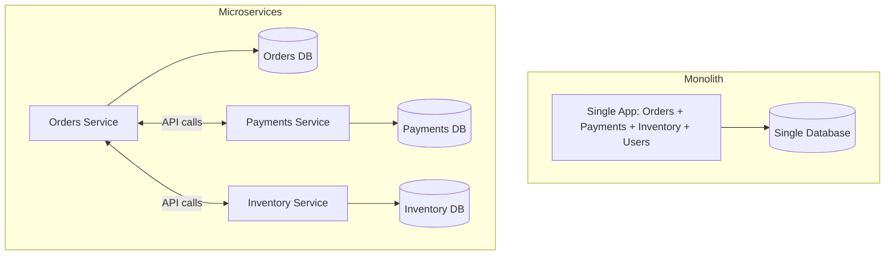
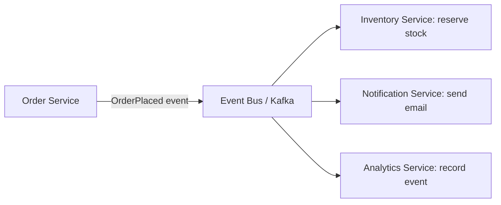
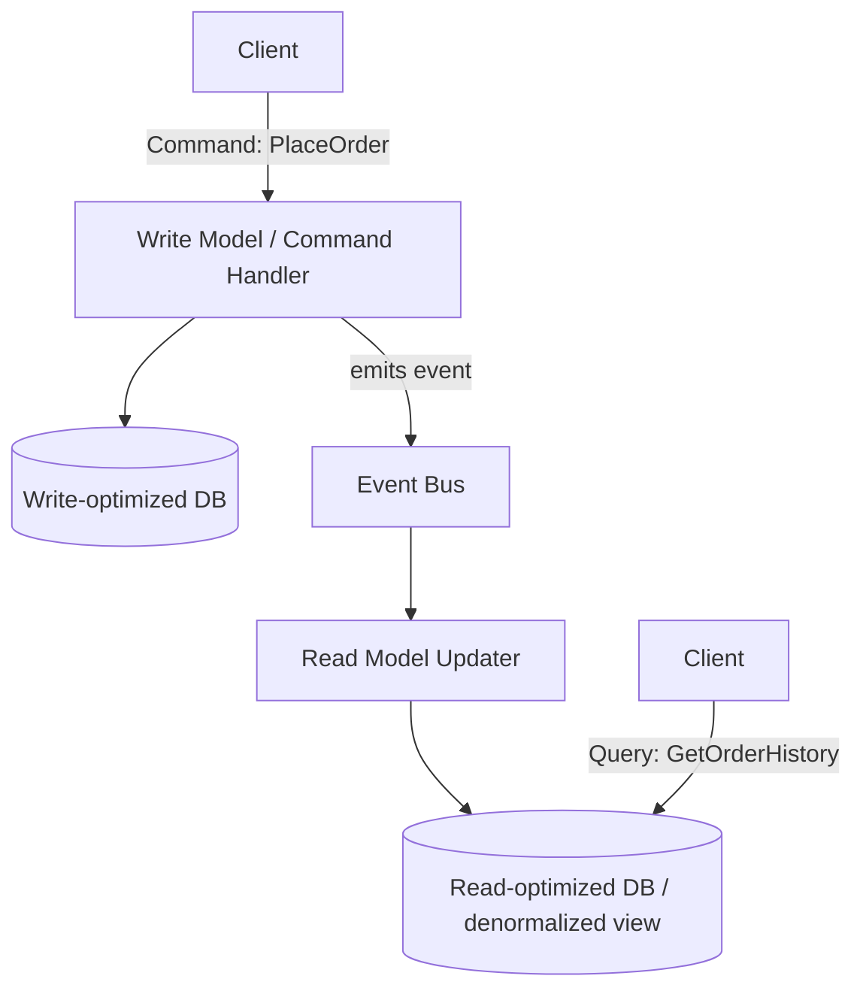
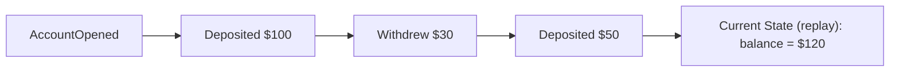
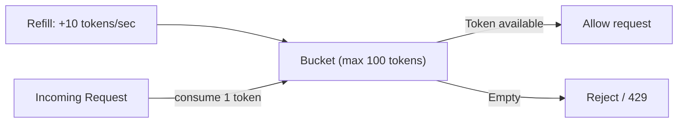
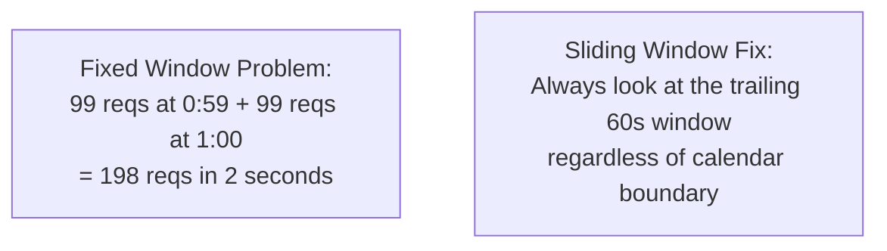
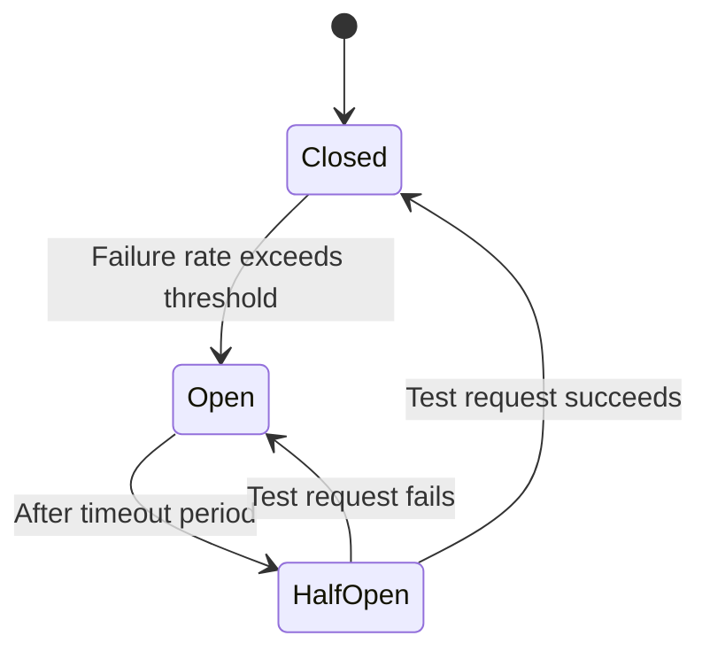
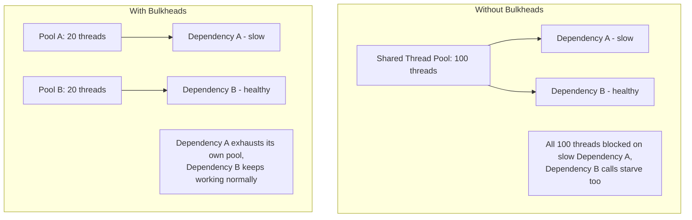
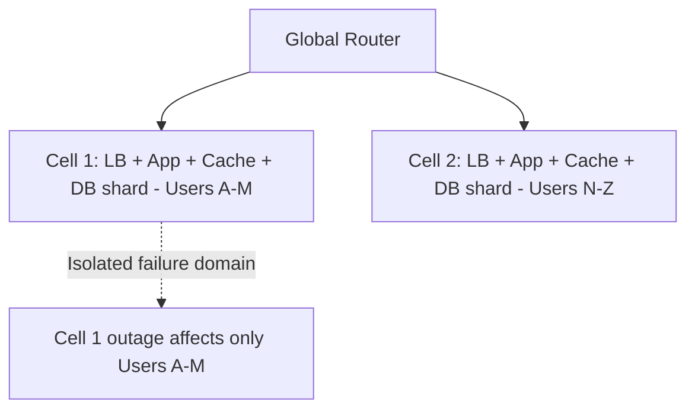
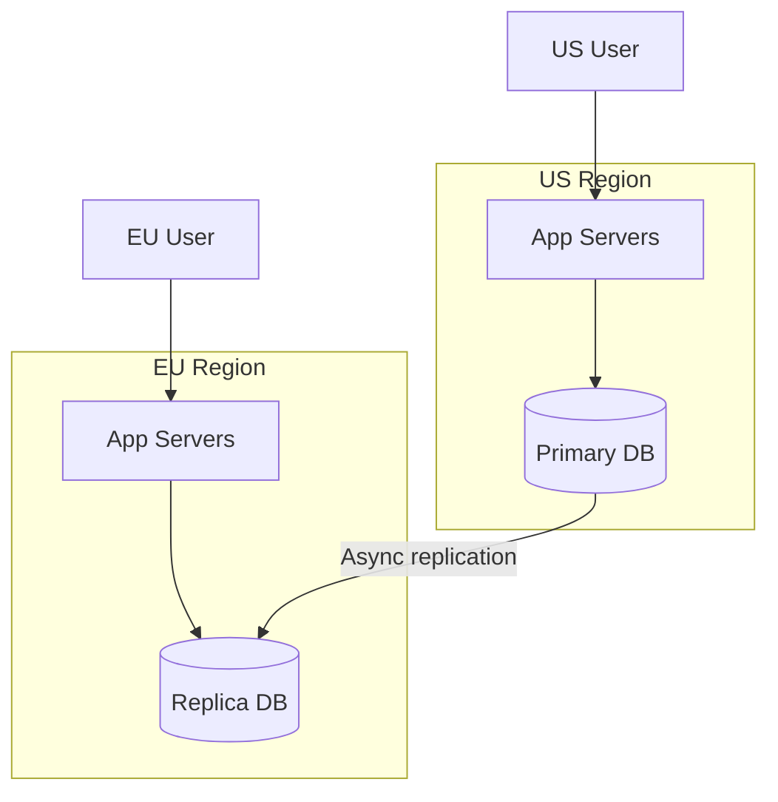

# 05. Scalability Patterns

These are the architectural patterns you reach for once a system has grown past "one service, one database." Each one trades simplicity for some combination of scale, resilience, or team independence — and a senior candidate's job is naming that trade explicitly, not just listing the pattern.

## Microservices vs Monolith

A **monolith** is a single deployable unit containing all application logic. A **microservices** architecture splits the application into independently deployable services, each owning its own data and communicating over the network.

| Aspect | Monolith | Microservices |
|---|---|---|
| Deployment | Single unit, simple | Independent per service, complex orchestration |
| Scaling | Scale the whole app together | Scale each service independently |
| Team ownership | Harder to isolate teams | Clear service boundaries map to teams |
| Data consistency | Easy (single DB, local transactions) | Hard (distributed, eventual consistency, sagas) |
| Operational overhead | Low | High (service discovery, distributed tracing, more infra) |
| Failure isolation | A bug can take down everything | A failing service can be isolated (with circuit breakers) |
| Best for | Early-stage products, small teams | Large orgs, independently scaling components, polyglot needs |

The honest senior answer is almost never "always use microservices." It's: "I'd start as a modular monolith with clear internal boundaries, and split out a service only when I have a concrete scaling or team-ownership reason to — like the payments logic needing a different compliance/deployment cadence than the rest of the app." Premature microservices is one of the most common real-world architecture mistakes, and naming that risk is itself a seniority signal.

## Event-Driven Architecture

Instead of services calling each other directly (request/response), services publish events when something happens, and other services subscribe and react independently.

Benefits: loose coupling (Order Service doesn't need to know Notification Service exists), easy to add new consumers without touching producers, natural fit for async workflows. Costs: harder to trace a request's full path (you need distributed tracing), eventual consistency between services, and debugging "why didn't X happen" requires checking event logs rather than following a single call stack.

## CQRS (Command Query Responsibility Segregation)

Separate the model used for writes (commands) from the model used for reads (queries). Often paired with event-driven architecture: commands produce events, and a separate read model is built by consuming those events.

Why bother: write and read workloads often have very different shapes. Writes need normalization and strong consistency; reads often need denormalized, pre-joined data optimized for a specific UI view, and can tolerate slightly stale data. CQRS lets you scale and optimize each side independently — e.g., write model on PostgreSQL for transactional integrity, read model on Elasticsearch for fast search, both fed by the same event stream.

Cost: the read model lags behind the write model (eventual consistency), and you now maintain two models plus the synchronization pipeline between them — real complexity that should be justified by an actual read/write pattern mismatch, not applied reflexively.

## Event Sourcing

Instead of storing current state, store the full sequence of events that led to that state. Current state is derived by replaying events (or reading a cached "snapshot" plus recent events).

Benefits: full audit trail for free, ability to reconstruct state at any point in time, natural fit with CQRS (events are both your source of truth and your read-model feed). Costs: replaying a long event history is slow without snapshotting, schema evolution of events over time is genuinely hard (you can't just "migrate" historical events the way you'd alter a table), and it's a significant mental model shift for a team used to CRUD.

Use it where the audit trail and historical replay are themselves valuable to the business (financial ledgers, inventory history) — not as a default persistence strategy.

## Rate Limiting Algorithms

Rate limiting protects a system from being overwhelmed, whether by a buggy client, a malicious actor, or simple overload.

### Token Bucket

A bucket holds up to `N` tokens, refilled at a fixed rate. Each request consumes one token; if the bucket is empty, the request is rejected or queued.

Allows bursts up to the bucket size while enforcing a long-term average rate. This is the most commonly used algorithm in practice (AWS, Stripe, most API gateways) because it balances fairness with burst tolerance.

### Leaky Bucket

Requests enter a queue (the "bucket") and are processed ("leak out") at a fixed rate. Unlike token bucket, this smooths bursts into a constant output rate rather than allowing them through.

### Fixed Window Counter

Count requests in a fixed time window (e.g., "100 requests per minute, resetting on the minute"). Simple, but has a boundary problem: a client could send 100 requests at 0:59 and another 100 at 1:00, achieving 200 requests in 2 seconds despite the "100/minute" limit.

### Sliding Window Log / Sliding Window Counter

Track exact timestamps of recent requests (log) or a weighted combination of the current and previous fixed windows (counter) to avoid the boundary burst problem.

| Algorithm | Burst handling | Memory cost | Accuracy |
|---|---|---|---|
| Token bucket | Allows controlled bursts | Low (one counter) | Good |
| Leaky bucket | Smooths to constant rate | Low | Good |
| Fixed window | Vulnerable to boundary bursts | Lowest | Poor at edges |
| Sliding window log | No boundary issue | High (stores every timestamp) | Exact |
| Sliding window counter | No boundary issue | Low | Approximate, very good |

Senior framing: "I'd use token bucket at the API gateway for per-client rate limiting because it tolerates legitimate bursts, implemented in Redis with `INCR`/`EXPIRE` or a Lua script for atomicity across concurrent requests to the same key."

## Circuit Breakers

A circuit breaker wraps a call to a downstream dependency and "trips open" after a failure threshold, failing fast instead of continuing to hammer an already-struggling dependency.

- **Closed**: requests flow normally; failures are counted.
- **Open**: requests fail immediately (or fall back) without calling the dependency, giving it time to recover.
- **Half-open**: after a cooldown, a limited number of test requests are let through; success closes the circuit again, failure re-opens it.

This prevents cascading failure: without a circuit breaker, every caller keeps retrying a dead dependency, piling up threads/connections waiting on timeouts, which can take down the caller too. This is a near-universal probe in senior interviews — expect to be asked "what happens when service X is down" for any dependency you draw on the whiteboard.

## Bulkheads

Named after ship compartments that stop one flooded section from sinking the whole vessel. The pattern: isolate resources (thread pools, connection pools) per dependency so a failure or slowdown in one doesn't exhaust resources needed by the rest of the system.

Combine bulkheads with circuit breakers: the bulkhead limits blast radius, the circuit breaker stops the bleeding once a threshold is crossed.

## Cell-Based Architecture

Partition the entire system (not just the database) into independent "cells," each a complete, isolated stack serving a subset of users/traffic. A failure in one cell doesn't affect others.

This is how AWS and similarly-scaled companies limit blast radius — a bad deploy or a cascading failure within one cell is contained, rather than a shared load balancer or shared cache taking down 100% of traffic. The cost is operational complexity (routing, per-cell capacity planning, cross-cell consistency for any shared data) and some resource inefficiency (each cell needs its own headroom, you can't pool capacity as tightly as one giant shared pool).

## Multi-Region and Geo-Replication

Running infrastructure in multiple geographic regions, for latency (serve users from the nearest region) and disaster recovery (a whole region going down doesn't take the product down).

Key decisions:
- **Active-passive**: one region takes all writes, others are read replicas and failover targets. Simpler consistency story, but failover takes time (promote replica, re-point DNS) and the passive region's hardware sits mostly idle.
- **Active-active**: multiple regions accept writes. Better latency and resource usage, but requires handling write conflicts (see multi-leader replication and vector clocks in files 02/04) and is significantly more complex to operate correctly.
- **Data residency**: regulations (GDPR and similar) can require certain users' data to physically stay within a region, which interacts directly with your sharding strategy — geo-based partitioning becomes a compliance requirement, not just a latency optimization.

A senior answer names the actual trigger for going multi-region: "If our latency SLA requires sub-100ms responses for EU users and our only region is in us-east-1, that's roughly 80-100ms of pure network RTT before any processing — that alone justifies an EU region, independent of disaster recovery concerns."

## Practice Questions

1. **Why shouldn't a team default to microservices for a new product?**
   Early on, you don't yet know the right service boundaries, and the overhead of distributed transactions, service discovery, and operational tooling outweighs benefits that only materialize at scale or with multiple independent teams.

2. **What specific problem does CQRS solve that a single shared model can't solve well?**
   When write and read workloads have fundamentally different shapes and scaling needs (e.g., normalized transactional writes vs. denormalized search-optimized reads), a single model forces a compromise that hurts one side; CQRS lets each be optimized independently.

3. **Why does fixed-window rate limiting allow a burst 2x the stated limit?**
   Because the window resets on a clock boundary rather than on a rolling basis, a client can exhaust its full quota in the last moment of one window and immediately exhaust a full new quota in the first moment of the next, concentrating 2x the limit into a very short real time span.

4. **How do circuit breakers and bulkheads work together?**
   Bulkheads cap how much damage a struggling dependency can do by isolating its resource pool from the rest of the system; circuit breakers detect that the dependency is failing and stop sending it traffic altogether, so the two combine to both limit blast radius and actively reduce load on a failing system.

5. **What's the main cost of active-active multi-region replication?**
   You must handle write conflicts when the same data is modified in two regions concurrently, which requires conflict resolution strategies (last-write-wins, CRDTs, vector clocks) and adds real operational and correctness complexity compared to a single-writer active-passive setup.

## Senior-Level Probes

- "You've split a monolith into microservices, and now a single user action triggers calls across 6 services. p99 latency doubled. How do you diagnose and fix this?" (Expects: distributed tracing to find the critical path, converting some sequential calls to parallel/async, caching cross-service lookups, and questioning whether the split was correctly scoped.)
- "Design for 10x growth: your token-bucket rate limiter lives in a single Redis instance and is now a bottleneck itself. What do you do?" (Expects: sharding the rate limiter by client ID, using local in-memory approximate limits with periodic sync, or moving to a distributed counter design — and naming the accuracy trade-off of each.)
- "Walk me through what 'eventual consistency' actually means for the user in your event-driven order system, and how you'd set their expectations in the UI." (Expects: concrete UX handling — e.g., showing an order as 'processing' until the read model catches up, rather than pretending consistency is instant.)
- "Why might cell-based architecture be wrong for a startup, even though it's what hyperscalers use?" (Expects: recognizing the resource overhead and operational complexity of per-cell isolated stacks is only justified once failure blast-radius actually matters at your scale and team size.)
