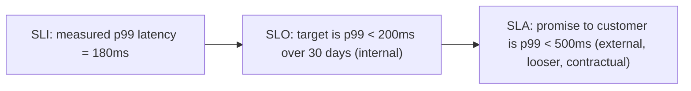
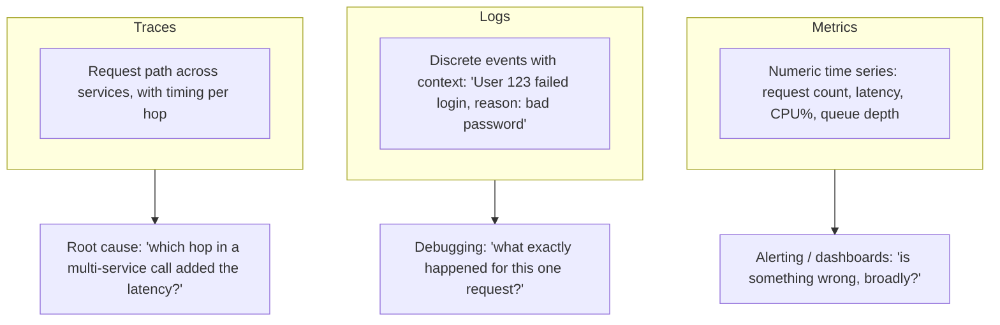
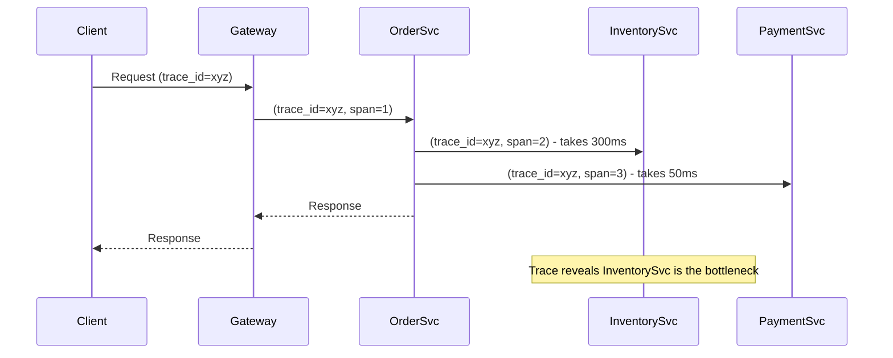
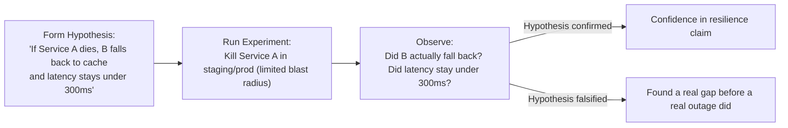
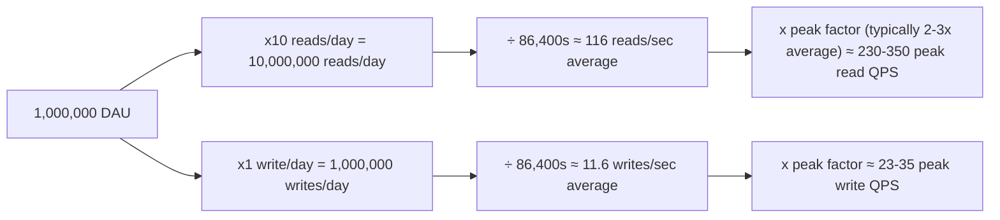

# 06. Observability, Reliability, and Capacity Estimation

You can design the most elegant architecture on the whiteboard and still fail the interview if you can't say how you'd know it's broken in production, or whether it can actually handle the stated load. This file covers both: how to observe and reason about reliability, and how to do the back-of-envelope math every case study needs.

## SLI, SLO, SLA

These three terms get used loosely outside of interviews, but precision here signals experience.

- **SLI (Service Level Indicator)**: a measured metric, e.g., "percentage of requests served under 200ms" or "percentage of requests returning 2xx."
- **SLO (Service Level Objective)**: an internal target for an SLI, e.g., "99.9% of requests under 200ms, measured over a rolling 30 days."
- **SLA (Service Level Agreement)**: an external, often contractual, commitment to a customer, usually with a looser target than the internal SLO and financial/credit consequences for missing it.

The SLO should always be stricter than the SLA — that gap is your buffer to detect and fix a problem before you breach a customer contract.

### Error Budgets

If your SLO is 99.9% availability, your **error budget** is the remaining 0.1% — roughly 43 minutes of downtime per month. This reframes reliability work from "zero defects" (impossible and wasteful) to "we have this much budget to spend on risk," which is directly useful for deciding whether to ship a risky feature now or slow down. If you've already burned your error budget this month, that's a legitimate reason to freeze risky deploys until the next period.

## Monitoring, Logging, Tracing — The Three Pillars

- **Metrics**: cheap to store and query at scale, aggregated numeric data (counters, gauges, histograms). Good for dashboards and alerting (e.g., Prometheus + Grafana). You lose per-request detail — a spike in error rate doesn't tell you which specific request failed or why.
- **Logs**: detailed, per-event records. Expensive to store at full volume and slow to query across millions of lines without a good indexing/search layer (e.g., Elasticsearch, Loki). Essential for understanding exactly what happened to a specific request.
- **Distributed tracing**: follows a single request across every service it touches, recording timing for each hop (e.g., Jaeger, Zipkin, OpenTelemetry). Essential in a microservices architecture to answer "which of these 6 services added the extra 400ms."

A single correlation/trace ID propagated through every service call (as introduced in the microservices-architect reference material) is what ties metrics, logs, and traces together into one coherent debugging story for a single request.

### Alerting Principles

Alert on **symptoms** (user-facing SLI breaches, e.g., elevated p99 latency or error rate) rather than **causes** (CPU at 80%) whenever possible — high CPU that doesn't affect user-facing latency or error rate often doesn't need a 3 AM page. Every page should be actionable; alerts that fire but require no action train people to ignore pages, which is how real incidents get missed.

## Chaos Engineering

Deliberately injecting failure into a system (in a controlled way) to verify it actually survives failure modes you've designed for, instead of assuming it does.

Common experiments: kill a random instance (does the load balancer route around it correctly), inject network latency between two services (does the circuit breaker trip as designed), fill disk on a node (does the system degrade gracefully or cascade). The point isn't to be reckless — experiments should start in staging or with heavily limited blast radius in production, with an immediate rollback/abort mechanism, exactly like a real game-day exercise.

Mentioning chaos engineering unprompted, in the context of validating a specific failure mode you just described (e.g., "I'd actually want to chaos-test that the circuit breaker trips as expected before trusting this in production"), is a strong signal at the senior level — it shows you don't just design for failure, you verify the design works.

## Capacity Estimation — The Math Interviewers Expect

Every case study in file 07 starts with this. The goal is not precision, it's showing you can reason from a stated user base down to concrete infrastructure numbers in under two minutes, out loud, with round numbers.

### Core Numbers to Memorize

- Seconds in a day: **86,400** (round to **100,000** for quick mental math)
- 1 million = 10^6, 1 billion = 10^9
- 1 byte = 8 bits; 1 KB = 10^3 bytes (or 2^10 = 1024, close enough for estimation)
- Typical read:write ratio for most consumer apps: **100:1** to **10:1** (reads dominate)

### Worked Example: QPS for a 1M DAU Social App

**Given**: 1,000,000 daily active users, each makes 10 read requests and 1 write request per day on average.

Step by step out loud:
1. Total reads/day = 1,000,000 users × 10 reads = 10,000,000 reads/day.
2. Average read QPS = 10,000,000 / 86,400 ≈ **116 QPS**. (Using the 100,000-second approximation: 10,000,000 / 100,000 = 100 QPS — close enough, and faster to say out loud.)
3. Peak QPS is typically **2-3x average** (traffic isn't uniform across 24 hours) → roughly **230-350 peak read QPS**.
4. Repeat for writes: 1,000,000 / 86,400 ≈ 11.6 average, ~25-35 peak write QPS.

This single pattern — total daily actions ÷ 86,400 (or ÷100,000 for speed) × peak multiplier — is the one formula that answers 90% of "what's your QPS" questions in any case study.

### Worked Example: Storage Estimation

**Given**: the same 1M DAU app, each write is a post averaging 1 KB of text plus metadata, retained for 5 years.

1. Writes/day = 1,000,000 (from above).
2. Storage/day = 1,000,000 posts × 1 KB = 1,000,000 KB = **1 GB/day**.
3. Storage over 5 years = 1 GB × 365 × 5 ≈ **1,825 GB ≈ 1.8 TB**.
4. Add replication factor (commonly 3x for durability) → **~5.5 TB** total raw storage.
5. If posts include images (say 20% of posts include a 200 KB image): 200,000 images/day × 200 KB = 40,000,000 KB ≈ **40 GB/day** just for images — note how media dominates storage over text almost immediately, which is why image/video-heavy systems (file 07's YouTube and Instagram case studies) need object storage (S3-style) rather than a relational DB for the media itself.

### Worked Example: Bandwidth Estimation

**Given**: 350 peak read QPS, each response averages 5 KB (JSON payload with a few posts).

1. Peak bandwidth = 350 QPS × 5 KB = 1,750 KB/s ≈ **1.75 MB/s** ≈ **14 Mbps** (×8 to convert bytes to bits).
2. For a video platform where each response might stream a chunk of video (say 500 KB per chunk request), the same 350 QPS becomes 350 × 500 KB = 175,000 KB/s ≈ **175 MB/s** ≈ **1.4 Gbps** — bandwidth, not just QPS, is the actual bottleneck for media-heavy systems, which is exactly why they lean so heavily on CDNs (file 01) to avoid this load hitting origin servers at all.

### Quick Reference Cheatsheet

| Quantity | Approximation |
|---|---|
| Seconds/day | 86,400 (≈100,000 for fast math) |
| Average → Peak QPS multiplier | 2-3x |
| Read:Write ratio (typical social app) | 10:1 to 100:1 |
| Replication factor for durability | 3x (common default) |
| 1 KB text post | ~1,000 bytes |
| 1 compressed photo | ~200 KB - 2 MB |
| 1 minute of 1080p video | ~50-100 MB (varies hugely by codec/bitrate) |
| Bytes to bits for bandwidth | x8 |

## Practice Questions

1. **Why should an SLO always be stricter than the public SLA?**
   The gap gives you time to detect and fix a reliability regression internally before it breaches the contractual promise made to customers, acting as an early warning buffer.

2. **What is an error budget, and how does it change engineering decisions?**
   It's the allowed amount of unreliability implied by your SLO (e.g., 0.1% for a 99.9% target); once a team has spent its budget for the period, it's a legitimate, metric-backed reason to prioritize stability work over shipping new risky features until the budget resets.

3. **Why alert on symptoms rather than causes?**
   A cause-based alert (like high CPU) can fire without any actual user impact, training responders to ignore pages; a symptom-based alert (elevated error rate or latency breaching the SLO) is tied directly to what users experience and is always actionable.

4. **Walk through estimating write throughput for an app with 5 million DAU where each user sends 3 messages/day.**
   Total messages/day = 5,000,000 × 3 = 15,000,000; average QPS = 15,000,000 / 86,400 ≈ 174 QPS; applying a 2-3x peak multiplier gives roughly 350-520 peak write QPS.

5. **Why does a chaos engineering experiment need a defined blast radius and abort mechanism?**
   Without limiting scope, an experiment meant to validate resilience could itself cause a real, unplanned outage; starting small (staging, or a tiny percentage of production traffic) with an immediate rollback path lets you learn safely rather than discovering the hard way that your hypothesis was wrong.

## Senior-Level Probes

- "Your service is meeting its SLO on average, but a specific customer keeps complaining about slowness. How do you investigate without just looking at aggregate dashboards?" (Expects: per-tenant/per-customer metrics or trace sampling, recognizing that aggregate SLIs can hide a bad experience for a specific segment.)
- "You have a 99.99% availability SLO. Your team wants to do a risky migration that could cause a 10-minute outage. Is that acceptable?" (Expects: calculating the error budget — 99.99% monthly allows about 4.3 minutes of downtime, so a planned 10-minute outage already exceeds the entire month's budget, which should drive the conversation about timing, partial rollout, or reducing blast radius.)
- "Design for 10x growth: your capacity estimate assumed a 2x peak multiplier, but a viral event just drove 20x normal traffic in an hour. What breaks first, and how would monitoring have told you it was coming?" (Expects: naming the likely first bottleneck — often the database or a single hot shard — and discussing leading indicators like queue depth or connection pool saturation that would show stress before a full outage.)
- "Why is distributed tracing specifically necessary once you move from a monolith to microservices, when logs and metrics already existed before?" (Expects: explaining that logs and metrics are per-service and don't inherently connect across a multi-hop request; only a propagated trace ID lets you reconstruct the full path and attribute latency to the right hop.)
