# 07. Case Studies

Ten full worked designs. Each follows the same structure deliberately — requirements, estimation, API, data model, high-level design, deep dive, bottlenecks, trade-offs — because that structure itself is what file 08's interview framework asks you to reproduce live. Read these as fully fleshed-out examples of the framework in action, not as scripts to memorize.

---

## 1. URL Shortener (like bit.ly)

### Requirements
Functional: shorten a long URL into a short one, redirect short → long, optional custom aliases, optional expiration.
Non-functional: low-latency redirects (<50ms), high read:write ratio (reads dominate heavily), uniqueness of short codes, high availability for redirects (people clicked a link expecting it to work).

### Estimation
Assume 100M new URLs/month, 100:1 read:write ratio.
- Writes/sec = 100,000,000 / (30 × 86,400) ≈ **38 writes/sec**.
- Reads/sec ≈ 38 × 100 = **3,800 reads/sec**.
- Storage: each record ~500 bytes (long URL + short code + metadata). 100M/month × 500 bytes = 50 GB/month, over 5 years ≈ **3 TB**, trivial for modern storage — this system is read-latency-bound, not storage-bound.

### API
```
POST /shorten {long_url, custom_alias?, expiry?} -> {short_url}
GET  /{short_code} -> 301/302 redirect to long_url
```

### Data Model
```
urls: short_code (PK), long_url, created_at, expiry_at, user_id, click_count
```

### High-Level Design

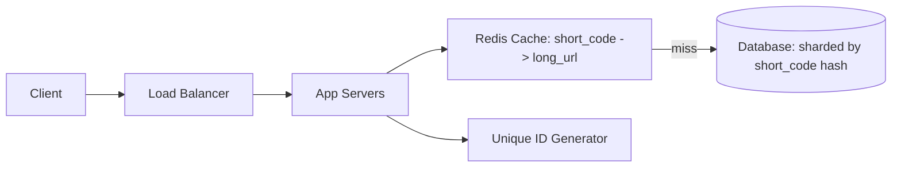

### Deep Dive: Generating Short Codes

Two approaches:
1. **Base62 encode an auto-incrementing ID**: a counter (from a dedicated ID-generation service, e.g., a range of IDs leased per app server to avoid a single DB counter bottleneck) is encoded into base62 (a-z, A-Z, 0-9), giving a 6-7 character code for billions of URLs. Deterministic, no collisions, but sequential IDs can leak information (approximate creation order/volume).
2. **Hash the long URL (MD5/SHA-256) and take the first 6-8 characters**: collisions are possible (two different URLs' hash prefixes matching), so you need a collision-check-and-retry loop against the DB. Avoids needing a centralized counter.

Recommended: base62-encoded distributed ID generator (like a Twitter Snowflake variant) — avoids both the centralized-counter bottleneck of a naive auto-increment and the collision handling of hashing.

### Bottlenecks and Trade-offs
- The redirect path is almost entirely read-heavy and cacheable — cache-aside on `short_code → long_url` with a long TTL handles the vast majority of traffic without touching the DB.
- 301 (permanent) vs 302 (temporary) redirect: 301 lets browsers cache the redirect, reducing load on your servers for repeat clicks, but means you lose the ability to update where a short link points or to count every single click server-side (the browser skips you on repeat visits). Most URL shorteners intentionally use 302 to keep click analytics accurate, trading a bit of server load for tracking fidelity.
- Custom aliases need a uniqueness check at write time, a small write-path cost justified by the feature.

---

## 2. Rate Limiter (as a standalone service)

### Requirements
Functional: limit requests per client (by API key, user ID, or IP) to N requests per time window; return remaining quota.
Non-functional: must not become a bottleneck itself; must be accurate enough to be fair but doesn't need perfect precision; low added latency.

### Estimation
Assume this service sits in front of an API gateway doing 1M QPS total across all clients. The limiter must add well under 1ms per check to avoid becoming the dominant latency cost.

### API
```
Internal check: ALLOW(client_id) -> {allowed: bool, remaining: int, reset_at: timestamp}
```

### High-Level Design

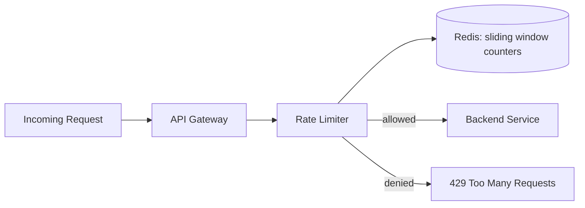

### Deep Dive

Use the **sliding window counter** algorithm (file 05) implemented in Redis: each client_id maps to a counter incremented via a Lua script that atomically checks-and-increments (avoiding a race condition between separate GET and SET calls). Redis's single-threaded execution model makes this atomic by construction when done inside one Lua script.

For very high throughput, run this check **locally on each gateway node** using an approximate token bucket, periodically syncing aggregate usage to a central Redis for cross-node accuracy — trading perfect global accuracy for the ability to check limits without a network round-trip on every single request. This is the exact AP-leaning trade-off from the CAP/PACELC discussion in file 02: you accept a slightly loose limit (a client might burst slightly over N across all nodes combined) in exchange for much lower latency and no single point of failure.

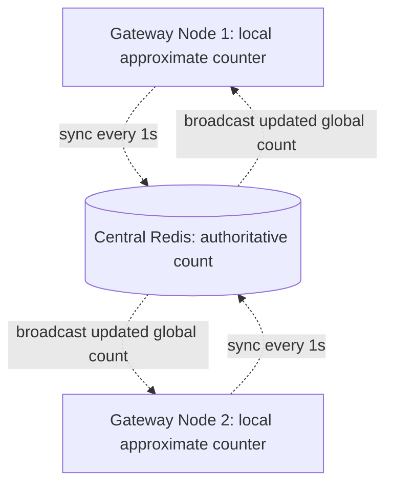

### Bottlenecks and Trade-offs
- A single centralized Redis instance for rate limiting is itself a single point of failure and bottleneck at extreme scale — shard it by client_id hash, same consistent-hashing idea from file 02.
- Strict global accuracy vs. low latency is the central trade-off; almost every production rate limiter (Stripe, AWS) accepts some looseness at the edges in exchange for speed.

---

## 3. Chat System (like WhatsApp)

### Requirements
Functional: 1:1 and group messaging, online/offline status, message delivery/read receipts, message history.
Non-functional: low latency delivery (<200ms for online users), messages must not be lost, must scale to billions of messages/day, support offline users (store and forward).

### Estimation
Assume 500M DAU, each sending 40 messages/day.
- Messages/day = 500,000,000 × 40 = 20,000,000,000 (20 billion).
- Average QPS = 20,000,000,000 / 86,400 ≈ **230,000 QPS**, peak (2-3x) ≈ **500,000-700,000 QPS**.
- Storage per message ~100 bytes (sender, receiver, text, timestamp). 20B/day × 100 bytes = 2 TB/day — this is a genuinely write-heavy, high-volume system, pointing strongly toward an LSM-tree-based store (Cassandra) rather than a traditional RDBMS for message storage.

### API
```
WebSocket: SEND_MESSAGE {to, content} 
WebSocket: ACK {message_id, status: delivered|read}
GET /messages?conversation_id&before=timestamp (paginated history)
```

### Data Model
```
messages: message_id, conversation_id, sender_id, content, timestamp, status
  - partitioned by conversation_id, clustered by timestamp (natural fit for wide-column store)
conversations: conversation_id, participant_ids, last_message_at
```

### High-Level Design

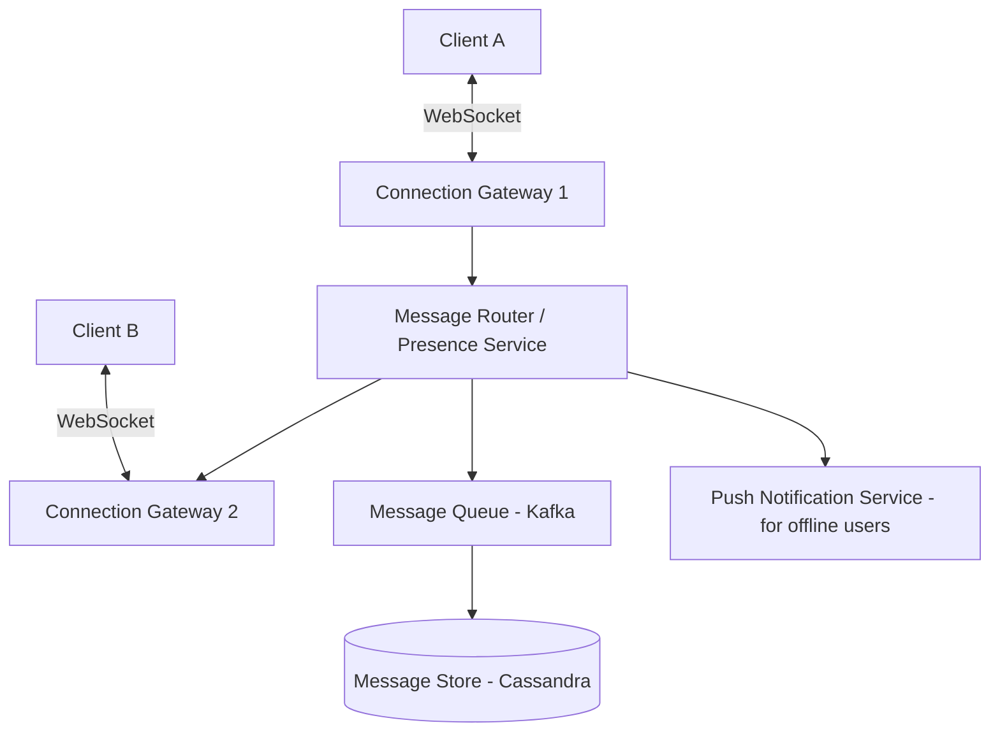

### Deep Dive: Message Delivery and Ordering

Each client holds a persistent WebSocket connection to a **connection gateway** (a stateful service tracking which server holds which user's socket — this mapping itself typically lives in Redis for fast lookup). When User A sends a message:
1. Gateway 1 receives it, assigns a unique message ID (ordered per conversation — a Lamport-clock-like counter per conversation works well here, see file 04), and writes it durably to the message store and/or a Kafka topic keyed by `conversation_id` (guaranteeing order within that conversation).
2. The router looks up where User B's socket currently lives (which gateway node) and forwards the message there in real time if online.
3. If User B is offline, the message sits durably stored, and a push notification is triggered; delivery happens when B reconnects and fetches undelivered messages.

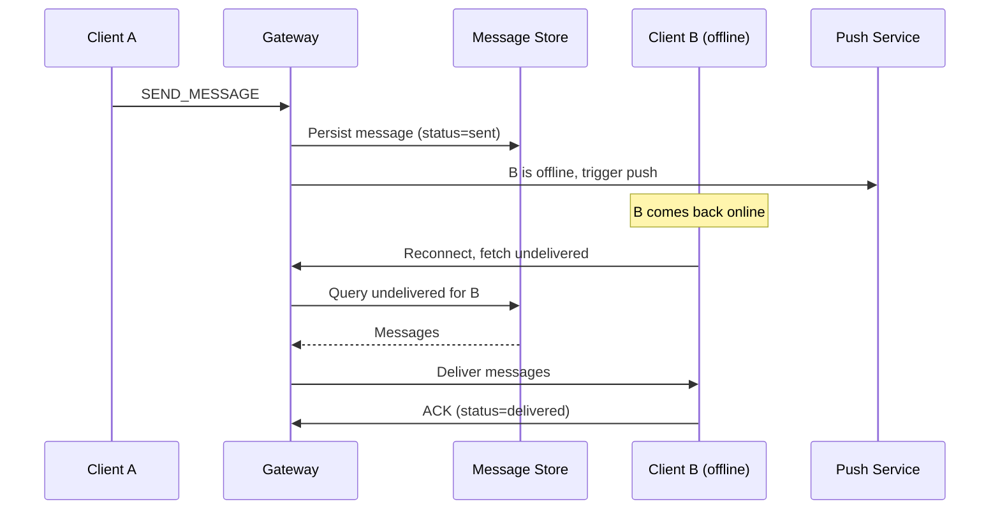

Delivery/read receipts are just additional small messages flowing the same path in reverse, updating the `status` field — this reuses the exact same idempotent, at-least-once delivery mindset from file 03 (a receipt delivered twice should just be a no-op update, not a double-counted event).

### Bottlenecks and Trade-offs
- The connection-gateway-to-user mapping is a hot, frequently-read piece of state; it must live in a fast store (Redis) and be updated on every connect/disconnect, which itself needs careful handling during gateway node restarts/deploys (a classic case for graceful connection draining).
- Group chat fan-out (one message, N recipients) doesn't scale linearly by naively sending N individual writes for huge groups; typically a size threshold switches from fan-out-on-write (push to every member's inbox immediately, good for small groups) to fan-out-on-read (store once, compute recipient view on fetch, good for very large groups/channels) — the exact same push/pull trade-off that appears again in case study 4.
- End-to-end encryption (as WhatsApp actually does) means the server cannot read message content at all, which affects server-side search and content moderation — worth naming as a real product trade-off if the interviewer pushes on encryption.

---

## 4. News Feed (like Twitter/Instagram)

### Requirements
Functional: users post content, follow other users, see a feed of posts from people they follow, roughly reverse-chronological or ranked.
Non-functional: feed must load fast (<200ms), must handle users with millions of followers (celebrities) without falling over, eventual consistency is acceptable.

### Estimation
Assume 300M DAU, average 200 follows per user, 2 posts/day per active poster (assume 10% of DAU post).
- Posts/day = 30,000,000 × 2 = 60,000,000 ≈ **700 writes/sec** average.
- Feed reads: assume each DAU checks their feed 10x/day = 3,000,000,000 reads/day ≈ **35,000 reads/sec** average, peaking at 70-100K — feed reads dominate writes by roughly 50:1, confirming this is a read-heavy system.

### API
```
POST /posts {content} -> {post_id}
GET  /feed?cursor=... -> [posts] (paginated)
POST /follow {target_user_id}
```

### High-Level Design

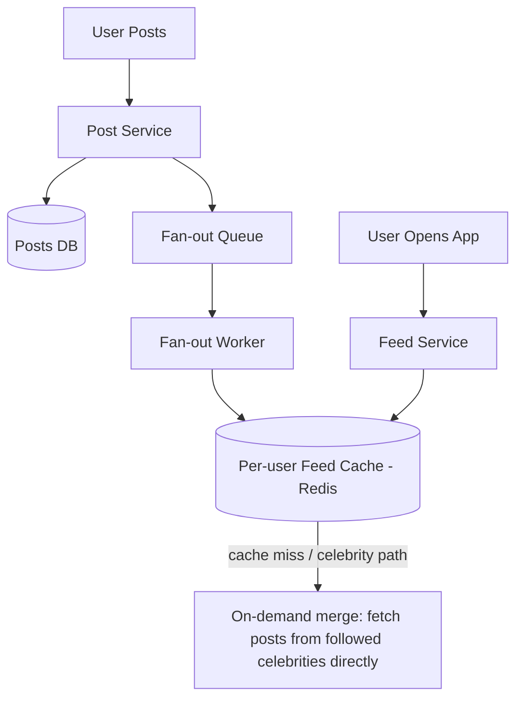

### Deep Dive: Fan-out on Write vs Fan-out on Read

This is the single most important decision in this design, and it is exactly the push/pull trade-off that shows up repeatedly across this course.

**Fan-out on write (push)**: when User A posts, immediately push that post into the precomputed feed cache of every one of A's followers. Feed reads become a single fast cache lookup. Breaks down badly for celebrities with 50M followers — one post would trigger 50M cache writes, a massive, slow, resource-intensive fan-out for a single action.

**Fan-out on read (pull)**: store posts once; when a user opens their feed, query posts from everyone they follow and merge them on the fly. Avoids the celebrity fan-out explosion, but makes every feed read more expensive (fetching and merging from potentially hundreds of followed accounts).

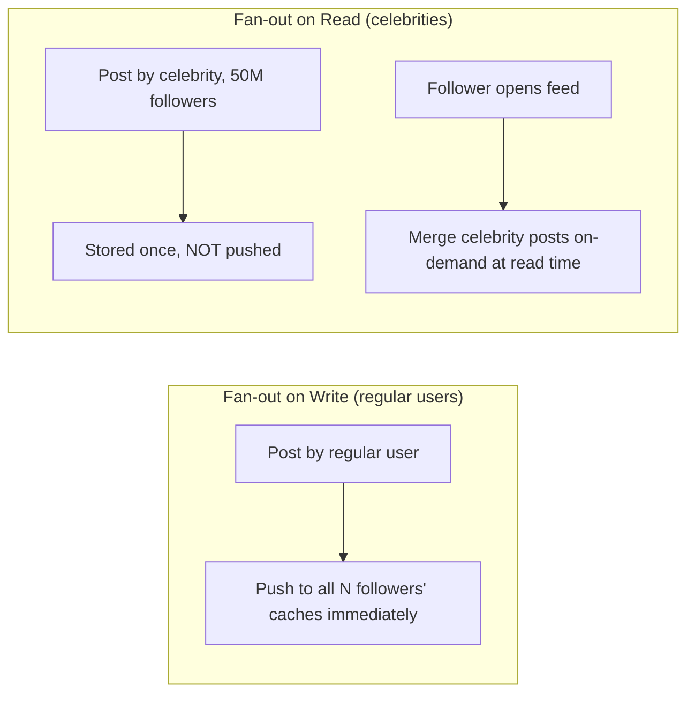

**The hybrid solution used in practice**: fan-out on write for regular users (the vast majority of accounts, where push cost is small), and fan-out on read specifically for accounts above a follower-count threshold (celebrities). A user's final feed is the merge of their precomputed pushed feed plus an on-demand fetch from the small number of celebrities they follow. This hybrid is the answer that signals you understand the actual bottleneck (fan-out cost scales with follower count, not with post count) rather than picking one strategy dogmatically.

### Bottlenecks and Trade-offs
- Ranking (not just reverse-chronological) adds a scoring step, typically done by a separate ranking service pulling in engagement signals — out of scope for the storage design but worth naming as a layer that sits on top of whichever fan-out strategy you pick.
- Feed cache staleness is an accepted trade-off (AP-leaning, per file 02) — a feed that's a few seconds stale is an acceptable cost for low latency and availability.

---

## 5. Video Platform (like YouTube)

### Requirements
Functional: upload video, transcode to multiple resolutions/formats, stream video to viewers, view counts, comments.
Non-functional: handle very large files (GBs), support adaptive bitrate streaming across varying network conditions, minimize latency to first frame, massive read (view) scale.

### Estimation
Assume 500 hours of video uploaded per minute (a commonly cited real-world scale figure for this type of platform), average video is 100MB raw per uploaded minute of footage before transcoding.
- Upload data rate ≈ 500 × 100MB / 60s ≈ **830 MB/s raw ingest**.
- Views dwarf uploads by orders of magnitude; a single popular video can be viewed millions of times, meaning **CDN offload is not optional, it's the core of the architecture** — origin servers must never serve the bulk of playback traffic directly.

### API
```
POST /videos/upload (chunked/resumable upload) -> {video_id, upload_url}
GET  /videos/{video_id}/manifest -> adaptive streaming manifest (HLS/DASH)
GET  /videos/{video_id}/metadata
```

### High-Level Design

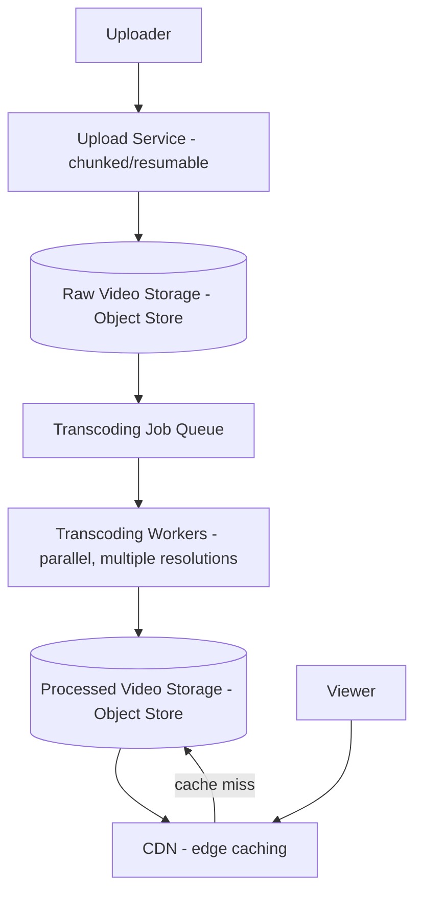

### Deep Dive: Transcoding and Adaptive Streaming

After upload, a video is split into **chunks** and transcoded in parallel into multiple resolutions (240p, 480p, 720p, 1080p, 4K) and formats, using a job queue (file 03's queue patterns apply directly — this is exactly a producer/consumer workload well-suited to a message queue with autoscaling consumer workers based on queue depth). Transcoding is CPU/GPU intensive and embarrassingly parallel across chunks, so throwing more worker instances at the queue scales it linearly.

Output uses **adaptive bitrate streaming** (HLS or DASH): the video is split into short segments (e.g., 6 seconds) at each resolution, and the player downloads a manifest listing all available qualities, then dynamically switches resolution segment-by-segment based on the viewer's current network conditions — this is why video starts at a lower resolution and gets sharper after a few seconds on a slow connection, without ever stopping to "buffer" if done well.

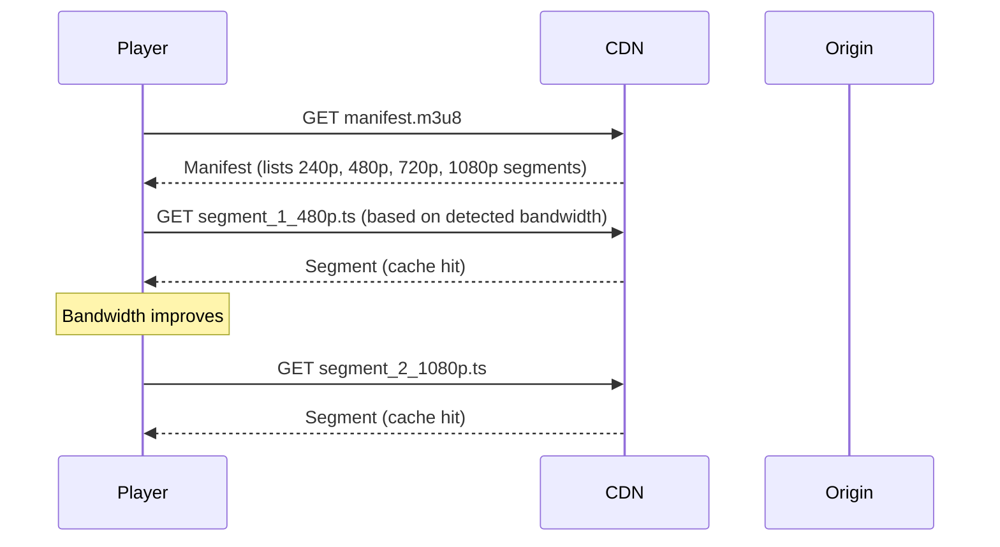

### Bottlenecks and Trade-offs
- Transcoding is slow and expensive; a trade-off exists between transcoding every resolution upfront (higher upload-to-availability latency, but every viewer gets instant access to their ideal quality) vs. transcoding lazily on first request for a given resolution (faster initial availability, first viewer at each resolution pays a penalty) — most large platforms pre-transcode the most common resolutions and lazily generate rarer ones.
- Storage cost is dominated by keeping multiple resolution copies of every video indefinitely; cold/rarely-viewed videos are often moved to cheaper, higher-latency storage tiers (an explicit storage-cost vs. access-latency trade-off).
- The CDN cache-hit ratio is the single most important efficiency metric in this entire system — a cache miss for a popular video means the origin and transcoding storage layer absorb load they were never sized for.

---

## 6. Ride Sharing (like Uber)

### Requirements
Functional: riders request rides, match with nearby available drivers, real-time location tracking, fare calculation, trip history.
Non-functional: matching must happen in seconds, location updates must be near-real-time, must handle regional surges (e.g., a concert ending), strong consistency needed for "this driver is now unavailable" to avoid double-booking.

### Estimation
Assume 5M concurrent active drivers globally sending a location ping every 4 seconds.
- Location update QPS = 5,000,000 / 4 ≈ **1.25M location writes/sec** globally — this is enormous and must be partitioned geographically; no single system should see all of this traffic.
- Ride requests: assume 20M rides/day ≈ 230 average QPS, peaking far higher in dense regions during rush hour or events — peak-to-average ratio is much higher than typical web traffic because of real-world geographic/temporal clustering.

### API
```
POST /location/update {driver_id, lat, lng} (high frequency, from driver app)
POST /ride/request {rider_id, pickup, destination} -> {ride_id}
GET  /ride/{ride_id}/status
```

### High-Level Design

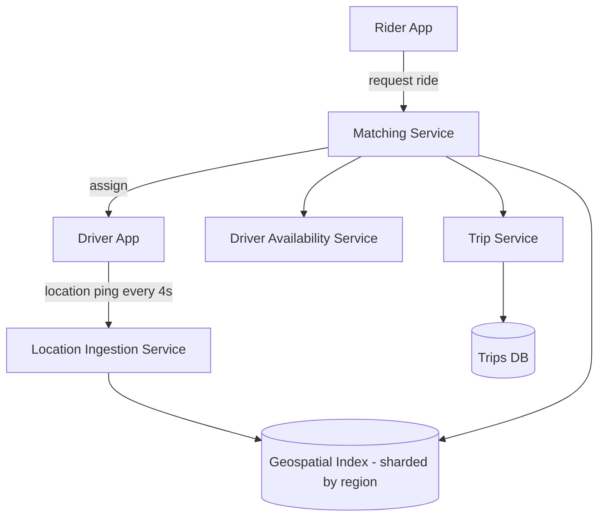

### Deep Dive: Geospatial Indexing and Matching

Finding "nearby available drivers" is fundamentally a spatial query, which a standard B-tree index (file 02) can't do efficiently. The standard technique is **geohashing**: encode latitude/longitude into a string where nearby locations share long common prefixes, letting you find nearby points with a simple prefix range query on a regular index. Alternatively, a **quadtree** recursively divides the map into cells, subdividing further wherever driver density is high — giving naturally finer granularity in dense cities and coarser granularity in sparse rural areas.

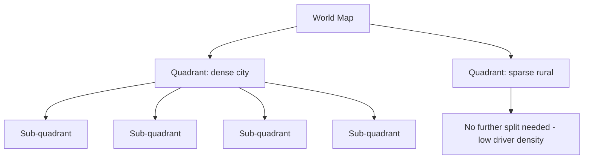

Matching flow: rider requests a ride → matching service queries the geo-index for available drivers within an expanding radius (start small, widen if too few found) → ranks candidates (distance, ETA, driver rating) → sends ride offer to top candidate with a short timeout → if declined/no response, offers to next candidate → on acceptance, atomically marks the driver unavailable (this specific write needs strong consistency — two riders simultaneously being matched to the same driver is a direct product-breaking bug, unlike the "likes count" example from file 02 where staleness was fine).

### Bottlenecks and Trade-offs
- Location data is partitioned geographically (by city/region), both because queries are naturally regional (you never match a rider in Mumbai with a driver in Toronto) and because it keeps each geo-shard's write volume manageable — this is the geo-based partitioning strategy from file 02 applied directly.
- The driver-availability "mark as busy" write is the one place in this whole system that must be strongly consistent (CP-leaning), while location pings themselves can tolerate being slightly stale (AP-leaning) — a single system intentionally mixing consistency models per data type, a hallmark of a senior-level answer rather than picking one model for everything.
- Surge pricing requires near-real-time aggregation of supply/demand imbalance per region — a natural fit for a stream-processing layer consuming the same location/request event stream.

---

## 7. Payment System

### Requirements
Functional: process payments (charge a card/account), handle refunds, maintain an auditable ledger, support multiple payment methods.
Non-functional: correctness is non-negotiable (no double charges, no lost money), strong consistency for balance/ledger operations, must integrate with external payment processors (which can be slow or fail), full auditability.

### Estimation
Assume 2M transactions/day.
- Average TPS = 2,000,000 / 86,400 ≈ **23 TPS**, peak (e.g., holiday sales) could be 5-10x ≈ **115-230 TPS** — volume here is modest compared to the chat/feed examples; the challenge in payments is correctness and consistency, not raw throughput.

### API
```
POST /payments/charge {idempotency_key, amount, currency, payment_method} -> {payment_id, status}
POST /payments/{payment_id}/refund {idempotency_key, amount}
GET  /payments/{payment_id}
```

### Data Model
```
payments: payment_id, idempotency_key (unique), amount, status, created_at
ledger_entries: entry_id, account_id, amount, type (debit/credit), payment_id, created_at
  - append-only, never updated or deleted (this IS event sourcing, file 05, applied to money)
```

### High-Level Design

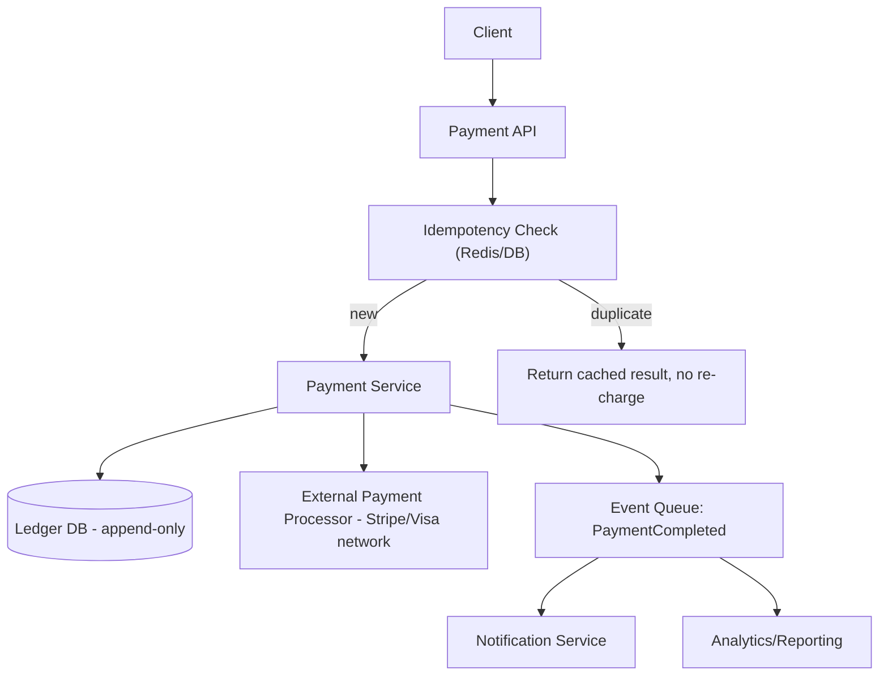

### Deep Dive: Idempotency and the Ledger

Every charge request carries a client-generated idempotency key (file 04's idempotency pattern, applied to the highest-stakes possible use case). Before doing anything else, the service checks if this key has already been processed; if so, it returns the stored result immediately rather than risking a double charge from a client retry after a network timeout. This single mechanism is the most interview-relevant detail in the entire payment system design — expect to be asked about it directly even if you don't bring it up first.

The ledger itself is **append-only**: instead of updating an account's balance in place, every transaction writes a new debit/credit entry, and the current balance is the sum of all entries (or a cached running total, periodically reconciled against the full sum). This gives a complete, immutable audit trail by construction — exactly the event-sourcing pattern from file 05, chosen here specifically because financial auditability is a hard business requirement, not a nice-to-have.

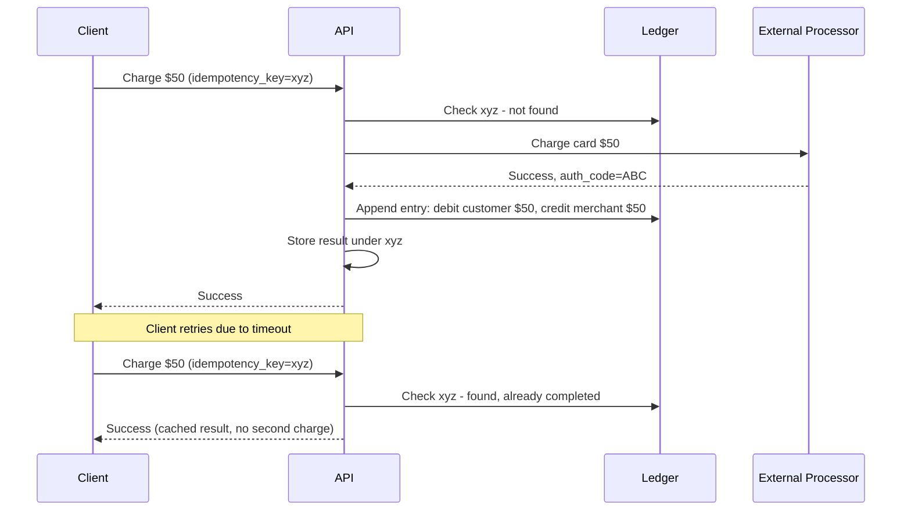

Because the external payment processor call can itself fail or time out ambiguously (did the charge go through or not?), the system needs a reconciliation process: periodically querying the processor's own records for any payment left in a `pending` state longer than expected, and resolving it definitively rather than guessing.

### Bottlenecks and Trade-offs
- Strong consistency (Serializable isolation, per file 02) is non-negotiable for the ledger write itself — this is one of the rare cases where you explicitly choose correctness over latency/throughput, unlike most of the other case studies in this file.
- The external processor is the slowest, least reliable dependency in the whole flow, which is exactly where a circuit breaker and bulkhead (file 05) belong — a slow processor shouldn't be allowed to exhaust your service's entire thread pool.
- 2PC (file 04) might seem tempting for "charge card AND update ledger atomically," but in practice this is handled as a saga-like flow: charge first, then durably record the result, with reconciliation handling the ambiguous-failure case — true cross-system atomicity with an external, third-party processor isn't achievable, so the design embraces eventual consistency with a reconciliation safety net instead.

---

## 8. Notification System

### Requirements
Functional: send notifications via multiple channels (push, email, SMS), support templated content, respect user preferences (opt-outs, quiet hours), handle high-volume broadcast (e.g., "breaking news" to millions at once).
Non-functional: high throughput for broadcast scenarios, delivery should be at-least-once (missing a notification is worse than a rare duplicate), must not overwhelm downstream providers (email/SMS gateways have their own rate limits).

### Estimation
Assume a broadcast notification to 50M users needs to go out within 10 minutes.
- Required throughput = 50,000,000 / 600s ≈ **83,000 notifications/sec** — this is a burst-heavy, queue-driven workload, not a steady-state one, making it a textbook application of the backpressure and rate-limiting concepts from file 03/05.

### API
```
POST /notifications/send {user_id or segment, channel, template_id, params}
POST /notifications/broadcast {segment_query, template_id, params}
```

### High-Level Design

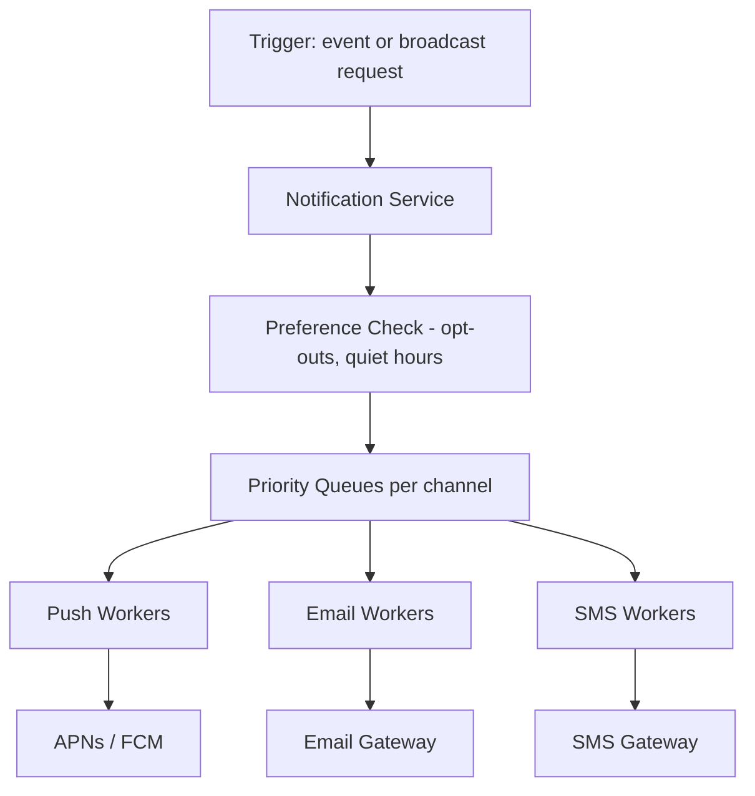

### Deep Dive: Fan-out and Rate Limiting Against External Providers

A broadcast to 50M users is conceptually similar to the celebrity fan-out problem in case study 4 — you cannot synchronously process 50M individual sends in the request path. Instead, the broadcast request enqueues a single job that a fleet of workers pulls from, each worker pulling a batch of user IDs and generating individual notification tasks, pushed onto per-channel queues.

Each channel's workers are rate-limited (token bucket, file 05) to match the external provider's actual capacity — e.g., FCM/APNs and SMS gateways have hard caps on requests/sec per account, and exceeding them gets you throttled or banned. The queue absorbs the burst; the token bucket smooths output to a rate the provider can sustain, directly applying the backpressure patterns from file 03.


Delivery is explicitly **at-least-once** (file 03): if a worker crashes mid-batch, the queue redelivers, and a duplicate push notification is an acceptable, minor annoyance compared to a user silently never receiving an important notification — the opposite trade-off from the payment system, where a duplicate was unacceptable. Naming this difference explicitly between case studies is a strong signal that you understand delivery semantics are a deliberate choice per use case, not a fixed property of "the system."

### Bottlenecks and Trade-offs
- Preference/opt-out checks must happen before enqueueing, not after, otherwise you've already paid the queueing and worker cost for a notification that gets dropped at the last step — pushing filtering as early as possible in the pipeline.
- Priority queues separate time-sensitive notifications (security alerts, OTP codes) from bulk/marketing ones, so a huge marketing broadcast doesn't delay a password-reset code sitting behind it in the same queue.
- Per-provider rate limiting must be tuned per provider and per channel independently; a single global rate limit would let one channel's burst starve another's capacity.

---

## 9. Distributed Cache (designing something like Redis/Memcached itself)

### Requirements
Functional: get/set/delete key-value pairs, TTL support, support for data larger than one machine's memory.
Non-functional: very low latency (sub-millisecond), high availability, horizontal scalability, predictable eviction behavior under memory pressure.

### Estimation
Assume 10TB of data to cache, single node capacity 64GB RAM.
- Nodes needed (raw) = 10TB / 64GB ≈ **156 nodes**, plus replication factor (commonly 2-3x for availability) → **300-470 nodes** total — at this scale, the system is fundamentally about efficient partitioning and failure handling, not single-node performance.

### High-Level Design

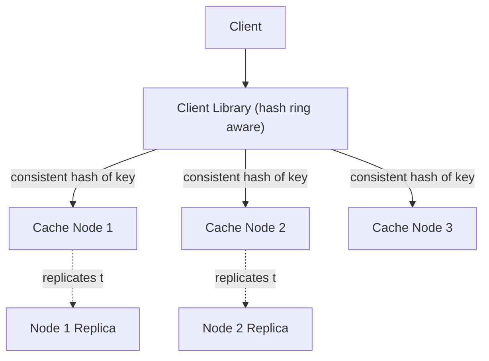

### Deep Dive: Partitioning, Replication, and Hot Keys

Keys are distributed across nodes using **consistent hashing with virtual nodes** (file 02), so adding/removing a node only reshuffles a small fraction of keys rather than the whole dataset. The client library itself is typically hash-ring-aware, routing requests directly to the correct node without an extra proxy hop — minimizing latency, since this is a system where every microsecond matters.

Each node's data is replicated to 1-2 other nodes for availability; on node failure, a replica is promoted (leader election pattern, file 04) and the hash ring is updated to route around the dead node. Because this is a cache, not a system of record, losing a small amount of recently-written data on a node crash is usually acceptable — the application can always re-fetch from the underlying database (this is precisely why cache-aside, file 03, is forgiving of cache data loss in a way a primary database would never be).

**Hot keys** are the recurring hard problem (same issue surfaced in file 02's probes): if one key gets disproportionate traffic, the single node owning it becomes a bottleneck regardless of how well the rest of the ring is balanced. Mitigation: detect hot keys via per-key access metrics, then either replicate that specific key to multiple nodes with client-side random selection among replicas, or cache it one layer closer to the client (a local in-process cache in front of the distributed cache) to absorb the worst of the traffic before it even reaches the distributed layer.

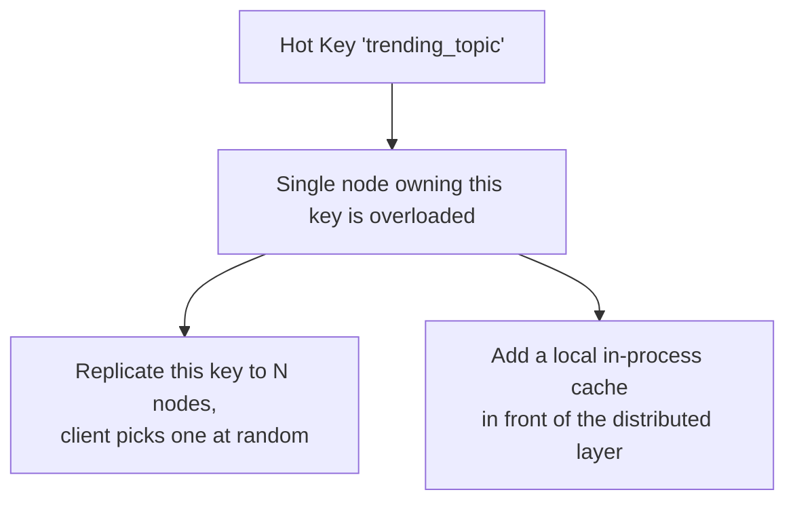

### Bottlenecks and Trade-offs
- Memory eviction policy (LRU/LFU, file 03) directly trades off hit rate for implementation simplicity and overhead — LFU gives better hit rates for stable access patterns but costs more bookkeeping per access than LRU.
- Synchronous replication (file 02) on every write would hurt the low-latency goal that's the entire point of a cache; most distributed caches replicate asynchronously and simply accept that a crash can lose the last few milliseconds of writes on that node.
- A proxy-based architecture (requests go through a routing layer rather than a smart client) simplifies clients at the cost of an extra network hop and a potential bottleneck at the proxy layer — a direct instance of the "where do I put this complexity" trade-off that recurs throughout this course.

---

## 10. Search Autocomplete (typeahead, like a search box suggesting queries as you type)

### Requirements
Functional: as a user types, suggest the top-k most relevant/popular completions in real time.
Non-functional: extremely low latency (<100ms, ideally much less, since this fires on every keystroke), suggestions should reflect current popularity trends, must scale to handle a request on essentially every keystroke of every active user.

### Estimation
Assume 100M DAU, average search query is 20 characters, meaning ~20 autocomplete requests fire per actual search (one per keystroke, though clients typically debounce/throttle this).
- If 20% of DAU perform 5 searches/day with debounced ~5 autocomplete calls per query: 20,000,000 × 5 × 5 = 500,000,000 autocomplete requests/day ≈ **5,800 QPS average**, peaking higher — this is a high-QPS, extremely-latency-sensitive, read-dominated workload, meaning essentially everything must be served from memory.

### API
```
GET /autocomplete?prefix=abc -> [top-k suggestions]
```

### High-Level Design

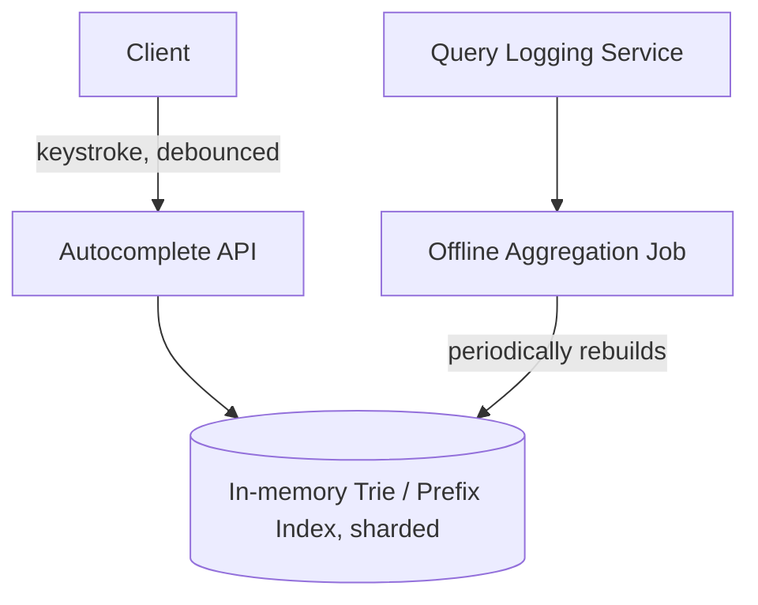

### Deep Dive: Trie-Based Prefix Matching and Precomputed Top-K

The core data structure is a **trie**: each node represents one character, and a path from root to node represents a prefix. At each node, the top-k most popular completions reachable through that node are precomputed and cached directly on the node — so a lookup is O(prefix length) to find the node, then an O(1) read of the precomputed list, instead of searching through all possible completions at query time.

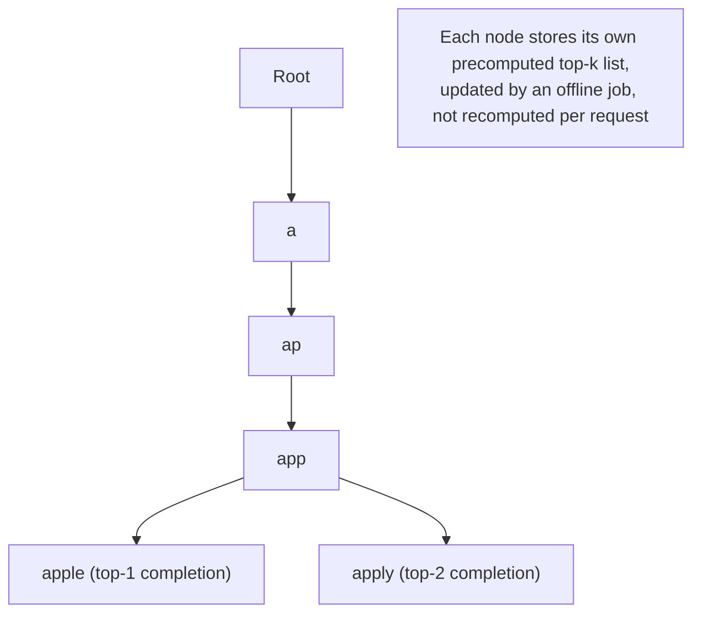

Because actual query popularity shifts over time (trending topics), the trie's precomputed top-k lists are **not updated synchronously on every search** — that would make every search both a read and a write to a shared structure, which doesn't scale. Instead, raw search queries are logged to a queue (file 03) and an **offline aggregation job** periodically (e.g., every few minutes to hours) recomputes popularity counts and rebuilds or incrementally updates the trie's top-k lists. This is a direct application of the CQRS pattern from file 05: writes (search query logs) and reads (autocomplete serving) are fully separated, with the read-optimized structure (the trie) rebuilt asynchronously from the write-side log.

The trie itself, once built, is small enough and hot enough to live entirely in memory, sharded by first character (or first few characters) across multiple nodes if it grows too large for one machine — and because rebuilding happens offline, the serving path never touches a database at request time at all, which is how sub-100ms latency is achievable even at very high QPS.

### Bottlenecks and Trade-offs
- Freshness vs. serving latency is the central trade-off: a synchronously-updated trie would reflect trends instantly but tank latency and throughput; the offline-rebuild approach sacrifices some freshness (new trends take minutes, not milliseconds, to appear) in exchange for consistently fast reads — an explicit instance of the PACELC latency/consistency trade-off (file 02) applied to a non-database system.
- Personalization (showing a user's own search history in suggestions) adds a second, per-user data source that must be merged with the global trie results at request time — a small increase in per-request work in exchange for noticeably better relevance.
- Typos and fuzzy matching (not just exact prefixes) require a different structure entirely (e.g., edit-distance-aware indexes) and are usually layered on top of, not instead of, the fast trie-based exact-prefix path.
