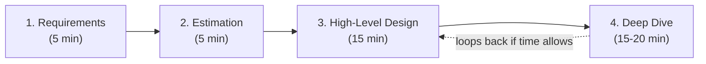

# 08. Interview Framework and Practice Questions

Everything in files 01-07 is raw material. This file is about how to actually use that material in a 45-minute room, and what specifically separates a 10-12 year candidate's answer from a mid-level one.

## The 4-Step Framework

### Step 1: Requirements (5 minutes)

Do not start drawing boxes yet. Clarify functional requirements (what must the system do) and non-functional requirements (scale, latency, consistency, availability needs) out loud, and explicitly state what's out of scope.

Ask targeted questions, don't just list every feature imaginable:
- "Is this read-heavy or write-heavy?" (shapes your entire storage choice, file 02)
- "What's the scale — DAU, requests/sec, data volume?" (feeds directly into step 2)
- "Does this need strong consistency anywhere specifically, or is eventual consistency acceptable everywhere?" (file 02's CAP/PACELC framing)
- "Is this a global/multi-region product, or single-region for now?"

A senior signal here: proactively **narrowing scope**. "I'll focus on the core posting and feed-reading flow, and explicitly set aside comments and notifications unless we have time to come back to them" shows you can manage a 45-minute budget, not just that you know things.

### Step 2: Estimation (5 minutes)

Use the back-of-envelope math from file 06. State your assumptions explicitly ("I'll assume 100M DAU and a 10:1 read:write ratio since we weren't given exact numbers"), then derive QPS, storage, and bandwidth out loud, step by step. The actual numbers matter less than demonstrating you can connect a user-facing scale number to an infrastructure requirement.

This step should directly inform choices you make in step 3 — if you compute 230 writes/sec, say so and conclude "that's well within a single well-provisioned primary database, so I won't jump to sharding yet" rather than estimating numbers and never referencing them again.

### Step 3: High-Level Design (15 minutes)

Draw the main components and data flow: client, load balancer/gateway, services, data stores, cache, queue — whatever the specific system needs (file 07's diagrams are the template). Keep it at the box-and-arrow level; don't go deep on any one component yet.

State your initial technology choices with one-sentence justifications tied back to step 1/2's requirements: "Given the 10:1 read ratio and need for flexible queries, I'll start with PostgreSQL and add a read-through cache in front of the hottest queries."

### Step 4: Deep Dive (15-20 minutes)

This is where the interviewer steers you (or you proactively steer yourself) into the 1-2 hardest parts of the system — the parts where a generic answer falls apart. File 07's "Deep Dive" sections are exactly this: celebrity fan-out, idempotent payments, geospatial matching, hot keys. This is where distributed-systems vocabulary from files 02 and 04 (consistent hashing, quorum, idempotency, consensus) earns its keep.

Always close the loop on trade-offs: for every significant decision, name the alternative you didn't pick and why. "I chose fan-out on write for most users because it keeps reads fast, but switched to fan-out on read above a follower threshold because fan-out cost scales with follower count, and I don't want one celebrity's post to trigger 50 million writes."

## How a 10-12 Year Candidate Signals Seniority

The content knowledge in files 01-07 is table stakes at this level — everyone in the room is expected to know what Kafka is. What differentiates a senior answer is *how* you use that knowledge.

### 1. Trade-off language, not feature lists

Junior: "I'll use Kafka for messaging."
Senior: "I'll use Kafka specifically because I need multiple independent consumers to replay the same event stream for analytics and fraud detection, which RabbitMQ doesn't naturally support since it deletes messages once consumed."

### 2. Naming failure modes before being asked

Junior waits for "what if service X goes down" to be asked. Senior says, unprompted, while drawing the diagram: "This call to the payment processor needs a circuit breaker, because if it starts timing out under load, I don't want every request thread in my service blocked waiting on it."

### 3. Quantified reasoning, not vague scale talk

Junior: "This needs to scale a lot."
Senior: "At 500K peak writes/sec, a single Postgres primary won't keep up — I'd shard by `conversation_id` using consistent hashing to spread writes across, say, 64 shards, giving each shard roughly 8K writes/sec, well within a single node's capacity."

### 4. Acknowledging what you're consciously not solving

Senior candidates explicitly flag simplifications: "I'm treating this as eventually consistent and not handling the exact-once delivery problem in full rigor here — in practice I'd rely on idempotency keys rather than trying to build true exactly-once semantics, which is a much harder and usually unnecessary guarantee."

### 5. Correcting course visibly

If partway through a deep dive you realize your initial choice doesn't hold up, say so out loud and explain why: "Actually, thinking about this more — hash-based sharding here would make the range queries this feature needs very expensive, since results would be scattered across every shard. I'd switch to range-based partitioning by timestamp instead." Interviewers consistently rate this higher than silently never revising an early mistake.

### 6. Operational awareness beyond the design itself

Mentioning rollout strategy, monitoring (file 06), and chaos testing unprompted for the riskiest part of the design is a strong staff-level signal: "Before I'd trust this circuit breaker threshold in production, I'd want to chaos-test it by actually killing the dependency in staging and confirming the breaker trips and the fallback behaves as expected."

## 30 Interview Questions with Answer Outlines

### Design Questions (full case-study style — see file 07 for complete worked versions)

1. **Design a URL shortener.** → Base62-encoded distributed ID generator, cache-aside on redirects, discuss 301 vs 302 trade-off. (File 07 §1)
2. **Design a rate limiter.** → Token bucket in Redis via Lua script for atomicity, discuss local-approximate vs. centralized-exact trade-off at extreme scale. (File 07 §2)
3. **Design a chat application (WhatsApp).** → WebSocket gateways + presence service, Kafka-backed durable message store, fan-out-on-write/read hybrid for large groups. (File 07 §3)
4. **Design a news feed (Twitter/Instagram).** → Hybrid fan-out: push for regular users, pull for celebrities, merge at read time. (File 07 §4)
5. **Design a video streaming platform (YouTube).** → Chunked upload, parallel transcoding workers, adaptive bitrate streaming via CDN. (File 07 §5)
6. **Design a ride-sharing system (Uber).** → Geospatial indexing (geohash/quadtree), mixed consistency (strong for driver-busy flag, eventual for location pings). (File 07 §6)
7. **Design a payment processing system.** → Idempotency keys, append-only ledger (event sourcing), saga-style reconciliation with external processor instead of 2PC. (File 07 §7)
8. **Design a notification system.** → Queue-based fan-out, per-provider token-bucket rate limiting, at-least-once delivery accepted. (File 07 §8)
9. **Design a distributed cache (build Redis).** → Consistent hashing with virtual nodes, async replication, hot-key mitigation via local caching or key replication. (File 07 §9)
10. **Design a search autocomplete/typeahead.** → Trie with precomputed top-k per node, offline aggregation job rebuilds it (CQRS pattern). (File 07 §10)

### Deep-Dive Probe Questions

11. **How does Kafka guarantee ordering?**
   Only within a single partition; messages with the same key land on the same partition and are read in the order written. Across partitions, there's no ordering guarantee — this is a deliberate trade for parallelism.

12. **Design for 10x growth: your single-leader database is now a write bottleneck. What are your options and their trade-offs?**
   Shard the data (consistent hashing, accept loss of easy cross-shard transactions), move to a multi-leader or leaderless system (accept conflict-resolution complexity), or vertically scale the leader as a short-term bridge while building the sharding layer properly.

13. **Why can't you guarantee true exactly-once message delivery across a network?**
   Delivering a message and durably recording its effect are two separate operations across an unreliable network; any point of failure between them (sender timeout, receiver crash before ack) makes it impossible to distinguish "delivered but ack lost" from "never delivered" without additional coordination — so systems achieve the equivalent effect via at-least-once delivery plus idempotent processing.

14. **Explain the difference between CAP and PACELC, and why the latter matters more day-to-day.**
   CAP only governs behavior during an actual network partition, which is relatively rare; PACELC additionally captures the constant latency/consistency trade-off you make on every single request even when there's no partition, via your replication and consistency settings — this is the trade-off you're actually tuning on a daily basis.

15. **How would you detect and mitigate a hot key in a sharded system?**
   Monitor per-key access rates; once a key is identified as hot, either replicate it across multiple nodes with client-side random selection, add a local in-process cache layer in front of the shared store, or split the key's data further along a secondary dimension if possible.

16. **Walk through what happens if a leader in a Raft cluster crashes mid-write.**
   If the write hadn't yet been replicated to a majority, it's lost and the client should retry (it was never committed); if it had reached a majority before the crash, the newly elected leader (which must have an up-to-date log to win the election) will have that entry and can complete replicating it to the remaining followers.

17. **Why is 2PC a poor fit for most microservice architectures?**
   If the coordinator crashes between the Prepare and Commit phases, participants are left blocking indefinitely holding locks, unable to resolve the transaction on their own — this availability risk, combined with the tight coupling 2PC requires between independently-deployed services, is why sagas with compensating actions are generally preferred instead.

18. **How do you prevent a cache stampede on a key that just expired and is extremely popular?**
   Use a short-lived lock so only the first request to miss repopulates the cache while concurrent requests wait briefly or receive stale data, combined with jittered TTLs so hot keys don't all expire in the same instant.

19. **Explain vector clocks and give a real scenario where you'd need them over simple Lamport clocks.**
   Vector clocks track one counter per node and can detect true concurrency (neither event causally preceded the other), unlike Lamport clocks which only give a partial order; a real scenario is a Dynamo-style multi-region database detecting that two regions wrote conflicting updates to the same key concurrently, requiring explicit conflict resolution rather than silently picking one.

20. **Your circuit breaker is tripping constantly even though the downstream dependency seems mostly healthy. What would you check?**
   Check if the failure threshold is too sensitive relative to the dependency's normal transient error rate, check if timeouts are set too aggressively (treating slow-but-successful calls as failures), and check if the half-open state's test traffic volume is too low to get a representative signal before re-opening.

21. **Why does consistent hashing use virtual nodes instead of mapping one physical node to one point on the ring?**
   A single point per physical node means removing that node dumps its entire load onto just one neighbor; virtual nodes spread each physical node's data across many points on the ring, so a failure's load redistributes evenly across many remaining nodes instead of overloading one.

22. **Design for 10x growth: your fan-out-on-write news feed system is struggling because average follower count has grown. What's your next move?**
   Lower the threshold at which accounts switch from fan-out-on-write to fan-out-on-read, and consider adding an intermediate tier (e.g., precompute for small follower counts, lazily cache-and-merge for medium, pure on-demand for celebrities) rather than a single hard cutoff.

23. **What's the difference between liveness and readiness health checks, and why does the distinction matter?**
   Liveness confirms the process hasn't deadlocked/crashed; readiness confirms it can actually serve traffic right now (e.g., DB connections warmed up) — treating a not-yet-ready-but-alive instance as healthy routes real traffic to it before it can serve correctly, causing avoidable errors during deploys/restarts.

24. **How would you design idempotency for an operation that has side effects on two different downstream systems?**
   Store the idempotency key with a status tracking which downstream step has completed so far (not just success/failure overall), so a retry can resume from the correct step rather than either skipping a step that never ran or redoing one that already succeeded.

25. **Explain the write amplification trade-off in LSM trees, and why it's an acceptable cost.**
   Compaction rewrites data multiple times as SSTables merge, meaning more total bytes written to disk than the logical data size — an acceptable cost because it enables the purely sequential, very fast write path (append to memtable/WAL) that makes LSM trees so much faster for write-heavy workloads than a B-tree's random-I/O updates.

26. **Your monitoring shows p50 latency is fine but p99 has been creeping up for weeks. What's your hypothesis-driven approach to find the cause?**
   Suspect a tail-latency-specific cause rather than a uniform slowdown — check for GC pauses, a specific slow downstream dependency that only some requests hit, lock contention under specific conditions, or a hot shard/node that's degrading while the rest of the fleet is healthy and pulling the average down.

27. **Why would you choose range-based over hash-based partitioning for a time-series workload, despite the hot-shard risk?**
   Time-series queries overwhelmingly filter by a time range, and range-based partitioning lets a query touch only the relevant shards instead of scattering across all of them as hash-based partitioning would; the hot-shard risk (all new writes hitting the latest range) is then mitigated separately, e.g., by also partitioning by a secondary key like region or device ID.

28. **What's the real difference between an SLO and an SLA, and why should the SLO be stricter?**
   An SLO is an internal reliability target used to drive engineering decisions; an SLA is an external, often contractual, promise to customers — keeping the SLO stricter than the SLA creates a buffer so internal degradation is caught and fixed before it ever breaches what customers were actually promised.

29. **Design for 10x growth: your Saga-based checkout flow's compensating actions are starting to fail occasionally under higher load, leaving orders in a stuck intermediate state. How do you handle this?**
   Add retry-with-backoff specifically for compensating actions, route persistently-failing compensations to a dead-letter queue with alerting for manual intervention, and track intermediate-state duration so stuck orders are surfaced proactively rather than discovered by customer complaints.

30. **Why might a staff engineer deliberately choose a monolith over microservices for a new, high-stakes project, even knowing the company will eventually need to scale?**
   Early on, service boundaries aren't yet well understood, and premature microservices lock in bad boundaries while adding real operational overhead (distributed tracing, service discovery, eventual consistency) before that complexity is actually earning its cost; a well-structured modular monolith can be split later, once real usage patterns reveal where the natural seams actually are.

## Closing Note on Practice

Work through file 07's ten case studies by re-deriving them yourself, out loud, against a timer, without looking at the text — that rehearsal, not re-reading, is what makes the 4-step framework automatic under real interview pressure.
