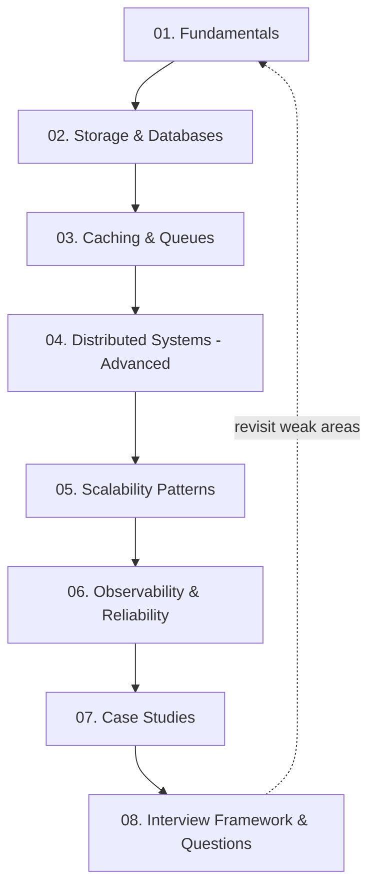

# System Design Interview Track

A complete system design track for engineers with 10-12 years of experience preparing for staff/senior-level interviews at FAANG and similar companies. This is one of four parallel tracks in the broader interview-mastery-course (alongside DSA, MERN+Kubernetes, and ML/GenAI).

## Who This Is For

You already know what a load balancer is. This course assumes that and pushes toward what separates a senior answer from a mid-level one: trade-off language, failure-mode awareness, quantified reasoning, and the judgment to know when a pattern is overkill. If you're newer to system design, work through the files in order — the fundamentals are still covered in depth, just without hand-holding.

## How to Study This Track

1. **First pass (concept building)**: read files 01-06 in order. Each builds on the last — file 04's consensus discussion assumes you know replication from file 02, file 05's rate limiting assumes you know Redis patterns from file 03. Don't skip ahead.
2. **Second pass (application)**: work through file 07's ten case studies. For each, cover the right-hand side of the page and try to derive the estimation, API, and high-level design yourself before reading the worked answer.
3. **Third pass (interview simulation)**: use file 08's framework and timer yourself doing a case study from scratch in 45 minutes, out loud, as if an interviewer were in the room. Then check your answer against file 07's version and the trade-offs you may have missed.
4. **Ongoing**: every concept file ends with "Practice Questions" (quick recall check) and "Senior-Level Probes" (the actual bar you're being held to). Revisit the probes specifically — they're the questions that catch people who've only memorized definitions.

Budget roughly 2-3 hours per concept file (01-06), a full day working through all of file 07, and then recurring 45-minute mock sessions using file 08 until the 4-step framework feels automatic rather than effortful.

## File Index

| File | Topic | What You'll Learn |
|---|---|---|
| [01-fundamentals.md](./01-fundamentals.md) | Networking & infrastructure basics | Client-server model, latency vs throughput, vertical/horizontal scaling, load balancer algorithms (L4/L7), DNS, CDN, proxies |
| [02-storage-and-databases.md](./02-storage-and-databases.md) | Data layer | SQL vs NoSQL, indexing, replication, sharding/partitioning, consistent hashing, CAP/PACELC, isolation levels, LSM trees vs B-trees |
| [03-caching-and-queues.md](./03-caching-and-queues.md) | Caching & async messaging | Cache strategies, eviction policies, cache stampede, Redis patterns, Kafka vs RabbitMQ, delivery semantics, backpressure |
| [04-distributed-systems-advanced.md](./04-distributed-systems-advanced.md) | Hard distributed-systems theory | Raft/Paxos consensus, leader election, 2PC vs Saga, idempotency, Lamport/vector clocks, quorum, gossip, split-brain |
| [05-scalability-patterns.md](./05-scalability-patterns.md) | Architecture patterns at scale | Microservices vs monolith, event-driven architecture, CQRS, event sourcing, rate limiting algorithms, circuit breakers, bulkheads, cell-based architecture, multi-region |
| [06-observability-and-reliability.md](./06-observability-and-reliability.md) | Running systems in production | SLI/SLO/SLA, error budgets, monitoring/logging/tracing, chaos engineering, full back-of-envelope capacity math with worked examples |
| [07-case-studies.md](./07-case-studies.md) | Full worked designs | URL shortener, rate limiter, chat (WhatsApp), news feed (Twitter/Instagram), video platform (YouTube), ride sharing (Uber), payment system, notifications, distributed cache, search autocomplete |
| [08-interview-framework-and-questions.md](./08-interview-framework-and-questions.md) | Interview execution | The 4-step framework, how to signal seniority explicitly, 30 questions with answer outlines |

## Core Principles Woven Through Every File

- **Every design decision is a trade-off, not a best practice.** Files consistently ask "what did you give up to get this" rather than presenting patterns as universally correct.
- **Numbers over vibes.** Estimation isn't a box-checking ritual at the start of an interview — file 06's capacity math is referenced and reused throughout file 07's case studies to justify specific architectural choices.
- **The same handful of patterns recur everywhere.** Consistent hashing, idempotency, the push-vs-pull (fan-out-on-write vs fan-out-on-read) trade-off, and the CP/AP choice show up again and again across files 02-07 in different contexts. Recognizing the same underlying pattern in a new question is a stronger signal than memorizing ten unrelated case studies.
- **Diagrams over paragraphs for structure.** Every file uses Mermaid flowcharts and sequence diagrams specifically so you internalize how to *draw* these systems, not just describe them in prose — that's the actual skill tested on a whiteboard.

## Quick Reference: When to Use What

| If the problem has... | Reach for... | Covered in |
|---|---|---|
| Heavy read traffic, tolerant of staleness | Cache-aside + CDN | 01, 03 |
| Need for multi-row transactions | Relational DB, strong isolation | 02 |
| Massive write throughput, flexible schema | Wide-column/LSM store (Cassandra) | 02 |
| A hot key or celebrity-scale fan-out | Key replication, fan-out-on-read hybrid | 02, 07 |
| Retries that must not duplicate side effects | Idempotency keys | 04, 07 |
| Cross-service workflow that must survive partial failure | Saga with compensations, not 2PC | 04, 07 |
| A dependency that might be slow or down | Circuit breaker + bulkhead | 05 |
| Bursty traffic that could overwhelm a client or your own capacity | Token bucket rate limiting + queue-based backpressure | 03, 05 |
| A geographically distributed user base | Geo-partitioning, multi-region, CDN | 01, 02, 05 |
| A need to prove the design survives failure, not just assume it | Chaos engineering | 06 |

Start with file 01.
