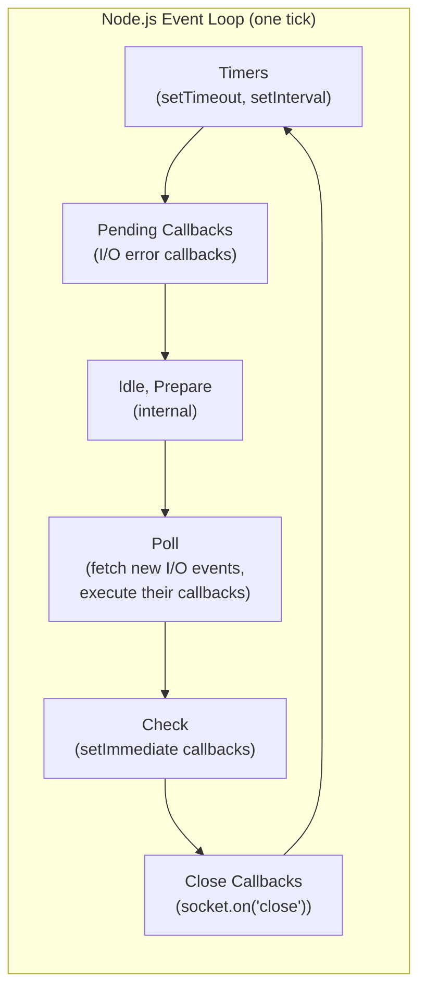
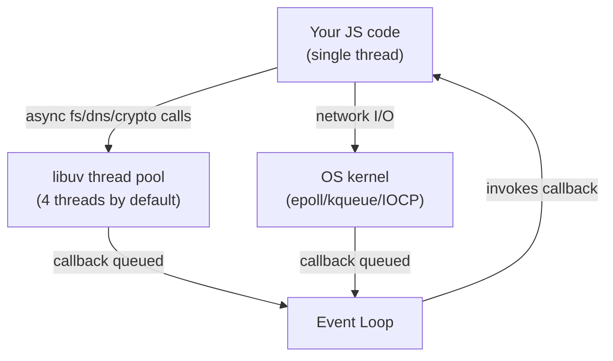
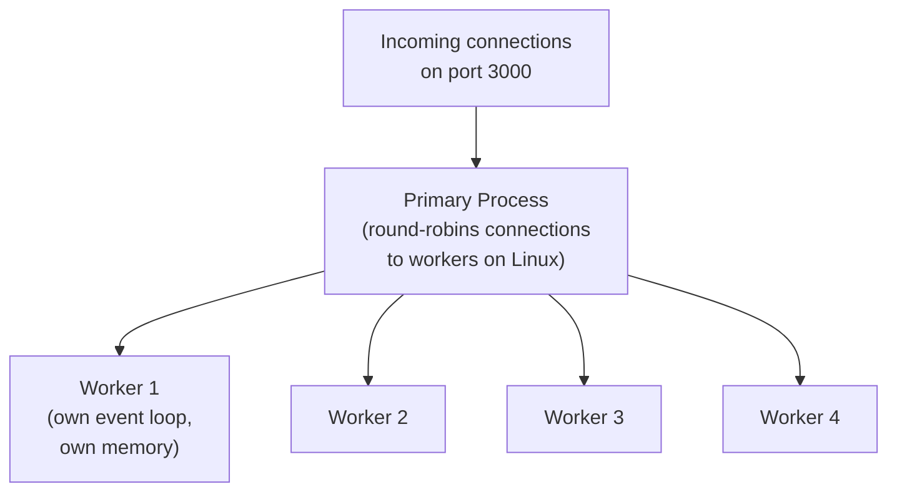

# 01 — Node.js & Express for Senior Interviews

## Table of Contents
1. The Event Loop (how Node is actually single-threaded but non-blocking)
2. Streams and Buffers
3. Clustering and the `worker_threads` module
4. Express middleware model
5. Centralized error handling
6. REST API design principles
7. Security: Helmet, rate limiting, and OWASP for Node

---

## 1. The Event Loop

Node.js runs your JavaScript on **one thread**, but it can still handle thousands of concurrent connections because I/O (disk, network, DNS) is delegated to the OS kernel or to libuv's thread pool, and the event loop picks up the *results* of that I/O when they're ready.

### The phases



Between **every phase**, and actually between every single callback, Node drains:
1. The **microtask queue** (Promise `.then`/`.catch`, `queueMicrotask`) — fully, until empty.
2. The **`process.nextTick` queue** — this runs even before Promise microtasks, and also fully drains before the loop continues.

This is the single most misunderstood part of Node and a favorite interview trap:

```js
console.log('1 sync');

setTimeout(() => console.log('2 timeout'), 0);

Promise.resolve().then(() => console.log('3 promise'));

process.nextTick(() => console.log('4 nextTick'));

console.log('5 sync');

// Output order:
// 1 sync
// 5 sync
// 4 nextTick    <- nextTick queue drains first
// 3 promise     <- then microtask queue
// 2 timeout     <- then we enter the timers phase
```

**Why this matters in practice**: recursively calling `process.nextTick` can starve the event loop entirely — I/O callbacks (the "Poll" phase) never get a chance to run because the nextTick queue is drained to completion before moving to the next phase. This is a real production bug pattern ("nextTick starvation").

### Libuv and the thread pool

Not everything in Node is non-blocking at the OS level. Things like `fs.readFile`, DNS lookups (`dns.lookup`), and `crypto.pbkdf2` are offloaded to **libuv's thread pool**, which defaults to **4 threads** (`UV_THREADPOOL_SIZE`). CPU-bound work like `bcrypt.hashSync`, JSON.parse on huge payloads, or heavy regex **does block the main thread** — there's no async magic that saves you there.



**Rule of thumb for interviews**: "Node is non-blocking for I/O, not for CPU work. If you have CPU-heavy work (image resizing, PDF generation, heavy crypto), move it to `worker_threads`, a child process, or an external queue/service — never run it inline on the main event loop in a request handler."

### Microtasks vs Macrotasks — summary table

| Queue | Examples | When it drains |
|---|---|---|
| `process.nextTick` | `process.nextTick(fn)` | Immediately after current operation, before microtasks |
| Microtask (Promise) | `.then()`, `async/await` continuation, `queueMicrotask` | After nextTick queue, before next event loop phase |
| Macrotask (Timers) | `setTimeout`, `setInterval` | In the "Timers" phase |
| Macrotask (Check) | `setImmediate` | In the "Check" phase, after Poll |

---

## 2. Streams and Buffers

A **Buffer** is a fixed-size chunk of raw binary data allocated outside the V8 heap. A **Stream** is an abstraction for reading or writing data piece by piece, instead of loading it all into memory.

### Four stream types

- **Readable** — source of data (`fs.createReadStream`, HTTP request body)
- **Writable** — destination for data (`fs.createWriteStream`, HTTP response)
- **Duplex** — both readable and writable (TCP sockets)
- **Transform** — a duplex stream that modifies data as it passes through (`zlib.createGzip`)

### Why streams matter: memory

```js
// BAD — loads the entire file into memory before sending.
// A 2GB file will crash a container with a 512MB memory limit.
app.get('/download', (req, res) => {
  const data = fs.readFileSync('./big-file.csv');
  res.send(data);
});

// GOOD — streams the file in small chunks, constant memory usage.
app.get('/download', (req, res) => {
  const stream = fs.createReadStream('./big-file.csv');
  stream.on('error', (err) => {
    res.status(500).end('Error reading file');
  });
  stream.pipe(res);
});
```

### Backpressure

`pipe()` automatically handles **backpressure**: if the writable destination (say, a slow network socket) can't keep up, the readable source pauses reading until the writable drains. If you build pipelines manually with `.on('data', ...)`, you must handle this yourself by checking the return value of `write()`:

```js
function writeData(readable, writable) {
  readable.on('data', (chunk) => {
    const canContinue = writable.write(chunk);
    if (!canContinue) {
      readable.pause();
      writable.once('drain', () => readable.resume());
    }
  });
}
```

### Transform stream example (gzip a file on the fly)

```js
const fs = require('fs');
const zlib = require('zlib');
const { pipeline } = require('stream');

pipeline(
  fs.createReadStream('input.txt'),
  zlib.createGzip(),
  fs.createWriteStream('input.txt.gz'),
  (err) => {
    if (err) {
      console.error('Pipeline failed:', err);
    } else {
      console.log('Pipeline succeeded');
    }
  }
);
```

Always prefer `stream.pipeline()` over manual `.pipe()` chains in production code — it correctly propagates errors and cleans up all streams if any one of them fails or is destroyed, which bare `.pipe()` does not do reliably.

---

## 3. Clustering and Worker Threads

A single Node process uses **one CPU core**. To use all cores on a machine, you need multiple processes.

### `cluster` module

```js
// server.js
const cluster = require('cluster');
const os = require('os');
const express = require('express');

const numCPUs = os.cpus().length;

if (cluster.isPrimary) {
  console.log(`Primary ${process.pid} is running, forking ${numCPUs} workers`);

  for (let i = 0; i < numCPUs; i++) {
    cluster.fork();
  }

  cluster.on('exit', (worker, code, signal) => {
    console.log(`Worker ${worker.process.pid} died (${signal || code}). Restarting...`);
    cluster.fork(); // self-heal
  });
} else {
  // Each worker runs its own Express app and shares the same port.
  const app = express();
  app.get('/', (req, res) => res.send(`Handled by worker ${process.pid}`));
  app.listen(3000, () => console.log(`Worker ${process.pid} listening on 3000`));
}
```



Key facts:
- Each worker has its **own event loop and own memory** — no shared variables between workers. Session state, in-memory caches, and WebSocket connection maps must live in an external store (Redis) if you run more than one worker/process.
- In production, most teams use **PM2** (`pm2 start server.js -i max`) or let the **container orchestrator** (Kubernetes) handle replication with multiple single-threaded Pods instead of clustering inside one container. Kubernetes-managed horizontal scaling is now the more common pattern — cluster module is more relevant for a single VM deployment.

### `worker_threads` — for CPU-bound work

Unlike `cluster` (separate OS processes), `worker_threads` run in the **same process** but on **separate threads**, and can share memory via `SharedArrayBuffer`. Use this for CPU-heavy work you don't want blocking your request-handling thread.

```js
// main.js
const { Worker } = require('worker_threads');

function runHeavyTask(data) {
  return new Promise((resolve, reject) => {
    const worker = new Worker('./heavy-task.js', { workerData: data });
    worker.on('message', resolve);
    worker.on('error', reject);
  });
}

app.post('/process-report', async (req, res) => {
  const result = await runHeavyTask(req.body);
  res.json(result);
});
```

```js
// heavy-task.js
const { workerData, parentPort } = require('worker_threads');

function expensiveComputation(data) {
  // simulate CPU-bound work (e.g. generating a large report)
  let sum = 0;
  for (let i = 0; i < 1e9; i++) sum += i;
  return { sum, inputLength: JSON.stringify(data).length };
}

parentPort.postMessage(expensiveComputation(workerData));
```

**Interview distinction**: `cluster` = multiple processes, no shared memory, used to scale request throughput across cores. `worker_threads` = multiple threads in one process, can share memory, used to offload CPU-bound tasks without blocking the main thread.

---

## 4. Express Middleware Model

Express is fundamentally a chain of functions with the signature `(req, res, next)`. Middleware runs **in the order it's registered**, and each one decides whether to call `next()` (continue the chain) or end the response.


```js
const express = require('express');
const app = express();

// 1. Logging middleware — runs for every request
app.use((req, res, next) => {
  console.log(`${req.method} ${req.path}`);
  next(); // must call next() or the request hangs forever
});

// 2. Body parsing — built into Express since v4.16
app.use(express.json({ limit: '1mb' }));

// 3. Router-level middleware, scoped to a path prefix
const authRouter = express.Router();
authRouter.use((req, res, next) => {
  const token = req.headers.authorization?.split(' ')[1];
  if (!token) return res.status(401).json({ error: 'No token provided' });
  try {
    req.user = verifyToken(token); // throws if invalid
    next();
  } catch (err) {
    next(err); // forward to error-handling middleware
  }
});

authRouter.get('/profile', (req, res) => {
  res.json({ user: req.user });
});

app.use('/api', authRouter);
```

**Things that trip up candidates:**
- Forgetting `next()` → request hangs until client timeout.
- Calling `next()` **and** sending a response → "headers already sent" errors.
- Error-handling middleware must have **4 parameters** `(err, req, res, next)` — Express detects arity to distinguish it from regular middleware.
- Middleware order matters: `express.json()` must run before any route handler that reads `req.body`; auth middleware must run before the protected route.

---

## 5. Centralized Error Handling

Never scatter `try/catch` + manual error responses across every route. Use a central error-handling middleware and a small custom error class hierarchy.

```js
// errors/AppError.js
class AppError extends Error {
  constructor(message, statusCode, isOperational = true) {
    super(message);
    this.statusCode = statusCode;
    this.isOperational = isOperational; // true = expected (bad input), false = bug
    Error.captureStackTrace(this, this.constructor);
  }
}

class NotFoundError extends AppError {
  constructor(resource = 'Resource') {
    super(`${resource} not found`, 404);
  }
}

class ValidationError extends AppError {
  constructor(message) {
    super(message, 400);
  }
}

module.exports = { AppError, NotFoundError, ValidationError };
```

```js
// middleware/asyncHandler.js
// Wraps an async route handler so rejected promises are forwarded to next(err)
// instead of crashing the process with an unhandled rejection.
const asyncHandler = (fn) => (req, res, next) => {
  Promise.resolve(fn(req, res, next)).catch(next);
};

module.exports = asyncHandler;
```

```js
// routes/users.js
const asyncHandler = require('../middleware/asyncHandler');
const { NotFoundError } = require('../errors/AppError');
const User = require('../models/User');

router.get('/users/:id', asyncHandler(async (req, res) => {
  const user = await User.findById(req.params.id);
  if (!user) throw new NotFoundError('User');
  res.json(user);
}));
```

```js
// middleware/errorHandler.js — must be registered LAST, after all routes
function errorHandler(err, req, res, next) {
  const statusCode = err.statusCode || 500;
  const isOperational = err.isOperational ?? false;

  // Log full details server-side, including unexpected (non-operational) errors
  if (!isOperational) {
    console.error('UNEXPECTED ERROR:', err);
  }

  res.status(statusCode).json({
    error: {
      message: isOperational ? err.message : 'Internal server error',
      // never leak stack traces to the client in production
      ...(process.env.NODE_ENV !== 'production' && { stack: err.stack }),
    },
  });
}

module.exports = errorHandler;
```

```js
// app.js
app.use('/api', apiRoutes);
app.use(errorHandler); // always last

// Catch truly unhandled cases so the process doesn't silently keep running
// in a corrupted state. Log, then exit and let the orchestrator (k8s) restart you.
process.on('unhandledRejection', (reason) => {
  console.error('Unhandled Rejection:', reason);
  process.exit(1);
});

process.on('uncaughtException', (err) => {
  console.error('Uncaught Exception:', err);
  process.exit(1);
});
```

---

## 6. REST API Design Principles

| Principle | Good practice |
|---|---|
| Resource naming | Nouns, plural: `/users`, `/users/:id/orders` — never verbs like `/getUser` |
| HTTP methods | `GET` (read, safe+idempotent), `POST` (create, not idempotent), `PUT` (full replace, idempotent), `PATCH` (partial update), `DELETE` (idempotent) |
| Status codes | `200` OK, `201` Created (+ `Location` header), `204` No Content, `400` bad input, `401` unauthenticated, `403` unauthorized, `404` not found, `409` conflict, `422` unprocessable entity, `429` rate limited, `500` server error |
| Versioning | `/api/v1/...` in the URL, or an `Accept: application/vnd.myapp.v1+json` header |
| Pagination | `?page=2&limit=20` (offset) or `?cursor=abc123&limit=20` (cursor — better for large/changing datasets) |
| Filtering/sorting | `?status=active&sort=-createdAt` |
| Idempotency | For `POST` that creates payments/orders, accept an `Idempotency-Key` header to safely handle client retries |
| HATEOAS (optional) | Include links to related resources in the response — rarely demanded in practice, but know the term |

### Example: a well-designed endpoint

```
GET /api/v1/orders?status=pending&page=1&limit=20&sort=-createdAt
```

```json
{
  "data": [
    { "id": "ord_123", "status": "pending", "total": 49.99, "createdAt": "2026-10-01T10:00:00Z" }
  ],
  "pagination": { "page": 1, "limit": 20, "totalPages": 5, "totalItems": 97 }
}
```

### Consistent error shape (used across the whole API)

```json
{
  "error": {
    "code": "VALIDATION_ERROR",
    "message": "Email is required",
    "fields": { "email": "This field is required" }
  }
}
```

---

## 7. Security: Helmet, Rate Limiting, and OWASP for Node

### Helmet — sets secure HTTP headers

```js
const helmet = require('helmet');
app.use(helmet()); // applies a sensible set of defaults

// Explicit, stricter Content-Security-Policy example
app.use(
  helmet.contentSecurityPolicy({
    directives: {
      defaultSrc: ["'self'"],
      scriptSrc: ["'self'"],
      objectSrc: ["'none'"],
      upgradeInsecureRequests: [],
    },
  })
);
```

What Helmet sets by default (know these for interviews):
- `X-Content-Type-Options: nosniff` — stops browsers from MIME-sniffing a response away from the declared `Content-Type`.
- `X-Frame-Options: SAMEORIGIN` (now largely superseded by CSP's `frame-ancestors`) — mitigates clickjacking.
- `Strict-Transport-Security` — forces HTTPS for subsequent requests.
- Removes the `X-Powered-By: Express` header — reduces fingerprinting.

### Rate limiting

```js
const rateLimit = require('express-rate-limit');

const apiLimiter = rateLimit({
  windowMs: 15 * 60 * 1000, // 15 minutes
  max: 100, // limit each IP to 100 requests per window
  standardHeaders: true, // return rate limit info in RateLimit-* headers
  legacyHeaders: false,
  message: { error: { code: 'RATE_LIMITED', message: 'Too many requests, try again later.' } },
});
app.use('/api', apiLimiter);

// Stricter limiter specifically for login, to slow down credential stuffing / brute force
const loginLimiter = rateLimit({
  windowMs: 10 * 60 * 1000,
  max: 5,
  skipSuccessfulRequests: true, // only count failed login attempts
});
app.post('/api/auth/login', loginLimiter, loginHandler);
```

In a multi-replica deployment (Kubernetes with several Pods), the in-memory store used by `express-rate-limit` by default is **per-process**, so limits aren't shared across Pods. Use the `rate-limit-redis` store backed by a shared Redis instance for correct limits across replicas.

### OWASP Top issues relevant to Node/Express, and the fix for each

| Issue | Example vulnerability | Fix |
|---|---|---|
| **Injection** (NoSQL injection) | `User.find({ username: req.body.username })` where `req.body.username = { $gt: "" }` bypasses auth | Validate/sanitize input types; use a schema validator (Joi/Zod); use Mongoose with strict schemas |
| **Broken Authentication** | Weak JWT secret, no expiry, storing JWT in `localStorage` (XSS-exposed) | Strong secret (32+ random bytes), short expiry + refresh rotation, `httpOnly` cookies — see file 04 |
| **Sensitive Data Exposure** | Logging passwords/tokens, returning password hash in API responses | `select: false` on sensitive Mongoose fields, redact logs, HTTPS everywhere |
| **XML External Entities (XXE)** | Rare in Node/JSON APIs, but relevant if you parse XML/SOAP uploads | Disable external entity resolution in XML parsers |
| **Broken Access Control** | Checking auth but not checking ownership (`/api/orders/:id` lets any logged-in user view any order) | Always verify resource ownership/role server-side, never trust client-supplied IDs alone |
| **Security Misconfiguration** | Verbose stack traces in prod, default admin credentials, CORS `*` with credentials | `NODE_ENV=production`, Helmet, least-privilege CORS (see file 04) |
| **Cross-Site Scripting (XSS)** | Reflecting unescaped user input into HTML/JSON rendered as HTML | React escapes by default — danger is `dangerouslySetInnerHTML`; sanitize with `DOMPurify` if you must render HTML |
| **Insecure Deserialization** | `eval()`, unsafe `JSON.parse` with prototype pollution gadgets | Never use `eval`; use `JSON.parse` only (safe), validate object shape, use `Object.freeze` on prototypes if accepting deeply nested untrusted JSON |
| **Using Components with Known Vulnerabilities** | Outdated npm packages with CVEs | `npm audit`, Dependabot/Renovate, pin versions, review before upgrading major versions |
| **Insufficient Logging & Monitoring** | No record of failed logins, no alerting on anomalies | Structured logging (see file 08), alert on spikes in 401/403/429 |

### Additional Node-specific hardening checklist

```js
// Prevent prototype pollution from untrusted JSON bodies
app.use(express.json());
app.use((req, res, next) => {
  if (req.body && (req.body.__proto__ || req.body.constructor)) {
    // crude example — in practice use a library like 'express-mongo-sanitize'
    return res.status(400).json({ error: { message: 'Invalid payload' } });
  }
  next();
});

// Sanitize MongoDB operator injection ($gt, $where, etc.) from query/body
const mongoSanitize = require('express-mongo-sanitize');
app.use(mongoSanitize());

// Limit payload size to prevent memory exhaustion DoS
app.use(express.json({ limit: '1mb' }));
app.use(express.urlencoded({ extended: true, limit: '1mb' }));
```

---

## Practice Tasks

1. Write a script that proves `process.nextTick` runs before `Promise.then`, and that both run before `setTimeout(fn, 0)`. Add `setImmediate` too and explain its position.
2. Build an Express endpoint that streams a large CSV file to the client using `fs.createReadStream` + `pipe`, and verify (using `process.memoryUsage()`) that memory usage stays flat regardless of file size.
3. Implement the `cluster` example above. Hit it with `ab -n 1000 -c 50 http://localhost:3000/` and confirm requests are distributed across multiple worker PIDs.
4. Build the centralized error handler pattern (`AppError`, `asyncHandler`, `errorHandler`) in a small Express app with at least 3 routes that throw different error types.
5. Add `helmet`, `express-rate-limit`, and `express-mongo-sanitize` to an existing Express app, and write a quick script that tries a NoSQL injection payload (`{"username": {"$gt": ""}}`) to confirm it's blocked.

## Interview Questions

1. **Explain the Node.js event loop phases in order, and explain why `process.nextTick` callbacks run before Promise microtasks.**
   The phases are: timers → pending callbacks → poll → check → close callbacks. Between every callback, Node fully drains the `process.nextTick` queue first, then the Promise microtask queue, before proceeding. `process.nextTick` was added before Promises existed in Node and was given higher priority by design; it still holds that priority today.

2. **Is Node.js single-threaded? Justify your answer precisely.**
   Your JavaScript executes on a single thread. However, Node itself (via libuv) uses a thread pool (default size 4) for certain async operations like file I/O, DNS lookups, and some crypto functions, and relies on the OS kernel's async I/O facilities (epoll/kqueue) for network sockets. So the *runtime* is multi-threaded under the hood, but your *application code* runs on one thread — meaning CPU-bound JS work blocks everything else.

3. **What's the difference between `cluster` and `worker_threads`? When would you use each?**
   `cluster` forks separate OS processes, each with its own memory and event loop, used to scale HTTP throughput across CPU cores (no shared memory, data must go through IPC or a shared store like Redis). `worker_threads` runs multiple threads inside one process, can share memory via `SharedArrayBuffer`, and is the right tool for offloading CPU-bound work (image processing, heavy computation) without blocking the main request-handling thread.

4. **Why should you use `stream.pipeline()` instead of `.pipe()` directly when chaining multiple streams?**
   `.pipe()` doesn't automatically forward errors between streams and doesn't clean up (destroy) all streams in the chain if one of them errors or is prematurely closed, which can cause memory/file-descriptor leaks. `stream.pipeline()` handles error propagation and cleanup correctly across the whole chain and calls a single callback when it's done or failed.

5. **Walk through what happens, step by step, when a request hits an Express app with middleware: logger → body-parser → auth → route handler → error handler.**
   The request enters the middleware stack top-down in registration order. Logger logs and calls `next()`. Body-parser parses the body into `req.body` and calls `next()`. Auth middleware checks the token; if invalid it calls `next(err)`, which skips directly to the error-handling middleware (bypassing the route handler); if valid, it calls `next()` to proceed. The route handler processes the request and sends a response. If any middleware or the route handler throws (or calls `next(err)`), control jumps to the error-handling middleware, identified by Express because it has 4 parameters `(err, req, res, next)`.

6. **How would you prevent NoSQL injection in a MongoDB + Express app, concretely?**
   Never interpolate raw `req.body`/`req.query` values directly into query objects without validation. Use a schema validator (Zod/Joi) to enforce that fields expected to be strings/numbers actually are primitives, not objects (which blocks payloads like `{ "$gt": "" }`). Additionally use middleware like `express-mongo-sanitize` to strip `$` and `.` prefixed keys from incoming request data before it reaches your query layer.

7. **A single-process Express app works fine locally but falls over under production load. What are your first three hypotheses, and how would you verify each?**
   (1) CPU-bound blocking code in the request path (e.g., synchronous bcrypt or JSON parsing on large payloads) — verify with CPU profiling (`node --prof` or `clinic doctor`) to see if the event loop is blocked. (2) Not scaled horizontally — a single Node process only uses one core; verify by checking CPU usage per core and whether `cluster`/multiple Pods are in use. (3) A memory leak or unbounded cache growing with load — verify with heap snapshots (`--inspect` + Chrome DevTools) and `process.memoryUsage()` trending over time.
