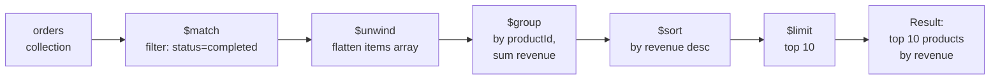
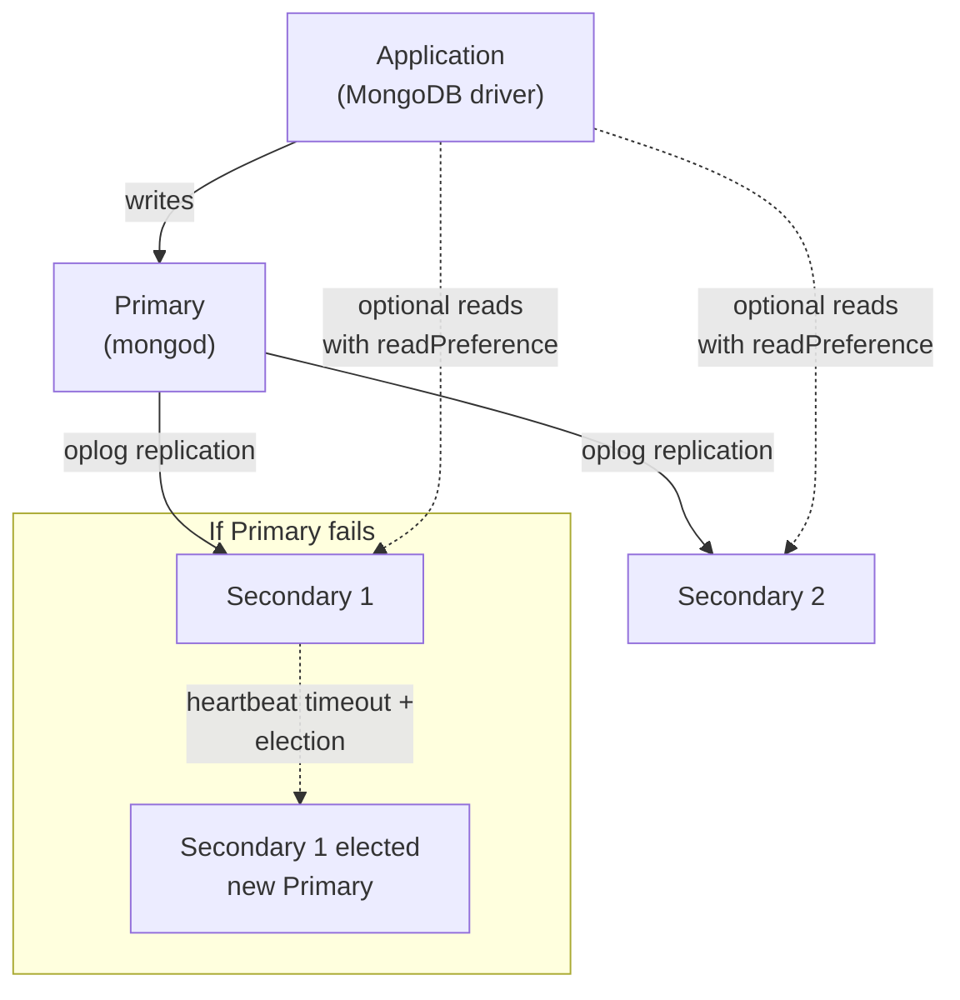
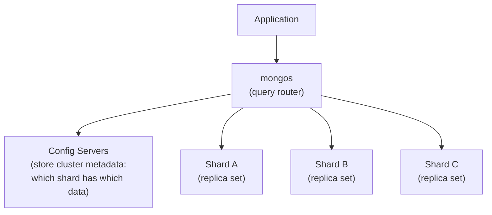

# 02 — MongoDB for Senior Interviews

## Table of Contents
1. Document modeling philosophy
2. Embedding vs referencing — the core modeling decision
3. Indexes (how they work, how to design them)
4. The aggregation pipeline
5. Transactions
6. Replication and sharding
7. Mongoose patterns

---

## 1. Document Modeling Philosophy

MongoDB is schema-flexible, but that does **not** mean "don't think about schema." The core principle, straight from MongoDB's own docs: **model your data to match how your application queries it**, not how a relational DBA would normalize it.

The question to ask for every relationship is: **"Do I usually read this data together?"** If yes, lean toward embedding. If the related data is large, grows unboundedly, or is often queried independently, lean toward referencing.

---

## 2. Embedding vs Referencing

### Embedding (denormalization)

Store related data **inside** the parent document.

```js
// A blog post with embedded comments (good when comments are few and always read with the post)
{
  _id: ObjectId("..."),
  title: "Understanding MongoDB Indexes",
  author: "Sandeep",
  body: "...",
  comments: [
    { user: "Alice", text: "Great post!", createdAt: ISODate("2026-09-01") },
    { user: "Bob", text: "Thanks for this", createdAt: ISODate("2026-09-02") }
  ],
  tags: ["mongodb", "database", "interview-prep"]
}
```

**Pros**: one query reads everything; atomic updates to the whole document; great read performance.
**Cons**: document grows unboundedly (MongoDB's hard document size limit is **16MB**); if comments can number in the thousands, this design breaks. Updating a single embedded item requires array-matching update operators and can get awkward.

### Referencing (normalization)

Store a reference (`ObjectId`) to a separate document in another collection.

```js
// posts collection
{ _id: ObjectId("post1"), title: "Understanding MongoDB Indexes", authorId: ObjectId("user1") }

// comments collection — referenced by postId, can grow unboundedly
{ _id: ObjectId("c1"), postId: ObjectId("post1"), user: "Alice", text: "Great post!" }

// users collection
{ _id: ObjectId("user1"), name: "Sandeep", email: "sandeep@example.com" }
```

**Pros**: no document size limit issue; independent updates; no duplication.
**Cons**: requires a second query or a `$lookup` (join) to assemble related data — more round trips or more complex aggregation.

### Decision table

| Scenario | Choice | Why |
|---|---|---|
| Blog post + a handful of tags | Embed | Tags are small, bounded, always read with post |
| Blog post + comments (could be thousands) | Reference | Unbounded growth, 16MB document limit risk |
| User + their shipping address | Embed | 1:1, small, always read together |
| User + their orders (could be thousands over time) | Reference | Unbounded growth, orders often queried independently (e.g., "show all pending orders across users") |
| Product + current price/inventory snapshot | Embed (with care) | Frequently read together, but consider a separate `inventory` collection if updated at very high frequency to avoid write contention on the product doc |
| Many-to-many (e.g., students ↔ courses) | Reference, usually with an array of ObjectIds on one side, or a dedicated join collection if the relationship itself has attributes (enrollment date, grade) | Avoids duplicating course info into every student doc |

### Hybrid: extended reference pattern

A common senior-level pattern: embed a **small, denormalized subset** of frequently-displayed fields alongside a reference, to avoid a join for common reads, while keeping the full data in its own collection.

```js
// orders collection — embeds a snapshot of product name/price (what the customer actually saw at purchase time),
// but references the full product via productId for anything else.
{
  _id: ObjectId("order1"),
  userId: ObjectId("user1"),
  items: [
    { productId: ObjectId("prod1"), name: "Wireless Mouse", priceAtPurchase: 24.99, qty: 2 }
  ],
  total: 49.98,
  createdAt: ISODate("2026-10-01")
}
```

This also solves a correctness problem: if the product's price changes later, old orders should still show the price the customer actually paid.

---

## 3. Indexes

An index is a separate, ordered data structure (B-tree) that MongoDB maintains alongside your collection, mapping field values to document locations — so queries on indexed fields avoid a full **collection scan**.

### Checking if a query uses an index

```js
db.orders.find({ userId: ObjectId("user1"), status: "pending" }).explain("executionStats");
```

Look for `"stage": "IXSCAN"` (index used) vs `"stage": "COLLSCAN"` (full collection scan — bad on large collections). Check `totalDocsExamined` vs `nReturned` — if they're wildly different, your index isn't selective enough or isn't being used correctly.

### Index types

```js
// Single-field index
db.orders.createIndex({ userId: 1 });

// Compound index — order of fields matters a lot (see below)
db.orders.createIndex({ userId: 1, status: 1, createdAt: -1 });

// Unique index — enforces uniqueness, e.g. email
db.users.createIndex({ email: 1 }, { unique: true });

// Text index — for basic full-text search
db.products.createIndex({ name: "text", description: "text" });

// TTL index — auto-deletes documents after a time period (great for sessions, logs, OTPs)
db.sessions.createIndex({ createdAt: 1 }, { expireAfterSeconds: 3600 });

// Partial index — only indexes documents matching a filter, saves space/write cost
db.orders.createIndex(
  { userId: 1 },
  { partialFilterExpression: { status: "pending" } }
);

// Multikey index — automatically created when you index an array field
db.products.createIndex({ tags: 1 });
```

### The ESR rule for compound indexes: Equality, Sort, Range

When designing a compound index, order fields as: **Equality** matches first, then **Sort** fields, then **Range** filters last.

```js
// Query: find pending orders for a user, sorted by newest first
db.orders.find({ userId: ObjectId("u1"), status: "pending" }).sort({ createdAt: -1 });

// Correct index, following ESR:
db.orders.createIndex({ userId: 1, status: 1, createdAt: -1 });
//                       ^equality  ^equality  ^sort
```

If you instead had a range query:

```js
// Query: orders for a user placed in the last 30 days
db.orders.find({ userId: ObjectId("u1"), createdAt: { $gte: thirtyDaysAgo } });

// Index: equality field first, range field last
db.orders.createIndex({ userId: 1, createdAt: 1 });
```

### Index pitfalls (favorite interview topics)

- **Index selectivity**: an index on a boolean field (`isActive: true/false`) with 90% `true` isn't very useful — MongoDB may choose a collection scan anyway because the index doesn't narrow down results much.
- **Too many indexes slow down writes**: every insert/update/delete must update every index on the collection. Don't index fields you never query on.
- **Sort without a supporting index** can cause an **in-memory sort**, which MongoDB will abort if it exceeds 100MB (unless you use `allowDiskUse`), causing a query failure under load.
- **Leading field matters**: an index on `{ status: 1, createdAt: 1 }` can serve a query on `status` alone, but **cannot** efficiently serve a query on `createdAt` alone — compound indexes only help queries that use a prefix of the indexed fields, left to right.
- **`$ne`, `$nin`, regex without anchors** (`/abc/` instead of `/^abc/`) generally can't use an index efficiently.

---

## 4. The Aggregation Pipeline

A sequence of **stages**, each transforming the stream of documents, similar to Unix pipes.



```js
db.orders.aggregate([
  // 1. Filter to only completed orders in the last quarter
  {
    $match: {
      status: "completed",
      createdAt: { $gte: ISODate("2026-07-01"), $lt: ISODate("2026-10-01") },
    },
  },
  // 2. Flatten the items array so each line item becomes its own document
  { $unwind: "$items" },
  // 3. Group by product, summing revenue and quantity
  {
    $group: {
      _id: "$items.productId",
      totalRevenue: { $sum: { $multiply: ["$items.priceAtPurchase", "$items.qty"] } },
      totalQty: { $sum: "$items.qty" },
      orderCount: { $sum: 1 },
    },
  },
  // 4. Join with the products collection to get product name
  {
    $lookup: {
      from: "products",
      localField: "_id",
      foreignField: "_id",
      as: "product",
    },
  },
  { $unwind: "$product" },
  // 5. Shape the final output
  {
    $project: {
      _id: 0,
      productId: "$_id",
      productName: "$product.name",
      totalRevenue: 1,
      totalQty: 1,
      orderCount: 1,
    },
  },
  // 6. Sort by revenue descending
  { $sort: { totalRevenue: -1 } },
  // 7. Top 10 only
  { $limit: 10 },
]);
```

### Key stages to know cold

| Stage | Purpose |
|---|---|
| `$match` | Filter documents (put this as early as possible — it reduces the working set for later stages, and can use indexes if it's the first stage) |
| `$group` | Aggregate (sum, avg, count, min, max) by a key |
| `$project` | Reshape documents — include/exclude/compute fields |
| `$sort` | Sort the stream |
| `$limit` / `$skip` | Pagination within a pipeline |
| `$unwind` | Flatten an array field into separate documents |
| `$lookup` | Left outer join to another collection |
| `$facet` | Run multiple sub-pipelines in parallel on the same input (e.g., get both paginated results AND a total count in one query) |
| `$addFields` | Add computed fields without dropping existing ones |
| `$bucket` / `$bucketAuto` | Group numeric/date values into ranges (histograms) |

### `$facet` example — pagination + total count in a single round trip

```js
db.products.aggregate([
  { $match: { category: "electronics" } },
  {
    $facet: {
      data: [{ $skip: 20 }, { $limit: 10 }],
      totalCount: [{ $count: "count" }],
    },
  },
]);
```

### Performance rule

Put `$match` and `$sort` as early as possible in the pipeline — if they're the **first stage**, MongoDB can use an index to satisfy them before the rest of the pipeline runs. Once you `$unwind` or `$group`, you've lost the index.

---

## 5. Transactions

MongoDB supports **multi-document ACID transactions** since version 4.0 (for replica sets) and 4.2 (for sharded clusters). Use them when you must update multiple documents (possibly across collections) **atomically** — all succeed or all roll back.

### Classic use case: transferring money between two accounts

```js
const session = client.startSession();

try {
  await session.withTransaction(async () => {
    const accounts = client.db('bank').collection('accounts');

    const from = await accounts.findOne({ _id: fromAccountId }, { session });
    if (from.balance < amount) {
      throw new Error('Insufficient funds');
    }

    await accounts.updateOne(
      { _id: fromAccountId },
      { $inc: { balance: -amount } },
      { session }
    );

    await accounts.updateOne(
      { _id: toAccountId },
      { $inc: { balance: amount } },
      { session }
    );

    // If either update fails, or the thrown Error above fires,
    // withTransaction automatically aborts the whole transaction.
  });
} finally {
  await session.endSession();
}
```

### With Mongoose

```js
const mongoose = require('mongoose');

async function transferFunds(fromId, toId, amount) {
  const session = await mongoose.startSession();
  session.startTransaction();
  try {
    const fromAccount = await Account.findById(fromId).session(session);
    if (fromAccount.balance < amount) throw new Error('Insufficient funds');

    await Account.updateOne({ _id: fromId }, { $inc: { balance: -amount } }, { session });
    await Account.updateOne({ _id: toId }, { $inc: { balance: amount } }, { session });

    await session.commitTransaction();
  } catch (err) {
    await session.abortTransaction();
    throw err;
  } finally {
    session.endSession();
  }
}
```

### When NOT to reach for transactions

Transactions have real performance overhead (locking, write-ahead journaling across the operation). Before using one, ask: **can this be modeled as a single atomic document update instead?** MongoDB guarantees atomicity on a **single document** write (including nested arrays/objects) without any transaction needed:

```js
// This is already atomic — no transaction needed — because it's one document.
await Order.updateOne(
  { _id: orderId, 'items.productId': productId },
  { $inc: { 'items.$.qty': 1 } }
);
```

Design your schema (embedding related data that's updated together) specifically to avoid needing transactions where possible — this is a senior-level insight interviewers look for.

---

## 6. Replication and Sharding

### Replication — for high availability

A **replica set** is a group of `mongod` processes maintaining the same data set: one **Primary** (accepts all writes) and multiple **Secondaries** (replicate from the primary via the oplog, can serve reads if you opt into eventual consistency).



- If the Primary goes down, the remaining members hold an **election** (needs a majority of voting members) and promote a Secondary to Primary — this is automatic failover, typically completing in a few seconds.
- **Write concern** (`w: "majority"`) controls how many replica members must acknowledge a write before it's considered successful — trades latency for durability guarantees.
- **Read preference** (`primary`, `secondaryPreferred`, `nearest`, etc.) controls which members can serve reads, trading consistency for read scalability/latency.

### Sharding — for horizontal scale (write throughput + data volume)

When a single replica set's storage or write throughput isn't enough, you **shard**: split the collection's data across multiple replica sets (**shards**) based on a **shard key**.



- The **shard key** determines how data is distributed. Pick a shard key with **high cardinality** and **even distribution** — e.g., `userId` is usually fine; a field like `status` (few possible values) creates hot, unbalanced shards ("jumbo chunks").
- A **hashed shard key** is a common choice to guarantee even distribution when the natural key would otherwise cluster writes (e.g., a monotonically increasing `_id` or timestamp would concentrate all new writes on one shard — this is called the "hot shard" problem).
- Queries that **include the shard key** can be routed directly to the relevant shard(s). Queries that don't include the shard key must **broadcast to all shards** ("scatter-gather"), which is much slower.

### Interview-ready one-liner

"Replication is for availability and read scaling with the same dataset copied across nodes. Sharding is for horizontal scaling of writes and total data volume by partitioning the dataset across independent replica sets. In most production MongoDB deployments, you shard a set of replica sets — the two techniques are combined, not alternatives."

---

## 7. Mongoose Patterns

### Schema with validation, indexes, virtuals, and hooks

```js
const mongoose = require('mongoose');
const bcrypt = require('bcrypt');

const userSchema = new mongoose.Schema(
  {
    name: { type: String, required: true, trim: true, maxlength: 100 },
    email: {
      type: String,
      required: true,
      unique: true,
      lowercase: true,
      match: [/^\S+@\S+\.\S+$/, 'Invalid email format'],
    },
    passwordHash: { type: String, required: true, select: false }, // never returned by default
    role: { type: String, enum: ['user', 'admin'], default: 'user' },
    isActive: { type: Boolean, default: true },
  },
  { timestamps: true } // adds createdAt/updatedAt automatically
);

// Virtual — computed property, not stored in the database
userSchema.virtual('displayName').get(function () {
  return `${this.name} <${this.email}>`;
});

// Instance method
userSchema.methods.comparePassword = function (candidate) {
  return bcrypt.compare(candidate, this.passwordHash);
};

// Static method
userSchema.statics.findActiveByEmail = function (email) {
  return this.findOne({ email, isActive: true });
};

// Pre-save hook — hash password automatically before saving, only if changed
userSchema.pre('save', async function (next) {
  if (!this.isModified('passwordHash')) return next();
  this.passwordHash = await bcrypt.hash(this.passwordHash, 12);
  next();
});

// Index defined at the schema level (alternative to db.collection.createIndex)
userSchema.index({ email: 1 }, { unique: true });

module.exports = mongoose.model('User', userSchema);
```

### `populate` — Mongoose's abstraction over `$lookup` for referenced documents

```js
// orders collection references users via userId
const orderSchema = new mongoose.Schema({
  userId: { type: mongoose.Schema.Types.ObjectId, ref: 'User', required: true },
  items: [{ productId: { type: mongoose.Schema.Types.ObjectId, ref: 'Product' }, qty: Number }],
  total: Number,
});

// Fetch an order with the user's name/email populated inline — avoids a manual second query
const order = await Order.findById(orderId)
  .populate('userId', 'name email') // only pull these fields from User
  .populate('items.productId', 'name price');
```

**Caution**: `populate` issues a separate query under the hood (it's not a real join at the database engine level in older MongoDB versions unless using `$lookup` directly). For hot paths with heavy joins, consider using `.aggregate()` with `$lookup` for a single round trip, or denormalize (extended reference pattern from section 2).

### Lean queries for read-heavy endpoints

```js
// .lean() skips Mongoose document hydration (no change tracking, no virtuals, no instance methods)
// — significantly faster and lower memory for read-only API responses.
const products = await Product.find({ category: 'electronics' }).lean();
```

### Schema versioning / migrations

Mongoose doesn't enforce schema at the database level — old documents created before a schema change still exist with the old shape. Handle this with:
1. A `__v` style explicit `schemaVersion` field on documents.
2. A migration script (using a tool like `migrate-mongo`) that runs transformation queries against existing data when deploying a schema change.
3. Defensive defaults in the schema (`default: ...`) so missing fields on old documents don't break reads.

---

## Practice Tasks

1. Design two schemas for a "social media post with comments" feature: one using embedding, one using referencing. Write the Mongoose schema for both, and write one query for each that fetches a post with its 5 most recent comments.
2. Create a compound index following the ESR rule for a query that filters by `userId` (equality), `category` (equality), and sorts by `createdAt` descending. Run `.explain("executionStats")` to confirm `IXSCAN` is used.
3. Write an aggregation pipeline that computes the top 5 customers by total lifetime spend from an `orders` collection, including their name via `$lookup`.
4. Implement the bank transfer transaction example with Mongoose against a real local replica set (transactions require a replica set, even a single-node one, not a standalone `mongod`).
5. Explain, in writing, why a shard key of `createdAt` (a monotonically increasing timestamp) would create a "hot shard," and propose a better shard key or a hashed-key alternative.

## Interview Questions

1. **How do you decide between embedding and referencing when modeling a one-to-many relationship in MongoDB?**
   Ask whether the related data is always read together with the parent, is bounded in size, and is updated at similar frequency. If yes to all, embed. If the related collection is unbounded (grows indefinitely, like comments or orders), or is frequently queried independently of the parent, reference it instead. Also watch the 16MB document size limit as a hard constraint against embedding unbounded arrays.

2. **What does the ESR rule mean for compound indexes, and why does field order matter?**
   ESR stands for Equality, Sort, Range — the recommended order of fields in a compound index. Equality-matched fields should come first because MongoDB can use them to narrow the index scan to an exact range immediately; sort fields come next so the index already returns results in the needed order without an in-memory sort; range-filtered fields come last because they scan a contiguous range of the index rather than a point lookup. Getting the order wrong (e.g., range before equality) can force MongoDB to scan far more index entries than necessary.

3. **A query is slow despite having what looks like a relevant index. How do you diagnose it?**
   Run `.explain("executionStats")` and check the winning plan's stage — confirm it's `IXSCAN` not `COLLSCAN`. Compare `totalDocsExamined` to `nReturned`: a large gap means the index isn't selective enough for this query, or the query doesn't use the index's leading fields. Also check for a mismatch between the index field order and the query's equality/sort/range fields (ESR violation), or whether the query uses operators like `$ne`/regex-without-anchor that can't use the index efficiently.

4. **When should you use a MongoDB transaction, and when should you avoid one?**
   Use a transaction when you must atomically update multiple documents, potentially across multiple collections, where partial application would leave data inconsistent (e.g., a funds transfer touching two account documents). Avoid transactions when the update can be modeled as a single atomic document write instead (MongoDB already guarantees atomicity within one document, including nested arrays) — reaching for a transaction when a schema redesign would eliminate the need for one adds unnecessary latency and lock contention.

5. **Explain the difference between replication and sharding, and how they're used together in production.**
   Replication copies the same dataset across multiple nodes (one primary, multiple secondaries) for high availability and automatic failover, and optionally for read scaling. Sharding partitions a dataset across multiple independent shards to scale write throughput and total storage beyond what a single machine/replica set can hold. In production, each shard is typically itself a replica set, so you get both horizontal scalability (sharding) and high availability (replication) simultaneously.

6. **What's a "hot shard" and how do you avoid it?**
   A hot shard happens when the shard key causes writes (or reads) to concentrate disproportionately on one shard instead of being spread evenly — commonly caused by monotonically increasing keys like timestamps or auto-incrementing IDs, where all new writes land on the shard holding the highest key range. You avoid it by choosing a shard key with high cardinality and even write distribution, or by using a hashed shard key, which distributes values pseudo-randomly across shards regardless of their natural ordering.

7. **Why would you use `.lean()` in Mongoose, and what do you give up by using it?**
   `.lean()` returns plain JavaScript objects instead of full Mongoose Documents, skipping change-tracking, virtuals, getters/setters, and instance methods. This is significantly faster and uses less memory, which matters for high-throughput read-only endpoints. You give up the ability to call `.save()` on the result, use virtuals, or rely on Mongoose's built-in casting/validation on that object — fine for pure read paths, wrong for anything you intend to mutate and persist.
