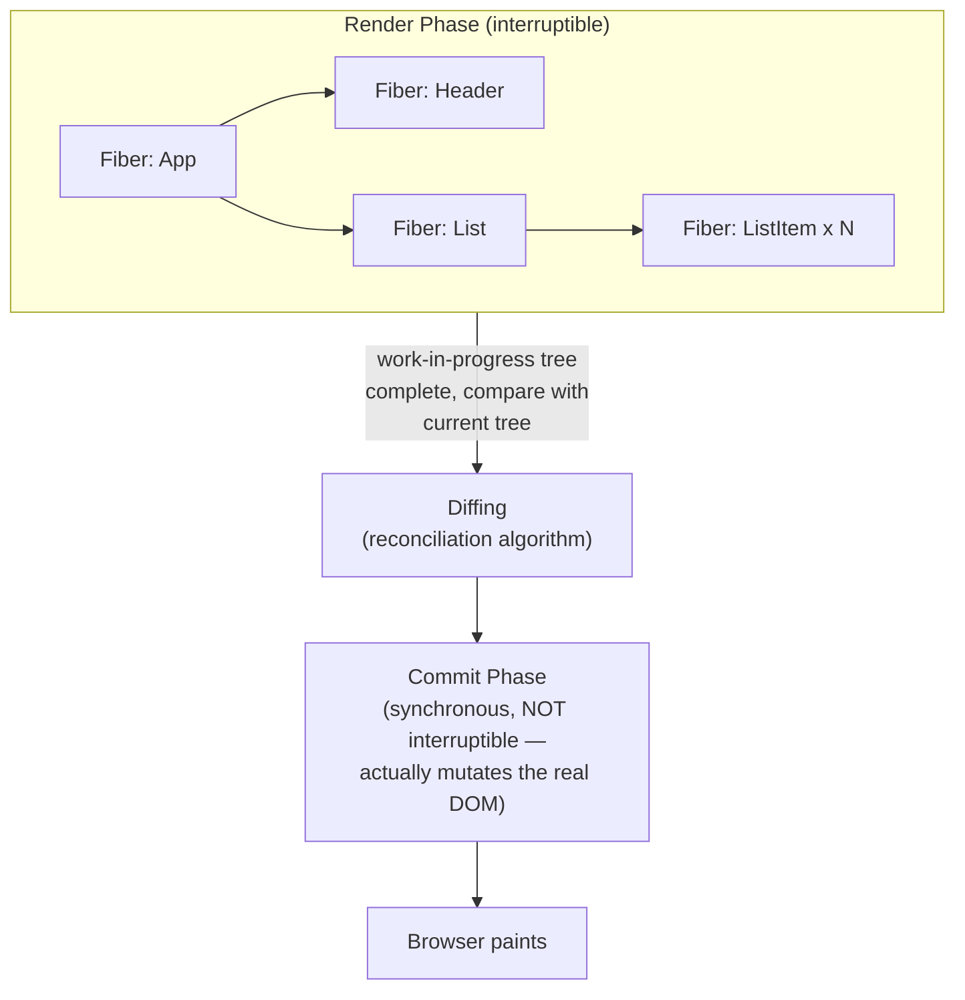
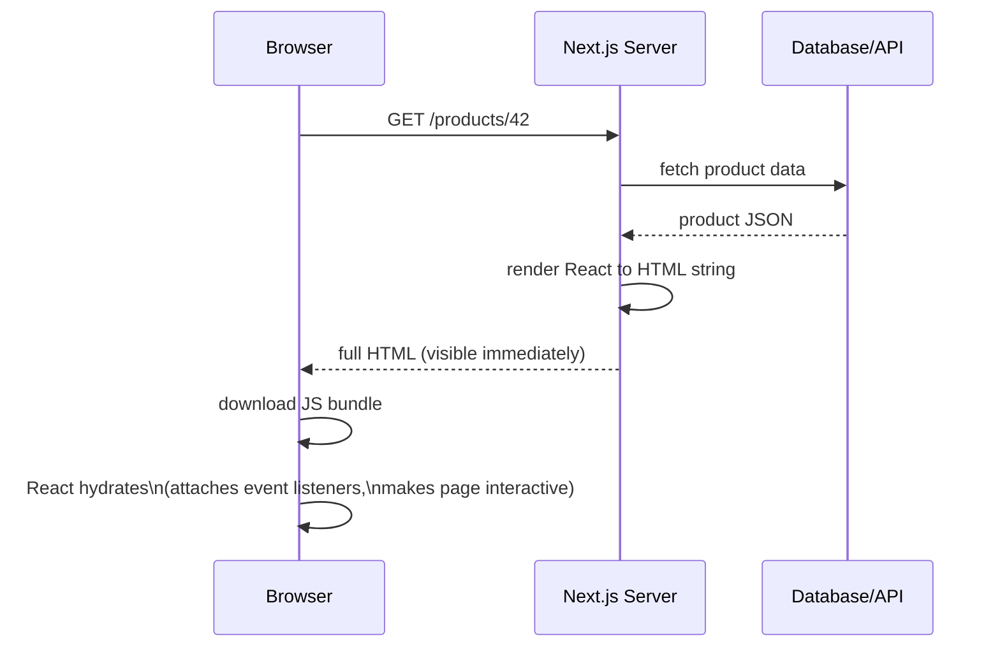

# 03 — React Advanced for Senior Interviews

## Table of Contents
1. Hooks deep dive
2. Reconciliation and the Fiber architecture
3. Performance: memo, useMemo, code splitting, virtualization
4. State management: Context vs Redux vs Zustand
5. SSR / Next.js overview
6. Testing with React Testing Library

---

## 1. Hooks Deep Dive

### The rule of hooks, and why it exists

Hooks must be called **in the same order on every render**, and only at the top level of a component (not inside loops/conditions/nested functions). This is not an arbitrary style rule — React stores hook state in a **linked list attached to the Fiber node** for that component, and it identifies *which* piece of state belongs to *which* `useState`/`useEffect` call purely by **call order**, not by name. If a hook call is conditionally skipped on some render, every hook after it would read the wrong slot.

```js
// BROKEN — if `isLoggedIn` changes between renders, hook order shifts and React throws
function Profile({ isLoggedIn }) {
  if (isLoggedIn) {
    const [name, setName] = useState(''); // sometimes called, sometimes not
  }
  const [age, setAge] = useState(0); // its "slot index" shifts depending on the above
  // ...
}
```

### `useState` — functional updates and stale closures

```js
function Counter() {
  const [count, setCount] = useState(0);

  function incrementThreeTimesWrong() {
    // BUG: all three calls close over the SAME `count` value from this render.
    setCount(count + 1);
    setCount(count + 1);
    setCount(count + 1);
    // Result: count only increases by 1, not 3.
  }

  function incrementThreeTimesRight() {
    // FIX: functional form always receives the latest pending state.
    setCount((prev) => prev + 1);
    setCount((prev) => prev + 1);
    setCount((prev) => prev + 1);
    // Result: count correctly increases by 3.
  }
}
```

### `useEffect` — dependency arrays and cleanup

```js
function ChatRoom({ roomId }) {
  useEffect(() => {
    const connection = createConnection(roomId);
    connection.connect();

    // Cleanup runs before the NEXT effect fires (on roomId change)
    // and when the component unmounts.
    return () => connection.disconnect();
  }, [roomId]); // effect re-runs only when roomId changes
}
```

Three dependency-array behaviors to know cold:
- `[]` (empty array) — runs once after initial mount, cleanup runs once on unmount.
- No array at all — runs after **every** render (rarely what you want).
- `[dep1, dep2]` — runs after mount and whenever any listed dependency changes by reference (`Object.is` comparison).

**Classic bug**: passing an object or array literal as a dependency causes the effect to re-run every render, because a new object reference is created each render even if its contents are identical.

```js
// BUG: `options` is a new object every render → effect runs every render
useEffect(() => {
  fetchData(options);
}, [options]); // options = { page: 1, limit: 10 } created inline in render

// FIX 1: memoize the object
const options = useMemo(() => ({ page, limit }), [page, limit]);

// FIX 2: depend on primitives directly
useEffect(() => {
  fetchData({ page, limit });
}, [page, limit]);
```

### `useRef` — mutable value that doesn't trigger re-render

```js
function Timer() {
  const intervalRef = useRef(null);
  const [seconds, setSeconds] = useState(0);

  useEffect(() => {
    intervalRef.current = setInterval(() => setSeconds((s) => s + 1), 1000);
    return () => clearInterval(intervalRef.current);
  }, []);

  // intervalRef.current changes do NOT cause a re-render — unlike useState.
}
```

### `useLayoutEffect` vs `useEffect`

`useEffect` runs **asynchronously after** the browser paints the screen. `useLayoutEffect` runs **synchronously before** the paint. Use `useLayoutEffect` only when you need to measure the DOM (e.g., element size/position) and synchronously adjust it before the user sees a flicker — e.g., tooltip positioning. Default to `useEffect` for everything else; `useLayoutEffect` blocks painting and hurts performance if overused.

### `useReducer` — for complex, multi-field state transitions

```js
const initialState = { status: 'idle', data: null, error: null };

function fetchReducer(state, action) {
  switch (action.type) {
    case 'FETCH_START':
      return { status: 'loading', data: null, error: null };
    case 'FETCH_SUCCESS':
      return { status: 'success', data: action.payload, error: null };
    case 'FETCH_ERROR':
      return { status: 'error', data: null, error: action.payload };
    default:
      throw new Error(`Unknown action: ${action.type}`);
  }
}

function useFetch(url) {
  const [state, dispatch] = useReducer(fetchReducer, initialState);

  useEffect(() => {
    let cancelled = false;
    dispatch({ type: 'FETCH_START' });

    fetch(url)
      .then((res) => res.json())
      .then((data) => { if (!cancelled) dispatch({ type: 'FETCH_SUCCESS', payload: data }); })
      .catch((err) => { if (!cancelled) dispatch({ type: 'FETCH_ERROR', payload: err.message }); });

    return () => { cancelled = true; }; // prevent setting state on an unmounted/stale request
  }, [url]);

  return state;
}
```

### Custom hooks — composing logic, not UI

```js
function useDebounce(value, delayMs) {
  const [debounced, setDebounced] = useState(value);

  useEffect(() => {
    const timer = setTimeout(() => setDebounced(value), delayMs);
    return () => clearTimeout(timer);
  }, [value, delayMs]);

  return debounced;
}

// Usage: debounce a search input before firing an API call
function SearchBox() {
  const [query, setQuery] = useState('');
  const debouncedQuery = useDebounce(query, 400);

  useEffect(() => {
    if (debouncedQuery) searchApi(debouncedQuery);
  }, [debouncedQuery]);

  return <input value={query} onChange={(e) => setQuery(e.target.value)} />;
}
```

---

## 2. Reconciliation and the Fiber Architecture

### The old problem: synchronous stack reconciliation (pre-React 16)

React used to walk the virtual DOM tree recursively and synchronously, top to bottom, with no way to pause. On large trees, this could block the main thread long enough to cause dropped frames and janky input (typing lag, scroll stutter).

### The Fiber solution

React 16+ rewrote the reconciler around **Fiber** — a unit of work represented as a JS object (not a call stack frame) that can be paused, resumed, prioritized, or thrown away.



Key properties of Fiber:
- **Render phase is interruptible**: React can pause work mid-tree, yield back to the browser to handle something urgent (user input), and resume later. This is what powers **Concurrent features** like `useTransition` and `Suspense`.
- **Commit phase is synchronous and uninterruptible**: once React decides what changed, it applies all DOM mutations in one atomic pass so the user never sees a half-updated UI.
- Each Fiber node has a `type`, pending `props`, a pointer to its `alternate` (the corresponding fiber in the other tree — React keeps two trees: `current` [what's on screen] and `workInProgress` [being built]), and pointers to `child`/`sibling`/`return` forming a linked structure that can be traversed without a real call stack.

### Diffing heuristics (why `key` matters)

React's diffing algorithm is **O(n)**, not the theoretically correct but expensive O(n³) tree-diff, achieved via two heuristics:
1. **Different component types at the same position → tear down and rebuild** (no attempt to diff a `<div>` against a `<span>`, even if their children are similar).
2. **Lists are diffed using `key`**. Without a stable `key`, React falls back to **index-based matching**, which causes unnecessary unmounts/remounts (losing input focus, animation state, etc.) when items are reordered, inserted, or removed from the middle of a list.

```jsx
// BAD: index as key — if you reorder/delete items, React misattributes state
{items.map((item, index) => <TodoItem key={index} item={item} />)}

// GOOD: stable, unique key tied to the item's identity, not its position
{items.map((item) => <TodoItem key={item.id} item={item} />)}
```

### Lanes and priority (React 18 concurrent rendering, high level)

React 18 assigns updates to different **lanes** with different priorities (e.g., a user typing in an input is urgent; a large list re-filter triggered by that typing can be deprioritized). `useTransition` lets you explicitly mark an update as non-urgent:

```jsx
function SearchResults() {
  const [query, setQuery] = useState('');
  const [isPending, startTransition] = useTransition();
  const [results, setResults] = useState([]);

  function handleChange(e) {
    setQuery(e.target.value); // urgent — update the input immediately
    startTransition(() => {
      setResults(filterLargeList(e.target.value)); // non-urgent, can be interrupted
    });
  }

  return (
    <>
      <input value={query} onChange={handleChange} />
      {isPending ? <Spinner /> : <ResultsList results={results} />}
    </>
  );
}
```

---

## 3. Performance

### `React.memo` — skip re-rendering a component if props haven't changed

```jsx
const ExpensiveRow = React.memo(function ExpensiveRow({ item, onSelect }) {
  console.log('Rendering row', item.id);
  return <tr onClick={() => onSelect(item.id)}>{item.name}</tr>;
});
```

`React.memo` does a **shallow comparison** of props. It is useless (or harmful) if you pass a new object/function reference on every parent render — which is why it's almost always paired with `useCallback`/`useMemo` on the parent side.

```jsx
function ParentList({ items }) {
  // Without useCallback, a NEW function is created every render,
  // which defeats ExpensiveRow's memo because props.onSelect !== previous props.onSelect.
  const handleSelect = useCallback((id) => {
    console.log('selected', id);
  }, []); // stable reference across renders

  return (
    <table>
      {items.map((item) => (
        <ExpensiveRow key={item.id} item={item} onSelect={handleSelect} />
      ))}
    </table>
  );
}
```

### `useMemo` — cache an expensive computed value

```jsx
function ProductList({ products, searchTerm }) {
  // Without useMemo, filtering re-runs on EVERY render of this component,
  // even renders triggered by unrelated state changes.
  const filtered = useMemo(
    () => products.filter((p) => p.name.toLowerCase().includes(searchTerm.toLowerCase())),
    [products, searchTerm]
  );

  return <ul>{filtered.map((p) => <li key={p.id}>{p.name}</li>)}</ul>;
}
```

**Rule of thumb**: don't reach for `useMemo`/`useCallback` everywhere by default — they have their own overhead (storing the previous deps and value) and only pay off for genuinely expensive computations or to preserve referential stability for `memo`-wrapped children/effect dependencies. Measure first with the React DevTools Profiler.

### Code splitting — `React.lazy` + `Suspense`

```jsx
import { lazy, Suspense } from 'react';

// This chunk is only downloaded when the user navigates to /settings,
// reducing the initial bundle size for everyone who never visits that route.
const SettingsPage = lazy(() => import('./pages/SettingsPage'));

function App() {
  return (
    <Suspense fallback={<PageSkeleton />}>
      <Routes>
        <Route path="/settings" element={<SettingsPage />} />
      </Routes>
    </Suspense>
  );
}
```

Route-based code splitting is the highest-leverage performance win for most apps — it directly reduces Time to Interactive by shrinking the JS the browser must parse/execute before the app is usable.

### Virtualization — rendering only visible rows of a huge list

Rendering 10,000 DOM nodes for a list, even if most are off-screen, kills performance (layout, paint, memory). A virtualization library (`react-window`, `@tanstack/react-virtual`) renders only the rows currently in the viewport, plus a small buffer.

```jsx
import { FixedSizeList } from 'react-window';

function BigList({ items }) {
  const Row = ({ index, style }) => (
    <div style={style}>{items[index].name}</div>
  );

  return (
    <FixedSizeList
      height={600}
      width="100%"
      itemCount={items.length}
      itemSize={48} // px per row
    >
      {Row}
    </FixedSizeList>
  );
}
```

Under the hood, this renders an absolutely-positioned container sized to the *total* list height (so the scrollbar looks correct), but only mounts DOM nodes for rows currently scrolled into view — recycling them as the user scrolls.

### Performance checklist for a senior interview answer

1. Measure first — React DevTools Profiler, Lighthouse, Web Vitals (LCP, FID/INP, CLS) — never optimize blind.
2. Code-split by route at minimum; consider component-level splitting for heavy, rarely-used widgets (charts, rich text editors).
3. Virtualize any list that can exceed ~100 rendered rows.
4. Memoize expensive computations (`useMemo`) and stabilize callback/object references passed to memoized children (`useCallback`, `useMemo`).
5. Avoid prop drilling causing unrelated re-renders — colocate state close to where it's used, or use a selector-based state library (Zustand, Redux with `useSelector`) that only re-renders subscribers of the slice that changed.
6. Images: lazy-load below-the-fold images, serve responsive sizes, use modern formats (WebP/AVIF).

---

## 4. State Management: Context vs Redux vs Zustand

### React Context — built-in, best for low-frequency updates

```jsx
const ThemeContext = createContext('light');

function App() {
  const [theme, setTheme] = useState('light');
  return (
    <ThemeContext.Provider value={{ theme, setTheme }}>
      <Toolbar />
    </ThemeContext.Provider>
  );
}

function ThemedButton() {
  const { theme } = useContext(ThemeContext);
  return <button className={theme}>Click</button>;
}
```

**The Context performance trap**: every component consuming a Context re-renders whenever the Provider's `value` changes — **even if that component only cares about a field that didn't change**, because Context has no built-in selector mechanism. This makes Context a poor fit for frequently-changing, high-fan-out state (e.g., a global "current user cursor position" updated 60 times/second with hundreds of consumers).

```jsx
// ANTI-PATTERN: a new object literal every render means EVERY consumer re-renders
// on every App render, even if theme/setTheme are logically unchanged.
<ThemeContext.Provider value={{ theme, setTheme }}>

// FIX: memoize the value
const value = useMemo(() => ({ theme, setTheme }), [theme]);
<ThemeContext.Provider value={value}>
```

### Redux (with Redux Toolkit) — best for large apps, complex state logic, strong dev tooling needs

```js
// store/counterSlice.js
import { createSlice } from '@reduxjs/toolkit';

const counterSlice = createSlice({
  name: 'counter',
  initialState: { value: 0 },
  reducers: {
    increment: (state) => { state.value += 1; }, // Immer lets you "mutate" safely
    decrement: (state) => { state.value -= 1; },
    incrementByAmount: (state, action) => { state.value += action.payload; },
  },
});

export const { increment, decrement, incrementByAmount } = counterSlice.actions;
export default counterSlice.reducer;
```

```jsx
// Component usage — useSelector subscribes ONLY to the slice it reads,
// re-rendering only when that specific piece of state changes.
import { useSelector, useDispatch } from 'react-redux';
import { increment } from './store/counterSlice';

function Counter() {
  const count = useSelector((state) => state.counter.value);
  const dispatch = useDispatch();
  return <button onClick={() => dispatch(increment())}>{count}</button>;
}
```

Redux gives you: a single predictable store, time-travel debugging (Redux DevTools), middleware (logging, async via `redux-thunk`/RTK Query), and strict unidirectional data flow — valuable at scale with many engineers touching shared state, but it's more boilerplate for simple apps.

### Zustand — minimal API, no boilerplate, selector-based re-renders out of the box

```js
import { create } from 'zustand';

const useCounterStore = create((set) => ({
  count: 0,
  increment: () => set((state) => ({ count: state.count + 1 })),
  reset: () => set({ count: 0 }),
}));

// Component usage — selecting `state.count` means this component only
// re-renders when `count` changes, not when other store fields change.
function Counter() {
  const count = useCounterStore((state) => state.count);
  const increment = useCounterStore((state) => state.increment);
  return <button onClick={increment}>{count}</button>;
}
```

Zustand has no Provider requirement, works outside React (plain function calls), and its selector pattern avoids the Context re-render problem by design — each component subscribes only to the slice of state it reads.

### Decision table

| Need | Choice |
|---|---|
| A few rarely-changing globals (theme, locale, auth user) | Context |
| Large app, many teams, need strict conventions + time-travel debugging | Redux Toolkit |
| Want Redux-like global store with minimal boilerplate, small-to-mid app | Zustand |
| Server data (API responses) — not really "client state" at all | TanStack Query / RTK Query (see below) — don't put server data in Redux/Zustand by default |

### A crucial distinction: server state vs client state

A very common senior-interview gotcha: candidates store API response data in Redux/Context manually, then hand-roll loading/error/caching/refetch logic. **Server state (data that lives on a server and can go stale) is a different problem than client state** (UI toggles, form inputs, themes). Use a dedicated data-fetching library:

```jsx
import { useQuery } from '@tanstack/react-query';

function UserProfile({ userId }) {
  const { data, isLoading, error } = useQuery({
    queryKey: ['user', userId],
    queryFn: () => fetch(`/api/users/${userId}`).then((r) => r.json()),
    staleTime: 60_000, // consider data fresh for 60s, avoid redundant refetches
  });

  if (isLoading) return <Spinner />;
  if (error) return <ErrorMessage error={error} />;
  return <div>{data.name}</div>;
}
```

TanStack Query handles caching, deduplication of concurrent requests, background refetching, retries, and cache invalidation — all things you'd otherwise reimplement poorly inside a Redux slice.

---

## 5. SSR / Next.js Overview

### Why SSR

Client-side rendering (CSR) ships a near-empty HTML shell and lets JS build the page in the browser — bad for SEO crawlers that don't execute JS well, and bad for perceived performance on slow devices/networks (blank screen until JS loads, parses, and runs). **Server-Side Rendering** renders the initial HTML on the server so the browser has meaningful content to paint immediately, then "hydrates" it with React to make it interactive.



### Next.js App Router rendering strategies

```jsx
// app/products/[id]/page.js — Server Component by default (no "use client")
// Runs ONLY on the server — never shipped to the browser as JS.
async function ProductPage({ params }) {
  const product = await fetch(`https://api.example.com/products/${params.id}`, {
    next: { revalidate: 60 }, // Incremental Static Regeneration: cache for 60s
  }).then((r) => r.json());

  return <ProductDetail product={product} />;
}

export default ProductPage;
```

```jsx
// components/AddToCartButton.js — needs interactivity, so opt into Client Component
'use client';
import { useState } from 'react';

export function AddToCartButton({ productId }) {
  const [added, setAdded] = useState(false);
  return (
    <button onClick={() => { addToCart(productId); setAdded(true); }}>
      {added ? 'Added!' : 'Add to Cart'}
    </button>
  );
}
```

| Strategy | When rendered | Good for |
|---|---|---|
| **SSR** (dynamic render per request) | On every request, on the server | Personalized/frequently-changing pages (dashboards, search results) |
| **SSG** (Static Site Generation) | At build time | Pages identical for every user, rarely change (marketing pages, blog posts) |
| **ISR** (Incremental Static Regeneration) | At build time, then regenerated in the background on a timer | Content that changes occasionally but doesn't need to be realtime (product pages, listings) |
| **CSR** (Client-Side Rendering) | In the browser, after JS loads | Highly interactive, user-specific, behind-login dashboards where SEO doesn't matter |

### Server Components vs Client Components (React 19 / Next.js App Router)

- **Server Components** run only on the server, can directly access databases/secrets, and contribute **zero JS** to the client bundle. They can't use hooks like `useState`/`useEffect` or browser APIs.
- **Client Components** (`'use client'`) run in the browser (after being rendered once on the server for the initial HTML, then hydrated), and are needed for interactivity, state, effects, and browser-only APIs.

The architectural win: keep data-fetching, heavy logic, and non-interactive UI as Server Components, and push `'use client'` boundaries as far down the tree as possible (ideally to small leaf components like a single button), minimizing the JS bundle actually shipped to the browser.

---

## 6. Testing with React Testing Library

### Philosophy: test behavior, not implementation

RTL deliberately makes it hard to query by component internals (CSS classes, implementation details) and easy to query the way a user would perceive the page — by visible text, labels, and roles.

```jsx
// LoginForm.jsx
export function LoginForm({ onSubmit }) {
  const [email, setEmail] = useState('');
  const [password, setPassword] = useState('');
  const [error, setError] = useState('');

  function handleSubmit(e) {
    e.preventDefault();
    if (!email || !password) {
      setError('Both fields are required');
      return;
    }
    onSubmit({ email, password });
  }

  return (
    <form onSubmit={handleSubmit}>
      <label htmlFor="email">Email</label>
      <input id="email" value={email} onChange={(e) => setEmail(e.target.value)} />

      <label htmlFor="password">Password</label>
      <input id="password" type="password" value={password} onChange={(e) => setPassword(e.target.value)} />

      {error && <p role="alert">{error}</p>}
      <button type="submit">Log In</button>
    </form>
  );
}
```

```jsx
// LoginForm.test.jsx
import { render, screen } from '@testing-library/react';
import userEvent from '@testing-library/user-event';
import { LoginForm } from './LoginForm';

test('submits email and password when both fields are filled', async () => {
  const handleSubmit = jest.fn();
  const user = userEvent.setup();
  render(<LoginForm onSubmit={handleSubmit} />);

  await user.type(screen.getByLabelText('Email'), 'test@example.com');
  await user.type(screen.getByLabelText('Password'), 'secret123');
  await user.click(screen.getByRole('button', { name: 'Log In' }));

  expect(handleSubmit).toHaveBeenCalledWith({
    email: 'test@example.com',
    password: 'secret123',
  });
});

test('shows a validation error when fields are empty', async () => {
  const user = userEvent.setup();
  render(<LoginForm onSubmit={jest.fn()} />);

  await user.click(screen.getByRole('button', { name: 'Log In' }));

  expect(screen.getByRole('alert')).toHaveTextContent('Both fields are required');
});
```

### Mocking API calls with MSW (Mock Service Worker) — preferred over mocking `fetch` directly

```js
// mocks/handlers.js
import { http, HttpResponse } from 'msw';

export const handlers = [
  http.get('/api/users/:id', ({ params }) => {
    return HttpResponse.json({ id: params.id, name: 'Sandeep' });
  }),
];
```

```jsx
// UserProfile.test.jsx
import { render, screen } from '@testing-library/react';
import { setupServer } from 'msw/node';
import { handlers } from '../mocks/handlers';
import { UserProfile } from './UserProfile';

const server = setupServer(...handlers);
beforeAll(() => server.listen());
afterEach(() => server.resetHandlers());
afterAll(() => server.close());

test('renders user name after fetch resolves', async () => {
  render(<UserProfile userId="42" />);
  expect(await screen.findByText('Sandeep')).toBeInTheDocument(); // findBy* waits for async updates
});
```

MSW intercepts actual network requests at the network layer, so your component code (using `fetch` or `axios` normally) doesn't need to know it's being tested — this gives higher-fidelity tests than mocking `fetch` directly, and the same mock handlers can be reused in Storybook or local dev.

### Query priority (RTL's own recommended order)

1. `getByRole` (most robust — matches how assistive tech and users perceive the page)
2. `getByLabelText` (for form fields)
3. `getByText` (for non-interactive content)
4. `getByTestId` (last resort — couples the test to implementation, use sparingly)

---

## Practice Tasks

1. Build the `useFetch` custom hook from this file, then write a component using it that shows a spinner while loading, an error message on failure, and the data on success. Add a cancellation guard and prove (by rapidly changing the URL prop) that stale responses never overwrite newer state.
2. Take a list of 10,000 items and render it two ways: a plain `.map()` and `react-window`'s `FixedSizeList`. Profile both with the React DevTools Profiler and record the difference in render time and DOM node count.
3. Build the same small counter app three times: with Context, with Redux Toolkit, and with Zustand. Compare the amount of boilerplate and write a short note on when you'd pick each.
4. Convert a Create-React-App page into a Next.js App Router page, splitting it into a Server Component (data fetching) and a small Client Component (an interactive button). Confirm in the browser Network tab that the Client Component's JS is a separate, smaller chunk.
5. Write RTL tests for a form with at least one async validation step (e.g., checking username availability via a mocked API call with MSW), using `findBy*` queries correctly to handle the async UI update.

## Interview Questions

1. **Why must hooks be called in the same order on every render, and what actually breaks if that rule is violated?**
   React associates each hook call with a specific "slot" in a linked list attached to that component's Fiber node, identified purely by the order hooks are called in — not by variable name. If a hook is conditionally skipped on some renders, every subsequent hook's slot index shifts, causing React to read/write the wrong piece of state (e.g., `useEffect`'s dependency array compared against the wrong previous value), leading to stale state, crashes, or a dev-mode warning about a hook count mismatch.

2. **What problem did the Fiber architecture solve that the old reconciler couldn't?**
   The old stack-based reconciler walked the component tree synchronously and recursively, with no way to pause mid-render — large trees could block the main thread long enough to drop frames and make input feel janky. Fiber represents each unit of work as a plain JS object that can be paused, resumed, prioritized, or abandoned, enabling the render phase to be interruptible. This is the foundation that lets React 18's concurrent features (like `useTransition`, `Suspense` for data) deprioritize non-urgent work in favor of responding to user input.

3. **Why is using array index as a React `key` considered an anti-pattern?**
   React's list-diffing algorithm uses `key` to match elements between renders. With index-based keys, if the list is reordered, or an item is inserted/removed from the middle, the indices of unrelated items shift, causing React to misattribute component state/DOM nodes between items (e.g., an input's focus or typed value jumping to the wrong row) and often causing unnecessary unmount/remount cycles that hurt performance. A stable key tied to the item's actual identity (like a database ID) avoids this.

4. **`React.memo` isn't preventing re-renders like you expected. What are the likely causes?**
   Most commonly: the parent is passing new object/array/function references as props on every render (e.g., an inline arrow function or object literal), so the shallow prop comparison `memo` performs always sees "different" props even though the logical values are the same — fix with `useCallback`/`useMemo` on the parent. Less commonly: the component is also consuming Context, and `memo` doesn't prevent re-renders triggered by a Context value change even if the component's own props didn't change.

5. **When would you choose Context over Redux/Zustand, and what's the main performance risk of Context?**
   Context is well-suited for small, infrequently-changing global values with few consumers — theme, locale, authenticated user. The main performance risk is that every component consuming a Context re-renders whenever the Provider's value reference changes, with no built-in selector mechanism to subscribe to just a slice of that value — so Context scales poorly for frequently-updated state with many consumers, where Redux's `useSelector` or Zustand's selector-based subscriptions only re-render components whose specific slice actually changed.

6. **Explain the difference between SSR, SSG, and ISR, and give a real use case for each.**
   SSR renders the page on the server on every request — good for personalized or frequently-changing content like a logged-in dashboard, because it's always fresh but has request-time latency. SSG renders once at build time, producing static HTML served instantly from a CDN — ideal for content identical to every visitor and rarely changing, like a marketing landing page. ISR is a hybrid: pages are statically generated at build time but can be regenerated in the background after a configured time window, giving near-static performance for content that changes occasionally, like a product catalog page with prices that update a few times a day.

7. **Why does React Testing Library discourage testing component internals, and what do you query by instead?**
   Testing internals (component state, specific class names, implementation structure) ties tests tightly to how a component is built rather than how it behaves, so tests break on harmless refactors and don't actually verify the user-facing contract. RTL encourages querying by role, label text, and visible text — the same signals a real user (or assistive technology) perceives — so tests validate actual behavior and remain stable across internal refactors as long as the user-facing behavior doesn't change.
