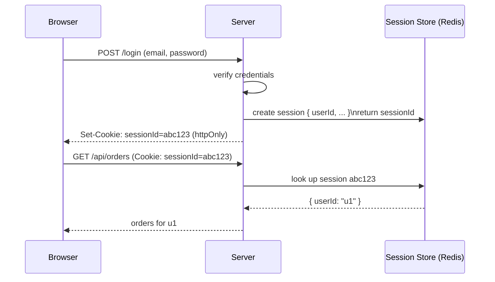
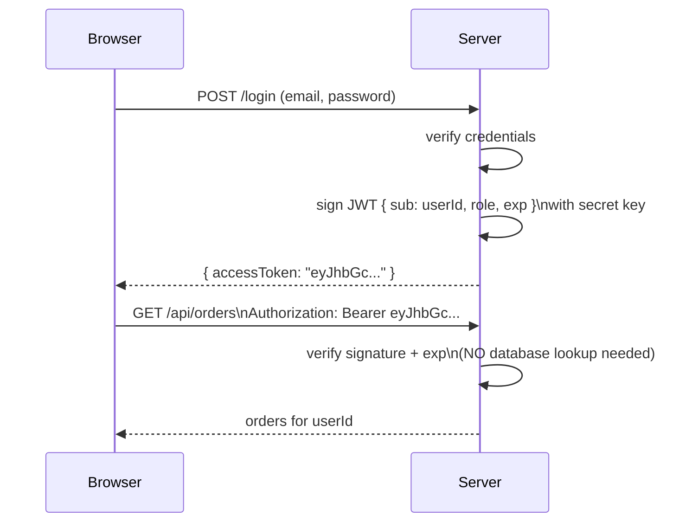
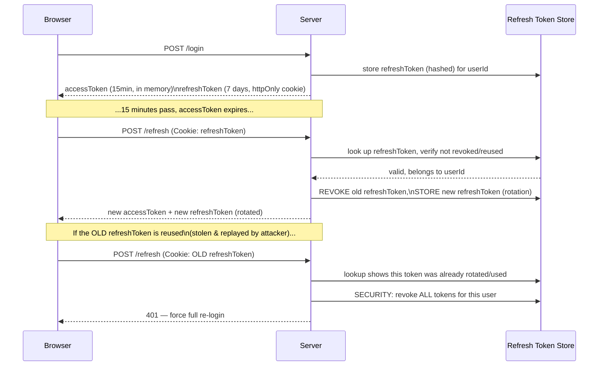
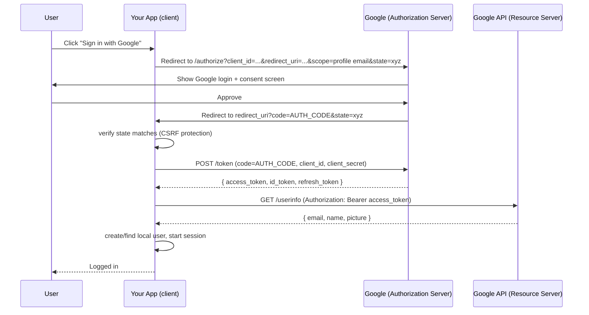
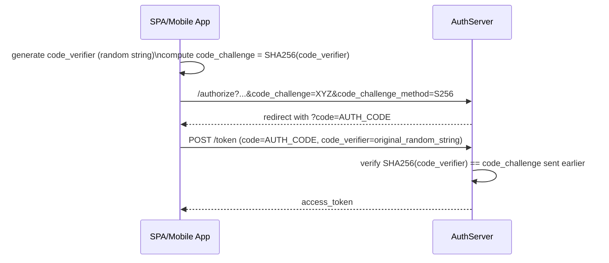
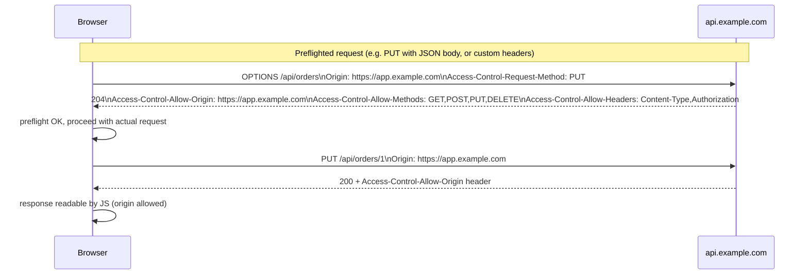

# 04 — Authentication & API Security for Senior Interviews

## Table of Contents
1. JWT vs Sessions
2. Refresh Token Rotation
3. OAuth2 Flows
4. RBAC (Role-Based Access Control)
5. CORS
6. CSRF and XSS Prevention

---

## 1. JWT vs Sessions

### Sessions (stateful)



- Server stores session data (in Redis, a DB, or memory); the client only holds an opaque session ID in a cookie.
- **Revocation is trivial**: delete the session from the store, and the user is immediately logged out everywhere.
- **Requires a shared store** across all server instances (Redis) — in-memory sessions break the moment you run more than one server replica, since a request could hit a replica that never created that session.

### JWT (stateless)



- The token itself carries the claims (`userId`, `role`, expiry), cryptographically signed. The server **verifies the signature** instead of looking anything up — this is what "stateless" means.
- **Scales horizontally with zero shared state** — any server replica with the same secret/public key can verify any token.
- **Revocation is hard**: a signed token is valid until it expires, full stop. There is no built-in way to "delete" a JWT early. This is the single biggest tradeoff candidates must understand.

### JWT structure

```
header.payload.signature

header:    { "alg": "HS256", "typ": "JWT" }
payload:   { "sub": "user123", "role": "admin", "iat": 1730000000, "exp": 1730003600 }
signature: HMACSHA256(base64(header) + "." + base64(payload), secretKey)
```

The payload is **base64-encoded, not encrypted** — anyone can decode and read it (try it at jwt.io). Never put secrets (passwords, card numbers) in a JWT payload. The signature only guarantees the token **hasn't been tampered with**, not that its contents are private.

### Decision table

| Factor | Sessions | JWT |
|---|---|---|
| Revocation | Instant (delete from store) | Hard (must wait for expiry, or maintain a blocklist — which reintroduces state) |
| Horizontal scaling | Needs shared store (Redis) | Naturally stateless |
| Payload size on the wire | Small (just an ID) | Larger (full claims on every request) |
| Mobile / cross-domain APIs | Cookies are awkward across domains/native apps | Works cleanly as a Bearer header, domain-agnostic |
| Best fit | Traditional web apps, same-domain | Microservices, mobile apps, multi-domain SPAs |

**Senior-level answer**: "Many production systems use a hybrid: short-lived JWT access tokens (5-15 min) for stateless API verification, combined with a server-side refresh token record (so refresh tokens — and by extension, long-term sessions — CAN be revoked), getting the scalability of JWTs with most of the revocability of sessions."

---

## 2. Refresh Token Rotation

A short-lived **access token** (JWT, 5-15 min expiry) is used for API calls. A longer-lived **refresh token** (days/weeks) is used only to obtain new access tokens, and is stored server-side (or at least tracked server-side) so it **can** be revoked.



### Why rotation matters

Without rotation, a single leaked refresh token (e.g., stolen via XSS or a compromised device) is a valid "golden ticket" for its **entire** lifetime. With rotation:
1. Every refresh issues a **brand new** refresh token and invalidates the old one.
2. If an old (already-rotated) refresh token is ever presented again, that's a strong signal of **token theft** (the legitimate client already moved on to the new token) — the server responds by revoking the entire token family, forcing the real user to log in again, containing the breach.

### Implementation sketch

```js
// POST /api/auth/login
async function login(req, res) {
  const { email, password } = req.body;
  const user = await User.findOne({ email }).select('+passwordHash');
  if (!user || !(await bcrypt.compare(password, user.passwordHash))) {
    return res.status(401).json({ error: { message: 'Invalid credentials' } });
  }

  const accessToken = jwt.sign({ sub: user.id, role: user.role }, process.env.ACCESS_TOKEN_SECRET, {
    expiresIn: '15m',
  });

  const refreshToken = crypto.randomBytes(40).toString('hex');
  await RefreshToken.create({
    tokenHash: hashToken(refreshToken), // never store raw tokens, hash them like passwords
    userId: user.id,
    expiresAt: new Date(Date.now() + 7 * 24 * 60 * 60 * 1000),
    revoked: false,
  });

  res.cookie('refreshToken', refreshToken, {
    httpOnly: true, // not accessible to JS — mitigates XSS token theft
    secure: true, // HTTPS only
    sameSite: 'strict', // mitigates CSRF
    maxAge: 7 * 24 * 60 * 60 * 1000,
  });

  res.json({ accessToken });
}

// POST /api/auth/refresh
async function refresh(req, res) {
  const token = req.cookies.refreshToken;
  if (!token) return res.status(401).json({ error: { message: 'No refresh token' } });

  const record = await RefreshToken.findOne({ tokenHash: hashToken(token) });

  if (!record || record.revoked || record.expiresAt < new Date()) {
    if (record?.revoked) {
      // Reuse of an already-rotated token — likely theft. Nuke the whole family.
      await RefreshToken.updateMany({ userId: record.userId }, { revoked: true });
    }
    return res.status(401).json({ error: { message: 'Invalid refresh token, please log in again' } });
  }

  // Rotate: revoke the used token, issue a new one
  record.revoked = true;
  await record.save();

  const newRefreshToken = crypto.randomBytes(40).toString('hex');
  await RefreshToken.create({
    tokenHash: hashToken(newRefreshToken),
    userId: record.userId,
    expiresAt: new Date(Date.now() + 7 * 24 * 60 * 60 * 1000),
    revoked: false,
  });

  const accessToken = jwt.sign({ sub: record.userId }, process.env.ACCESS_TOKEN_SECRET, { expiresIn: '15m' });

  res.cookie('refreshToken', newRefreshToken, { httpOnly: true, secure: true, sameSite: 'strict' });
  res.json({ accessToken });
}
```

### Where to store the access token on the client

- **In memory (a JS variable / React state)** — not persisted, lost on page refresh, but **not accessible to an XSS payload reading `localStorage`**. Recommended.
- **`localStorage`** — persists across refresh, but readable by any injected script → high XSS risk. Avoid for tokens.
- **`httpOnly` cookie** — not readable by JS at all (best XSS protection), but needs CSRF protection (see section 6) since the browser attaches cookies automatically.

Common senior-level pattern: access token in memory, refresh token in an `httpOnly`, `secure`, `sameSite=strict` cookie.

---

## 3. OAuth2 Flows

OAuth2 is a **delegation/authorization** protocol — "let app X do Y on my behalf at provider Z" — not strictly an authentication protocol (OpenID Connect, layered on top of OAuth2, adds the identity/authentication layer with ID tokens).

### Authorization Code Flow (the one you should know cold — used for "Sign in with Google" on a server-rendered or SPA app with a backend)



**Why the extra "code" hop instead of returning the token directly?** The authorization code is exchanged for a token in a **server-to-server** call, using the `client_secret` — this keeps the secret off the browser entirely (the redirect in the first leg only ever carries a short-lived, single-use code, which is useless to an attacker without the client secret).

### PKCE (Proof Key for Code Exchange) — required for public clients (SPAs, mobile apps that can't safely hold a `client_secret`)



PKCE replaces the `client_secret` requirement for public clients: since the app can't safely store a secret, it proves it's the same app that initiated the flow by presenting the original random `code_verifier`, which only it knows (never transmitted until this final step).

### Other flows (know these exist, know when NOT to use them)

| Flow | Use case | Status |
|---|---|---|
| **Authorization Code (+ PKCE)** | Web apps, SPAs, mobile apps | **Recommended, use this** |
| **Client Credentials** | Machine-to-machine (no user involved), e.g. a backend service calling another backend service's API | Fine for server-to-server |
| **Implicit Flow** | Old SPA pattern — token returned directly in URL fragment | **Deprecated** — exposes tokens in browser history/redirect URLs, no client authentication. Use Auth Code + PKCE instead. |
| **Resource Owner Password Credentials** | App collects the user's password directly and exchanges it for a token | **Deprecated/avoid** — defeats the entire purpose of OAuth2 (never give your password to a third-party app); only acceptable for first-party legacy migration scenarios |

---

## 4. RBAC (Role-Based Access Control)

### Basic model

```js
// A user has one or more roles. Each role maps to a set of permissions.
const ROLE_PERMISSIONS = {
  viewer: ['orders:read'],
  editor: ['orders:read', 'orders:write'],
  admin: ['orders:read', 'orders:write', 'orders:delete', 'users:manage'],
};

function hasPermission(user, permission) {
  return user.roles.some((role) => ROLE_PERMISSIONS[role]?.includes(permission));
}
```

### Express middleware for RBAC

```js
function requirePermission(permission) {
  return (req, res, next) => {
    if (!hasPermission(req.user, permission)) {
      return res.status(403).json({ error: { code: 'FORBIDDEN', message: 'Insufficient permissions' } });
    }
    next();
  };
}

router.delete('/orders/:id', authenticate, requirePermission('orders:delete'), deleteOrderHandler);
```

### RBAC is not enough on its own — don't forget resource-level (ownership) checks

A classic senior-interview trap: a candidate implements role checks ("is this user an editor?") but forgets **ownership** checks ("is this specific order *this user's* order, or someone else's?"). This is **Broken Access Control** (OWASP #1 in recent years) — specifically an **IDOR** (Insecure Direct Object Reference) vulnerability.

```js
// VULNERABLE: any authenticated "editor" can edit ANY order, including other users' orders,
// just by guessing/incrementing the :id in the URL.
router.put('/orders/:id', authenticate, requirePermission('orders:write'), async (req, res) => {
  const order = await Order.findByIdAndUpdate(req.params.id, req.body, { new: true });
  res.json(order);
});

// FIXED: verify the resource actually belongs to the requester (or the requester is an admin)
router.put('/orders/:id', authenticate, requirePermission('orders:write'), async (req, res) => {
  const order = await Order.findById(req.params.id);
  if (!order) return res.status(404).json({ error: { message: 'Not found' } });

  const isOwner = order.userId.equals(req.user.id);
  const isAdmin = req.user.roles.includes('admin');
  if (!isOwner && !isAdmin) {
    return res.status(403).json({ error: { message: 'Not your order' } });
  }

  Object.assign(order, req.body);
  await order.save();
  res.json(order);
});
```

### RBAC vs ABAC

- **RBAC** — permission depends on the user's **role** (static sets: admin, editor, viewer).
- **ABAC** (Attribute-Based Access Control) — permission depends on **attributes** of the user, resource, and context (e.g., "a manager can approve expense reports only for their own direct reports, only during business hours, only if the amount is under their approval limit"). More flexible, more complex to implement/audit. Mention this distinction if asked about scaling permission systems beyond simple roles.

---

## 5. CORS

CORS (Cross-Origin Resource Sharing) is a **browser-enforced** security mechanism — it does nothing to protect a server from non-browser clients (curl, Postman, server-to-server calls ignore CORS entirely). It exists solely to control which **websites** (origins) are allowed to read the response of a cross-origin request made from client-side JS (`fetch`/`XMLHttpRequest`) in a user's browser.

### Simple request vs preflighted request



A request triggers a **preflight** (`OPTIONS`) when it uses a method other than `GET`/`HEAD`/`POST`, or sends custom headers, or a `Content-Type` other than simple form types. The browser automatically sends the `OPTIONS` request first and only proceeds with the real request if the server's preflight response allows it.

### Express CORS configuration

```js
const cors = require('cors');

const allowedOrigins = ['https://app.example.com', 'https://admin.example.com'];

app.use(cors({
  origin: (origin, callback) => {
    // allow no-origin requests (server-to-server, curl, mobile apps) and whitelisted origins
    if (!origin || allowedOrigins.includes(origin)) {
      callback(null, true);
    } else {
      callback(new Error('Not allowed by CORS'));
    }
  },
  credentials: true, // allow cookies to be sent cross-origin — ONLY if you actually need cookie auth
  methods: ['GET', 'POST', 'PUT', 'DELETE'],
  allowedHeaders: ['Content-Type', 'Authorization'],
}));
```

### The dangerous misconfiguration (explicitly test for this in interviews)

```js
// NEVER DO THIS if credentials: true is also set.
app.use(cors({ origin: '*', credentials: true }));
// Browsers actually REJECT this combination (spec forbids wildcard origin + credentials),
// but candidates who don't know this will try it and be confused why cookies aren't sent.
// The CORRECT fix is to explicitly whitelist origins when credentials are involved — shown above.
```

**Key interview point**: CORS is not a substitute for authentication/authorization. It only restricts which *browser-based origins* can read a response — it is a client-side (browser) policy, not a server-side access control mechanism. The real access control must happen via auth checks (JWT/session validation) regardless of CORS settings.

---

## 6. CSRF and XSS Prevention

### CSRF (Cross-Site Request Forgery)

An attacker's site tricks a logged-in user's browser into submitting a request to your site, using the victim's **automatically-attached cookies** — the attacker never sees the cookie, they just ride on the browser automatically including it.

```mermaid
sequenceDiagram
    participant Victim as Victim's Browser
    participant Evil as evil-site.com
    participant Bank as bank.com

    Note over Victim,Bank: Victim is already logged into bank.com (has a session cookie)
    Victim->>Evil: visits evil-site.com (contains a hidden auto-submitting form)
    Evil->>Victim: serves page with:\n<form action="https://bank.com/transfer" method="POST">
    Victim->>Bank: browser auto-submits form,\nautomatically attaches bank.com session cookie
    Bank->>Bank: sees a valid session cookie,\nprocesses the transfer — THINKS it's a legit request
```



**Defenses:**

1. **`SameSite` cookie attribute** — the modern, simplest defense. `SameSite=Strict` or `SameSite=Lax` tells the browser not to send the cookie on cross-site requests.
   ```js
   res.cookie('sessionId', id, { httpOnly: true, secure: true, sameSite: 'strict' });
   ```
2. **CSRF tokens** — a random token embedded in the page (via a hidden form field or custom header) that an attacker's cross-origin form can't know or replicate, verified server-side on state-changing requests.
   ```js
   const csrf = require('csurf');
   app.use(csrf({ cookie: true }));

   app.get('/form', (req, res) => {
     res.render('form', { csrfToken: req.csrfToken() }); // embed in a hidden <input>
   });

   app.post('/transfer', (req, res) => {
     // csurf middleware automatically validates req.body._csrf against the session — throws if mismatched
     processTransfer(req.body);
   });
   ```
3. **Check the `Origin`/`Referer` header** server-side on state-changing requests as a defense-in-depth layer (not sufficient alone, since these headers can be absent in some legitimate scenarios, but a strong signal).

**Important nuance**: CSRF is primarily a threat for **cookie-based auth**, because cookies are sent automatically by the browser. If you use a `Bearer` token in an `Authorization` header (not a cookie) and the client JS explicitly attaches it, CSRF is naturally mitigated — an attacker's form can't force the victim's browser to attach an arbitrary header. This is one more argument for Bearer-token APIs, at the cost of needing to defend against XSS instead (since the token must live somewhere JS-accessible, unless using the in-memory pattern from section 2).

### XSS (Cross-Site Scripting)

Attacker injects malicious JS that executes in victim users' browsers, in the context of your site — able to read cookies (if not `httpOnly`), make authenticated requests, steal tokens from `localStorage`, deface the page, etc.

| Type | How it happens |
|---|---|
| **Stored XSS** | Malicious script saved in your database (e.g., a comment field) and served to every viewer |
| **Reflected XSS** | Malicious script in a URL parameter, reflected back into the page's HTML without escaping |
| **DOM-based XSS** | Client-side JS writes untrusted data into the DOM via unsafe sinks (`innerHTML`, `document.write`) |

### Defenses

1. **React escapes by default** — `{userInput}` in JSX is automatically HTML-escaped. The danger is explicitly opting out:
   ```jsx
   // SAFE — React escapes this automatically, even if comment.text contains "<script>"
   <p>{comment.text}</p>

   // DANGEROUS — bypasses React's escaping entirely
   <div dangerouslySetInnerHTML={{ __html: comment.text }} />

   // If you MUST render user-supplied HTML (e.g., a rich text editor's output),
   // sanitize it first with a dedicated library:
   import DOMPurify from 'dompurify';
   <div dangerouslySetInnerHTML={{ __html: DOMPurify.sanitize(comment.text) }} />
   ```
2. **Content Security Policy (CSP)** — an HTTP header instructing the browser to only execute scripts from trusted sources, even if an injection succeeds in the HTML.
   ```js
   app.use(helmet.contentSecurityPolicy({
     directives: {
       defaultSrc: ["'self'"],
       scriptSrc: ["'self'"], // blocks inline <script> tags and scripts from other domains
       styleSrc: ["'self'", "'unsafe-inline'"],
       imgSrc: ["'self'", 'data:', 'https://cdn.example.com'],
     },
   }));
   ```
3. **`httpOnly` cookies** for session/refresh tokens — even if an XSS injection succeeds, injected JS cannot read an `httpOnly` cookie's value via `document.cookie`.
4. **Sanitize/validate on the server too** — never rely solely on frontend escaping; always validate and, where HTML is accepted at all, sanitize server-side before storage, since data can be written by non-browser clients (API calls, mobile apps) that bypass your React layer entirely.

### Quick summary table

| Threat | Primary defense |
|---|---|
| CSRF | `SameSite` cookies, CSRF tokens, or avoid cookies entirely (Bearer tokens) |
| Stored/Reflected XSS | Escape output (React does this by default), sanitize any raw HTML with DOMPurify, CSP header |
| Token theft via XSS | `httpOnly` cookies for refresh tokens, in-memory (not `localStorage`) for access tokens |
| IDOR (broken access control) | Always verify resource ownership server-side, never trust client-supplied IDs alone |

---

## Practice Tasks

1. Implement the login + refresh + rotation flow from section 2 end-to-end against a real MongoDB-backed `RefreshToken` model. Manually replay an old (already-rotated) refresh token and confirm the server revokes the entire token family.
2. Register a real OAuth app with Google or GitHub and implement the Authorization Code flow end-to-end in a small Express app, including `state` parameter verification.
3. Build an RBAC middleware with at least 3 roles and 2 resource types, then deliberately introduce and then fix an IDOR vulnerability (a route that doesn't check resource ownership).
4. Set up a minimal repro of the CORS preflight: an Express API on `localhost:4000` and a static HTML page served from `localhost:5500` making a `PUT` request with `credentials: true`. Watch the preflight `OPTIONS` request in the browser Network tab.
5. Write a small React component with `dangerouslySetInnerHTML` rendering unsanitized user input containing a `<script>` or `` payload, observe the XSS execute, then fix it with `DOMPurify.sanitize()` and confirm it no longer executes.

## Interview Questions

1. **What is the fundamental tradeoff between JWT and session-based authentication?**
   Sessions are stateful (the server stores session data and only the ID is given to the client), making revocation instant but requiring a shared store (like Redis) to scale across multiple server instances. JWTs are stateless and self-contained (verified by signature, no lookup needed), which scales horizontally with zero shared state, but revocation before expiry isn't naturally possible since a signed token remains valid for its entire lifetime unless you reintroduce server-side tracking (a blocklist or a refresh-token record), which brings back some of the statefulness you were trying to avoid.

2. **Why use refresh token rotation instead of just a single long-lived refresh token?**
   A single long-lived refresh token, if ever stolen (e.g., via XSS or a compromised device), remains a valid credential for its entire lifetime with no way to detect the theft. Rotation issues a new refresh token on every use and invalidates the previous one; if an already-used (rotated-out) token is ever presented again, that's a strong signal of theft (the legitimate client already moved past it), allowing the server to revoke the entire token family immediately and force re-authentication, containing the blast radius of a leaked token.

3. **Explain why the OAuth2 Authorization Code flow exchanges a code for a token in a separate server-to-server step, instead of returning the access token directly in the redirect.**
   The initial redirect goes through the user's browser, which is visible in browser history, server logs, and potentially to malicious scripts/extensions — returning the actual access token there would expose it broadly. Instead, only a short-lived, single-use authorization code is exposed in the redirect; the actual token exchange happens in a direct, non-browser-visible request from the app's backend to the authorization server, authenticated with a client secret the browser never sees, which is a much smaller and more controlled attack surface.

4. **Describe an IDOR vulnerability and how you'd prevent it, specifically in the context of RBAC.**
   IDOR (Insecure Direct Object Reference) happens when an API checks that a user has a role/permission to perform an action in general, but fails to check whether the *specific resource* they're acting on actually belongs to them — e.g., checking "is this user an editor" but not "is this order actually this user's order," letting any editor modify any user's data by changing the ID in the URL. The fix is to always perform an explicit ownership check (or admin override) server-side before allowing access/mutation of a specific resource, in addition to the role/permission check.

5. **Why doesn't CORS protect your API from attacks made with curl or Postman?**
   CORS is enforced entirely by the browser, not the server — the server just responds with headers (`Access-Control-Allow-Origin`, etc.) that tell the *browser* whether to allow JavaScript running on a given origin to read the response. Tools like curl and Postman aren't browsers; they don't enforce CORS policy at all and will happily show you the response of any cross-origin request. CORS is about protecting users' browsers from malicious websites reading data from an authenticated session elsewhere, not about protecting your server from arbitrary API clients.

6. **How does the `SameSite` cookie attribute mitigate CSRF, and what's the difference between `Strict` and `Lax`?**
   `SameSite` tells the browser under what cross-site navigation conditions it's allowed to send a cookie. `Strict` never sends the cookie on any cross-site request, including top-level navigation (clicking a link from another site) — most secure, but can break flows like arriving at your site via an external link while still wanting to appear logged in. `Lax` (the modern browser default) sends the cookie on top-level GET navigations from another site (so following a link still works) but blocks it on cross-site POST/PUT/etc. and on requests triggered from ``/`<form>` auto-submits embedded in another page — which is exactly the CSRF attack vector, so `Lax` is usually sufficient and more user-friendly than `Strict`.

7. **Your React app uses `dangerouslySetInnerHTML` to render user-generated rich text (from a WYSIWYG editor). What's the risk, and how do you mitigate it correctly?**
   Rendering raw HTML bypasses React's automatic escaping entirely, so if the stored content contains a malicious payload (e.g., `` or a `<script>` tag), it will execute in the browser of anyone viewing that content — a stored XSS vulnerability. The correct mitigation is to sanitize the HTML through a dedicated library like DOMPurify (which strips dangerous tags/attributes while preserving safe formatting) immediately before rendering, and ideally also sanitize/validate on the server at write-time, since the data could also be written by non-browser API clients that never go through your sanitizing frontend code.
