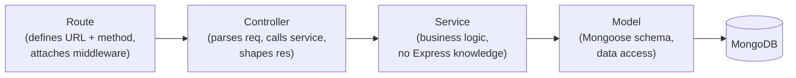
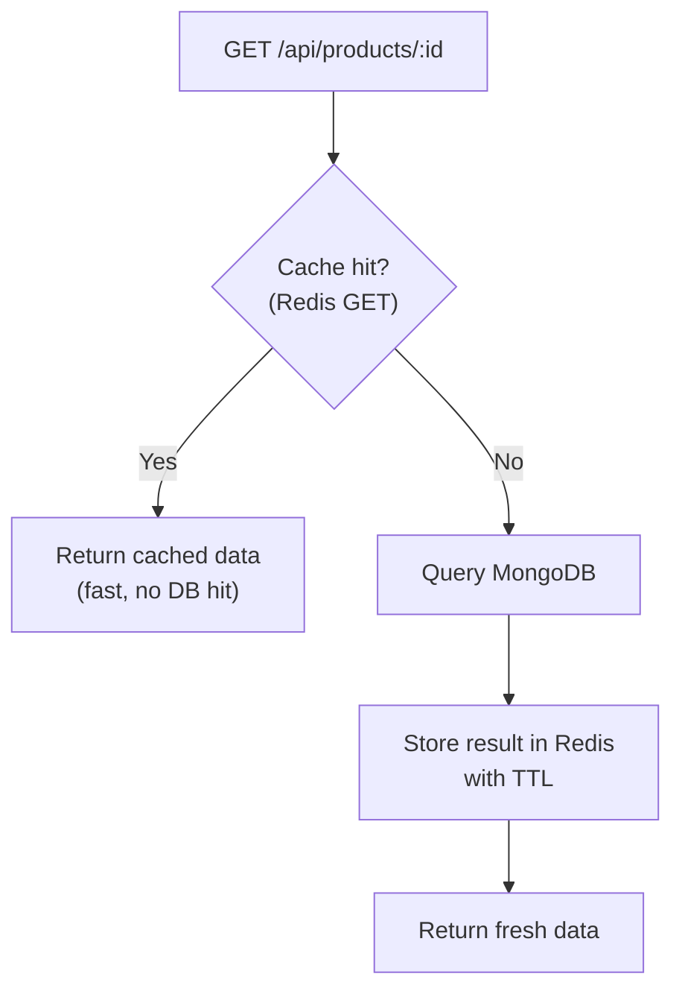
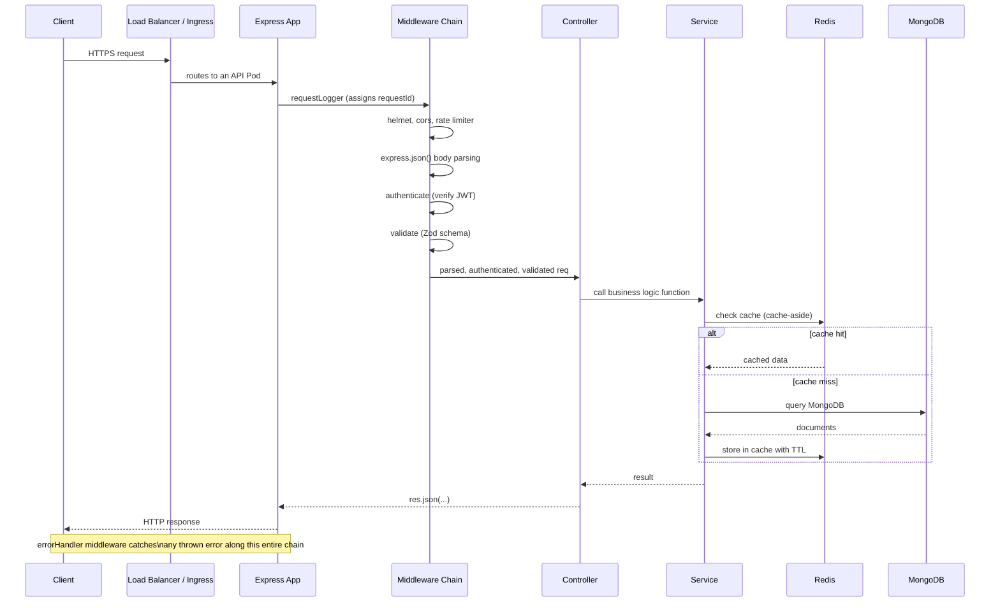

# 05 — Full-Stack Project Architecture (Production-Grade MERN)

This file is a reference architecture for a production MERN application. Treat it as a blueprint you can defend in an interview ("walk me through how you'd structure a new service") and actually reuse in real projects.

## Table of Contents
1. Folder structure
2. Environment configuration
3. Request validation
4. Logging
5. Caching with Redis
6. WebSockets
7. Putting it together — request lifecycle diagram

---

## 1. Folder Structure

```
mern-app/
├── client/                        # React app (Vite)
│   ├── src/
│   │   ├── api/                   # API client functions (axios instances, per-resource)
│   │   │   ├── axiosClient.js
│   │   │   └── ordersApi.js
│   │   ├── components/            # reusable, presentational components
│   │   ├── features/               # feature-based organization (not type-based)
│   │   │   ├── orders/
│   │   │   │   ├── OrderList.jsx
│   │   │   │   ├── OrderDetail.jsx
│   │   │   │   ├── useOrders.js    # custom hook wrapping TanStack Query
│   │   │   │   └── orders.test.jsx
│   │   │   └── auth/
│   │   ├── hooks/                  # cross-feature shared hooks
│   │   ├── store/                  # Zustand/Redux store setup
│   │   ├── App.jsx
│   │   └── main.jsx
│   ├── .env.example
│   ├── vite.config.js
│   └── package.json
│
├── server/                         # Node/Express API
│   ├── src/
│   │   ├── config/
│   │   │   ├── env.js              # validated environment config (see section 2)
│   │   │   └── db.js               # Mongoose connection setup
│   │   ├── models/                 # Mongoose schemas
│   │   │   ├── User.js
│   │   │   └── Order.js
│   │   ├── routes/                 # Express routers, thin — delegate to controllers
│   │   │   ├── auth.routes.js
│   │   │   └── orders.routes.js
│   │   ├── controllers/            # request/response handling, calls services
│   │   │   └── orders.controller.js
│   │   ├── services/                # business logic, no req/res awareness
│   │   │   └── orders.service.js
│   │   ├── validators/              # Zod/Joi schemas per endpoint
│   │   │   └── orders.validator.js
│   │   ├── middleware/
│   │   │   ├── authenticate.js
│   │   │   ├── errorHandler.js
│   │   │   ├── asyncHandler.js
│   │   │   └── requestLogger.js
│   │   ├── utils/
│   │   │   ├── logger.js           # Winston/Pino setup
│   │   │   └── AppError.js
│   │   ├── sockets/                 # Socket.IO handlers (see section 6)
│   │   │   └── index.js
│   │   ├── app.js                   # Express app assembly (middleware, routes)
│   │   └── server.js                # entrypoint: starts HTTP server, connects DB
│   ├── tests/
│   │   ├── unit/
│   │   └── integration/
│   ├── .env.example
│   └── package.json
│
├── docker-compose.yml               # local dev: mongo + redis + api + client
├── .github/workflows/ci.yml         # CI/CD pipeline (see file 06)
└── README.md
```

### Why layered: routes → controllers → services → models



This separation matters for a concrete, testable reason: **services contain no `req`/`res` objects**, so they can be unit tested by calling plain functions with plain arguments — no need to mock Express request/response objects. Controllers stay thin (parse input, call service, format output), and routes stay thin (just wiring).

```js
// routes/orders.routes.js — thin, just wiring
const router = require('express').Router();
const { authenticate } = require('../middleware/authenticate');
const { validate } = require('../middleware/validate');
const { createOrderSchema } = require('../validators/orders.validator');
const ordersController = require('../controllers/orders.controller');
const asyncHandler = require('../middleware/asyncHandler');

router.post(
  '/',
  authenticate,
  validate(createOrderSchema),
  asyncHandler(ordersController.createOrder)
);

module.exports = router;
```

```js
// controllers/orders.controller.js — parses req, calls service, shapes response
const ordersService = require('../services/orders.service');

async function createOrder(req, res) {
  const order = await ordersService.createOrder(req.user.id, req.body);
  res.status(201).json({ data: order });
}

module.exports = { createOrder };
```

```js
// services/orders.service.js — pure business logic, fully unit-testable without Express
const Order = require('../models/Order');
const { ValidationError } = require('../utils/AppError');

async function createOrder(userId, orderData) {
  if (orderData.items.length === 0) {
    throw new ValidationError('Order must contain at least one item');
  }

  const total = orderData.items.reduce((sum, item) => sum + item.price * item.qty, 0);

  return Order.create({ userId, items: orderData.items, total, status: 'pending' });
}

module.exports = { createOrder };
```

```js
// tests/unit/orders.service.test.js — no Express mocking needed at all
const { createOrder } = require('../../src/services/orders.service');

test('throws ValidationError when items array is empty', async () => {
  await expect(createOrder('user1', { items: [] })).rejects.toThrow('at least one item');
});
```

---

## 2. Environment Configuration

Never read `process.env.X` scattered throughout the codebase — centralize and **validate** config at startup, so a missing/malformed environment variable fails fast at boot (loudly, in staging) instead of causing a mysterious runtime bug in production.

```js
// config/env.js
const { z } = require('zod');

const envSchema = z.object({
  NODE_ENV: z.enum(['development', 'test', 'production']).default('development'),
  PORT: z.coerce.number().default(4000),
  MONGO_URI: z.string().url(),
  REDIS_URL: z.string().url(),
  ACCESS_TOKEN_SECRET: z.string().min(32, 'Must be at least 32 characters'),
  REFRESH_TOKEN_SECRET: z.string().min(32),
  CORS_ORIGIN: z.string(),
  LOG_LEVEL: z.enum(['debug', 'info', 'warn', 'error']).default('info'),
});

const parsed = envSchema.safeParse(process.env);

if (!parsed.success) {
  console.error('Invalid environment configuration:');
  console.error(parsed.error.format());
  process.exit(1); // fail fast — never start the server with bad config
}

module.exports = parsed.data;
```

```js
// server.js
const env = require('./config/env'); // validated and type-coerced
const app = require('./app');
const connectDB = require('./config/db');

async function start() {
  await connectDB(env.MONGO_URI);
  app.listen(env.PORT, () => {
    console.log(`Server listening on port ${env.PORT} [${env.NODE_ENV}]`);
  });
}

start();
```

```bash
# .env.example — committed to git, shows every required variable with no real values
NODE_ENV=development
PORT=4000
MONGO_URI=mongodb://localhost:27017/mernapp
REDIS_URL=redis://localhost:6379
ACCESS_TOKEN_SECRET=replace_with_a_real_32+_char_random_secret
REFRESH_TOKEN_SECRET=replace_with_a_different_32+_char_random_secret
CORS_ORIGIN=http://localhost:5173
LOG_LEVEL=debug
```

**Key practice**: `.env` is in `.gitignore` (never commit real secrets); `.env.example` IS committed (documents what's needed). In Kubernetes, these values come from ConfigMaps/Secrets instead of a `.env` file (see file 07) — the `env.js` validation layer stays identical either way, since it just reads `process.env`.

---

## 3. Request Validation

Validate at the **edge** (before it touches your business logic), with one schema per endpoint, using Zod (or Joi).

```js
// validators/orders.validator.js
const { z } = require('zod');

const createOrderSchema = z.object({
  body: z.object({
    items: z
      .array(
        z.object({
          productId: z.string().regex(/^[0-9a-fA-F]{24}$/, 'Invalid product ID'),
          qty: z.number().int().positive(),
        })
      )
      .min(1, 'At least one item is required'),
    shippingAddress: z.object({
      street: z.string().min(1),
      city: z.string().min(1),
      zip: z.string().min(1),
    }),
  }),
});

module.exports = { createOrderSchema };
```

```js
// middleware/validate.js — generic validation middleware, reused across all routes
function validate(schema) {
  return (req, res, next) => {
    const result = schema.safeParse({ body: req.body, query: req.query, params: req.params });
    if (!result.success) {
      return res.status(400).json({
        error: {
          code: 'VALIDATION_ERROR',
          message: 'Invalid request data',
          details: result.error.flatten().fieldErrors,
        },
      });
    }
    // overwrite with parsed/coerced data (e.g., string "5" -> number 5)
    req.body = result.data.body;
    next();
  };
}

module.exports = { validate };
```

This gives you three wins at once: rejecting malformed input before it reaches business logic, type coercion (query strings are always strings — Zod can coerce `"5"` to `5`), and a single consistent error response shape across the whole API.

---

## 4. Logging

Use a structured logger (Pino is faster and more production-friendly than console.log; Winston is more configurable for multiple transports) — never plain `console.log` in production code.

```js
// utils/logger.js
const pino = require('pino');
const env = require('../config/env');

const logger = pino({
  level: env.LOG_LEVEL,
  formatters: {
    level: (label) => ({ level: label }), // ensures level is a string, not a number, in JSON output
  },
  timestamp: pino.stdTimeFunctions.isoTime,
  redact: ['req.headers.authorization', 'req.body.password'], // never log secrets
});

module.exports = logger;
```

```js
// middleware/requestLogger.js — structured request logging with correlation IDs
const { randomUUID } = require('crypto');
const logger = require('../utils/logger');

function requestLogger(req, res, next) {
  req.id = req.headers['x-request-id'] || randomUUID(); // propagate or generate a correlation ID
  const start = Date.now();

  res.on('finish', () => {
    logger.info({
      requestId: req.id,
      method: req.method,
      path: req.path,
      statusCode: res.statusCode,
      durationMs: Date.now() - start,
      userId: req.user?.id,
    }, 'request completed');
  });

  next();
}

module.exports = requestLogger;
```

Why structured (JSON) logs over plain text: they can be directly ingested, indexed, and queried by log aggregation tools (ELK stack, Loki, Datadog) without fragile regex parsing — see file 08 for the full operational picture. The `requestId` correlation pattern is essential in production: it lets you trace a single request's full lifecycle across logs even when multiple requests are being handled concurrently by multiple server replicas.

---

## 5. Caching with Redis

Use Redis for: session/refresh-token storage (file 04), rate limiting counters shared across replicas (file 01), and **caching expensive or frequently-read data** to reduce database load.

```js
// config/redis.js
const { createClient } = require('redis');
const env = require('./env');
const logger = require('../utils/logger');

const redisClient = createClient({ url: env.REDIS_URL });
redisClient.on('error', (err) => logger.error({ err }, 'Redis connection error'));

async function connectRedis() {
  await redisClient.connect();
  logger.info('Connected to Redis');
}

module.exports = { redisClient, connectRedis };
```

### Cache-aside pattern (the most common pattern — know this cold)



```js
// services/products.service.js
const { redisClient } = require('../config/redis');
const Product = require('../models/Product');

const CACHE_TTL_SECONDS = 300; // 5 minutes

async function getProductById(productId) {
  const cacheKey = `product:${productId}`;

  const cached = await redisClient.get(cacheKey);
  if (cached) {
    return JSON.parse(cached); // cache hit — skip the database entirely
  }

  const product = await Product.findById(productId).lean();
  if (!product) return null;

  await redisClient.set(cacheKey, JSON.stringify(product), { EX: CACHE_TTL_SECONDS });
  return product;
}

// Invalidate the cache whenever the underlying data changes — critical, easy to forget
async function updateProduct(productId, updates) {
  const updated = await Product.findByIdAndUpdate(productId, updates, { new: true });
  await redisClient.del(`product:${productId}`); // invalidate stale cache entry
  return updated;
}

module.exports = { getProductById, updateProduct };
```

### Cache stampede protection (senior-level nuance)

If a popular cache key expires and 1,000 concurrent requests all miss simultaneously, they can all hammer the database at once ("thundering herd"). Mitigate with a short-lived lock or by staggering TTLs with jitter:

```js
async function getProductByIdSafe(productId) {
  const cacheKey = `product:${productId}`;
  const cached = await redisClient.get(cacheKey);
  if (cached) return JSON.parse(cached);

  const lockKey = `lock:${cacheKey}`;
  // SET ... NX = only set if not already set (acts as a distributed lock), with a short expiry
  const acquiredLock = await redisClient.set(lockKey, '1', { NX: true, EX: 5 });

  if (!acquiredLock) {
    // someone else is already rebuilding the cache — wait briefly and retry from cache
    await new Promise((r) => setTimeout(r, 100));
    return getProductByIdSafe(productId);
  }

  const product = await Product.findById(productId).lean();
  await redisClient.set(cacheKey, JSON.stringify(product), {
    EX: CACHE_TTL_SECONDS + Math.floor(Math.random() * 30), // jitter avoids synchronized re-expiry
  });
  await redisClient.del(lockKey);
  return product;
}
```

---

## 6. WebSockets

Use Socket.IO (adds reconnection, fallback transports, and room/namespace abstractions over raw WebSockets) for real-time features: live order status updates, chat, notifications.

```js
// sockets/index.js
const { Server } = require('socket.io');
const jwt = require('jsonwebtoken');
const env = require('../config/env');
const logger = require('../utils/logger');

function initSockets(httpServer) {
  const io = new Server(httpServer, {
    cors: { origin: env.CORS_ORIGIN, credentials: true },
  });

  // Authenticate the socket connection using the same JWT access token used for REST calls
  io.use((socket, next) => {
    try {
      const token = socket.handshake.auth.token;
      const payload = jwt.verify(token, env.ACCESS_TOKEN_SECRET);
      socket.userId = payload.sub;
      next();
    } catch (err) {
      next(new Error('Unauthorized'));
    }
  });

  io.on('connection', (socket) => {
    logger.info({ userId: socket.userId }, 'socket connected');

    // Join a room scoped to this user — lets the server push to ONLY this user's sockets
    // (a user may have multiple tabs/devices open, each a separate socket in the same room)
    socket.join(`user:${socket.userId}`);

    socket.on('disconnect', () => {
      logger.info({ userId: socket.userId }, 'socket disconnected');
    });
  });

  return io;
}

module.exports = { initSockets };
```

```js
// server.js — wiring sockets into the same HTTP server as Express
const http = require('http');
const app = require('./app');
const { initSockets } = require('./sockets');

const httpServer = http.createServer(app);
const io = initSockets(httpServer);

// Make `io` available to services that need to push events (e.g., order status updates)
app.set('io', io);

httpServer.listen(env.PORT);
```

```js
// services/orders.service.js — pushing a real-time update when order status changes
async function updateOrderStatus(orderId, newStatus, io) {
  const order = await Order.findByIdAndUpdate(orderId, { status: newStatus }, { new: true });

  io.to(`user:${order.userId}`).emit('order:statusChanged', {
    orderId: order.id,
    status: newStatus,
  });

  return order;
}
```

### Scaling WebSockets across multiple server replicas

A critical production gotcha: if you run multiple Node replicas (which you will, in Kubernetes), a `socket.io` connection lives on exactly **one** replica. If replica A needs to push an event to a user whose socket is connected to replica B, a plain in-memory `io.emit()` on replica A does nothing for that user. Fix this with the **Redis adapter**, which lets all replicas broadcast events through a shared Redis Pub/Sub channel:

```js
const { createAdapter } = require('@socket.io/redis-adapter');
const { createClient } = require('redis');

async function initSocketsWithRedisAdapter(httpServer) {
  const pubClient = createClient({ url: env.REDIS_URL });
  const subClient = pubClient.duplicate();
  await Promise.all([pubClient.connect(), subClient.connect()]);

  const io = new Server(httpServer, { cors: { origin: env.CORS_ORIGIN } });
  io.adapter(createAdapter(pubClient, subClient));
  // Now io.to(room).emit(...) correctly reaches sockets connected to ANY replica.

  return io;
}
```

---

## 7. Request Lifecycle — Putting It All Together



---

## Practice Tasks

1. Scaffold this exact folder structure for a small "task manager" MERN app (users, tasks). Implement the routes → controllers → services → models chain for a single resource end-to-end.
2. Add the `env.js` Zod validation layer, then deliberately delete a required env var and confirm the server refuses to start with a clear error message instead of crashing later with a confusing runtime error.
3. Implement cache-aside caching for a "get product by ID" endpoint with Redis, and write a test that confirms the second call doesn't hit MongoDB (e.g., by spying on the Mongoose query).
4. Implement the Socket.IO user-room pattern, and manually test it with two browser tabs logged in as the same user — confirm both tabs receive a pushed `order:statusChanged` event.
5. Simulate running 2 instances of your API (two terminal windows, two ports) with the Redis Socket.IO adapter, connect two different browser clients to each instance, and confirm an event emitted from instance A reaches a client connected to instance B.

## Interview Questions

1. **Why separate your code into routes, controllers, services, and models instead of putting logic directly in route handlers?**
   This separation makes business logic (services) independent of Express entirely — services take plain arguments and return plain values/throw errors, with no `req`/`res` objects — so they can be unit tested directly without mocking HTTP objects. It also means business logic is reusable (a service function can be called from a REST route, a WebSocket handler, or a scheduled job, identically), and controllers/routes stay thin and easy to reason about.

2. **Why validate environment variables at startup instead of just reading `process.env.X` wherever needed?**
   Reading `process.env` scattered throughout the codebase means a missing or malformed variable only surfaces as a confusing runtime error deep in some unrelated code path, often in production under load. Validating all required env vars against a schema (e.g., with Zod) at application startup means the app fails fast and loudly, with a clear error message, the moment it's deployed with bad configuration — before it ever accepts traffic.

3. **Explain the cache-aside pattern and the two things you must get right for it to be safe in production.**
   Cache-aside means the application checks the cache first; on a miss, it queries the source of truth (the database), then populates the cache with a TTL before returning the result. The two critical correctness concerns are: (1) cache invalidation — whenever the underlying data changes, you must explicitly delete or update the relevant cache key, or clients will see stale data for up to the TTL duration; (2) cache stampede protection — if a hot key expires and many concurrent requests miss simultaneously, they can all hit the database at once, which you mitigate with a short-lived lock or jittered TTLs.

4. **Why can't you just call `io.emit()` from one Node process and expect it to reach a client connected to a different replica?**
   Each server replica holds its own in-memory set of active Socket.IO connections — a socket's TCP connection physically terminates at exactly one process. Without a shared mechanism, emitting from replica A has no way to know about or reach sockets connected to replica B. The fix is the Redis adapter, which has every replica subscribe to a shared Redis Pub/Sub channel, so an emit on any replica is broadcast to all replicas, each of which then delivers it to any locally-connected sockets in the target room.

5. **What's the benefit of structured (JSON) logging with a request correlation ID over plain `console.log` statements?**
   Structured JSON logs can be directly ingested and indexed by log aggregation systems (ELK, Loki, Datadog) without fragile text parsing, enabling fast filtering/querying by field (status code, user ID, duration). A correlation ID (request ID) attached to every log line for a given request lets you reconstruct the full lifecycle of that specific request across every middleware and service it touched, even when many requests are being processed concurrently across multiple replicas — without it, interleaved logs from concurrent requests are effectively impossible to untangle in production.
