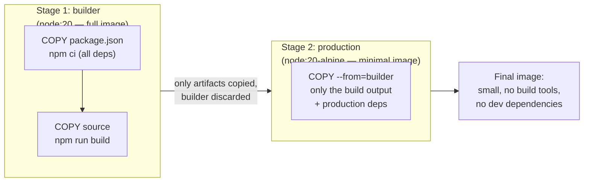
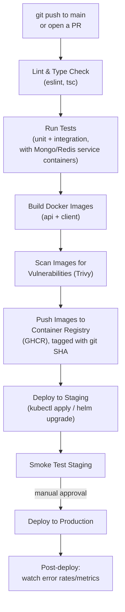

# 06 — Docker & CI/CD for Senior Interviews

## Table of Contents
1. Dockerfile best practices (multi-stage builds)
2. Dockerfile for the Node/Express API
3. Dockerfile for the React client (served via Nginx)
4. docker-compose for the full MERN stack
5. CI/CD pipeline with GitHub Actions (complete working YAML)

---

## 1. Dockerfile Best Practices

### Multi-stage builds — why they matter

A naive Dockerfile installs build tools, dev dependencies, and source code into the **final** image — bloating it and including things (compilers, test frameworks, source maps) that have no business being in production and increase attack surface. **Multi-stage builds** use one stage to build/compile, and a separate, minimal final stage that only copies the build **output**.



### General best practices checklist

- **Order layers from least-to-most frequently changing** — Docker caches each layer; put `COPY package*.json` + `npm ci` *before* `COPY . .` so dependency installation is cached and skipped on rebuilds unless `package.json` actually changed.
- **Use specific, minimal base images** (`node:20-alpine`, not `node:latest`) — `alpine` images are a fraction of the size of full Debian-based images and reduce the vulnerability surface.
- **Run as a non-root user** — never run the container process as `root`; create and switch to an unprivileged user.
- **Use `.dockerignore`** — exclude `node_modules`, `.git`, `.env`, test files from the build context, which otherwise gets uploaded to the Docker daemon on every build (slow) and could leak secrets into layers.
- **Pin versions** — avoid `:latest` tags in production; pin to a specific digest or semver tag for reproducible builds.
- **One process per container** — don't run a supervisor managing multiple services inside one container; let Kubernetes/Docker Compose manage multiple containers instead.
- **Add a `HEALTHCHECK`** (or rely on Kubernetes probes — file 07 — which is the more common production pattern).

---

## 2. Dockerfile for the Node/Express API

```dockerfile
# server/Dockerfile

# ---------- Stage 1: dependencies ----------
FROM node:20-alpine AS deps
WORKDIR /app
COPY package.json package-lock.json ./
# npm ci is deterministic (uses package-lock.json exactly) and faster than npm install in CI
RUN npm ci --omit=dev

# ---------- Stage 2: builder (if using TypeScript / a build step) ----------
FROM node:20-alpine AS builder
WORKDIR /app
COPY package.json package-lock.json ./
RUN npm ci
COPY . .
RUN npm run build

# ---------- Stage 3: production ----------
FROM node:20-alpine AS production
WORKDIR /app

# Create a non-root user explicitly (alpine's node image ships a 'node' user, but be explicit)
RUN addgroup -g 1001 appgroup && adduser -u 1001 -G appgroup -s /bin/sh -D appuser

ENV NODE_ENV=production

# Copy only production node_modules (from deps stage) and built output (from builder stage)
COPY --from=deps /app/node_modules ./node_modules
COPY --from=builder /app/dist ./dist
COPY package.json ./

USER appuser

EXPOSE 4000

HEALTHCHECK --interval=30s --timeout=5s --start-period=10s --retries=3 \
  CMD node -e "require('http').get('http://localhost:4000/health', (r) => process.exit(r.statusCode === 200 ? 0 : 1)).on('error', () => process.exit(1))"

CMD ["node", "dist/server.js"]
```

```dockerfile
# server/.dockerignore
node_modules
npm-debug.log
.env
.env.*
.git
.gitignore
coverage
tests
*.md
Dockerfile
.dockerignore
```

---

## 3. Dockerfile for the React Client (served via Nginx)

React apps build to static files (HTML/CSS/JS) — there's no Node runtime needed in production, just a static file server. Nginx is the standard choice.

```dockerfile
# client/Dockerfile

# ---------- Stage 1: build the React app ----------
FROM node:20-alpine AS builder
WORKDIR /app
COPY package.json package-lock.json ./
RUN npm ci
COPY . .
# Vite/CRA build-time env vars must be passed as build ARGs, since static files
# are baked at build time — they CANNOT be changed at container runtime like server env vars.
ARG VITE_API_URL
ENV VITE_API_URL=$VITE_API_URL
RUN npm run build

# ---------- Stage 2: serve with Nginx ----------
FROM nginx:1.27-alpine AS production

# Remove default Nginx welcome page config
RUN rm -rf /usr/share/nginx/html/*

# Copy built static files from the builder stage
COPY --from=builder /app/dist /usr/share/nginx/html

# Custom Nginx config (see below) — handles SPA client-side routing
COPY nginx.conf /etc/nginx/conf.d/default.conf

EXPOSE 80

HEALTHCHECK --interval=30s --timeout=3s CMD wget -q --spider http://localhost/ || exit 1

CMD ["nginx", "-g", "daemon off;"]
```

```nginx
# client/nginx.conf
server {
    listen 80;
    server_name _;
    root /usr/share/nginx/html;
    index index.html;

    # Gzip compression for text-based assets
    gzip on;
    gzip_types text/plain text/css application/json application/javascript text/xml application/xml;

    # Cache hashed static assets (JS/CSS with content-hash filenames) aggressively
    location ~* \.(js|css|png|jpg|jpeg|gif|svg|woff2?)$ {
        expires 1y;
        add_header Cache-Control "public, immutable";
    }

    # SPA routing: any path not matching a real file falls back to index.html,
    # so React Router can handle client-side routes like /products/42 on a hard refresh.
    location / {
        try_files $uri $uri/ /index.html;
    }

    # Reverse-proxy API calls to the backend service (useful inside docker-compose/K8s,
    # avoiding CORS entirely by making the API same-origin from the browser's perspective)
    location /api/ {
        proxy_pass http://api:4000/;
        proxy_http_version 1.1;
        proxy_set_header Host $host;
        proxy_set_header X-Real-IP $remote_addr;
        proxy_set_header X-Forwarded-For $proxy_add_x_forwarded_for;
    }
}
```

**Interview point**: build-time vs runtime env vars is a common confusion. Server-side Node apps read `process.env` at **runtime**, so the same image can be deployed to dev/staging/prod with different env vars injected by the orchestrator. A React app's env vars (`import.meta.env.VITE_API_URL` or `process.env.REACT_APP_*`) are baked into the static JS bundle **at build time** — changing them requires rebuilding the image, unless you adopt a runtime-config pattern (e.g., fetching a `/config.json` at app startup instead of baking values in).

---

## 4. docker-compose for the Full MERN Stack

```yaml
# docker-compose.yml — local development environment
version: '3.9'

services:
  mongo:
    image: mongo:7
    container_name: mern_mongo
    restart: unless-stopped
    ports:
      - '27017:27017'
    environment:
      MONGO_INITDB_ROOT_USERNAME: root
      MONGO_INITDB_ROOT_PASSWORD: ${MONGO_ROOT_PASSWORD:-devpassword}
      MONGO_INITDB_DATABASE: mernapp
    volumes:
      - mongo_data:/data/db
    healthcheck:
      test: echo 'db.runCommand("ping").ok' | mongosh localhost:27017/test --quiet
      interval: 10s
      timeout: 5s
      retries: 5

  redis:
    image: redis:7-alpine
    container_name: mern_redis
    restart: unless-stopped
    ports:
      - '6379:6379'
    volumes:
      - redis_data:/data
    healthcheck:
      test: ['CMD', 'redis-cli', 'ping']
      interval: 10s
      timeout: 3s
      retries: 5

  api:
    build:
      context: ./server
      dockerfile: Dockerfile
      target: production
    container_name: mern_api
    restart: unless-stopped
    ports:
      - '4000:4000'
    environment:
      NODE_ENV: development
      PORT: 4000
      MONGO_URI: mongodb://root:${MONGO_ROOT_PASSWORD:-devpassword}@mongo:27017/mernapp?authSource=admin
      REDIS_URL: redis://redis:6379
      ACCESS_TOKEN_SECRET: ${ACCESS_TOKEN_SECRET:-dev_access_secret_change_me_32chars}
      REFRESH_TOKEN_SECRET: ${REFRESH_TOKEN_SECRET:-dev_refresh_secret_change_me_32ch}
      CORS_ORIGIN: http://localhost:5173
    depends_on:
      mongo:
        condition: service_healthy
      redis:
        condition: service_healthy
    volumes:
      - ./server/src:/app/src # bind mount for local hot-reload during dev
    command: npm run dev

  client:
    build:
      context: ./client
      dockerfile: Dockerfile
      args:
        VITE_API_URL: http://localhost:4000
    container_name: mern_client
    restart: unless-stopped
    ports:
      - '5173:80'
    depends_on:
      - api

volumes:
  mongo_data:
  redis_data:
```

```bash
# Common commands (documented, not executed by this course material)
docker compose up -d --build     # build and start all services in the background
docker compose logs -f api       # tail logs for a specific service
docker compose down -v           # stop and remove containers + volumes (full reset)
```

**Interview point on `depends_on` + `condition: service_healthy`**: plain `depends_on` only waits for the container to *start*, not for the service inside it to be *ready* to accept connections (Mongo/Redis can take a few seconds after container start to actually accept connections). The `healthcheck` + `condition: service_healthy` combination makes Compose wait for the actual readiness signal — this exact same concept (readiness, not just "started") reappears as Kubernetes readiness probes in file 07.

---

## 5. CI/CD Pipeline with GitHub Actions

### Pipeline flow



### Full working GitHub Actions workflow

```yaml
# .github/workflows/ci-cd.yml
name: CI/CD Pipeline

on:
  push:
    branches: [main]
  pull_request:
    branches: [main]

env:
  REGISTRY: ghcr.io
  IMAGE_NAME_API: ${{ github.repository }}/api
  IMAGE_NAME_CLIENT: ${{ github.repository }}/client

jobs:
  # ---------------- Job 1: Lint and type-check ----------------
  lint:
    runs-on: ubuntu-latest
    steps:
      - uses: actions/checkout@v4

      - name: Set up Node.js
        uses: actions/setup-node@v4
        with:
          node-version: '20'
          cache: 'npm'
          cache-dependency-path: server/package-lock.json

      - name: Install server dependencies
        working-directory: ./server
        run: npm ci

      - name: Lint server
        working-directory: ./server
        run: npm run lint

      - name: Install client dependencies
        working-directory: ./client
        run: npm ci

      - name: Lint client
        working-directory: ./client
        run: npm run lint

  # ---------------- Job 2: Run tests with real Mongo + Redis service containers ----------------
  test:
    runs-on: ubuntu-latest
    needs: lint

    services:
      mongo:
        image: mongo:7
        ports:
          - 27017:27017
        options: >-
          --health-cmd "echo 'db.runCommand(\"ping\").ok' | mongosh localhost:27017/test --quiet"
          --health-interval 10s
          --health-timeout 5s
          --health-retries 5

      redis:
        image: redis:7-alpine
        ports:
          - 6379:6379
        options: >-
          --health-cmd "redis-cli ping"
          --health-interval 10s
          --health-timeout 5s
          --health-retries 5

    steps:
      - uses: actions/checkout@v4

      - name: Set up Node.js
        uses: actions/setup-node@v4
        with:
          node-version: '20'
          cache: 'npm'
          cache-dependency-path: server/package-lock.json

      - name: Install dependencies
        working-directory: ./server
        run: npm ci

      - name: Run unit + integration tests
        working-directory: ./server
        env:
          MONGO_URI: mongodb://localhost:27017/test
          REDIS_URL: redis://localhost:6379
          ACCESS_TOKEN_SECRET: ci_test_access_secret_32_characters_min
          REFRESH_TOKEN_SECRET: ci_test_refresh_secret_32_characters_min
          NODE_ENV: test
        run: npm test -- --coverage

      - name: Upload coverage report
        uses: actions/upload-artifact@v4
        with:
          name: coverage-report
          path: server/coverage

  # ---------------- Job 3: Build, scan, and push Docker images ----------------
  build-and-push:
    runs-on: ubuntu-latest
    needs: test
    if: github.event_name == 'push' && github.ref == 'refs/heads/main'
    permissions:
      contents: read
      packages: write

    steps:
      - uses: actions/checkout@v4

      - name: Log in to GitHub Container Registry
        uses: docker/login-action@v3
        with:
          registry: ${{ env.REGISTRY }}
          username: ${{ github.actor }}
          password: ${{ secrets.GITHUB_TOKEN }}

      - name: Set up Docker Buildx
        uses: docker/setup-buildx-action@v3

      - name: Build and push API image
        uses: docker/build-push-action@v5
        with:
          context: ./server
          push: true
          tags: |
            ${{ env.REGISTRY }}/${{ env.IMAGE_NAME_API }}:${{ github.sha }}
            ${{ env.REGISTRY }}/${{ env.IMAGE_NAME_API }}:latest
          cache-from: type=gha
          cache-to: type=gha,mode=max

      - name: Build and push Client image
        uses: docker/build-push-action@v5
        with:
          context: ./client
          push: true
          build-args: |
            VITE_API_URL=https://api.myapp.com
          tags: |
            ${{ env.REGISTRY }}/${{ env.IMAGE_NAME_CLIENT }}:${{ github.sha }}
            ${{ env.REGISTRY }}/${{ env.IMAGE_NAME_CLIENT }}:latest
          cache-from: type=gha
          cache-to: type=gha,mode=max

      - name: Scan API image for vulnerabilities
        uses: aquasecurity/trivy-action@master
        with:
          image-ref: ${{ env.REGISTRY }}/${{ env.IMAGE_NAME_API }}:${{ github.sha }}
          severity: 'CRITICAL,HIGH'
          exit-code: '1' # fail the pipeline if critical/high vulnerabilities are found

  # ---------------- Job 4: Deploy to staging automatically ----------------
  deploy-staging:
    runs-on: ubuntu-latest
    needs: build-and-push
    environment: staging
    steps:
      - uses: actions/checkout@v4

      - name: Set up kubectl
        uses: azure/setup-kubectl@v4
        with:
          version: 'v1.30.0'

      - name: Configure kubeconfig
        run: |
          mkdir -p ~/.kube
          echo "${{ secrets.KUBE_CONFIG_STAGING }}" | base64 -d > ~/.kube/config

      - name: Deploy API to staging
        run: |
          kubectl set image deployment/api-deployment \
            api=${{ env.REGISTRY }}/${{ env.IMAGE_NAME_API }}:${{ github.sha }} \
            -n staging
          kubectl rollout status deployment/api-deployment -n staging --timeout=120s

      - name: Deploy Client to staging
        run: |
          kubectl set image deployment/client-deployment \
            client=${{ env.REGISTRY }}/${{ env.IMAGE_NAME_CLIENT }}:${{ github.sha }} \
            -n staging
          kubectl rollout status deployment/client-deployment -n staging --timeout=120s

      - name: Smoke test staging
        run: |
          curl -f https://staging-api.myapp.com/health || exit 1

  # ---------------- Job 5: Deploy to production — requires manual approval ----------------
  deploy-production:
    runs-on: ubuntu-latest
    needs: deploy-staging
    environment: production # GitHub Environments can require manual approval before this job runs
    steps:
      - uses: actions/checkout@v4

      - name: Set up kubectl
        uses: azure/setup-kubectl@v4
        with:
          version: 'v1.30.0'

      - name: Configure kubeconfig
        run: |
          mkdir -p ~/.kube
          echo "${{ secrets.KUBE_CONFIG_PRODUCTION }}" | base64 -d > ~/.kube/config

      - name: Deploy API to production (rolling update)
        run: |
          kubectl set image deployment/api-deployment \
            api=${{ env.REGISTRY }}/${{ env.IMAGE_NAME_API }}:${{ github.sha }} \
            -n production
          kubectl rollout status deployment/api-deployment -n production --timeout=180s

      - name: Deploy Client to production
        run: |
          kubectl set image deployment/client-deployment \
            client=${{ env.REGISTRY }}/${{ env.IMAGE_NAME_CLIENT }}:${{ github.sha }} \
            -n production
          kubectl rollout status deployment/client-deployment -n production --timeout=180s

      - name: Verify production health
        run: curl -f https://api.myapp.com/health || exit 1
```

### Key CI/CD design decisions to be able to defend in an interview

- **Tag images with the git SHA, not just `latest`** — guarantees every deployment is traceable to an exact commit, and lets you roll back by redeploying a specific previous SHA, not just "whatever `latest` happened to point to."
- **Fail the pipeline on critical/high vulnerabilities** (Trivy `exit-code: '1'`) — shifts security left, catching known CVEs in base images/dependencies before they reach production.
- **Separate staging and production deploy jobs with a `needs` dependency chain** — nothing reaches production without first passing through staging and (via GitHub Environments) an optional required manual approval gate.
- **`kubectl rollout status`** blocks the pipeline until the rolling update actually completes successfully (or times out) — this is what makes the deploy job meaningfully verify success rather than just firing `kubectl set image` and immediately declaring victory.
- **Smoke test after deploy** — a minimal health-check curl that fails the pipeline fast if the newly deployed version is already broken, before it's left serving broader traffic.

---

## Practice Tasks

1. Write a multi-stage Dockerfile for a small Express API from scratch, and verify (using `docker image inspect` or `docker history`) that the final image does not contain `devDependencies`.
2. Build the Nginx-served React Dockerfile, and manually confirm that hard-refreshing a client-side route (e.g., `/products/42`) returns the app instead of an Nginx 404 — this validates your SPA fallback config.
3. Write the full `docker-compose.yml` for this stack, bring it up, and use `docker compose ps` to confirm all 4 services report healthy before the API container becomes "ready" (test by deliberately slowing Mongo's startup and observing the API wait).
4. Set up this exact GitHub Actions pipeline (or a simplified version without real K8s credentials) in a real GitHub repo, and watch it run end-to-end on a push to a feature branch and a PR.
5. Deliberately introduce a known-vulnerable dependency version in `package.json`, push, and confirm the Trivy scan step fails the pipeline.

## Interview Questions

1. **Why use a multi-stage Dockerfile instead of a single-stage build?**
   A single-stage build leaves build tools, dev dependencies, and intermediate build artifacts in the final image, increasing image size (slower pulls/deploys) and attack surface (more installed packages that could carry vulnerabilities). A multi-stage build uses an early stage with everything needed to compile/build the app, then a minimal final stage that copies over only the production artifacts and production dependencies, discarding the builder stage entirely — producing a smaller, more secure final image.

2. **Why should you run containers as a non-root user?**
   If an attacker finds a remote code execution vulnerability in your application, running as root inside the container gives them root privileges within that container's namespace, which significantly increases the blast radius of a container escape vulnerability (root in a container is much closer to root on the host than a properly-namespaced non-root user). Running as a dedicated non-root user limits what an attacker can do even if they compromise the running process.

3. **What's the difference between build-time and runtime environment variables, and why does it matter specifically for a React app versus a Node API?**
   A Node API reads `process.env` while the process is running, so the exact same built image/artifact can be deployed to dev, staging, and production with different environment variables injected by the orchestrator at container start — no rebuild needed. A React app's env vars are substituted into the JavaScript bundle at build time (e.g., Vite's `import.meta.env`), becoming static strings baked into the compiled output; changing them requires rebuilding the image unless you specifically architect a runtime-config pattern (like fetching a small `/config.json` on app load).

4. **In docker-compose, why isn't `depends_on` alone sufficient to ensure your API doesn't fail on startup because Mongo isn't ready yet?**
   Plain `depends_on` only guarantees that Docker starts the Mongo container before the API container — it says nothing about whether Mongo has finished its own internal startup and is actually ready to accept connections, which commonly takes a few extra seconds. Combining `depends_on` with a `healthcheck` on the Mongo service and `condition: service_healthy` on the dependent service makes Compose wait for Mongo to pass its actual readiness check before starting the API — the same concept Kubernetes implements with readiness probes.

5. **Walk me through why you'd tag container images with a git commit SHA instead of just `latest` in a CI/CD pipeline.**
   Tagging with `latest` means the tag is a moving target — you can't tell which exact code is running in a given environment just by looking at the tag, and rolling back means you'd have to rebuild or manually retag an old image. Tagging with the immutable git SHA means every image is traceable to the exact commit that produced it, deployments are fully reproducible, and rolling back to any previous version is as simple as redeploying that specific SHA tag — this is essential for debugging production incidents and for safe rollbacks.

6. **Why run a vulnerability scanner like Trivy in the CI pipeline, and why fail the build on critical/high findings rather than just logging a warning?**
   Base images and third-party dependencies frequently carry known CVEs that get disclosed after the image was originally built; scanning on every CI run catches both newly-introduced vulnerable dependencies and newly-disclosed vulnerabilities in previously "clean" base images. Failing the build (rather than just warning) enforces a hard security gate — in practice, warnings get ignored under deadline pressure, while a failing pipeline forces the team to either patch, accept the risk explicitly (with a documented exception), or choose a different base image/dependency before the vulnerable code ever reaches production.

7. **Why separate the "deploy to staging" and "deploy to production" jobs with a dependency chain and a manual approval gate, instead of deploying straight to production after tests pass?**
   Automated tests catch known, anticipated failure modes, but staging exposure (even briefly) surfaces issues tests don't cover — integration with real external services, performance under realistic conditions, configuration drift between environments. Requiring staging to pass (and often a smoke test) before production is eligible, combined with a manual approval gate for production, adds a human checkpoint for business-sensitive releases while still keeping everything else — build, test, scan, staging deploy — fully automated, balancing deployment speed against the blast radius of a bad production release.
