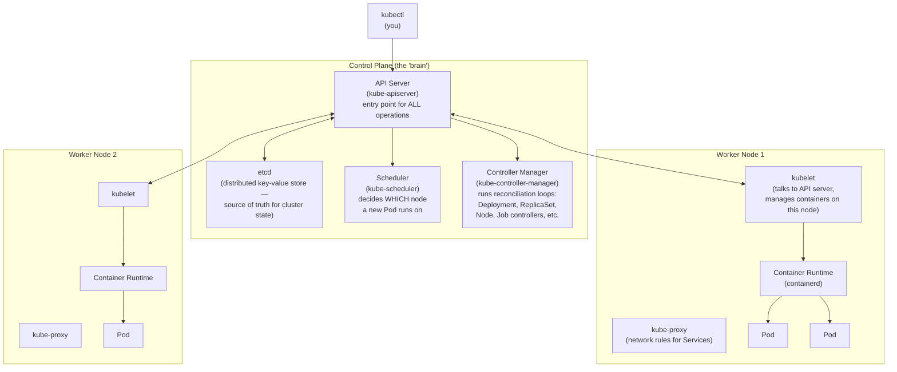
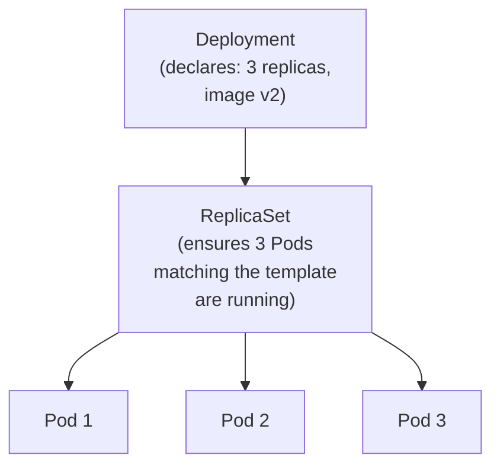
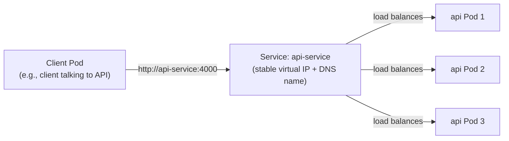
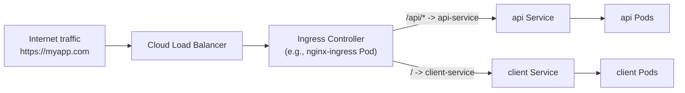
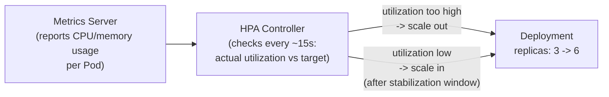
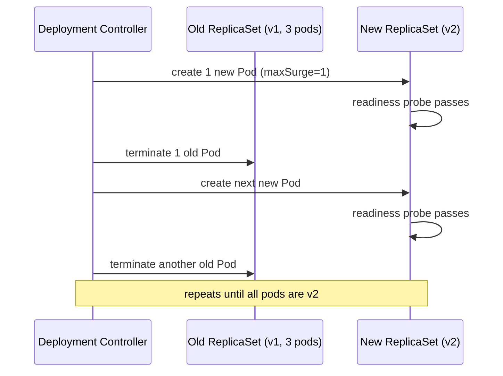

# 07 — Kubernetes for Senior Interviews

## Table of Contents
1. Kubernetes architecture
2. Core objects: Pods, Deployments, Services, Ingress
3. ConfigMaps and Secrets
4. Probes (liveness, readiness, startup)
5. Resource requests/limits and HPA
6. Rolling updates
7. Full manifests: deploying the MERN app on Kubernetes
8. Helm basics

---

## 1. Kubernetes Architecture



### The reconciliation loop (the single most important mental model in Kubernetes)

Kubernetes is **declarative**: you declare a **desired state** (e.g., "I want 3 replicas of this Pod running"), and controllers continuously compare desired state (stored in etcd) against **actual state** (what's really running), taking action to close any gap. You never imperatively tell Kubernetes "start a Pod" the way you'd run `docker run` — you describe the end state you want, and a controller loop drives reality toward it, forever, automatically healing deviations (a Pod crashes → the ReplicaSet controller notices actual=2 but desired=3, and schedules a replacement).

This is why `kubectl apply -f deployment.yaml` is idempotent — you're not issuing a command, you're updating the desired state, and the control plane handles converging actual state to match, whether that means creating, updating, or leaving things alone.

---

## 2. Core Objects

### Pod — the smallest deployable unit

A Pod is one or more containers that share the same network namespace (same IP, can talk via `localhost`) and storage volumes. In practice, **99% of Pods run exactly one application container**, sometimes plus a "sidecar" (a logging agent, a service mesh proxy like Envoy).

```yaml
# You will almost NEVER write a bare Pod manifest directly in production —
# Deployments manage Pods for you. Shown here purely to illustrate the concept.
apiVersion: v1
kind: Pod
metadata:
  name: api-pod-example
spec:
  containers:
    - name: api
      image: ghcr.io/myorg/mernapp/api:abc123
      ports:
        - containerPort: 4000
```

### Deployment — manages a set of identical Pod replicas, handles rollouts

A Deployment creates and manages a **ReplicaSet**, which in turn ensures the desired number of Pod replicas are running. Deployments add rolling-update and rollback behavior on top of a bare ReplicaSet.



### Service — stable network identity for a set of Pods

Pods are ephemeral (they get recreated with new IPs constantly). A **Service** provides a stable DNS name and virtual IP that load-balances traffic across whichever Pods currently match its label selector, regardless of Pod churn.



Service types:
- **ClusterIP** (default) — only reachable from inside the cluster. Used for internal service-to-service traffic (e.g., client Pods calling the api Service).
- **NodePort** — exposes the service on a static port on every node's IP. Rarely used directly in production; mostly a building block.
- **LoadBalancer** — provisions an external cloud load balancer (AWS ELB, GCP LB). Used for a small number of truly external entry points (often just the Ingress controller itself).
- **ExternalName** — maps a Service to an external DNS name (e.g., an external managed database), with no proxying.

### Ingress — HTTP(S) routing from outside the cluster to Services

An Ingress defines **host/path-based routing rules**; an **Ingress Controller** (nginx-ingress, Traefik, etc. — not built into Kubernetes core, must be installed separately) actually implements those rules, typically as a reverse proxy.



---

## 3. ConfigMaps and Secrets

**ConfigMaps** hold non-sensitive configuration as key-value pairs, injectable as environment variables or mounted files. **Secrets** hold sensitive data (passwords, tokens, keys) — structurally almost identical to ConfigMaps, but base64-encoded (NOT encrypted by default — this is a common misconception) and typically given tighter RBAC access and, in production clusters, encrypted at rest in etcd via a separately configured encryption provider, plus often integrated with an external secret manager (Vault, AWS Secrets Manager, Sealed Secrets) rather than raw plaintext-in-git.

**Critical interview point**: base64 encoding is **not encryption** — it's trivially reversible (`echo <value> | base64 -d`). Anyone with read access to the Secret object (or etcd) can decode it. True protection requires RBAC restricting who can `get`/`describe` Secrets, encryption-at-rest configured on the cluster, and ideally never committing raw Secret manifests to git (use Sealed Secrets, External Secrets Operator, or a vault integration instead).

---

## 4. Probes

| Probe | Question it answers | What happens on failure |
|---|---|---|
| **Liveness** | "Is this container still alive/functioning, or stuck?" | kubelet **kills and restarts** the container |
| **Readiness** | "Is this container ready to receive traffic right now?" | Pod is **removed from Service endpoints** (no traffic sent), but NOT restarted |
| **Startup** | "Has this container finished its (possibly slow) initial startup?" | Liveness/readiness probes are suppressed until startup succeeds, preventing a slow-starting app from being killed prematurely by an impatient liveness probe |

**The most common production mistake**: using the *same* check for liveness and readiness. A database connection blip should typically fail *readiness* (temporarily stop traffic, let it recover) — not *liveness* (which would kill and restart a perfectly healthy process just because a downstream dependency hiccuped, potentially causing a restart storm across all replicas simultaneously if the dependency outage is shared).

---

## 5. Resource Requests/Limits and HPA

- **Requests** — what the scheduler guarantees is reserved for this container when deciding which node to place it on. Also the baseline Kubernetes assumes the container needs.
- **Limits** — the hard ceiling. Exceeding a **memory** limit gets the container **OOMKilled** (terminated). Exceeding a **CPU** limit does **not** kill the container — it just gets throttled (CPU is a compressible resource; memory is not).

**HPA (Horizontal Pod Autoscaler)** automatically adjusts the number of replicas based on observed metrics (commonly CPU/memory utilization, or custom metrics like requests-per-second).



---

## 6. Rolling Updates

A Deployment's default `RollingUpdate` strategy replaces old Pods with new ones **incrementally**, controlled by `maxSurge` (how many extra Pods above `replicas` can exist during the rollout) and `maxUnavailable` (how many Pods can be unavailable during the rollout) — giving zero-downtime deploys when combined with correct readiness probes (a new Pod isn't sent traffic until its readiness probe passes, and an old Pod isn't terminated until a replacement is ready).



```bash
kubectl rollout status deployment/api-deployment -n production   # watch progress
kubectl rollout undo deployment/api-deployment -n production     # instant rollback to previous ReplicaSet
kubectl rollout history deployment/api-deployment -n production  # see revision history
```

---

## 7. Full Manifests — Deploying the MERN App on Kubernetes

All manifests below target a `mernapp` namespace and are meant to be applied together (`kubectl apply -f k8s/`). They are complete and internally consistent (label selectors, Service names, env references all match).

### Namespace

```yaml
# k8s/00-namespace.yaml
apiVersion: v1
kind: Namespace
metadata:
  name: mernapp
```

### ConfigMap (non-sensitive config)

```yaml
# k8s/01-configmap.yaml
apiVersion: v1
kind: ConfigMap
metadata:
  name: api-config
  namespace: mernapp
data:
  NODE_ENV: "production"
  PORT: "4000"
  CORS_ORIGIN: "https://myapp.com"
  LOG_LEVEL: "info"
  MONGO_URI: "mongodb://mongo-0.mongo-headless.mernapp.svc.cluster.local:27017,mongo-1.mongo-headless.mernapp.svc.cluster.local:27017,mongo-2.mongo-headless.mernapp.svc.cluster.local:27017/mernapp?replicaSet=rs0"
  REDIS_URL: "redis://redis-service:6379"
```

### Secret (sensitive config — base64-encoded, see note above about true protection)

```yaml
# k8s/02-secret.yaml
apiVersion: v1
kind: Secret
metadata:
  name: api-secrets
  namespace: mernapp
type: Opaque
# In real usage, generate these with:
#   kubectl create secret generic api-secrets --from-literal=ACCESS_TOKEN_SECRET=... -n mernapp
# rather than hand-writing base64 values into a file committed to git.
data:
  ACCESS_TOKEN_SECRET: cHJvZHVjdGlvbl9hY2Nlc3NfdG9rZW5fc2VjcmV0XzMyY2hhcnNtaW4=
  REFRESH_TOKEN_SECRET: cHJvZHVjdGlvbl9yZWZyZXNoX3Rva2VuX3NlY3JldF8zMmNoYXJz
  MONGO_ROOT_PASSWORD: cHJvZHVjdGlvbl9tb25nb19yb290X3Bhc3N3b3Jk
```

### MongoDB — StatefulSet (replica set, persistent storage, stable network identity)

MongoDB is deployed as a **StatefulSet**, not a Deployment, because each replica needs a **stable, unique network identity** (`mongo-0`, `mongo-1`, `mongo-2`) to form a replica set, and each needs its **own dedicated persistent volume** that follows it across rescheduling — properties a Deployment's interchangeable, identity-less Pods don't provide.

```yaml
# k8s/03-mongo-statefulset.yaml
apiVersion: v1
kind: Service
metadata:
  name: mongo-headless
  namespace: mernapp
spec:
  clusterIP: None # headless Service — gives each Pod a stable DNS record (mongo-0.mongo-headless...)
  selector:
    app: mongo
  ports:
    - port: 27017
      name: mongo
---
apiVersion: apps/v1
kind: StatefulSet
metadata:
  name: mongo
  namespace: mernapp
spec:
  serviceName: mongo-headless
  replicas: 3
  selector:
    matchLabels:
      app: mongo
  template:
    metadata:
      labels:
        app: mongo
    spec:
      containers:
        - name: mongo
          image: mongo:7
          command:
            - mongod
            - "--replSet=rs0"
            - "--bind_ip_all"
          ports:
            - containerPort: 27017
              name: mongo
          env:
            - name: MONGO_INITDB_ROOT_USERNAME
              value: root
            - name: MONGO_INITDB_ROOT_PASSWORD
              valueFrom:
                secretKeyRef:
                  name: api-secrets
                  key: MONGO_ROOT_PASSWORD
          resources:
            requests:
              cpu: "250m"
              memory: "512Mi"
            limits:
              cpu: "1000m"
              memory: "1Gi"
          volumeMounts:
            - name: mongo-data
              mountPath: /data/db
          livenessProbe:
            exec:
              command: ["mongosh", "--eval", "db.adminCommand('ping')"]
            initialDelaySeconds: 30
            periodSeconds: 20
          readinessProbe:
            exec:
              command: ["mongosh", "--eval", "db.adminCommand('ping')"]
            initialDelaySeconds: 10
            periodSeconds: 10
  volumeClaimTemplates:
    - metadata:
        name: mongo-data
      spec:
        accessModes: ["ReadWriteOnce"]
        resources:
          requests:
            storage: 10Gi
        # storageClassName: standard  # uncomment and set to your cluster's StorageClass if needed
```

> Note: after this StatefulSet's Pods are running, the replica set itself must be initialized once (`rs.initiate(...)` run against `mongo-0`, typically via a Kubernetes Job or an init script) — this is a one-time operational step, not something re-run on every deploy.

### Redis — Deployment + Service (single instance; stateless cache, acceptable to lose on restart)

```yaml
# k8s/04-redis.yaml
apiVersion: apps/v1
kind: Deployment
metadata:
  name: redis-deployment
  namespace: mernapp
spec:
  replicas: 1
  selector:
    matchLabels:
      app: redis
  template:
    metadata:
      labels:
        app: redis
    spec:
      containers:
        - name: redis
          image: redis:7-alpine
          ports:
            - containerPort: 6379
          resources:
            requests:
              cpu: "100m"
              memory: "128Mi"
            limits:
              cpu: "250m"
              memory: "256Mi"
          livenessProbe:
            tcpSocket:
              port: 6379
            initialDelaySeconds: 5
            periodSeconds: 10
          readinessProbe:
            exec:
              command: ["redis-cli", "ping"]
            initialDelaySeconds: 5
            periodSeconds: 5
---
apiVersion: v1
kind: Service
metadata:
  name: redis-service
  namespace: mernapp
spec:
  selector:
    app: redis
  ports:
    - port: 6379
      targetPort: 6379
```

### Node API — Deployment + Service

```yaml
# k8s/05-api-deployment.yaml
apiVersion: apps/v1
kind: Deployment
metadata:
  name: api-deployment
  namespace: mernapp
  labels:
    app: api
spec:
  replicas: 3
  revisionHistoryLimit: 5
  strategy:
    type: RollingUpdate
    rollingUpdate:
      maxSurge: 1
      maxUnavailable: 0 # never reduce available capacity during a rollout — zero-downtime
  selector:
    matchLabels:
      app: api
  template:
    metadata:
      labels:
        app: api
    spec:
      containers:
        - name: api
          image: ghcr.io/myorg/mernapp/api:latest # CI/CD pipeline overwrites this tag via kubectl set image
          ports:
            - containerPort: 4000
          envFrom:
            - configMapRef:
                name: api-config
          env:
            - name: ACCESS_TOKEN_SECRET
              valueFrom:
                secretKeyRef:
                  name: api-secrets
                  key: ACCESS_TOKEN_SECRET
            - name: REFRESH_TOKEN_SECRET
              valueFrom:
                secretKeyRef:
                  name: api-secrets
                  key: REFRESH_TOKEN_SECRET
          resources:
            requests:
              cpu: "200m"
              memory: "256Mi"
            limits:
              cpu: "500m"
              memory: "512Mi"
          startupProbe:
            httpGet:
              path: /health
              port: 4000
            failureThreshold: 30
            periodSeconds: 2 # allows up to 60s for a slow start before liveness takes over
          livenessProbe:
            httpGet:
              path: /health
              port: 4000
            initialDelaySeconds: 0
            periodSeconds: 15
            failureThreshold: 3
          readinessProbe:
            httpGet:
              path: /ready # checks DB/Redis connectivity — distinct from the shallow /health liveness check
              port: 4000
            initialDelaySeconds: 5
            periodSeconds: 10
            failureThreshold: 3
          securityContext:
            runAsNonRoot: true
            allowPrivilegeEscalation: false
            readOnlyRootFilesystem: true
            capabilities:
              drop: ["ALL"]
---
apiVersion: v1
kind: Service
metadata:
  name: api-service
  namespace: mernapp
spec:
  selector:
    app: api
  ports:
    - port: 4000
      targetPort: 4000
  type: ClusterIP
```

### React Client — Deployment + Service (static files via Nginx)

```yaml
# k8s/06-client-deployment.yaml
apiVersion: apps/v1
kind: Deployment
metadata:
  name: client-deployment
  namespace: mernapp
  labels:
    app: client
spec:
  replicas: 2
  strategy:
    type: RollingUpdate
    rollingUpdate:
      maxSurge: 1
      maxUnavailable: 0
  selector:
    matchLabels:
      app: client
  template:
    metadata:
      labels:
        app: client
    spec:
      containers:
        - name: client
          image: ghcr.io/myorg/mernapp/client:latest
          ports:
            - containerPort: 80
          resources:
            requests:
              cpu: "100m"
              memory: "128Mi"
            limits:
              cpu: "250m"
              memory: "256Mi"
          livenessProbe:
            httpGet:
              path: /
              port: 80
            periodSeconds: 20
          readinessProbe:
            httpGet:
              path: /
              port: 80
            periodSeconds: 10
---
apiVersion: v1
kind: Service
metadata:
  name: client-service
  namespace: mernapp
spec:
  selector:
    app: client
  ports:
    - port: 80
      targetPort: 80
  type: ClusterIP
```

### Ingress — routes external traffic to both Services

```yaml
# k8s/07-ingress.yaml
apiVersion: networking.k8s.io/v1
kind: Ingress
metadata:
  name: mernapp-ingress
  namespace: mernapp
  annotations:
    nginx.ingress.kubernetes.io/ssl-redirect: "true"
    nginx.ingress.kubernetes.io/rewrite-target: /$2
    cert-manager.io/cluster-issuer: letsencrypt-prod # if using cert-manager for automatic TLS
spec:
  ingressClassName: nginx
  tls:
    - hosts:
        - myapp.com
      secretName: myapp-tls-cert # populated automatically by cert-manager, or created manually
  rules:
    - host: myapp.com
      http:
        paths:
          - path: /api(/|$)(.*)
            pathType: ImplementationSpecific
            backend:
              service:
                name: api-service
                port:
                  number: 4000
          - path: /()(.*)
            pathType: ImplementationSpecific
            backend:
              service:
                name: client-service
                port:
                  number: 80
```

### HPA for the API

```yaml
# k8s/08-hpa.yaml
apiVersion: autoscaling/v2
kind: HorizontalPodAutoscaler
metadata:
  name: api-hpa
  namespace: mernapp
spec:
  scaleTargetRef:
    apiVersion: apps/v1
    kind: Deployment
    name: api-deployment
  minReplicas: 3
  maxReplicas: 10
  metrics:
    - type: Resource
      resource:
        name: cpu
        target:
          type: Utilization
          averageUtilization: 70 # scale out once average CPU exceeds 70% of requested CPU
    - type: Resource
      resource:
        name: memory
        target:
          type: Utilization
          averageUtilization: 80
  behavior:
    scaleDown:
      stabilizationWindowSeconds: 300 # wait 5 min of sustained low usage before scaling down
    scaleUp:
      stabilizationWindowSeconds: 0
      policies:
        - type: Pods
          value: 2
          periodSeconds: 60 # add at most 2 pods per minute, avoiding over-aggressive scale-out
```

### Applying everything

```bash
kubectl apply -f k8s/00-namespace.yaml
kubectl apply -f k8s/
kubectl get pods -n mernapp -w
```

---

## 8. Helm Basics

Helm is Kubernetes' package manager: it templates manifests (so you can parameterize image tags, replica counts, env values per environment) and manages them as a single named "release" that can be installed, upgraded, and rolled back as a unit.

### Minimal chart structure

```
mernapp-chart/
├── Chart.yaml
├── values.yaml              # default values
├── values-staging.yaml      # environment-specific overrides
├── values-production.yaml
└── templates/
    ├── api-deployment.yaml
    ├── api-service.yaml
    ├── client-deployment.yaml
    ├── client-service.yaml
    └── ingress.yaml
```

```yaml
# Chart.yaml
apiVersion: v2
name: mernapp
description: MERN stack application Helm chart
version: 1.0.0
appVersion: "1.0.0"
```

```yaml
# values.yaml
api:
  image: ghcr.io/myorg/mernapp/api
  tag: latest
  replicas: 3
  resources:
    requests: { cpu: 200m, memory: 256Mi }
    limits: { cpu: 500m, memory: 512Mi }

client:
  image: ghcr.io/myorg/mernapp/client
  tag: latest
  replicas: 2

ingress:
  host: myapp.com
```

```yaml
# templates/api-deployment.yaml — note the Go template syntax pulling from values.yaml
apiVersion: apps/v1
kind: Deployment
metadata:
  name: api-deployment
  namespace: {{ .Release.Namespace }}
spec:
  replicas: {{ .Values.api.replicas }}
  selector:
    matchLabels:
      app: api
  template:
    metadata:
      labels:
        app: api
    spec:
      containers:
        - name: api
          image: "{{ .Values.api.image }}:{{ .Values.api.tag }}"
          ports:
            - containerPort: 4000
          resources:
            {{- toYaml .Values.api.resources | nindent 12 }}
```

```bash
# Install for the first time
helm install mernapp ./mernapp-chart -f values-production.yaml -n mernapp --create-namespace

# Upgrade with a new image tag (typically how CI/CD deploys via Helm)
helm upgrade mernapp ./mernapp-chart -f values-production.yaml --set api.tag=abc123 -n mernapp

# Roll back to the previous release if the upgrade is bad
helm rollback mernapp -n mernapp

# See release history
helm history mernapp -n mernapp
```

**Why Helm over raw `kubectl apply -f`**: one `values.yaml` per environment eliminates duplicated YAML across dev/staging/production; `helm upgrade`/`helm rollback` treat an entire set of resources as one atomic, versioned release, rather than you manually tracking which raw manifest changes went out together; and templating lets you parameterize things (image tags, replica counts, resource limits) that would otherwise require hand-editing or complex `kustomize`/sed-based overlays.

---

## Practice Tasks

1. Apply the full manifest set above to a local cluster (minikube or kind). Confirm `kubectl get pods -n mernapp` shows 3 api Pods, 2 client Pods, 3 mongo Pods, and 1 redis Pod all `Running` and `Ready`.
2. Deliberately misconfigure the API's readiness probe to always fail, apply it, and observe (via `kubectl get endpoints api-service -n mernapp`) that the Service stops routing traffic to that Pod while `kubectl get pods` still shows it as `Running` (not restarted) — this demonstrates the liveness/readiness distinction concretely.
3. Trigger a rolling update by changing the API image tag, and watch `kubectl rollout status` and `kubectl get pods -w` simultaneously in two terminals to observe the surge/terminate sequence in real time.
4. Load-test the API (e.g., with `hey` or `ab`) to push CPU usage above 70%, and watch the HPA (`kubectl get hpa -n mernapp -w`) scale out additional replicas automatically.
5. Convert the raw manifests into a Helm chart with separate `values-staging.yaml`/`values-production.yaml`, and perform an `helm upgrade` followed by an intentional `helm rollback`.

## Interview Questions

1. **Explain the Kubernetes reconciliation loop model and why `kubectl apply` is idempotent.**
   Kubernetes operates declaratively: you submit a desired state (e.g., "3 replicas of this Pod spec") to the API server, which persists it in etcd. Controllers continuously run reconciliation loops comparing the stored desired state against the actual observed state of the cluster, taking whatever actions are needed to converge the two — creating missing Pods, removing extras, restarting failed ones. Because `kubectl apply` just updates the desired state record rather than issuing an imperative one-time command, applying the same manifest repeatedly produces the same end result regardless of the cluster's current state, which is what makes it idempotent and safe to re-run.

2. **What's the difference between a liveness probe and a readiness probe, and what's the risk of using the exact same check for both?**
   A liveness probe answers "is this container stuck/dead and needs to be killed and restarted?" — failing it causes a restart. A readiness probe answers "is this container currently able to serve traffic?" — failing it removes the Pod from Service endpoints (no traffic routed to it) without restarting it. Using the same check for both means a transient issue that should only pause traffic (like a brief downstream dependency hiccup) instead triggers container restarts across potentially all replicas simultaneously, which can turn a minor, recoverable blip into a cascading outage ("restart storm").

3. **Why is MongoDB deployed as a StatefulSet instead of a Deployment in Kubernetes?**
   A Deployment's Pods are interchangeable and identity-less — any replica can be replaced by a fresh one with a new name/IP, which is fine for stateless workloads like a Node API. MongoDB replica set members need a stable, predictable network identity (so they can find and address each other consistently, e.g. `mongo-0.mongo-headless...`) and each needs its own dedicated persistent volume that follows that specific ordinal Pod across rescheduling — both of which StatefulSet provides via stable Pod naming/ordering and per-replica `volumeClaimTemplates`, properties a Deployment doesn't offer.

4. **How does a rolling update achieve zero downtime, and what two settings control its behavior?**
   A rolling update incrementally replaces old Pods with new ones rather than tearing down everything at once: it creates new Pods (up to `maxSurge` above the desired replica count), waits for each to pass its readiness probe before routing traffic to it, and only then terminates a corresponding old Pod — repeating until all Pods are on the new version. `maxUnavailable` caps how many Pods can be down simultaneously during the rollout (setting it to 0 guarantees full capacity is maintained throughout), and `maxSurge` caps how many extra Pods above the desired count can exist temporarily — together they let you tune the tradeoff between rollout speed and resource headroom/safety.

5. **What's the difference between resource requests and limits, and what actually happens when a container exceeds each?**
   Requests are what the scheduler reserves and guarantees is available when deciding which node to place a Pod on; limits are hard ceilings on usage. Exceeding a memory limit gets the container OOMKilled and restarted, because memory is a non-compressible resource — the kernel can't just slow down memory usage. Exceeding a CPU limit does not kill the container; CPU is compressible, so the container is simply throttled (its CPU time is capped), running slower but continuing to run.

6. **Why is base64 encoding in a Kubernetes Secret not the same as encryption, and what do you need in addition to actually protect sensitive data?**
   Base64 is a reversible encoding scheme, not an encryption algorithm — anyone with read access to the Secret object (via `kubectl get secret -o yaml` or direct etcd access) can trivially decode the value with a single command; it provides no confidentiality on its own. True protection requires restricting RBAC so only necessary service accounts/users can read Secret objects, enabling encryption-at-rest for etcd at the cluster level, and ideally avoiding committing raw Secret manifests to version control by using a tool like Sealed Secrets, the External Secrets Operator, or a dedicated secret manager (Vault, AWS Secrets Manager) integration instead.

7. **What problem does Helm solve that raw `kubectl apply -f manifests/` doesn't, and what's the tradeoff?**
   Helm templates manifests so a single chart can be parameterized per environment (via separate `values.yaml` files) instead of maintaining near-duplicate raw YAML for dev/staging/production, and it tracks a full set of resources as one versioned, atomic "release" that can be upgraded or rolled back as a unit with `helm upgrade`/`helm rollback`, rather than you manually tracking which raw manifest edits were deployed together. The tradeoff is added complexity: templating syntax, chart dependency management, and another tool in the deployment pipeline to understand and debug when something goes wrong — for very small, single-environment projects, raw manifests (or a lighter tool like Kustomize) may be simpler to reason about.
