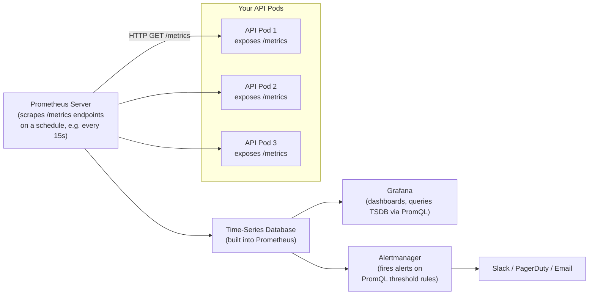
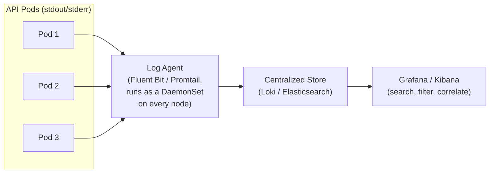
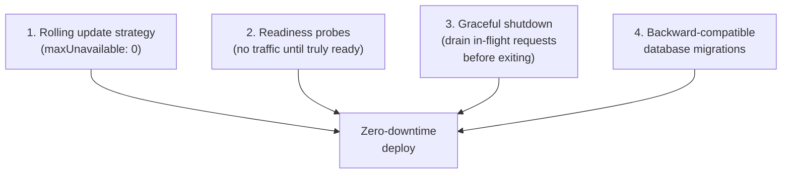
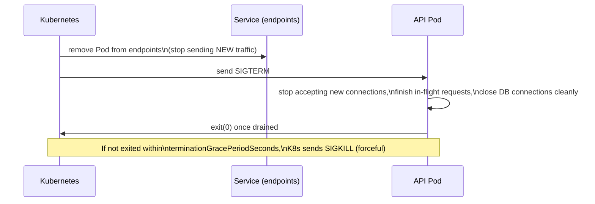

# 08 — Production Operations for Senior Interviews

## Table of Contents
1. Monitoring with Prometheus and Grafana
2. Logging strategy
3. Scaling strategies
4. Zero-downtime deploys
5. Debugging Pods in production
6. Cost basics

---

## 1. Monitoring with Prometheus and Grafana

### How Prometheus works: pull-based metrics



Unlike log aggregation (where apps push logs outward), Prometheus **pulls** — it scrapes an HTTP `/metrics` endpoint on each target at a regular interval. This is a deliberate design choice: it's easy to see which targets are up/down (a failed scrape is itself visible), and it decouples instrumentation from any particular shipping/transport mechanism.

### Instrumenting a Node/Express app

```js
// metrics.js
const client = require('prom-client');

const register = new client.Registry();
client.collectDefaultMetrics({ register }); // CPU, memory, event loop lag, GC stats, etc.

const httpRequestDuration = new client.Histogram({
  name: 'http_request_duration_seconds',
  help: 'Duration of HTTP requests in seconds',
  labelNames: ['method', 'route', 'status_code'],
  buckets: [0.01, 0.05, 0.1, 0.5, 1, 2, 5],
});
register.registerMetric(httpRequestDuration);

const httpRequestsTotal = new client.Counter({
  name: 'http_requests_total',
  help: 'Total number of HTTP requests',
  labelNames: ['method', 'route', 'status_code'],
});
register.registerMetric(httpRequestsTotal);

module.exports = { register, httpRequestDuration, httpRequestsTotal };
```

```js
// middleware/metricsMiddleware.js
const { httpRequestDuration, httpRequestsTotal } = require('../metrics');

function metricsMiddleware(req, res, next) {
  const start = process.hrtime.bigint();

  res.on('finish', () => {
    const durationSeconds = Number(process.hrtime.bigint() - start) / 1e9;
    const route = req.route?.path || req.path;
    const labels = { method: req.method, route, status_code: res.statusCode };

    httpRequestDuration.observe(labels, durationSeconds);
    httpRequestsTotal.inc(labels);
  });

  next();
}

module.exports = metricsMiddleware;
```

```js
// app.js
app.use(metricsMiddleware);

app.get('/metrics', async (req, res) => {
  res.set('Content-Type', register.contentType);
  res.end(await register.metrics());
});
```

### The four golden signals (know these cold for any monitoring question)

| Signal | What it measures | Example PromQL |
|---|---|---|
| **Latency** | How long requests take | `histogram_quantile(0.95, rate(http_request_duration_seconds_bucket[5m]))` — p95 latency |
| **Traffic** | Request volume | `sum(rate(http_requests_total[5m]))` — requests per second |
| **Errors** | Rate of failed requests | `sum(rate(http_requests_total{status_code=~"5.."}[5m])) / sum(rate(http_requests_total[5m]))` — error ratio |
| **Saturation** | How "full" the system is (CPU, memory, connection pool) | `sum(rate(container_cpu_usage_seconds_total[5m])) by (pod) / sum(kube_pod_container_resource_limits{resource="cpu"}) by (pod)` |

### Example Alertmanager rule

```yaml
# prometheus-rules.yaml
groups:
  - name: api-alerts
    rules:
      - alert: HighErrorRate
        expr: |
          sum(rate(http_requests_total{status_code=~"5..", app="api"}[5m]))
          / sum(rate(http_requests_total{app="api"}[5m])) > 0.05
        for: 5m
        labels:
          severity: critical
        annotations:
          summary: "API error rate above 5% for 5 minutes"

      - alert: HighP95Latency
        expr: |
          histogram_quantile(0.95, sum(rate(http_request_duration_seconds_bucket{app="api"}[5m])) by (le)) > 1
        for: 10m
        labels:
          severity: warning
        annotations:
          summary: "API p95 latency above 1s for 10 minutes"

      - alert: PodCrashLooping
        expr: increase(kube_pod_container_status_restarts_total{namespace="mernapp"}[15m]) > 3
        labels:
          severity: critical
        annotations:
          summary: "Pod {{ $labels.pod }} restarted more than 3 times in 15 minutes"
```

---

## 2. Logging Strategy

### Centralized logging architecture



**Golden rule**: containers should log to `stdout`/`stderr`, never to a file inside the container. Kubernetes and the container runtime already capture stdout/stderr automatically; a log agent (deployed as a DaemonSet, so one instance runs per node) tails these and forwards them to centralized storage. Writing to an internal file requires extra plumbing (sidecar containers, volume mounts) to get logs out at all, and the logs are lost the moment the Pod is deleted.

### Log levels — use them with intent

| Level | When to use |
|---|---|
| `error` | Something failed and needs attention — a caught exception, a failed external API call that couldn't be retried |
| `warn` | Something unexpected but recoverable — a retry succeeded after one failure, a deprecated API was called |
| `info` | Normal but noteworthy events — "server started," "user logged in," "order created" |
| `debug` | Detailed diagnostic info, usually disabled in production, enabled temporarily to investigate a specific issue |

### Correlating logs with traces across microservices (distributed tracing, high-level)

In a system with multiple services, a single user request can touch many services. A `requestId`/`traceId` generated at the edge (API gateway or Ingress) and propagated through every downstream call (as a header) lets you reconstruct the full request path across services in your log aggregator — this is the lightweight version of what dedicated distributed tracing tools (Jaeger, OpenTelemetry) do more rigorously with spans and timing data.

```js
// Propagate the trace ID to any downstream service call
async function callInventoryService(req, productId) {
  return fetch(`http://inventory-service/products/${productId}`, {
    headers: { 'x-trace-id': req.id }, // same ID used in this service's own logs
  });
}
```

---

## 3. Scaling Strategies

### Vertical vs Horizontal scaling

| | Vertical (scale up) | Horizontal (scale out) |
|---|---|---|
| What changes | More CPU/memory per Pod | More Pod replicas |
| Limit | Bounded by the biggest node available | Effectively unbounded (add more nodes) |
| Downtime to apply | Usually requires a Pod restart | None — new replicas add alongside existing ones |
| Kubernetes-native | `VerticalPodAutoscaler` (less mature, often used in recommend-only mode) | `HorizontalPodAutoscaler` (standard, well-established) |

**Senior-level default**: prefer horizontal scaling for stateless services (the Node API, the React static server) — it's more resilient (losing one of many replicas is a small blip) and has no hard ceiling. Vertical scaling remains relevant for stateful, hard-to-horizontally-scale components (a single-writer database primary), though MongoDB's own sharding (file 02) is itself a horizontal-scaling strategy at the database layer.

### Scaling the database layer vs the application layer

A very common senior-interview scenario: "Your API scales fine, but the database is the bottleneck." Application-layer horizontal scaling (more API Pods) does nothing if every one of those Pods ends up serializing writes through the same single MongoDB primary. The fixes live at the data layer: read replicas (route reads to secondaries, writes to primary — file 02's replication), caching (file 05's Redis cache-aside pattern) to avoid hitting the database at all for hot reads, and ultimately sharding if write throughput itself is the limit.

### Autoscaling based on custom metrics, not just CPU

CPU-based HPA is a blunt instrument — a Node.js API that's I/O-bound (waiting on database/network calls) might show low CPU usage even while queueing a large number of concurrent requests. A more accurate scaling signal is often **requests-per-second per Pod** or **queue depth**, via the Prometheus Adapter feeding custom metrics into HPA:

```yaml
# Simplified HPA using a custom metric (requires prometheus-adapter installed)
apiVersion: autoscaling/v2
kind: HorizontalPodAutoscaler
metadata:
  name: api-hpa-custom
  namespace: mernapp
spec:
  scaleTargetRef:
    apiVersion: apps/v1
    kind: Deployment
    name: api-deployment
  minReplicas: 3
  maxReplicas: 15
  metrics:
    - type: Pods
      pods:
        metric:
          name: http_requests_per_second
        target:
          type: AverageValue
          averageValue: "50" # scale out once average RPS per pod exceeds 50
```

---

## 4. Zero-Downtime Deploys

Zero-downtime deploys are the combined result of several pieces covered in earlier files, working together:



### Graceful shutdown — the piece most teams get wrong

When Kubernetes terminates a Pod (during a rolling update, a scale-down, or a node drain), it sends `SIGTERM`, then waits up to `terminationGracePeriodSeconds` (default 30s) before forcibly sending `SIGKILL`. If your app exits immediately on `SIGTERM` without finishing in-flight requests, those requests fail for the user even though nothing was technically "wrong."



```js
// server.js — graceful shutdown handling
const server = app.listen(PORT);

async function gracefulShutdown(signal) {
  logger.info(`Received ${signal}, starting graceful shutdown`);

  server.close(() => {
    logger.info('HTTP server closed, no longer accepting new connections');
  });

  // Give in-flight requests a bounded time to finish, then force-close remaining connections
  const forceExitTimer = setTimeout(() => {
    logger.error('Forcing shutdown after timeout — some requests may have been dropped');
    process.exit(1);
  }, 25_000); // stay under terminationGracePeriodSeconds (default 30s)

  await mongoose.connection.close();
  await redisClient.quit();

  clearTimeout(forceExitTimer);
  logger.info('Graceful shutdown complete');
  process.exit(0);
}

process.on('SIGTERM', () => gracefulShutdown('SIGTERM'));
process.on('SIGINT', () => gracefulShutdown('SIGINT'));
```

A corresponding `preStop` hook is good practice to add a small delay before SIGTERM is even sent, to account for the fact that removing a Pod from Service endpoints is not perfectly instantaneous across the cluster (some in-flight load balancer state may briefly still route to it):

```yaml
lifecycle:
  preStop:
    exec:
      command: ["sh", "-c", "sleep 5"]
```

### Backward-compatible database migrations

During a rolling update, **old and new versions of your code run simultaneously** for some period. If a schema migration happens to run at deploy time and the new code requires a field the old code doesn't know about (or the old code requires a field removed by the migration), you get errors from whichever version is still serving traffic against the incompatible shape. The safe pattern: deploy schema changes **additively and backward-compatibly** across multiple releases — add a new field (old code ignores it, new code uses it with a sensible default/fallback) in one release, only remove the old field in a *later* release once you're certain no running version depends on it.

---

## 5. Debugging Pods in Production

```bash
# See overall Pod status, restart counts, and age — the first command to run
kubectl get pods -n mernapp -o wide

# See WHY a Pod is in a bad state (events, scheduling failures, probe failures, OOMKills)
kubectl describe pod api-deployment-7d4f8c9b6-x2k9p -n mernapp

# Tail live logs
kubectl logs -f api-deployment-7d4f8c9b6-x2k9p -n mernapp

# Logs from the PREVIOUS container instance — essential after a crash/restart,
# since the crashed container's logs aren't in the current instance's log stream
kubectl logs api-deployment-7d4f8c9b6-x2k9p -n mernapp --previous

# Logs from all pods matching a label, tailed together
kubectl logs -f -l app=api -n mernapp --max-log-requests=10

# Open an interactive shell inside a running container for live inspection
kubectl exec -it api-deployment-7d4f8c9b6-x2k9p -n mernapp -- /bin/sh

# Check actual resource usage against requests/limits
kubectl top pods -n mernapp

# See resource allocation vs usage across a whole node (helps diagnose scheduling/eviction issues)
kubectl describe node <node-name>

# Port-forward to debug a service directly from your laptop, bypassing Ingress entirely
kubectl port-forward svc/api-service 4000:4000 -n mernapp
```

### Common failure signatures and what they mean

| Symptom (from `kubectl get pods`) | Likely cause | Where to look next |
|---|---|---|
| `CrashLoopBackOff` | The container starts, then exits/crashes repeatedly | `kubectl logs --previous` — almost always shows the actual error (uncaught exception, failed DB connection at startup, bad env var) |
| `ImagePullBackOff` | Kubernetes can't pull the specified image | `kubectl describe pod` — check image name/tag typos, registry auth (`imagePullSecrets`), or a tag that was never pushed |
| `Pending` (never scheduled) | No node has enough free resources, or a scheduling constraint isn't satisfiable | `kubectl describe pod` → `Events` section shows the scheduler's specific reason (insufficient CPU/memory, node selector mismatch, taints) |
| `OOMKilled` (visible in `describe pod` under Last State) | Container exceeded its memory limit | Check for a memory leak, or raise the memory limit if the workload genuinely needs more, informed by `kubectl top pods` history |
| Running but `0/1 Ready` | Readiness probe failing while the process itself is alive | `kubectl describe pod` to see probe failure details; check the readiness endpoint's actual dependency (DB/Redis connectivity) |

### Debugging a memory leak in production (a classic senior scenario question)

1. Confirm the trend: `kubectl top pods -n mernapp` sampled over time, or a Grafana panel of `container_memory_usage_bytes` per Pod — rule out a one-off spike vs a genuine steady climb.
2. Correlate with deploys: did memory usage start climbing right after a specific release? Check `kubectl rollout history` timestamps against the metrics graph.
3. Get a heap snapshot from a live Node process without killing it: `kubectl exec` in, then use `node --inspect` with port-forwarding, or trigger `process._getActiveHandles()`/`v8.getHeapSnapshot()` diagnostics, or attach Chrome DevTools remotely via port-forward.
4. Common root causes to check first: an unbounded in-memory cache/Map that's never evicted, event listeners added repeatedly without being removed (classic with WebSocket reconnects), or a large unbounded array accumulating (e.g., buffering all chunks of a stream instead of actually streaming them, from file 01).

---

## 6. Cost Basics

Cost is a real senior-interview topic — interviewers want to know you think about the bill, not just correctness.

| Lever | Impact |
|---|---|
| **Right-sizing requests/limits** | Over-requesting CPU/memory ("just to be safe") wastes money — the cluster autoscaler provisions nodes based on aggregate *requests*, not actual usage, so inflated requests directly inflate your node count/bill even if real utilization is low. Use `kubectl top` / Prometheus data to right-size based on observed p95 usage, not guesses. |
| **HPA min/max tuning** | A `minReplicas` set too high keeps idle capacity (and cost) running 24/7 for traffic that only shows up a few hours a day. A `maxReplicas` set too low risks throttling real traffic spikes — both directions have a cost/risk tradeoff to balance deliberately. |
| **Spot/preemptible nodes for non-critical workloads** | Significantly cheaper than on-demand, appropriate for fault-tolerant, stateless workloads (like the React static-file Pods) that can handle a Pod being evicted and rescheduled; NOT appropriate for the single-writer MongoDB primary. |
| **Cluster autoscaler (node-level)** | Scales the number of underlying VM nodes up/down based on whether Pods are Pending (need more capacity) or nodes are underutilized — complements HPA (which scales Pod count) by scaling the infrastructure Pods actually run on. |
| **Storage class choice** | Fast SSD-backed persistent volumes cost more than standard/HDD-backed ones — match the storage class to the actual I/O needs (a database's data volume genuinely needs fast storage; a rarely-read archive doesn't). |
| **Namespace/resource quotas** | In a multi-team cluster, `ResourceQuota` objects per namespace prevent one team's misconfigured Deployment (e.g., accidentally requesting 50 replicas) from silently consuming the entire cluster's budget. |
| **Egress/data transfer costs** | Often overlooked — cross-availability-zone traffic and traffic leaving the cloud provider's network both typically cost money; co-locating chatty services in the same zone and caching to reduce redundant calls (file 05) reduces this. |

### A senior-level framing for a cost question

"I'd start by right-sizing based on actual observed utilization rather than guesses, since over-provisioned requests are the single most common silent cost leak in Kubernetes — the cluster autoscaler reacts to requested capacity, not real usage. Then I'd tune HPA min/max to match real traffic patterns, use spot instances for stateless, interruption-tolerant workloads, and set resource quotas per namespace/team so cost ownership is visible and bounded, not just centrally absorbed."

---

## Practice Tasks

1. Instrument a small Express app with `prom-client` as shown, run Prometheus locally (via docker-compose) scraping it, and write a PromQL query computing p95 latency over a 5-minute window.
2. Write an Alertmanager rule for a 5% error-rate threshold, then deliberately make 20% of requests to a test endpoint return a 500 and confirm the alert fires in the Prometheus UI.
3. Implement the graceful shutdown handler in a real Express app, then run `kill -TERM <pid>` while a slow (artificially delayed) request is in flight, and confirm the request completes successfully before the process exits.
4. Deliberately deploy a version of your API with a 2-second artificial delay added to its readiness endpoint, trigger a rolling update, and watch (`kubectl get pods -w` alongside live curl requests to the Service) whether any requests fail during the rollout.
5. Intentionally cause a `CrashLoopBackOff` (e.g., throw an uncaught exception at startup based on a bad env var) and practice diagnosing it using only `kubectl describe pod` and `kubectl logs --previous`, without looking at the source code first.

## Interview Questions

1. **Why does Prometheus use a pull model (scraping `/metrics`) instead of apps pushing metrics to it?**
   Pulling lets Prometheus itself detect target health simply by whether a scrape succeeds or fails — a target that's down is immediately visible as a scrape failure, without needing separate heartbeat logic. It also decouples instrumentation from transport: an application just exposes a stable `/metrics` endpoint and doesn't need to know anything about where metrics are being shipped to, how many monitoring backends exist, or handle retry/backpressure logic for pushing data outward, which simplifies the application side considerably.

2. **What are the four golden signals, and why are they considered the minimum useful monitoring set for any service?**
   Latency (how long requests take), traffic (request volume), errors (rate of failures), and saturation (how close the system is to its resource limits). Together they answer the core questions an on-call engineer needs during an incident: is it slow, is it getting unusual load, is it actually failing, and is it about to run out of capacity — nearly every production issue manifests as a deviation in at least one of these four signals, making them a practical starting point before adding service-specific metrics.

3. **Explain what happens, step by step, when Kubernetes terminates a Pod during a rolling update, and why a naive app without graceful shutdown handling can drop requests even though "nothing was wrong."**
   Kubernetes first removes the Pod from the Service's endpoint list (to stop new traffic from being routed to it) and sends it a `SIGTERM` signal. If the application doesn't handle `SIGTERM`, the process may exit (or be killed by the runtime) before in-flight requests that were already accepted finish processing, dropping those requests for the user — not because anything failed, but purely due to termination timing. A graceful shutdown handler intercepts `SIGTERM`, stops accepting new connections, but allows existing in-flight requests to complete (within the bounded `terminationGracePeriodSeconds`) before the process actually exits, avoiding this class of dropped request entirely.

4. **A Pod shows `CrashLoopBackOff`. What's your diagnostic process?**
   First, `kubectl describe pod` to see the Events section and the pod's restart count/last state — this often immediately shows whether it's an OOMKill, a failed probe, or a plain application crash. Then `kubectl logs <pod> --previous` is essential, since the current (freshly restarted) container's log stream won't contain the error from the crash that just happened — the `--previous` flag retrieves logs from the prior, crashed container instance, which almost always shows the actual uncaught exception, missing environment variable, or failed startup dependency that caused the crash.

5. **Why can over-provisioned resource requests silently inflate your cloud bill even if actual CPU/memory usage is low?**
   The Kubernetes cluster autoscaler (and the scheduler more generally) makes node-provisioning decisions based on aggregate *requested* resources across all Pods, not actual real-time usage — if every Pod requests far more CPU/memory than it typically uses "just to be safe," the autoscaler will provision and pay for nodes sized to satisfy those inflated requests, even though the real utilization sitting on those nodes is low. The fix is to right-size requests based on observed p95/p99 usage data (from `kubectl top` or Prometheus) rather than guesses, periodically re-evaluating as traffic patterns change.

6. **How would you scale a system where the API layer is fine but the database has become the bottleneck?**
   Adding more API replicas does nothing if every replica ultimately serializes against the same overloaded database — the fix has to happen at the data layer. Specific levers include adding read replicas and routing read-heavy queries to secondaries while keeping writes on the primary, introducing a caching layer (Redis, cache-aside pattern) to absorb repeated hot reads before they ever reach the database, optimizing slow queries/missing indexes, and, if write throughput itself is the fundamental limit, sharding the dataset across multiple independent shards to parallelize write capacity.

7. **Why is CPU utilization alone often a misleading signal for autoscaling an I/O-bound Node.js API?**
   A Node.js API spending most of its time waiting on database queries or downstream network calls can show low CPU usage even while a large number of requests are queued and effectively starved for throughput, because CPU isn't actually the constrained resource in that scenario — concurrency/connection handling or downstream latency is. A more accurate autoscaling signal for such workloads is often a custom metric like requests-per-second per Pod or active request queue depth (fed into HPA via something like the Prometheus Adapter), which reflects actual load pressure rather than a resource dimension the workload isn't bottlenecked on.
