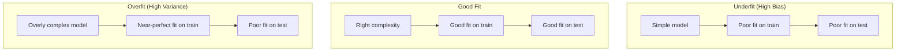
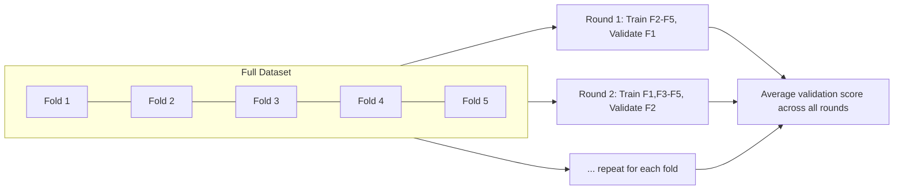

# 01. Machine Learning Fundamentals

This file covers the core ML concepts every senior engineer is expected to explain clearly
in an interview: the two big learning paradigms, the bias-variance tradeoff, regularization,
evaluation metrics, feature engineering, classic algorithms, and how to validate a model
correctly.

## 1. Supervised vs. Unsupervised Learning

**Supervised learning**: you have labeled data — inputs `X` paired with known outputs `y`.
The model learns a mapping `f(X) → y`. Two sub-types:

- **Regression**: predict a continuous number (house price, delivery time).
- **Classification**: predict a category (spam/not spam, churn/no churn).

**Unsupervised learning**: you only have `X`, no labels. The model finds structure on its
own. Common tasks:

- **Clustering**: group similar points together (customer segmentation).
- **Dimensionality reduction**: compress features while keeping the signal (PCA, t-SNE).
- **Anomaly detection**: find points that don't fit the pattern (fraud, defects).

There's a third category worth naming in interviews: **self-supervised learning**, where
labels are generated automatically from the data itself (e.g., "predict the next word" or
"predict the masked word"). This is exactly how LLMs are pretrained — covered in file 03.

**Reinforcement learning** is a fourth paradigm: an agent takes actions in an environment
and learns from reward signals rather than labeled examples. It's the foundation of RLHF,
covered in file 03 as well.

## 2. Bias-Variance Tradeoff

This is one of the most asked conceptual questions. Think of model error as having three
parts:

```
Total Error = Bias² + Variance + Irreducible Noise
```

- **Bias**: error from wrong assumptions in the model. A high-bias model is too simple and
  **underfits** — it misses real patterns in both training and test data.
- **Variance**: error from sensitivity to the specific training data. A high-variance model
  **overfits** — it memorizes training data noise and performs poorly on new data.
- **Irreducible noise**: randomness in the data that no model can remove.



**How to fix each:**
- High bias (underfitting): use a more complex model, add features, reduce regularization,
  train longer.
- High variance (overfitting): get more data, simplify the model, add regularization, use
  dropout/early stopping, use ensembling (bagging).

**Interview tip**: always connect this to the learning curve. If train error is high and
test error is close to train error → underfitting (high bias). If train error is low but
test error is much higher → overfitting (high variance).

## 3. Regularization

Regularization adds a penalty to the loss function to discourage overly complex models.

- **L1 (Lasso)**: adds `λ Σ|w_i|` to the loss. Pushes many weights exactly to zero →
  produces sparse models → acts as automatic feature selection.
- **L2 (Ridge)**: adds `λ Σ w_i²` to the loss. Shrinks weights smoothly toward zero but
  rarely to exactly zero → keeps all features but reduces their influence.
- **Elastic Net**: combines L1 and L2 — useful when you want some sparsity but also smooth
  shrinkage.
- **Dropout** (neural nets): randomly disables neurons during training, forcing the network
  not to rely too heavily on any single neuron. Covered more in file 02.
- **Early stopping**: stop training when validation loss stops improving, before the model
  starts memorizing the training set.

`λ` (the regularization strength) is itself a hyperparameter tuned via cross-validation —
too high and you underfit, too low and regularization does nothing.

## 4. Evaluation Metrics

### Classification metrics

Build these from the **confusion matrix**:

| | Predicted Positive | Predicted Negative |
|---|---|---|
| **Actual Positive** | True Positive (TP) | False Negative (FN) |
| **Actual Negative** | False Positive (FP) | True Negative (TN) |

- **Accuracy** = `(TP + TN) / (TP + TN + FP + FN)` — misleading on imbalanced data (e.g.,
  99% of transactions are not fraud, so a model predicting "never fraud" gets 99% accuracy
  while being useless).
- **Precision** = `TP / (TP + FP)` — of everything you flagged as positive, how much was
  actually positive? High precision = few false alarms. Matters when false positives are
  costly (e.g., flagging a legitimate transaction as fraud and blocking a customer).
- **Recall (Sensitivity)** = `TP / (TP + FN)` — of everything that was actually positive,
  how much did you catch? High recall = few misses. Matters when false negatives are costly
  (e.g., missing a cancer diagnosis).
- **F1 Score** = `2 × (Precision × Recall) / (Precision + Recall)` — harmonic mean, balances
  precision and recall into one number. Use when you need a single comparison metric and
  classes are imbalanced.
- **ROC-AUC**: Area under the Receiver Operating Characteristic curve, which plots True
  Positive Rate vs. False Positive Rate at every classification threshold. AUC = 1.0 is a
  perfect classifier, 0.5 is random guessing. Good for comparing models independent of a
  chosen threshold.
- **PR-AUC (Precision-Recall AUC)**: often more informative than ROC-AUC on heavily
  imbalanced data, because it focuses on the positive class only.

**Interview tip**: always ask "what's the cost of a false positive vs. a false negative?"
before picking a metric. Fraud detection usually favors recall (catch more fraud, accept
some false alarms); spam filters that could block important email favor precision.

### Regression metrics

- **MAE (Mean Absolute Error)**: average of `|predicted - actual|`. Easy to interpret, same
  units as the target, robust to outliers.
- **MSE (Mean Squared Error)**: average of `(predicted - actual)²`. Penalizes large errors
  much more than small ones because of the square — sensitive to outliers.
- **RMSE**: square root of MSE, brings units back to match the target — most commonly
  reported.
- **R² (coefficient of determination)**: proportion of variance in the target explained by
  the model. 1.0 is a perfect fit, 0 means the model is no better than predicting the mean.

## 5. Feature Engineering

The practical craft of turning raw data into inputs a model can learn from well.

- **Scaling/normalization**: many models (linear regression, k-means, neural nets, anything
  using distance or gradients) are sensitive to feature scale. Standardize (`(x - mean) /
  std`) or min-max normalize (`(x - min) / (max - min)`). Tree-based models (decision trees,
  random forest, gradient boosting) don't need this — they split on thresholds, not
  distances.
- **Encoding categorical variables**: one-hot encoding for low-cardinality categories,
  target/ordinal encoding or embeddings for high-cardinality categories (e.g., thousands of
  product IDs).
- **Handling missing values**: imputation (mean/median/mode), model-based imputation, or
  adding a "was missing" indicator flag so the model can learn from missingness itself.
- **Interaction features**: multiplying or combining two features when their combination
  carries signal (e.g., `price_per_sqft = price / sqft`).
- **Binning/discretization**: converting continuous variables into buckets when the
  relationship with the target is non-linear and interpretable buckets help.
- **Feature selection**: removing redundant or irrelevant features using correlation
  analysis, L1 regularization, or feature importance from tree-based models — reduces
  overfitting and speeds up training.

**Leakage warning**: never compute scaling statistics, target encodings, or imputation
values using the full dataset including test data. Fit these transformations only on the
training set, then apply them to validation/test — otherwise you leak information from the
future into the past, and your offline metrics will look better than real-world
performance.

## 6. Classic Algorithms

### Linear Regression
Predicts a continuous target as a weighted sum of features: `y = w₁x₁ + w₂x₂ + ... + b`.
Trained by minimizing MSE, typically with gradient descent or the closed-form normal
equation. Assumes a linear relationship between features and target.

### Logistic Regression
Despite the name, it's a classification algorithm. It applies the sigmoid function to a
linear combination of features to output a probability between 0 and 1:

```
p = 1 / (1 + e^(-(w·x + b)))
```

Trained by minimizing log loss (cross-entropy), not MSE. Simple, fast, interpretable (you
can read the weights as feature importance/log-odds), and a strong baseline for binary
classification.

### Decision Trees
Splits the feature space recursively using rules like "is age > 30?" to partition data into
purer and purer groups, measured by **Gini impurity** or **entropy/information gain**.
Easy to interpret, handles non-linear relationships and feature interactions naturally, but
prone to overfitting if grown too deep (control with `max_depth`, `min_samples_leaf`).

### Ensembles

- **Bagging (Random Forest)**: trains many decision trees on random subsets of data and
  features (bootstrap sampling), then averages their predictions. Reduces variance
  (overfitting) because errors from individual trees tend to cancel out.
- **Boosting (Gradient Boosting, XGBoost, LightGBM, CatBoost)**: trains trees sequentially,
  where each new tree focuses on correcting the errors (residuals) of the previous ones.
  Reduces bias, often achieves higher accuracy than bagging, but is more prone to
  overfitting and more sensitive to hyperparameters (learning rate, number of trees, tree
  depth).

| | Bagging (Random Forest) | Boosting (XGBoost/LightGBM) |
|---|---|---|
| Trees trained | In parallel, independently | Sequentially, each fixes prior errors |
| Main goal | Reduce variance | Reduce bias |
| Overfitting risk | Lower | Higher (needs tuning) |
| Training speed | Faster (parallelizable) | Slower (sequential) |
| Typical use | Quick strong baseline | Squeezing out max accuracy on tabular data |

### K-Means Clustering
Unsupervised algorithm that partitions data into `k` clusters by iterating:
1. Assign each point to the nearest cluster centroid.
2. Recompute each centroid as the mean of points assigned to it.
3. Repeat until centroids stop moving.

Requires choosing `k` upfront — use the **elbow method** (plot within-cluster sum of
squares vs. `k`, look for the bend) or the **silhouette score**. Sensitive to initial
centroid placement (use `k-means++` initialization) and to feature scale (always
standardize first).

## 7. Train/Validation/Test Split and Cross-Validation

- **Training set**: used to fit model parameters.
- **Validation set**: used to tune hyperparameters and select between models. The model
  never trains on this directly, but you do make decisions based on it, so it's not fully
  "unseen."
- **Test set**: touched only once, at the very end, to report final unbiased performance.
  If you tune anything based on test results, it stops being a fair test set.

A common split is 70/15/15 or 80/10/10, but with very large datasets even 98/1/1 can give
enough validation/test examples.

**K-Fold Cross-Validation**: instead of one fixed validation split, divide training data
into `k` folds. Train on `k-1` folds, validate on the remaining fold, repeat `k` times
rotating which fold is held out, then average the validation metric. This gives a more
robust estimate of model performance and reduces the risk that one lucky/unlucky split
skews your judgment. Common choice: `k = 5` or `k = 10`.

**Stratified K-Fold**: same idea, but preserves the class distribution in each fold —
essential for imbalanced classification problems.

**Time-series split**: never shuffle time-ordered data randomly into folds. Use a rolling
or expanding window where validation data always comes after training data in time,
otherwise you leak future information into the past.



## Practice Questions

**Q1: Your model has 99% accuracy on a fraud dataset where only 1% of transactions are
fraud. Should you be happy? Why or why not?**

A: No, not necessarily. With 99% of transactions being legitimate, a model that always
predicts "not fraud" also scores 99% accuracy while catching zero fraud. Accuracy is
misleading on imbalanced data. Check precision, recall, F1, and PR-AUC instead, and look
directly at the confusion matrix to see how many actual fraud cases were caught (recall)
and how many flagged transactions were real fraud (precision).

**Q2: You add more features to your model and training accuracy goes up, but validation
accuracy goes down. What's happening and what do you do?**

A: This is overfitting (high variance) — the model is learning noise specific to the
training set rather than generalizable patterns. Fixes: get more training data, remove
irrelevant/noisy features, add regularization (L1/L2), use a simpler model or fewer trees,
use dropout if it's a neural network, use cross-validation to pick hyperparameters more
robustly, or use early stopping.

**Q3: Explain the difference between L1 and L2 regularization, and when you'd pick each.**

A: L1 (Lasso) adds the sum of absolute weight values to the loss and drives many weights to
exactly zero, giving a sparse model that effectively does feature selection — useful when
you suspect many features are irrelevant and want an interpretable, compact model. L2
(Ridge) adds the sum of squared weights and shrinks all weights smoothly toward zero without
eliminating them — useful when most features carry some signal and you mainly want to
reduce their individual influence to control overfitting without losing any of them.

**Q4: Why can't you compute your feature scaling (e.g., StandardScaler mean/std) on the
entire dataset including the test set?**

A: That causes data leakage. The scaling statistics would incorporate information from the
test set, meaning your model indirectly "sees" the distribution of data it's supposed to be
evaluated on as unseen. This makes offline validation metrics overly optimistic and not
representative of real-world performance. Always `fit` transformations on the training set
only, then `transform` the validation/test sets using those same fitted statistics.

**Q5: When would you choose gradient boosting over random forest, and what's the tradeoff?**

A: Choose gradient boosting (e.g., XGBoost/LightGBM) when you need the highest possible
accuracy on structured/tabular data and are willing to invest time in tuning hyperparameters
(learning rate, tree depth, number of estimators, regularization) — boosting reduces bias by
sequentially correcting prior errors, often beating random forest on leaderboard-style
problems. Choose random forest when you want a strong, fast, low-maintenance baseline that's
more robust to overfitting out of the box and easier to parallelize, since its trees train
independently.

**Q6: What is the elbow method and what problem does it solve?**

A: It helps choose `k` in k-means clustering. You run k-means for a range of `k` values,
plot the within-cluster sum of squared distances (inertia) against `k`, and look for the
point where the curve's rate of improvement sharply flattens — the "elbow." Beyond that
point, adding more clusters gives diminishing returns and likely overfits to noise rather
than real structure.
