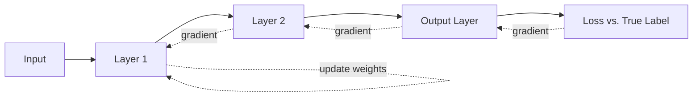
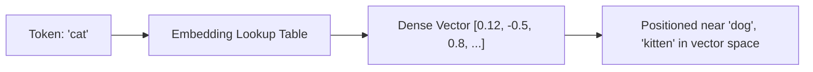

# 02. Deep Learning Fundamentals

This file builds on file 01 and covers neural networks — the engine behind every modern
generative AI system. You need this intuition before transformers make sense in file 03.

## 1. What a Neural Network Actually Is

A neural network is a stack of layers, each doing the same basic operation: take inputs,
multiply by learned weights, add a bias, then pass through a non-linear **activation
function**.

```
layer_output = activation(W · x + b)
```

Stack enough of these layers and the network can approximate extremely complex functions —
this is the **universal approximation theorem** in plain terms: a big enough network can
represent almost any function mapping inputs to outputs, given enough data and training.

- **Input layer**: the raw features (pixels, tokens, numbers).
- **Hidden layers**: intermediate representations the network learns on its own.
- **Output layer**: final prediction (a class probability, a number, a next-token
  distribution).

### Why non-linear activations matter

Without a non-linear activation, stacking linear layers collapses into a single linear
layer — you'd gain depth but zero extra expressive power. Common activations:

- **ReLU** `max(0, x)`: default for hidden layers, cheap to compute, avoids
  vanishing-gradient issues that older activations had. Downside: "dead neurons" if too many
  units output 0 permanently.
- **GELU/SiLU**: smoother variants of ReLU, now standard in transformer architectures (used
  in GPT, BERT, Llama-family models).
- **Sigmoid**: squashes to (0, 1), used for binary output probabilities, but saturates and
  causes vanishing gradients in deep networks — rarely used in hidden layers today.
- **Softmax**: converts a vector of raw scores ("logits") into a probability distribution
  that sums to 1. Used at the output layer for multi-class classification and for the
  next-token prediction in LLMs.

## 2. Backpropagation — The Intuition

Training a neural network means adjusting weights so the output gets closer to the correct
answer. Backpropagation is just the **chain rule from calculus** applied efficiently, layer
by layer, backward through the network.

1. **Forward pass**: push input through the network, get a prediction.
2. **Compute loss**: compare prediction to the true label using a loss function (MSE for
   regression, cross-entropy for classification).
3. **Backward pass**: compute how much each weight contributed to the error, starting from
   the output layer and working backward — each layer's gradient depends on the gradient of
   the layer after it (chain rule).
4. **Update weights**: nudge each weight in the direction that reduces the loss, scaled by
   the **learning rate**.



**Interview framing**: you don't need to derive the math live, but you should be able to
say — "backprop computes the gradient of the loss with respect to every weight using the
chain rule, propagating error signals backward from the output to the input, and then
gradient descent uses those gradients to update the weights."

### Vanishing / Exploding Gradients

In very deep networks, gradients can shrink toward zero (vanishing) or grow enormous
(exploding) as they're multiplied backward through many layers. Fixes: careful weight
initialization (Xavier/He init), batch/layer normalization, residual/skip connections (used
heavily in transformers — see file 03), gradient clipping, and activations like ReLU/GELU
that don't saturate as badly as sigmoid/tanh.

## 3. Optimizers

- **SGD (Stochastic Gradient Descent)**: update weights using the gradient from a small
  random batch of data rather than the full dataset — faster and adds helpful noise that
  can escape shallow local minima. Often combined with **momentum**, which smooths updates
  by factoring in the direction of previous steps.
- **Adam**: the default optimizer for most deep learning today. Combines momentum with
  per-parameter adaptive learning rates (using running averages of past gradients and
  squared gradients). Converges faster and is less sensitive to the initial learning rate
  choice than plain SGD.
- **AdamW**: Adam with properly decoupled weight decay — the standard optimizer for
  training transformers and LLMs.
- **Learning rate schedules**: warmup (start small, ramp up) followed by decay (cosine or
  linear) is standard practice for training large models — prevents early instability and
  helps convergence settle smoothly near the end of training.

## 4. Overfitting Remedies (Neural-Net-Specific)

Beyond the general regularization from file 01, neural nets have their own toolbox:

- **Dropout**: randomly zero out a fraction of neurons during each training step (e.g.,
  10-50%). Forces the network to not over-rely on any single neuron, which acts like
  training an ensemble of sub-networks. Disabled at inference time.
- **Batch Normalization**: normalizes layer activations within each mini-batch, stabilizing
  and speeding up training, and adding a mild regularizing effect.
- **Data augmentation**: artificially expand training data (image flips/crops/rotations;
  text paraphrasing/back-translation) so the model sees more variety without needing more
  labeled data.
- **Weight decay**: L2 regularization applied directly during the optimizer step.
- **Early stopping**: monitor validation loss, stop when it stops improving for a set number
  of epochs ("patience").

## 5. Convolutional Neural Networks (CNNs)

Originally built for images, CNNs exploit the fact that nearby pixels are related. Instead
of connecting every input to every neuron (like a plain feedforward network), a CNN slides
small learnable filters (kernels) across the image.

- **Convolution layer**: a filter (e.g., 3x3) slides across the image, computing a weighted
  sum at each position — this detects local patterns (edges, textures) and the same filter
  is reused across the whole image (**parameter sharing**), which drastically reduces the
  number of weights compared to a fully connected layer.
- **Pooling layer** (max/average pooling): downsamples the feature map, reducing spatial
  size and making the representation more robust to small shifts/distortions in the input.
- **Stacking layers**: early layers learn simple features (edges), deeper layers combine
  them into complex features (shapes, objects, faces).

CNNs are less central to interview questions now that transformers handle both vision and
text, but understanding "local receptive fields + parameter sharing + hierarchical feature
learning" is still a commonly asked concept.

## 6. RNNs and LSTMs

**Recurrent Neural Networks (RNNs)** process sequences one step at a time, carrying a
**hidden state** forward that's meant to summarize everything seen so far:

```
h_t = activation(W_x · x_t + W_h · h_(t-1) + b)
```

Problem: over long sequences, gradients during backprop-through-time tend to vanish,
meaning the network effectively "forgets" information from many steps earlier.

**LSTM (Long Short-Term Memory)** networks fix this with a **gating mechanism** — learned
gates that control what information to keep, forget, or output at each step:

- **Forget gate**: decides what to discard from the cell state.
- **Input gate**: decides what new information to add.
- **Output gate**: decides what to expose as the hidden state for this step.

This lets LSTMs retain useful information over much longer sequences than vanilla RNNs.
**GRUs (Gated Recurrent Units)** are a simplified, faster variant with fewer gates and
comparable performance.

**Why this matters today**: RNNs/LSTMs were the standard for sequence modeling (translation,
language modeling) before 2017. Transformers (file 03) replaced them almost entirely because
they process all sequence positions in parallel (instead of one step at a time) and handle
long-range dependencies better via attention. You should still know RNNs/LSTMs conceptually
— interviewers often ask "why did transformers replace RNNs?" and the answer is: **no
parallelism + poor long-range memory** were the core RNN weaknesses that attention solved.

## 7. Embeddings

An embedding is a **dense vector representation** of a discrete object (a word, a token, a
user ID, a product) learned so that similar objects end up close together in vector space.

- Instead of one-hot encoding a vocabulary of 50,000 words (a sparse 50,000-dimensional
  vector with a single 1), you learn a lookup table mapping each word to a dense vector of,
  say, 768 or 4096 numbers.
- Trained so that semantically similar items get similar vectors — classic example: the
  vector arithmetic `king - man + woman ≈ queen` emerges naturally from training on large
  text corpora (word2vec-style intuition).
- **In modern LLMs**: every token is converted to an embedding vector before entering the
  transformer, and these embeddings are learned jointly with the rest of the model during
  pretraining.
- **In RAG systems** (file 05): embeddings are the backbone of semantic search — text is
  converted to vectors, and similarity between vectors (cosine similarity) approximates
  similarity in meaning.



## Practice Questions

**Q1: Why do we need non-linear activation functions in a neural network?**

A: Without non-linearity, stacking any number of linear layers is mathematically equivalent
to a single linear layer — you gain no extra representational power from depth. Non-linear
activations (ReLU, GELU, etc.) let the network approximate complex, non-linear
relationships between inputs and outputs, which is what makes deep networks powerful.

**Q2: Explain backpropagation in one or two sentences, as you would in an interview.**

A: Backpropagation computes the gradient of the loss with respect to every weight in the
network by applying the chain rule backward from the output layer to the input layer. Those
gradients are then used by an optimizer (like SGD or Adam) to update the weights in the
direction that reduces the loss.

**Q3: What problem do LSTMs solve compared to vanilla RNNs?**

A: Vanilla RNNs struggle with long sequences because gradients vanish or explode during
backpropagation through time, causing the network to effectively forget distant
information. LSTMs introduce gating mechanisms (forget, input, output gates) that explicitly
control what information is kept or discarded in the cell state, allowing information to
persist over much longer sequences.

**Q4: What is dropout and why does it help prevent overfitting?**

A: Dropout randomly deactivates a fraction of neurons during each training step, so the
network can't become overly reliant on any specific neuron or co-adapted group of neurons.
This acts like implicitly training an ensemble of many smaller sub-networks and averaging
them, which improves generalization to unseen data. Dropout is disabled during inference.

**Q5: Why did transformers largely replace RNNs/LSTMs for sequence modeling?**

A: RNNs process sequences step-by-step, which is slow (can't parallelize across time steps)
and still struggles with very long-range dependencies despite LSTM gating. Transformers use
self-attention, which lets every position attend directly to every other position in a
single parallelizable computation, making training much faster on modern hardware (GPUs/
TPUs) and giving better handling of long-range dependencies.

**Q6: What's the difference between Adam and plain SGD, and why is Adam often the default
choice?**

A: Plain SGD updates weights using a single, often fixed learning rate applied uniformly,
optionally with momentum to smooth the direction of updates. Adam additionally adapts the
effective learning rate per parameter based on running averages of past gradients and
squared gradients, which makes it converge faster and be more forgiving of a
suboptimal learning rate choice. This is why Adam (or its improved variant AdamW) is the
default optimizer for training transformers and most deep learning models today, though
well-tuned SGD with momentum can sometimes generalize slightly better given enough tuning
budget.
