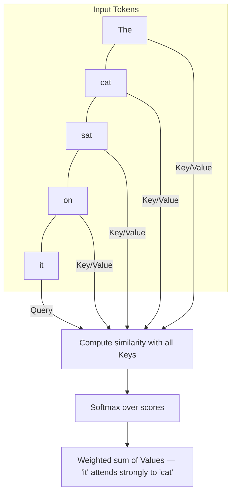
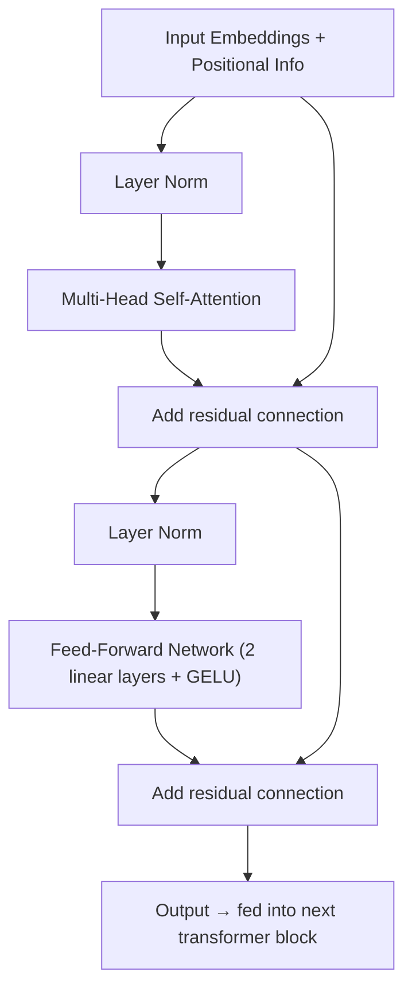
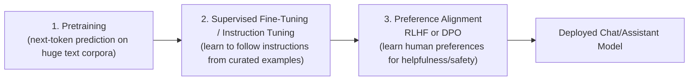
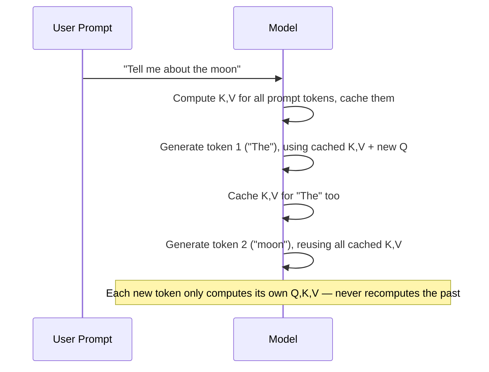
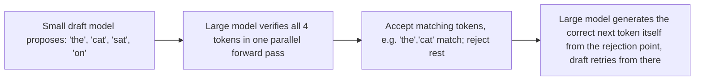

# 03. Transformers and Large Language Models

This is the most important file in the track. Transformers are the architecture behind
every modern LLM (GPT-family, Claude, Llama, Gemini, Mistral). Interviewers expect you to
explain attention clearly, know the training pipeline (pretrain → instruction tune →
RLHF/DPO), and speak confidently about inference-time concerns like context windows, KV
cache, and quantization.

## 1. Tokenization

Before any text reaches the model, it's broken into **tokens** — not quite words, not quite
characters. Most modern LLMs use **subword tokenization** (Byte-Pair Encoding or similar):

- Common words become a single token (`"the"` → 1 token).
- Rare/long words get split into pieces (`"unbelievable"` → `"un"`, `"believ"`, `"able"`).
- This handles any input text, including typos, new words, and multiple languages, without
  needing an infinite vocabulary.

Each token is mapped to an integer ID, then to a learned embedding vector (file 02, section
7). The model never "sees" raw text — only sequences of embedding vectors.

**Why this matters practically**: token count drives cost and context limits. "Tokens" are
the billing unit for API-based LLMs, and the context window is measured in tokens, not
words or characters. Roughly, 1 token ≈ 0.75 English words.

## 2. Self-Attention — The Core Mechanism

Self-attention lets every token in a sequence look at every other token and decide how much
to "pay attention" to it when building its own representation. This is what allows a
transformer to capture relationships regardless of distance — the word "it" in a long
sentence can attend directly back to the noun it refers to, 50 words earlier, in one step.

### The mechanism, step by step

For every token, the model computes three vectors by multiplying the token's embedding by
three learned weight matrices:

- **Query (Q)**: "what am I looking for?"
- **Key (K)**: "what do I contain / offer?"
- **Value (V)**: "what information do I pass along if selected?"

Attention score between any two tokens = how well one token's Query matches another
token's Key (via dot product). These scores are scaled, passed through softmax to become
weights that sum to 1, then used to compute a weighted sum of all tokens' Value vectors.

```
Attention(Q, K, V) = softmax( (Q · Kᵗ) / √d_k ) · V
```

- `Q · Kᵗ`: raw similarity scores between every pair of tokens.
- `√d_k` (square root of the key dimension): a scaling factor that keeps the dot products
  from growing too large and making softmax too "peaky" (which would hurt gradient flow).
- `softmax`: turns scores into a probability-like distribution over all tokens — "how much
  should I attend to each one?"
- Multiplying by `V`: produces the new representation of the token as a weighted blend of
  everyone's Value vectors, weighted by relevance.



### Multi-Head Attention

Instead of computing attention once, the model runs **multiple attention "heads" in
parallel**, each with its own learned Q/K/V projections. One head might learn to track
grammatical subject-verb relationships, another might track coreference ("it" → "cat"),
another might track local word order. The outputs of all heads are concatenated and
projected back to the model's dimension. This gives the model multiple independent "views"
of the relationships in the sequence.

### Self-Attention vs. Cross-Attention

- **Self-attention**: Q, K, V all come from the same sequence (used throughout decoder-only
  models like GPT).
- **Cross-attention**: Q comes from one sequence, K/V come from another (used in
  encoder-decoder models like the original Transformer for translation, and in some
  retrieval/vision-language architectures).

## 3. The Transformer Block

A full transformer layer combines attention with a feed-forward network, residual
connections, and normalization:



- **Residual connections** (the "Add" steps): the input to each sub-layer is added back to
  its output. This lets gradients flow directly through the network during backprop,
  enabling very deep stacks (dozens to over a hundred layers in large LLMs) without
  vanishing gradients.
- **Layer normalization**: stabilizes activations at each layer, improving training
  stability and speed. Modern LLMs typically use "pre-norm" (normalize before the
  sub-layer) rather than "post-norm" for better training stability at scale.
- **Feed-forward network (FFN)**: applied independently to each token position — typically
  expands the dimension (e.g., 4x), applies a non-linearity, then projects back down. This
  is where a large portion of the model's parameters and "knowledge storage" capacity live.
- A full model stacks many of these blocks (e.g., 32, 80, 120+ layers depending on model
  size).

### Positional Encoding

Attention by itself has no sense of word order — it treats the input as a set, not a
sequence. Positional information must be injected separately:

- **Absolute positional embeddings**: a learned or fixed vector added to each token's
  embedding based on its position (original Transformer and early GPT models).
- **RoPE (Rotary Positional Embeddings)**: rotates the Q/K vectors based on position in a
  way that naturally encodes relative distance between tokens. Used in most modern LLMs
  (Llama, Mistral, and many others) because it generalizes better to longer sequences than
  absolute embeddings.
- **ALiBi**: adds a distance-based penalty directly to attention scores, another approach
  for better long-context generalization.

### Encoder-only, Decoder-only, Encoder-Decoder

| Architecture | Examples | Attention pattern | Typical use |
|---|---|---|---|
| Encoder-only | BERT | Bidirectional (sees full context both directions) | Classification, embeddings, search |
| Decoder-only | GPT-family, Llama, Claude, Gemini (chat models) | Causal/masked (only sees past tokens) | Text generation, chat, code |
| Encoder-decoder | Original Transformer, T5 | Encoder bidirectional, decoder causal + cross-attention to encoder | Translation, summarization |

Almost all current general-purpose LLMs are **decoder-only**: they generate text one token
at a time, each new token only attending to itself and everything before it (**causal
masking** — future tokens are masked out during training so the model can't "cheat" by
peeking ahead).

### Mixture-of-Experts (MoE)

A scaling technique used in several modern large models: instead of every token passing
through the same dense feed-forward network, the model has many "expert" FFN sub-networks,
and a lightweight **router** selects only a few experts (e.g., 2 out of 8) to process each
token. This increases total parameter count massively while keeping the actual
compute-per-token roughly constant — you get a much larger "knowledge capacity" model at
similar inference cost to a smaller dense model. Tradeoff: more complex to train and serve
(load balancing across experts, more total memory needed even if compute per token is
cheaper).

## 4. Training Pipeline: Pretraining → Instruction Tuning → RLHF/DPO



### Stage 1: Pretraining

The model is trained on massive amounts of text (web pages, books, code) using a simple
self-supervised objective: **predict the next token** given all previous tokens. No human
labeling needed — the "label" is just the actual next word in the text. This is where the
model learns grammar, facts, reasoning patterns, and code structure. This stage is by far
the most computationally expensive (can cost many millions of dollars for frontier models).

The resulting **base model** is good at completing text but not naturally good at following
instructions or having a conversation — ask it a question and it might just continue the
question rather than answering it.

### Stage 2: Supervised Fine-Tuning (SFT) / Instruction Tuning

The base model is fine-tuned on a smaller, curated dataset of (instruction, ideal response)
pairs, often written or reviewed by humans. This teaches the model the "chat assistant"
behavior pattern: receive an instruction, produce a helpful, well-formatted answer. After
this stage the model is much more usable but still may not reliably prefer the *best*
possible answer among several reasonable ones.

### Stage 3: Preference Alignment — RLHF and DPO

This stage teaches the model to prefer responses that humans actually like — more helpful,
more honest, safer, better formatted.

**RLHF (Reinforcement Learning from Human Feedback)**:
1. Collect human preference data: show people multiple model responses to the same prompt,
   ask them to rank or pick the better one.
2. Train a **reward model** to predict which response a human would prefer, based on this
   ranked data.
3. Use reinforcement learning (commonly PPO — Proximal Policy Optimization) to fine-tune the
   LLM so it generates responses that score higher according to the reward model, while a
   KL-divergence penalty keeps it from drifting too far from the original SFT model (to
   avoid "reward hacking" / degenerate outputs).

**DPO (Direct Preference Optimization)**: a simpler, now widely used alternative. Instead
of training a separate reward model and running RL, DPO reformulates the preference
learning as a direct classification-style loss on the (chosen, rejected) response pairs,
optimizing the LLM directly to assign higher probability to preferred responses relative to
rejected ones. It's simpler to implement, more stable to train, and avoids the complexity
of full RL — which is why many recent model releases use DPO or DPO-variants (like KTO, IPO)
instead of full RLHF-with-PPO, sometimes in combination.

| | RLHF (PPO-based) | DPO |
|---|---|---|
| Needs separate reward model | Yes | No |
| Training stability | Harder (RL is finicky) | Easier, more stable |
| Implementation complexity | High | Lower |
| Typical use today | Still used, especially at frontier labs for fine control | Widely adopted as a simpler/cheaper alternative, especially in open-source model releases |

## 5. Scaling Laws

Research (notably from OpenAI and DeepMind, e.g. the "Chinchilla" scaling law work) found
predictable relationships between **model size**, **dataset size**, **compute budget**, and
resulting **loss/performance**. The key practical takeaways:

- Bigger models trained on more data with more compute reliably perform better — performance
  improvements from scale are smooth and fairly predictable in advance, not random.
- For a fixed compute budget, there's an optimal balance between model size and training
  data size — "Chinchilla-optimal" models found that many earlier large models were
  undertrained relative to their size (i.e., you often get more benefit from more training
  tokens than from just adding parameters).
- This is why modern frontier models are trained on increasingly massive, carefully curated
  datasets (trillions of tokens) rather than simply growing parameter count indefinitely.
- Scaling laws also motivate **MoE architectures** (section 3) as a way to add parameters
  (and knowledge capacity) without proportionally increasing per-token inference compute.

## 6. Context Windows and KV Cache

**Context window**: the maximum number of tokens (input + output combined) a model can
process in a single request. Modern frontier models range from 32K up to 1M+ tokens.
Longer context lets you stuff more documents, chat history, or code directly into the
prompt, but:
- Cost and latency scale with context length (attention is roughly O(n²) in sequence length
  for naive implementations, though optimized attention — e.g., FlashAttention — reduces the
  practical memory/speed cost significantly).
- Models can suffer from "lost in the middle" — information in the middle of a very long
  context sometimes gets less attention than information near the start or end.
- Long context is not a replacement for good retrieval (file 05) — even with huge context
  windows, retrieving only the relevant chunks is usually cheaper and often more accurate
  than stuffing everything in.

**KV Cache**: during autoregressive generation, the model generates one token at a time,
and each new token's attention needs the Key and Value vectors of all previous tokens.
Recomputing K/V for the entire sequence at every new token would be extremely wasteful.
Instead, the model **caches** the K/V vectors computed for each token the first time, and
reuses them for all future generation steps — only computing Q/K/V for the newest token each
time.



This dramatically speeds up generation (from O(n²) recomputation to O(n) incremental work per
new token) but costs GPU memory proportional to sequence length — KV cache memory usage is
often the real bottleneck limiting how many concurrent requests a server can handle, more
than raw compute.

## 7. Inference Optimization

### Quantization
Reduces the precision of model weights (and sometimes activations) from 32-bit or 16-bit
floating point down to 8-bit or even 4-bit integers. This shrinks memory footprint and speeds
up inference, with a small, usually acceptable, accuracy tradeoff. Common techniques: GPTQ,
AWQ, bitsandbytes (int8/int4), and GGUF-format quantized models for CPU/edge inference.
Essential for running large models on consumer hardware or for reducing serving cost at
scale.

### Speculative Decoding
A technique to speed up generation without changing output quality. A small, fast "draft"
model generates several candidate next tokens quickly; the large target model then verifies
all of them **in a single parallel pass** and accepts the ones that match what it would have
generated itself, rejecting the rest. Since verifying several tokens in parallel is nearly
as cheap as generating one token normally with the large model, this can give a meaningful
speedup (often 2-3x) with mathematically identical output distribution to not using
speculative decoding at all.



### Other serving optimizations
- **Continuous batching**: dynamically group multiple in-flight requests into the same GPU
  batch as they arrive and finish, instead of waiting for a fixed batch to fill — improves
  GPU utilization significantly for variable-length generation workloads (used by serving
  engines like vLLM — covered more in file 08).
- **PagedAttention**: manages KV cache memory in non-contiguous "pages" (similar to OS
  virtual memory paging), reducing memory fragmentation and letting a server handle more
  concurrent sequences with the same GPU memory.
- **Flash Attention**: a fused, memory-efficient implementation of the attention computation
  that avoids materializing the full attention score matrix in memory, giving large speedups
  and memory savings, especially for long sequences.

## Practice Questions

**Q1: Explain self-attention as you would to a non-ML engineer in an interview.**

A: Every word (token) in a sentence creates three things: a Query (what it's looking for), a
Key (what it offers), and a Value (the actual content it carries). To figure out how much
attention a word should pay to every other word, we compare its Query against every other
word's Key — a high match means "pay attention to this one." Those match scores are turned
into weights (via softmax) that sum to 1, and we use those weights to blend together the
Values of all words, giving each word an updated representation that incorporates relevant
context from anywhere else in the sentence, regardless of distance.

**Q2: Why do transformers scale the attention scores by `√d_k`?**

A: Without scaling, as the key dimension `d_k` grows, the dot products `Q · Kᵗ` tend to grow
large in magnitude, pushing the softmax into a very "peaky" regime where gradients become
extremely small (vanishing gradient-like problem inside attention). Dividing by `√d_k`
keeps the scores in a numerically stable range so softmax produces a smoother distribution
and gradients flow better during training.

**Q3: What's the difference between RLHF and DPO, and why have many recent models adopted
DPO?**

A: RLHF trains a separate reward model from human preference rankings, then uses
reinforcement learning (typically PPO) to optimize the LLM against that reward model, with a
KL penalty to prevent drifting too far from the base model. DPO skips the reward model and RL
loop entirely — it directly optimizes the LLM on (chosen, rejected) preference pairs using a
classification-style loss derived mathematically to have the same optimal solution as RLHF
under certain assumptions. DPO is simpler to implement, more stable to train (no finicky RL),
and cheaper, which is why many open releases now use DPO or DPO variants instead of or
alongside full RLHF.

**Q4: What is the KV cache and why does it matter for serving LLMs efficiently?**

A: During token-by-token generation, each new token's attention computation needs the Key
and Value vectors of every previous token. The KV cache stores these vectors as they're
computed so they never need to be recomputed, meaning each new token generation step only
computes Q/K/V for the single new token, not the whole sequence again. This is critical for
inference speed, but the cache grows with sequence length and batch size, and its memory
footprint is often the real limiting factor for how many concurrent users a server can
support — which is why techniques like PagedAttention exist to manage KV cache memory more
efficiently.

**Q5: What is Mixture-of-Experts and why would a model use it?**

A: MoE replaces a single dense feed-forward network per layer with multiple "expert"
sub-networks, where a router selects only a small subset (e.g., 2 of 8) of experts to process
each token. This lets the total model have a very large number of parameters — giving it
more knowledge capacity — while the actual compute used per token stays roughly similar to a
much smaller dense model, since only a few experts are active per token. The tradeoff is
added complexity in training (routing decisions, load balancing across experts) and higher
total memory requirements for serving, even though compute cost per token is reduced.

**Q6: A user complains that your LLM app is slow and expensive when they paste a 50-page
document into the prompt. What would you explain, and what alternative would you suggest?**

A: Context length directly drives both cost (billed per token) and latency (more tokens to
process and attend over, even with optimizations like FlashAttention, attention and KV cache
cost still scale with sequence length). A 50-page document likely contains far more context
than is relevant to the user's actual question, and very long contexts can also suffer from
"lost in the middle" effects where relevant details get less attention than they deserve. I'd
suggest a RAG approach instead (file 05): chunk and embed the document once, then at query
time retrieve only the most relevant chunks and pass those to the model — this is typically
cheaper, faster, and often more accurate than stuffing the entire document into context every
time.
