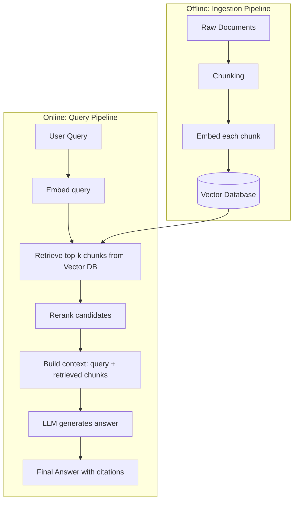
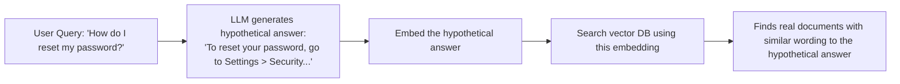
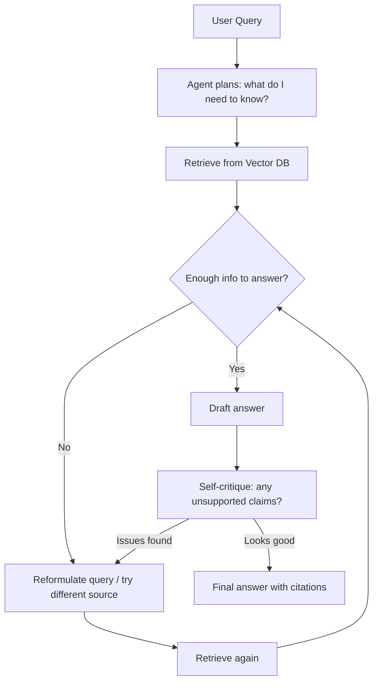

# 05. Retrieval-Augmented Generation (RAG)

RAG grounds an LLM's answers in your own data by retrieving relevant content at query time
and feeding it into the model's context, instead of relying only on what the model
memorized during pretraining. This file covers the full pipeline, advanced techniques, and
how to evaluate a RAG system — one of the most commonly asked design topics in GenAI
interviews.

## 1. Why RAG Exists

LLMs have three core limitations RAG addresses:

1. **Knowledge cutoff**: the model only knows what it saw during training, not your private
   documents or events after its cutoff date.
2. **Hallucination**: without grounding, models can generate plausible-sounding but
   incorrect facts.
3. **Cost of updating knowledge**: fine-tuning a model every time your data changes is slow
   and expensive; RAG lets you update a vector database instead, which is cheap and
   near-instant.

RAG doesn't change the model's weights — it changes **what the model sees in its context**
at inference time.

## 2. The Full RAG Pipeline



### Step 1: Chunking

Documents must be split into smaller pieces before embedding, because: embedding models
have input length limits, smaller chunks give more precise retrieval (you want to retrieve
the specific paragraph that answers the question, not an entire 50-page document), and
context budget is limited.

**Chunking strategies:**
- **Fixed-size chunking**: split every N tokens/characters, often with overlap (e.g., 500
  tokens with 50-token overlap). Simple, but can cut sentences or ideas in half.
- **Recursive/structure-aware chunking**: split along natural boundaries first (sections →
  paragraphs → sentences), falling back to fixed-size only when a unit is still too large.
  Generally better quality than naive fixed-size splitting.
- **Semantic chunking**: use embedding similarity between consecutive sentences to decide
  split points — split where meaning shifts, rather than at an arbitrary token count.
  More expensive to compute but produces more coherent chunks.
- **Document-aware chunking**: respect existing structure (markdown headers, HTML tags, code
  function boundaries) so chunks stay semantically complete (e.g., never split a function
  definition in half for a code RAG system).
- **Overlap**: a sliding window of overlap (e.g., 10-20% of chunk size) between consecutive
  chunks reduces the chance that an answer gets split exactly across a chunk boundary.

**Metadata enrichment**: attach metadata to each chunk (source document, section title,
page number, timestamp, author) — this enables filtering during retrieval (e.g., "only
search docs from the last 6 months") and lets you show citations back to the user.

### Step 2: Embeddings

Each chunk is converted into a dense vector using an embedding model. Semantically similar
chunks end up close together in vector space (measured by cosine similarity or dot product).

Practical considerations:
- Use the **same embedding model** for both ingestion and query time — vectors from
  different models are not comparable.
- Domain-specific embedding models (e.g., fine-tuned on legal or medical text) often
  outperform general-purpose ones for specialized domains.
- Embedding dimension affects storage cost and retrieval speed — higher dimensions capture
  more nuance but cost more to store and search.

### Step 3: Vector Databases

Store embeddings so you can efficiently find the nearest neighbors to a query vector among
potentially millions of chunks. Exact nearest-neighbor search doesn't scale, so vector
databases use **Approximate Nearest Neighbor (ANN)** algorithms (commonly HNSW — Hierarchical
Navigable Small World graphs) to trade a small amount of recall for massive speed gains.

| Vector DB | Type | Notable strengths |
|---|---|---|
| Pinecone | Managed cloud | Fully managed, easy to scale, good for production without infra overhead |
| Weaviate | Open-source / managed | Built-in hybrid search, GraphQL API, modular |
| Qdrant | Open-source / managed | Fast, rich filtering, good metadata support |
| Chroma | Open-source, embedded | Simple, great for prototyping and local dev |
| pgvector | Postgres extension | Reuse existing Postgres infra, good for teams already on Postgres, simpler ops |
| Milvus | Open-source | Built for very large scale, strong in enterprise deployments |

Choice drivers: existing infra (if you already run Postgres, pgvector avoids a new system),
expected scale, need for hybrid search out of the box, managed vs. self-hosted operational
preference, and metadata filtering capabilities.

### Step 4: Retrieval — Hybrid Search

Pure vector (semantic) search can miss exact keyword matches — e.g., a product SKU, an exact
name, or a rare technical term might not embed distinctly enough to rank top-1 purely by
semantic similarity. **Hybrid search** combines:

- **Dense retrieval** (vector similarity): good for semantic/conceptual matches, synonyms,
  paraphrasing.
- **Sparse retrieval** (keyword-based, e.g., BM25): good for exact term matches, rare words,
  acronyms, numbers.

Results from both are combined, commonly via **Reciprocal Rank Fusion (RRF)** or a weighted
score combination, to get a final ranked list that benefits from both strengths.

### Step 5: Reranking

The initial retrieval (vector + hybrid) typically pulls a larger candidate set (e.g.,
top-20-50) using fast but approximate methods. A **reranker** — usually a cross-encoder
model that jointly looks at the query and each candidate chunk together (rather than
comparing precomputed independent vectors) — then re-scores and reorders these candidates
much more precisely, and you keep only the top few (e.g., top-5) to pass to the LLM.

Why this two-stage approach: cross-encoders are far more accurate at judging true relevance
but too slow to run against the entire corpus (they can't be precomputed/indexed like
embeddings), so you use cheap retrieval to narrow the field, then expensive reranking to get
precision on the final shortlist.

### Step 6: Building Context and Generation

The final step assembles a prompt combining the user's query, the top reranked chunks
(with source metadata), and instructions (e.g., "answer only using the provided context; if
the answer isn't in the context, say you don't know; cite your sources"). The LLM then
generates the answer.

### Minimal Pseudocode for the Full Pipeline

```python
# --- Offline ingestion ---
def ingest(documents):
    for doc in documents:
        chunks = recursive_chunk(doc.text, chunk_size=500, overlap=50)
        for chunk in chunks:
            vector = embed_model.encode(chunk.text)
            vector_db.upsert(
                id=chunk.id,
                vector=vector,
                metadata={"source": doc.source, "section": chunk.section}
            )

# --- Online query ---
def answer_query(user_query, top_k=20, final_k=5):
    query_vector = embed_model.encode(user_query)

    dense_results = vector_db.search(query_vector, top_k=top_k)
    sparse_results = bm25_index.search(user_query, top_k=top_k)
    candidates = reciprocal_rank_fusion(dense_results, sparse_results)

    reranked = reranker_model.rerank(user_query, candidates, top_n=final_k)

    context = "\n\n".join(f"[{c.source}] {c.text}" for c in reranked)
    prompt = f"""Answer the question using ONLY the context below.
If the answer isn't in the context, say you don't know. Cite sources.

Context:
{context}

Question: {user_query}
Answer:"""

    return llm.generate(prompt)
```

## 3. Advanced RAG Techniques

### Query Rewriting / Query Expansion
Raw user queries are often short, ambiguous, or poorly phrased for retrieval (e.g., "what
about the refund thing?" after a long conversation). Before retrieval, an LLM call rewrites
the query into a clearer, more complete, standalone search query — incorporating
conversation history if needed. You can also generate multiple rewritten variants of the
same query and retrieve for each, merging results, to improve recall.

### HyDE (Hypothetical Document Embeddings)
Instead of embedding the user's (often short) question directly, you ask the LLM to first
generate a **hypothetical answer** to the question, then embed *that* hypothetical answer
and use it for retrieval. The intuition: a plausible answer is often more similar in
wording/style/vocabulary to the actual relevant documents than the original question is,
so this can improve retrieval especially when the question and documents use very different
phrasing.



### Graph RAG
Builds a knowledge graph from your documents (entities and their relationships) alongside
or instead of a flat vector index. Useful when questions require connecting multiple facts
across documents (multi-hop reasoning) — e.g., "which suppliers of Company A were also
investigated for violations in 2023?" — something pure semantic chunk retrieval struggles
with, because the answer requires traversing relationships, not just finding one similar
chunk. Retrieval becomes a mix of graph traversal (following entity relationships) plus
vector search over node/edge descriptions.

### Agentic RAG
Instead of a single fixed retrieve-then-generate pass, the LLM acts as an agent that can
**decide** to retrieve multiple times, reformulate its query based on what it finds,
retrieve from different sources/tools, and critique its own draft answer before finalizing
it. This handles complex, multi-step questions much better than single-shot RAG, at the
cost of more LLM calls (latency, cost) and more engineering complexity (loop control,
stopping conditions). This pattern connects directly to file 06 (agents) — agentic RAG is
essentially a RAG pipeline where retrieval is just one of several tools the agent can
choose to invoke, potentially repeatedly.



## 4. RAG Evaluation

Evaluating RAG means evaluating **two separate things**: retrieval quality and generation
quality — a system can retrieve well but generate poorly, or vice versa, so measure both.

### Retrieval metrics
- **Recall@k**: of all truly relevant chunks for a query, what fraction appear in the top-k
  retrieved results? Critical — if the right chunk never gets retrieved, the LLM cannot
  possibly give a correct, grounded answer no matter how good it is.
- **Precision@k**: of the top-k retrieved chunks, what fraction are actually relevant?
  Matters for reducing noise and token cost in the context sent to the LLM.
- **MRR (Mean Reciprocal Rank)**: rewards having the first relevant result ranked as high
  as possible — useful when you mainly care about the top result's position.

### Generation/answer metrics
- **Faithfulness (groundedness)**: does the generated answer only make claims that are
  actually supported by the retrieved context, or does it hallucinate beyond what was
  retrieved? Typically measured using an LLM-as-judge that checks each claim in the answer
  against the provided context (covered more in file 07).
- **Answer relevance**: does the answer actually address the user's question, regardless of
  faithfulness? (An answer can be perfectly faithful to irrelevant retrieved context and
  still fail to answer the question.)
- **Context relevance**: were the retrieved chunks actually relevant to the query, assessed
  independently of whether the final answer used them well?

Frameworks like **RAGAS** package these metrics (faithfulness, answer relevance, context
precision, context recall) into a standard evaluation harness you can run against a labeled
or synthetic test set — see file 07 for the broader evaluation harness discussion.

**Practical debugging tip**: when a RAG answer is wrong, always check retrieval first before
blaming the LLM. If the correct chunk wasn't in the retrieved set at all, no prompt
engineering or bigger model will fix it — fix chunking, embedding model choice, or hybrid
search/reranking instead.

## Practice Questions

**Q1: Your RAG system gives a wrong answer. How do you debug whether the problem is
retrieval or generation?**

A: First check whether the correct/relevant chunk was actually retrieved at all — inspect
the top-k results returned by the retriever for that query. If the relevant chunk is
missing from retrieval entirely, no amount of prompt tuning will fix it; you need to improve
chunking, try a different or domain-tuned embedding model, add hybrid search, or improve
reranking. If the relevant chunk was retrieved but the final answer still ignored it,
misread it, or hallucinated beyond it, that's a generation/faithfulness problem — improve
the prompt instructions (e.g., "answer only from context," require citations) or consider a
stronger model.

**Q2: Why use a two-stage retrieve-then-rerank pipeline instead of just reranking
everything directly?**

A: Cross-encoder rerankers are much more accurate because they jointly process the query and
each candidate together, but they can't be precomputed/indexed, so running them against an
entire corpus of millions of documents for every query would be far too slow. Fast
approximate retrieval (vector search, optionally combined with keyword/BM25 search) first
narrows millions of documents down to a small candidate set (e.g., top-20-50), and then the
more expensive, more accurate reranker reorders just that small set to get precision exactly
where it matters — the final few chunks actually sent to the LLM.

**Q3: What is HyDE and when would it help?**

A: HyDE (Hypothetical Document Embeddings) asks the LLM to first generate a plausible
hypothetical answer to the user's question, then embeds that hypothetical answer instead of
the raw question, and uses it to search the vector database. It helps when there's a
vocabulary/style mismatch between how users phrase questions and how the actual source
documents are written — a generated hypothetical answer tends to be phrased more like the
real documents, improving retrieval similarity. It adds one extra LLM call and works best
when the base model already has reasonable domain knowledge to generate a plausible
hypothetical answer.

**Q4: Explain the difference between faithfulness and answer relevance in RAG evaluation,
with an example of an answer that scores well on one but poorly on the other.**

A: Faithfulness measures whether every claim in the generated answer is actually supported
by the retrieved context (no hallucination beyond what was retrieved). Answer relevance
measures whether the answer actually addresses what the user asked, independent of
faithfulness. Example: if a user asks "What's your refund policy for electronics?" and the
retrieved context is actually about the shipping policy, a model could generate an answer
that's perfectly faithful to the (wrong) retrieved context — summarizing the shipping policy
accurately — while being completely irrelevant to the user's actual question about refunds.

**Q5: When would you reach for Graph RAG instead of standard vector-based RAG?**

A: Graph RAG helps when answering a question requires connecting multiple facts across
different documents through explicit relationships — multi-hop reasoning like "which
vendors used by Department X were also flagged in a 2023 audit?" Standard vector retrieval
finds chunks similar to the query, but struggles when the answer isn't contained in any
single chunk and instead requires traversing relationships between entities (vendors,
departments, audits) that live in different documents. Graph RAG builds an explicit
entity-relationship graph so the retrieval step can follow those connections directly,
rather than hoping semantic similarity alone surfaces the right combination of facts.

**Q6: What's the tradeoff of using agentic RAG instead of a single-pass retrieve-then-
generate pipeline?**

A: Agentic RAG lets the model iteratively decide to retrieve again, reformulate its query,
pull from different sources, or critique its own draft before finalizing — which handles
complex, multi-step, or ambiguous questions far better than a single fixed retrieval pass.
The tradeoff is cost and latency: multiple LLM calls and retrieval rounds per question
instead of one, plus added engineering complexity to control the loop (stopping conditions,
preventing infinite retrieval loops, handling cases where the agent still can't find a good
answer after several tries).
