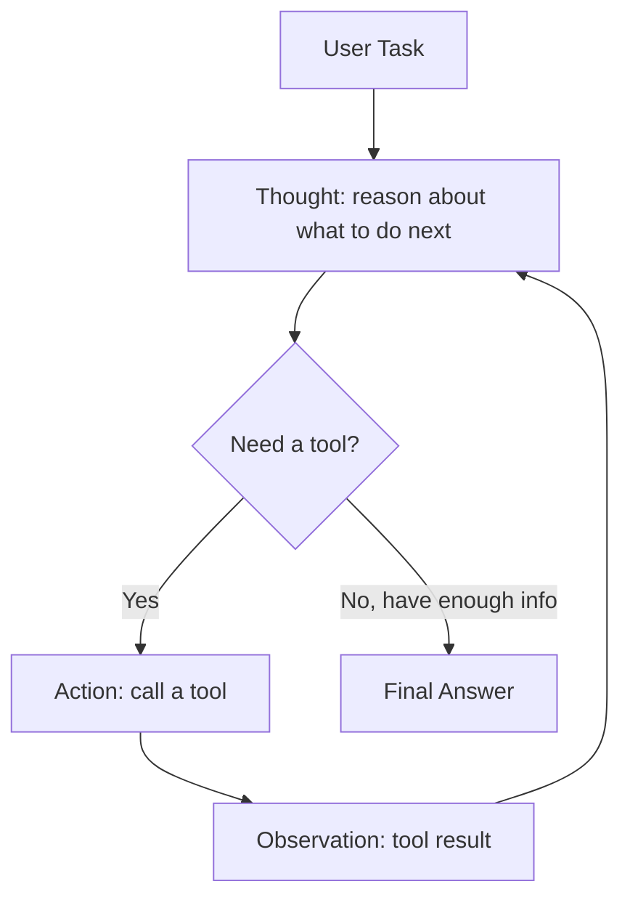
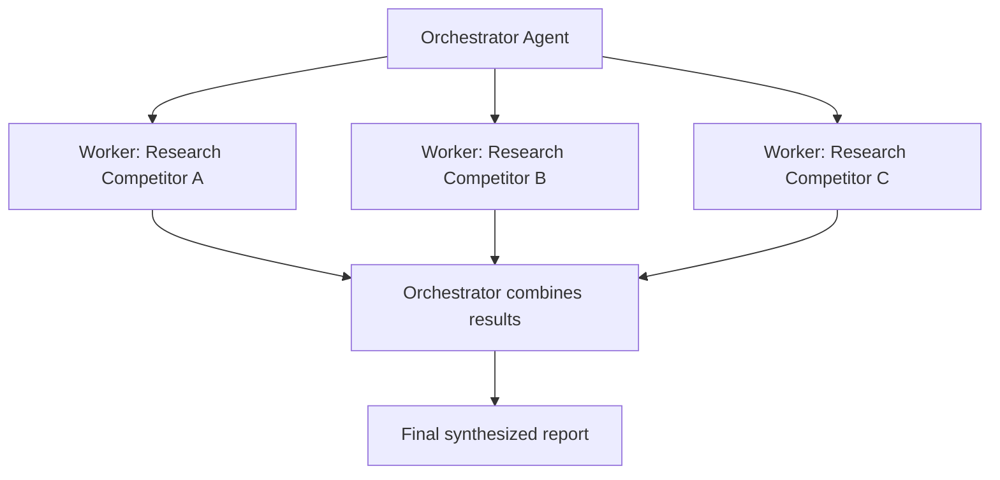
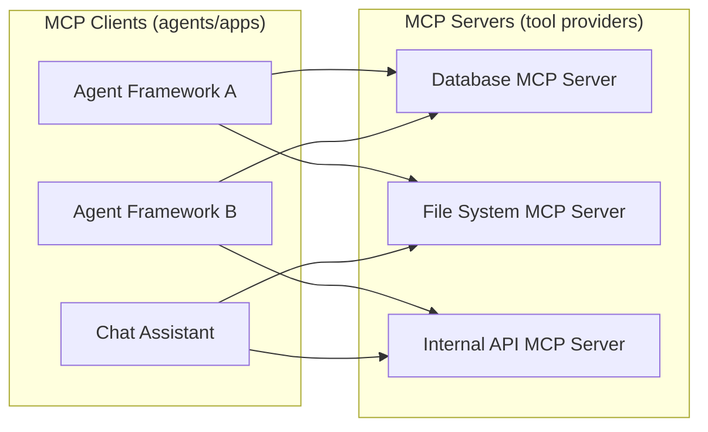

# 06. Agents and Tool Use

An "agent" is an LLM wrapped in a loop that can observe, decide, act (via tools), and
observe the result, repeating until the task is done. This file covers the core loop
pattern, memory, multi-agent designs, the Model Context Protocol (MCP), framework choices,
and the failure modes you must guard against.

## 1. The ReAct Loop

**ReAct (Reason + Act)** is the foundational pattern behind almost all LLM agents. Instead
of answering in one shot, the model alternates between reasoning about what to do next and
taking an action (usually a tool call), observing the result, and repeating.

```
Thought: I need to find the current price of AAPL stock.
Action: call_tool("get_stock_price", {"ticker": "AAPL"})
Observation: {"price": 178.32}
Thought: I have the price now, I can answer the user.
Final Answer: AAPL is currently trading at $178.32.
```



Why this works better than a single prompt: breaking the task into reasoning + discrete
actions lets the model gather real information (not just hallucinate it), correct course
based on actual observations, and handle multi-step tasks that can't be solved from
pretrained knowledge alone (e.g., "what's the weather right now" or "update this row in our
database").

**Stopping conditions**: every agent loop needs an explicit exit condition — a maximum
number of steps/iterations, a detected "final answer" signal, a timeout, or a budget limit
(tokens/cost). Without this, a confused agent can loop indefinitely, repeating failed tool
calls or never converging.

## 2. Planning

For complex, multi-step tasks, agents often benefit from an explicit **planning** step
before (or interleaved with) execution, rather than deciding one action at a time reactively.

- **Plan-and-execute**: the agent first produces a full multi-step plan ("1. Search for
  flights. 2. Search for hotels. 3. Compare total cost. 4. Book cheapest option."), then
  executes each step, potentially re-planning if a step fails or reveals new information.
  This tends to be more token-efficient and more coherent for long tasks than purely
  reactive ReAct, because the model isn't re-deriving the overall strategy at every step.
- **Reactive (pure ReAct)**: decide the next single action based only on the current state,
  without committing to a full plan upfront. More adaptable to unexpected observations, but
  can wander or lose the overall goal on long tasks.
- **Hybrid**: most production agent systems use a loose plan as a guide but allow
  replanning when actions don't go as expected — giving structure without being too rigid
  when reality doesn't match the plan.

## 3. Memory

Agents need memory beyond a single prompt to handle long conversations and tasks that span
many steps or sessions.

- **Short-term memory**: the current conversation/task context — the running sequence of
  thoughts, actions, and observations within the current session. This is just the LLM's
  context window; it disappears when the session ends unless explicitly saved.
- **Long-term memory**: information that persists across sessions — user preferences, facts
  learned in past interactions, completed task history. Typically implemented as an external
  store (often a vector database for semantic retrieval, or a structured database for exact
  facts) that the agent explicitly reads from and writes to, similar to RAG (file 05) but for
  the agent's own experience rather than static documents.
- **Working memory / scratchpad**: a space (often just part of the prompt) where the agent
  tracks intermediate state during a multi-step task — e.g., "step 3 of 5 complete, results
  so far: X, Y" — important for long tasks that would otherwise exceed context or lose track
  of progress.

**Practical pattern**: summarize or compress older parts of the conversation/task history
into a condensed form as it grows, rather than letting raw history consume the entire
context window — similar in spirit to context compression used in long chat sessions.

## 4. Multi-Agent Patterns

Splitting a task across multiple specialized agents instead of one generalist agent can
improve quality, parallelism, and maintainability — at the cost of coordination overhead.

### Orchestrator-Worker

A central **orchestrator** agent breaks a complex task into subtasks and dispatches each to
a specialized **worker** agent, then combines their results. Useful when a task naturally
decomposes into independent or loosely-coupled pieces (e.g., "research competitor pricing"
→ one worker per competitor, running in parallel).



### Debate / Critic-Actor

Two or more agents argue different perspectives, or one agent generates a solution while
another critiques it, iterating until they converge or a judge picks the best answer. Useful
for improving reasoning quality and catching errors on high-stakes tasks (e.g., code review:
one agent writes code, another actively tries to find bugs in it before it ships).

### Sequential Pipeline

Agents run in a fixed sequence, each handing its output to the next (e.g., Researcher →
Writer → Editor). Simple to reason about and debug, but less flexible than orchestrator
patterns when subtasks have complex dependencies.

**When to use multi-agent at all**: only when the task genuinely benefits from
specialization, parallelism, or adversarial checking. A single well-prompted agent with good
tools is simpler to build, debug, and reason about — multi-agent systems add real
coordination complexity (shared state, failure propagation, cost multiplication from
multiple LLM calls) and should be justified by a concrete benefit, not used by default.

## 5. Model Context Protocol (MCP)

MCP is an open standard for connecting LLM applications to external tools, data sources,
and systems in a consistent way — instead of every application writing custom,
provider-specific integration code for every tool.

- An **MCP server** exposes a set of capabilities (tools, resources, prompts) over a
  standard protocol.
- An **MCP client** (the agent/application) discovers and calls these capabilities using the
  same protocol regardless of which server it's talking to — a database MCP server, a file
  system MCP server, and a web search MCP server all look the same from the client's
  perspective.
- This decouples **tool implementation** from **agent framework** — you can write one MCP
  server for your internal API and use it from any MCP-compatible agent framework or
  assistant, without rewriting integration code for each one.



**Interview framing**: think of MCP as similar in spirit to how LSP (Language Server
Protocol) decoupled editors from language-specific tooling — before LSP, every editor needed
custom integration for every language; after LSP, any editor can talk to any language server
through one shared protocol. MCP aims to do the same for LLM-to-tool integration.

## 6. Agent Framework Comparison

| Framework | Core abstraction | Strengths | Best fit |
|---|---|---|---|
| **LangGraph** | Explicit state graph (nodes = steps, edges = transitions) | Fine-grained control over flow, good for complex conditional/cyclic workflows, strong debugging/visualization of graph state | Production systems needing precise control over agent logic and state transitions |
| **CrewAI** | "Crew" of role-based agents (e.g., Researcher, Writer) collaborating on a task | Quick to set up role-based multi-agent workflows, intuitive for task decomposition | Prototyping multi-agent collaboration with clear role separation |
| **OpenAI Agents SDK** | Lightweight agent + handoff + guardrail primitives | Simple core abstractions, built-in tracing, native integration with OpenAI's tool-calling and structured outputs | Teams wanting a minimal, provider-native agent framework without heavy abstraction |
| **AutoGen** | Conversational multi-agent (agents "chat" with each other) | Strong for research-style multi-agent conversation patterns, flexible agent-to-agent messaging | Experimentation with conversational agent societies, academic/research-style setups |

**Interview framing**: frameworks mostly differ in how explicit/rigid the control flow is.
LangGraph gives you the most control (good for production reliability) at the cost of more
upfront design. CrewAI and AutoGen optimize for fast multi-agent prototyping. There's no
universally "best" one — the right choice depends on how much control vs. speed-of-setup
you need, and whether your task is a tightly controlled business workflow or a more
open-ended collaborative task.

## 7. Failure Modes and Guardrails

Agents introduce new failure modes beyond a single LLM call, because they take real actions
and loop autonomously:

| Failure mode | Description | Guardrail |
|---|---|---|
| **Infinite/looping behavior** | Agent repeats the same failed action or oscillates between states without converging | Hard step/time/cost limits; detect repeated identical actions and force a different strategy or abort |
| **Tool misuse** | Agent calls a tool with wrong/malformed/dangerous arguments | Validate arguments against a schema before executing; sandbox destructive actions |
| **Hallucinated tool calls** | Agent invents a tool or argument that doesn't exist | Strict function-calling schemas; reject and retry on invalid calls rather than executing blindly |
| **Error cascades** | An early mistake (bad retrieval, wrong API result) compounds through later steps since the agent keeps reasoning on top of a wrong premise | Verification/self-critique steps; checkpoints where a human or a separate validator reviews intermediate state on high-stakes tasks |
| **Excessive cost/latency** | Long loops with many LLM + tool calls become slow and expensive, especially multi-agent setups | Budget limits (max tokens, max tool calls, max wall-clock time); prefer the simplest architecture that solves the task |
| **Over-privileged actions** | Agent has access to tools/scopes beyond what the task needs, risking damage from mistakes or injection (file 04, prompt injection) | Least-privilege tool access; human-in-the-loop approval for irreversible or sensitive actions (deletions, payments, sending external messages) |
| **Prompt injection via tool output** | A tool's returned data (web page, document, API response) contains adversarial instructions | Treat all tool output as untrusted data, not instructions (same defense-in-depth as file 04) |

**Human-in-the-loop** is the most reliable guardrail for high-stakes actions: let the agent
propose an action (e.g., "send this email," "execute this refund"), but require explicit
human approval before it actually executes, rather than fully autonomous execution for
anything irreversible or costly.

## Practice Questions

**Q1: Explain the ReAct loop and why it's more reliable than asking an LLM to answer a
multi-step question directly.**

A: ReAct alternates between the model reasoning about what to do next (Thought), taking an
action such as a tool call (Action), and observing the real result (Observation), repeating
until it has enough information for a final answer. This is more reliable than a single
direct answer because the model gathers actual, current information through tools rather
than relying purely on pretrained/potentially outdated knowledge, and it can adjust its
approach based on real observations rather than committing to a possibly wrong assumption
from the start.

**Q2: What's the difference between short-term and long-term memory in an agent system, and
how is long-term memory typically implemented?**

A: Short-term memory is the current session's context — the running thoughts, actions, and
observations within the active task, which exists only in the LLM's context window and
disappears when the session ends. Long-term memory persists across sessions — user
preferences, past facts, prior task outcomes — and is typically implemented with an external
store, often a vector database for semantic retrieval (similar to RAG) or a structured
database for exact facts, which the agent explicitly queries and writes to rather than
relying on the model's context alone.

**Q3: When would you use an orchestrator-worker multi-agent pattern instead of a single
agent, and what's the main cost of doing so?**

A: Use orchestrator-worker when a task naturally decomposes into independent or
loosely-coupled subtasks that can be handled by specialized workers, potentially in
parallel — e.g., researching several competitors simultaneously and combining results. The
main cost is coordination complexity and multiplied LLM calls/cost: you now need to manage
task decomposition, aggregate worker outputs, handle partial failures, and pay for multiple
agents' worth of LLM calls instead of one — so it should only be used when the
specialization/parallelism benefit clearly outweighs this overhead.

**Q4: What problem does the Model Context Protocol (MCP) solve?**

A: Without a shared standard, every LLM application needs custom integration code for every
external tool or data source it wants to use, and that integration code is often tied to a
specific provider or framework. MCP defines a standard protocol so that MCP servers (tool/
data providers) can be built once and used by any MCP-compatible client (agent framework or
assistant), decoupling tool implementation from agent framework — similar to how the
Language Server Protocol decoupled editors from language-specific tooling.

**Q5: An agent you built keeps calling the same failing tool over and over in a loop. What
guardrails would you add?**

A: Add a hard limit on the number of steps/tool calls and a timeout/cost budget so the loop
can't run indefinitely. Detect repeated identical (or near-identical) actions/arguments and
force the agent to either try a different strategy or abort with a clear failure message
instead of retrying blindly. Validate tool arguments and catch/surface tool errors clearly in
the observation so the agent has a real chance to adjust course, and as a last resort,
surface the failure to a human rather than looping silently.

**Q6: Why is human-in-the-loop approval still considered best practice for agents that can
take irreversible actions, even with good guardrails in place?**

A: Guardrails (schema validation, step limits, least-privilege tools) reduce risk but don't
eliminate it — an agent can still make a reasonable-looking but wrong decision due to a
hallucinated fact, a misread tool result, or a subtle prompt injection. For irreversible or
high-cost actions (sending money, deleting data, sending external communications), requiring
explicit human approval before execution provides a reliable final checkpoint that doesn't
depend on the model being correct 100% of the time, which is especially important given that
no current LLM guardrail technique offers a hard guarantee against all failure modes.
