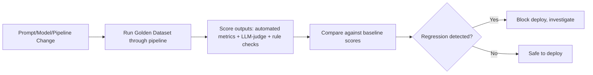
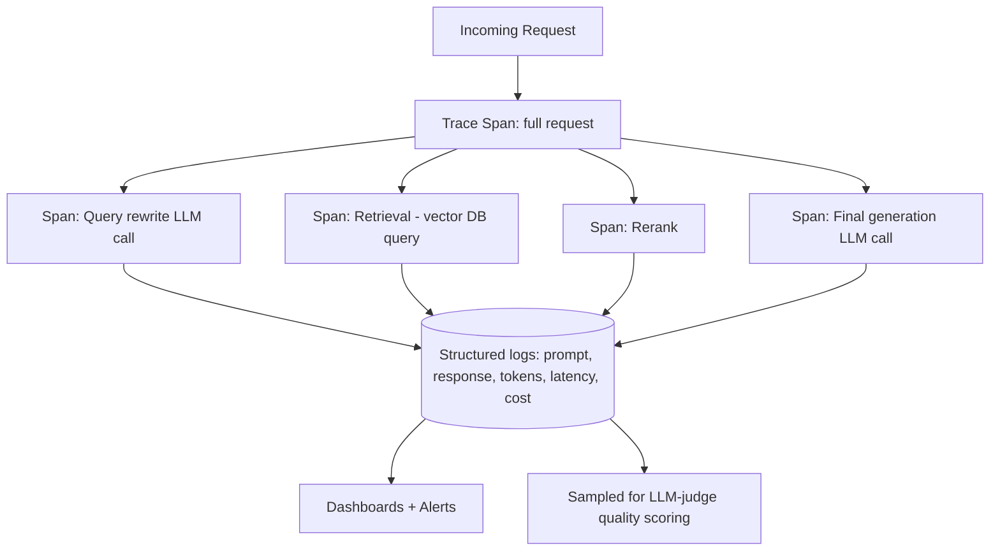

# 07. Evaluation and Harness for LLM Applications

Evaluating LLM applications is fundamentally harder than evaluating traditional ML models:
outputs are open-ended text, "correctness" is often subjective, and the same prompt can
produce different outputs on different runs. This file covers how production teams build
eval harnesses, measure quality, catch regressions, and defend against adversarial misuse.

## 1. Why Traditional ML Evaluation Isn't Enough

In classic ML (file 01), you compare a prediction against a single ground-truth label using
a fixed metric (accuracy, F1). LLM outputs are different:

- **Many valid answers**: there's often no single correct phrasing for "summarize this
  article" or "write a product description."
- **Non-determinism**: the same prompt can yield different outputs across calls (especially
  with non-zero temperature).
- **Multi-dimensional quality**: an answer can be factually correct but poorly formatted, or
  well-written but subtly wrong, or safe but unhelpfully evasive.

This is why LLM evaluation blends automated metrics, model-based judges, and human review,
rather than relying on one clean accuracy number.

## 2. LLM-as-Judge

A common and practical technique: use a strong LLM to **grade** another model's output
against a rubric, instead of (or alongside) human review.

```
You are evaluating an AI assistant's answer for correctness and helpfulness.

Question: {question}
Reference answer: {reference_answer}
Assistant's answer: {model_answer}

Score the assistant's answer from 1-5 on:
1. Factual accuracy relative to the reference answer
2. Completeness
3. Clarity

Return JSON: {"accuracy": int, "completeness": int, "clarity": int, "reasoning": string}
```

**Why this works reasonably well**: grading/comparing is often an easier task for an LLM
than generating the original answer — it's easier to recognize a good answer than to produce
one from scratch, similar to how it's easier to spot a bug in code than to write bug-free
code the first time.

**Known biases to control for**:
- **Position bias**: when comparing two answers side by side, judges tend to favor whichever
  is shown first. Fix: randomize order, or score answers independently rather than
  side-by-side when possible.
- **Verbosity bias**: judges (and humans) tend to rate longer answers as better even when
  they aren't. Fix: explicitly instruct the judge to penalize unnecessary verbosity, or
  control for length in your rubric.
- **Self-preference bias**: a model may rate its own outputs (or outputs from the same model
  family) more favorably. Fix: use a different, ideally stronger, model as the judge than the
  one being evaluated.

**Validate your judge**: before trusting an LLM-as-judge at scale, check its agreement rate
against a sample of human-labeled scores. If the judge disagrees with careful human raters
often, fix the rubric or prompt before relying on it for regression gating.

## 3. Golden Datasets and Regression Evals

A **golden dataset** is a curated, versioned set of representative test cases with expected
outputs or grading criteria — the eval equivalent of a unit test suite.

- Build it from real production examples (especially past failures/edge cases), not just
  synthetic made-up cases.
- Keep it versioned alongside your prompts/code so you can track exactly which dataset
  version was used for which eval run.
- Include **adversarial and edge cases** deliberately: ambiguous questions, out-of-scope
  requests, known tricky formatting cases, previously-found bugs.

**Regression evals**: run the current prompt/model/pipeline against the golden dataset
before every deploy, and compare scores against the previous baseline. This catches
"silent regressions" — e.g., a prompt tweak that fixes one case but breaks three others, or
a model upgrade that changes behavior in unexpected ways.



This is the same philosophy as CI/CD regression testing in traditional software — just with
fuzzier, partially model-graded assertions instead of exact equality checks.

## 4. Benchmarks

Public benchmarks are useful for comparing base model capability but have real limits for
evaluating your specific application.

- **General capability benchmarks**: broad academic/knowledge tests, coding benchmarks,
  reasoning benchmarks — useful for picking which base model to start with, but they measure
  general capability, not whether the model is good at *your* specific task or domain.
- **Domain-specific/custom benchmarks**: built from your own golden dataset — these are what
  actually matter for production decisions, since they reflect your real users' questions
  and your real success criteria.
- **Benchmark contamination risk**: public benchmarks can leak into training data of newer
  models, inflating scores without real capability gains — a reason to be skeptical of
  benchmark leaderboard numbers alone and to always validate with your own evals.

**Interview framing**: "we use public benchmarks to shortlist candidate models, but we never
ship based on benchmark scores alone — the final decision always comes from our own golden
dataset eval, since that's the only thing that reflects our actual use case."

## 5. A/B Testing

Offline evals (golden datasets, LLM-judge scores) are a proxy for real-world quality. **A/B
testing** validates the actual business impact by exposing a portion of real traffic to a
new prompt/model/pipeline version and comparing outcomes against the current version.

- Define a clear primary metric upfront (task completion rate, user satisfaction/thumbs-up
  rate, conversion rate, resolution rate for support tickets) — not just "vibes."
- Run with proper statistical rigor: adequate sample size, a defined test duration, and
  significance testing — don't ship based on a tiny sample or a few days of noisy data.
- **Guardrail metrics**: track metrics that should *not* get worse (e.g., latency, cost per
  request, safety violation rate) alongside the primary metric, so a win on the primary
  metric doesn't come with an unacceptable regression elsewhere.
- Offline evals and A/B tests serve different purposes: offline evals are fast, cheap,
  and good for catching regressions before deploy; A/B tests are slower and more expensive
  but measure real user impact, which is the metric that actually matters at the end of the
  day.

## 6. Observability and Tracing for LLM Apps

Production LLM systems need visibility into every step of a request — especially for
multi-step pipelines (RAG, agents) where a bad final answer could originate from any stage.

- **Tracing**: log every step of a request as a structured trace — the input, every
  retrieval call and its results, every tool call and its arguments/results, every LLM call
  with its full prompt and response, token counts, latency, and cost per step.
- **Why this matters for RAG/agents specifically**: when an agent produces a wrong answer
  after 5 tool calls, you need to see exactly which step went wrong (bad retrieval? wrong
  tool arguments? misread tool output? bad final reasoning?) — without full tracing, you're
  debugging blind.
- **Sampling and alerting**: log 100% of errors/failures, and a representative sample of
  successful requests for ongoing quality monitoring, with alerts on anomalies (latency
  spikes, cost spikes, error rate increases, sudden drop in judge scores for sampled live
  traffic).
- Common tooling categories: dedicated LLM observability platforms (tracing + eval
  integration), or general-purpose observability stacks (file 07's sibling topic in
  `monitoring-expert` skill territory) adapted with LLM-specific span types for prompts/
  completions/tool calls.



## 7. Red-Teaming

Red-teaming means deliberately trying to make your system fail or misbehave, before
attackers or unhappy users find the same gaps in production.

- **Adversarial prompt testing**: attempt jailbreaks, prompt injection (file 04), attempts to
  extract the system prompt or training data, attempts to get the model to produce harmful,
  biased, or policy-violating content.
- **Manual + automated red-teaming**: human red-teamers creatively probe for weaknesses;
  automated red-teaming uses another LLM to generate large volumes of adversarial test
  prompts at scale, which is cheaper and more exhaustive but may miss creative,
  human-specific attack strategies.
- **Scope for agentic systems**: also test for tool misuse (can the agent be tricked into
  calling a sensitive tool it shouldn't?), data exfiltration attempts, and over-permissioned
  action execution — not just bad text output.
- Findings feed back into system prompts, guardrail classifiers, tool permission scoping, and
  the golden dataset (add the discovered adversarial case as a permanent regression test).

## 8. Hallucination Measurement

Hallucination means the model states something confidently that isn't true or isn't
supported by the given context. Measuring it requires different approaches depending on the
situation:

- **Closed-book factual hallucination**: when the model answers from its own parametric
  knowledge (no provided context), check claims against a trusted knowledge source or
  reference answer — often via LLM-as-judge comparing claims to ground truth, or specialized
  fact-checking pipelines that decompose the answer into individual checkable claims.
- **Grounded/RAG hallucination (faithfulness)**: when the model is given context and should
  only use it, check whether every claim in the answer is actually supported by the provided
  context (see file 05's "faithfulness" metric) — this is more tractable than general factual
  checking because you have a fixed source of truth to check against.
- **Claim decomposition**: break a long answer into individual atomic claims, then verify
  each claim independently — gives a more granular and auditable hallucination score than
  judging the whole answer as one unit (e.g., "4 of 5 claims supported" vs. a vague overall
  "mostly accurate").
- **Calibration**: a related but distinct concern — does the model's expressed confidence
  match its actual accuracy? A model that says "I'm not sure, but..." before a wrong answer is
  better calibrated (and more trustworthy) than one that states wrong facts with full
  confidence.

**Practical mitigation** (not just measurement): grounding answers in retrieved context
(RAG), instructing the model to say "I don't know" when context is insufficient, requiring
citations so claims are auditable, and using a verification/self-critique pass before
finalizing an answer (as seen in agentic RAG, file 05) — all reduce hallucination rate, even
though no current technique eliminates it completely.

## Practice Questions

**Q1: Why can't you evaluate an LLM application the same way you'd evaluate a classic ML
classifier?**

A: Classic ML evaluation compares predictions against a single ground-truth label using a
fixed deterministic metric like accuracy or F1. LLM outputs are open-ended text where many
different phrasings can be equally valid, the same prompt can produce different outputs due
to sampling randomness, and quality has multiple independent dimensions (factual accuracy,
helpfulness, formatting, safety) that a single number can't capture. This is why LLM
evaluation combines automated rule-based checks, LLM-as-judge scoring, and human review
rather than one clean accuracy metric.

**Q2: What biases should you watch for when using an LLM as a judge, and how do you
mitigate them?**

A: Position bias (favoring whichever answer is shown first in a side-by-side comparison) is
mitigated by randomizing order or scoring answers independently rather than comparatively.
Verbosity bias (rating longer answers as better regardless of actual quality) is mitigated by
explicitly instructing the judge to penalize unnecessary length in the rubric. Self-preference
bias (a model favoring outputs from its own family) is mitigated by using a different,
ideally stronger, model as the judge than the one being evaluated. You should also validate
the judge's agreement rate against human-labeled scores before trusting it at scale.

**Q3: What's a golden dataset, and why should it include real production failure cases
rather than only synthetic examples?**

A: A golden dataset is a curated, versioned set of representative test cases with expected
outputs or grading criteria, used to catch regressions before every deploy — the LLM-app
equivalent of a unit test suite. Including real production failures matters because
synthetic examples you invent tend to reflect the cases you already thought of, while real
failures reveal the actual edge cases and failure modes your system encounters in practice;
adding each discovered failure as a permanent golden-dataset entry prevents the same bug from
silently reappearing after a future change.

**Q4: Why do you need both offline evals (golden dataset scoring) and online A/B testing —
isn't one enough?**

A: Offline evals are fast and cheap and catch regressions before deploy, but they're a proxy
for quality based on a fixed dataset and possibly automated/LLM-judge scoring, which may not
perfectly reflect real user satisfaction or business outcomes. A/B testing measures actual
impact on real traffic against a real business metric (task completion, satisfaction,
conversion), which is what ultimately matters, but it's slower, more expensive, and only
available post-deploy to a subset of traffic. Using both gives fast pre-deploy regression
protection plus a reliable real-world validation signal before a full rollout.

**Q5: You're debugging a RAG agent that gave a wrong answer after five tool calls. What
does good observability/tracing let you do that you couldn't do otherwise?**

A: Full tracing logs every step of the request as a structured span — each retrieval call
and its results, each tool call with its arguments and results, each LLM call with its full
prompt and response, along with latency/cost/tokens per step. This lets you pinpoint exactly
which step introduced the error (e.g., retrieval returned the wrong chunk, a tool was called
with wrong arguments, the model misread a tool's output, or the final reasoning step itself
was faulty) instead of only seeing the final wrong answer and having to guess which of the
five steps caused it.

**Q6: What's the difference between measuring hallucination in a RAG/grounded setting
versus a closed-book setting, and why is the RAG case more tractable?**

A: In a grounded/RAG setting, the model is given specific context and should only use it, so
hallucination measurement (faithfulness) just requires checking whether each claim in the
answer is supported by that fixed, available context — a well-defined, auditable check. In a
closed-book setting, the model answers from its own internal/parametric knowledge with no
provided source, so checking hallucination requires comparing claims against external
ground truth or trusted knowledge sources, which is a harder, more open-ended fact-checking
problem since there's no single fixed document to check against.
