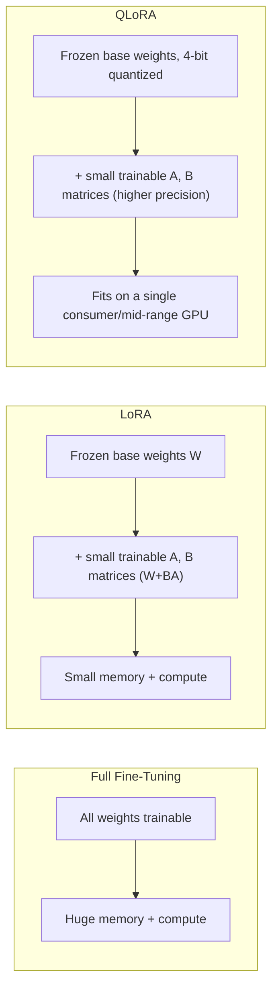
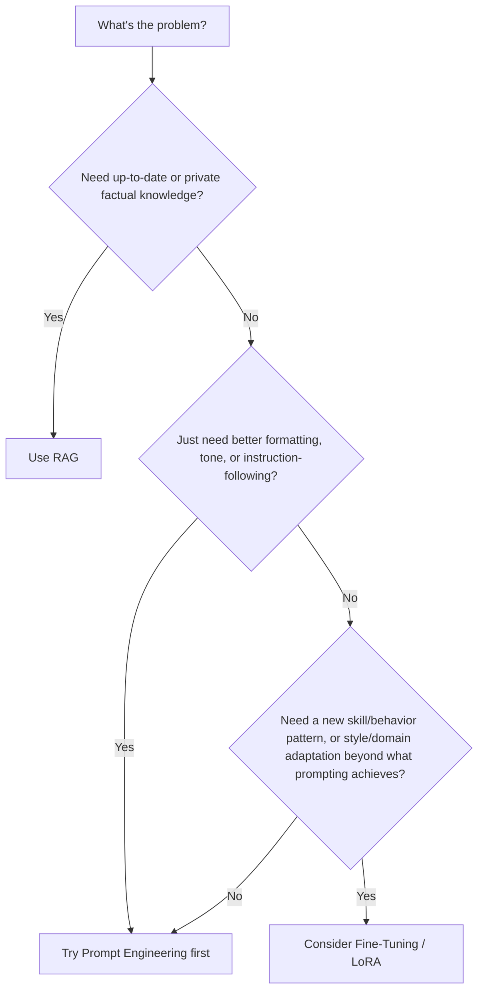
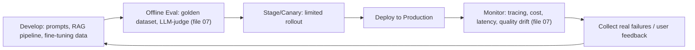

# 08. Fine-Tuning and LLMOps

This file covers when and how to customize an LLM's weights (as opposed to prompting or
RAG), how to serve models efficiently in production, and the operational lifecycle
(LLMOps) that keeps GenAI systems reliable, cost-effective, and safe.

## 1. Full Fine-Tuning vs. LoRA/QLoRA vs. PEFT

**Full fine-tuning**: update every parameter in the model using your own training data.
Gives maximum flexibility to change model behavior, but requires enormous GPU memory
(storing full-precision gradients and optimizer states for every parameter — often 3-4x the
model's own memory footprint), a large labeled dataset, and real risk of **catastrophic
forgetting** (the model loses general capabilities while overfitting to the new narrow
task). Rarely justified for teams outside large labs building a foundation model.

**PEFT (Parameter-Efficient Fine-Tuning)**: an umbrella term for techniques that freeze most
of the original model's weights and train only a small number of additional parameters.
Dramatically cheaper in memory and compute, less prone to catastrophic forgetting, and the
original base model can be reused across many different fine-tuned variants.

**LoRA (Low-Rank Adaptation)**: the most widely used PEFT method. Instead of updating a
weight matrix `W` directly, LoRA freezes `W` and learns two small low-rank matrices `A` and
`B` such that the effective update is `W + BA`, where `A` and `B` have far fewer parameters
than `W` itself (rank `r` is typically 8-64, much smaller than the full dimension).
Only `A` and `B` are trained and stored — at inference, `BA` can be merged into `W` for zero
extra latency, or kept separate as a small "adapter" that can be swapped in/out.

**QLoRA**: combines LoRA with **quantization** — the frozen base model is loaded in 4-bit
precision (drastically reducing memory), while the small LoRA adapter matrices are still
trained in higher precision. This makes it possible to fine-tune even large models on a
single consumer or mid-range GPU, since the memory-heavy frozen weights are compressed while
only the tiny trainable adapter needs full-precision gradients.

| | Full fine-tuning | LoRA | QLoRA |
|---|---|---|---|
| Parameters trained | 100% | ~0.1-1% | ~0.1-1% |
| GPU memory needed | Very high | Moderate | Low |
| Catastrophic forgetting risk | Higher | Lower | Lower |
| Can swap multiple task variants cheaply | No (full copy per task) | Yes (swap small adapters) | Yes (swap small adapters) |
| Typical use | Large labs building foundation/flagship models | Most teams customizing an open model for a specific task/style | Teams with limited GPU budget/hardware |

**Other PEFT variants worth knowing by name**: prefix tuning and prompt tuning (learn a
small set of virtual "soft prompt" tokens prepended to input, rest of model frozen),
adapters (small bottleneck layers inserted between transformer blocks). LoRA/QLoRA are the
dominant choice in practice today due to their simplicity and zero added inference latency
when merged.

## 2. Dataset Preparation for Fine-Tuning

Fine-tuning quality depends more on data quality than quantity or clever hyperparameters.

- **Format**: typically a set of (instruction, input, output) or (prompt, completion) pairs,
  matching the exact format you'll use at inference time (including system prompt style,
  if applicable).
- **Quality over quantity**: a few thousand carefully curated, correct, consistent examples
  often outperform a much larger noisy dataset — bad examples actively teach the model bad
  patterns.
- **Diversity**: cover the range of real inputs you expect, including edge cases and
  variations in phrasing — a narrow dataset produces a model that only works well on
  near-identical inputs to its training examples.
- **Deduplication**: remove near-duplicate examples, which can cause the model to overfit to
  repeated patterns and waste training budget.
- **Held-out validation set**: always keep a separate validation split (never trained on) to
  monitor for overfitting during fine-tuning, exactly as in classic ML (file 01).
- **Avoid label leakage**: make sure none of your validation/test examples (or
  near-duplicates of them) appear in the training set.

## 3. When to Fine-Tune vs. RAG vs. Prompt Engineering

This is one of the most common senior GenAI interview questions — the answer should be a
decision framework, not a blanket preference.

| | Prompt Engineering | RAG | Fine-Tuning |
|---|---|---|---|
| Best for | Formatting, tone, few-shot pattern matching, quick iteration | Injecting fresh/private factual knowledge | Teaching a new skill, consistent style/format at scale, domain-specific jargon/behavior |
| Update speed | Instant (just change the prompt) | Fast (update the vector DB) | Slow (requires retraining/redeploying) |
| Cost to change | Near zero | Low (re-ingest documents) | Moderate to high (GPU time, data curation) |
| Reduces hallucination? | Limited | Yes, when grounded well | Not directly — doesn't add new facts unless trained on them |
| Risk | Prompt injection, context limits | Retrieval failures, stale index | Catastrophic forgetting, data curation effort, overfitting on narrow data |

**Practical default order**: start with prompt engineering (cheapest, fastest to iterate).
Add RAG when the task needs knowledge the model wasn't trained on or that changes over
time. Reach for fine-tuning only when you've validated that prompting/RAG genuinely can't
achieve the needed behavior consistently — e.g., you need the model to always respond in a
very specific structured style across thousands of varied inputs, or you need much lower
per-request latency/cost by baking behavior into weights instead of a long system prompt.
These approaches are also commonly **combined**: a fine-tuned model that's also given RAG
context is a common production pattern (fine-tuning for style/behavior, RAG for facts).

## 4. Serving Fine-Tuned and Base Models: vLLM

Serving LLMs efficiently at scale requires specialized inference servers, not naive
single-request model calls, because production traffic is bursty, concurrent, and
cost-sensitive.

**vLLM** is a widely used open-source serving engine built around two key ideas introduced
in file 03:

- **PagedAttention**: manages KV cache memory in fixed-size, non-contiguous "pages" (similar
  to OS virtual memory), avoiding memory fragmentation and letting the server pack far more
  concurrent sequences into the same GPU memory compared to naive contiguous KV cache
  allocation.
- **Continuous batching**: instead of waiting for a fixed batch of requests to all arrive and
  finish together, new requests are dynamically added to and removed from the active GPU
  batch as they arrive/complete — dramatically improving GPU utilization for workloads with
  variable-length generations (some users get short answers, some get long ones).

Other serving considerations:
- **LoRA adapter serving**: many serving engines (including vLLM) support loading multiple
  LoRA adapters on top of one shared base model and routing requests to the right adapter
  dynamically — letting you serve many fine-tuned "variants" without needing a full separate
  copy of the base model in memory for each one.
- **Batching tradeoffs**: larger batches improve throughput (more tokens processed per
  second per GPU) but can increase per-request latency — tuning this tradeoff depends on
  whether your application is latency-sensitive (interactive chat) or throughput-sensitive
  (bulk offline processing).

## 5. Cost Optimization

Running LLMs in production has several concrete cost levers:

- **Right-size the model**: use the smallest/cheapest model that reliably meets your quality
  bar for each specific task — not every request needs a flagship frontier model. Route
  simple requests to smaller/cheaper models and reserve larger models for genuinely complex
  ones (**model routing/cascading**).
- **Caching**: cache responses for repeated/identical queries, and use prompt caching
  features (where providers charge less for reusing a previously-seen prompt prefix, like a
  long system prompt or document context) to avoid repeatedly paying full price for static
  content.
- **Quantization** (file 03): reduces memory and can improve throughput for self-hosted
  models, lowering infra cost per token.
- **Shorter prompts/context**: trim unnecessary context (via better RAG retrieval, file 05,
  rather than stuffing everything in), since cost scales with token count.
- **Batching offline/non-interactive workloads**: for bulk tasks that don't need real-time
  responses (e.g., nightly data processing), batch requests to maximize throughput and take
  advantage of any batch-pricing discounts providers offer.
- **Monitor cost per request/per feature** continuously (file 07's observability) — cost
  regressions are easy to miss without explicit tracking, especially after a prompt change
  that quietly increases average context length.

## 6. LLMOps Lifecycle

LLMOps extends traditional MLOps practices to the specific challenges of LLM-based
applications: prompt versioning, retrieval pipeline management, and continuous evaluation
against non-deterministic outputs.

Key practices:
- **Version everything**: prompts, system messages, RAG chunking/retrieval config,
  fine-tuning datasets, and model versions should all be version-controlled, just like code
  — a "prompt change" is a deploy and should go through the same review/testing rigor as a
  code change.
- **Canary/staged rollouts**: roll out prompt/model changes to a small percentage of traffic
  first, watch guardrail metrics (file 07), then expand gradually rather than switching 100%
  of traffic at once.
- **Continuous evaluation**: don't just eval before a deploy — continuously sample live
  traffic for ongoing quality monitoring, since model behavior can drift due to upstream
  provider model updates, changing user behavior, or data distribution shifts in retrieved
  content.
- **Rollback plan**: because LLM behavior changes aren't always predictable even with good
  eval coverage, always have a fast rollback path (revert prompt/model version) ready before
  shipping a change broadly.
- **Feedback loop into fine-tuning/golden datasets**: production failures discovered via
  monitoring should feed back both into the golden dataset (file 07) and, if a pattern is
  common enough, into fine-tuning data for the next training round.

## 7. Safety and Alignment Basics

- **Content moderation**: filter both inputs and outputs for disallowed content (hate
  speech, explicit violence, self-harm instructions, etc.) — typically via a dedicated
  classifier model or API, run separately from the main generation model, so moderation
  doesn't depend solely on the main model "choosing" to refuse.
- **Refusal behavior**: well-aligned models are trained (via instruction tuning and RLHF/DPO,
  file 03) to decline harmful requests while still being maximally helpful for legitimate
  ones — over-refusal (declining benign requests) is itself considered a quality/alignment
  failure, not just under-refusal.
- **Bias and fairness**: models can reproduce biases present in training data (e.g., biased
  associations between demographics and occupations/traits). Mitigation includes careful
  training data curation, targeted evaluation sets that specifically probe for biased
  outputs, and fine-tuning/alignment passes that explicitly penalize biased completions.
- **Data privacy**: fine-tuning on data containing personal/sensitive information risks the
  model memorizing and later regurgitating it. Mitigate with data anonymization/redaction
  before training, differential privacy techniques in sensitive settings, and strict access
  controls on training data.
- **Alignment is layered, not a single switch**: safety comes from a combination of
  pretraining data curation, instruction tuning, RLHF/DPO preference alignment (file 03),
  system-prompt-level instructions, input/output moderation classifiers, and application-level
  guardrails (file 04, file 06) — no single layer is sufficient alone, which is the same
  defense-in-depth philosophy as prompt injection defenses.

## Practice Questions

**Q1: Explain LoRA in simple terms, and why it uses far less memory than full fine-tuning.**

A: LoRA freezes the original model's weights entirely and instead learns two small low-rank
matrices, `A` and `B`, whose product `BA` approximates the "update" that would otherwise be
applied directly to a full weight matrix. Because `A` and `B` are much smaller (low rank)
than the full weight matrix, there are far fewer trainable parameters, which means far less
memory needed for gradients and optimizer states during training. At inference, `BA` can be
merged into the frozen weights for zero added latency, or kept as a separate small adapter
that can be swapped in and out without needing a full copy of the model per task.

**Q2: A teammate wants to fine-tune a model to answer questions about your company's
constantly-changing internal wiki. Why is this probably the wrong approach, and what would
you suggest instead?**

A: Fine-tuning bakes knowledge into the model's weights at training time, so any time the
wiki changes, you'd need to retrain — slow, expensive, and operationally painful for
frequently-changing content. RAG (file 05) is the better fit here: index the wiki into a
vector database, and retrieve relevant content at query time, so updates to the wiki are
reflected immediately just by re-ingesting the changed pages, with no retraining needed.
Fine-tuning would make more sense if the goal were teaching the model a consistent response
style or specialized reasoning pattern, not injecting frequently-changing factual content.

**Q3: What is catastrophic forgetting, and how does PEFT (like LoRA) reduce this risk
compared to full fine-tuning?**

A: Catastrophic forgetting is when fine-tuning on a narrow new task causes the model to lose
some of its original general capabilities, because full fine-tuning updates every parameter
and can overwrite previously learned representations in pursuit of minimizing loss on the
new, narrower dataset. PEFT methods like LoRA freeze essentially all of the original weights
and only train a small set of additional parameters, so the model's original knowledge
stored in the frozen weights stays intact, and only a small, targeted adaptation is learned
on top — substantially reducing the risk of losing general capability.

**Q4: What do PagedAttention and continuous batching in vLLM each solve?**

A: PagedAttention manages KV cache memory using fixed-size, non-contiguous pages (similar to
OS virtual memory paging) instead of requiring one large contiguous memory block per
sequence, which reduces memory fragmentation and lets the server fit many more concurrent
sequences into the same GPU memory. Continuous batching dynamically adds new requests to and
removes finished requests from the active GPU batch as they arrive and complete, rather than
waiting for a fixed batch to fully fill and finish together — this significantly improves GPU
utilization for real-world traffic where different requests generate very different output
lengths.

**Q5: Why is "version everything" (prompts, RAG config, model versions) considered a core
LLMOps practice?**

A: LLM application behavior depends on much more than application code — the exact prompt
wording, system message, RAG chunking/retrieval configuration, and model version can all
meaningfully change output quality and behavior. If these aren't version-controlled and
tracked the same way code is, you lose the ability to reproduce past behavior, correlate a
quality regression with the specific change that caused it, or safely roll back — so treating
a "prompt change" with the same rigor (review, testing, versioning, staged rollout) as a code
change is essential for reliable operations.

**Q6: Why is over-refusal (a model declining a benign, legitimate request) considered a
real alignment failure, not just an overly cautious but acceptable behavior?**

A: The goal of alignment is to make a model both safe and maximally helpful for legitimate
use cases — a model that refuses too aggressively fails the helpfulness half of that goal
just as much as a model that complies with harmful requests fails the safety half. Over-
refusal degrades real user experience, can push users toward less safe alternatives entirely
outside any guardrails, and signals that the model's refusal behavior isn't well-calibrated
to actual risk, which is why evaluation harnesses (file 07) should explicitly test for and
penalize over-refusal on benign prompts, not just under-refusal on harmful ones.
