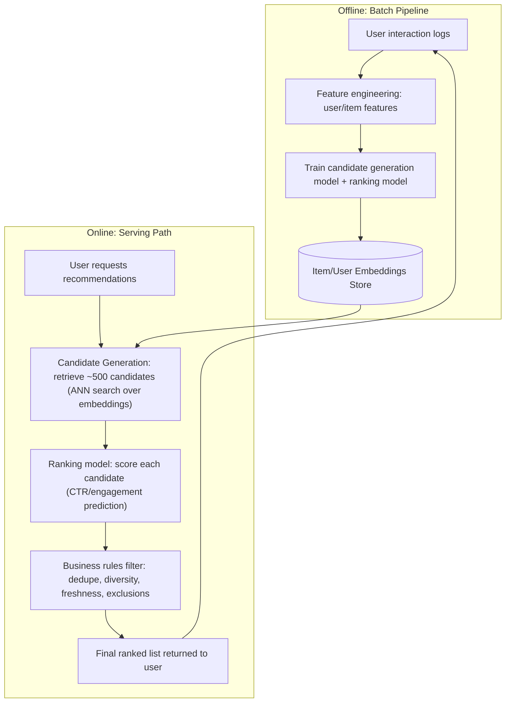
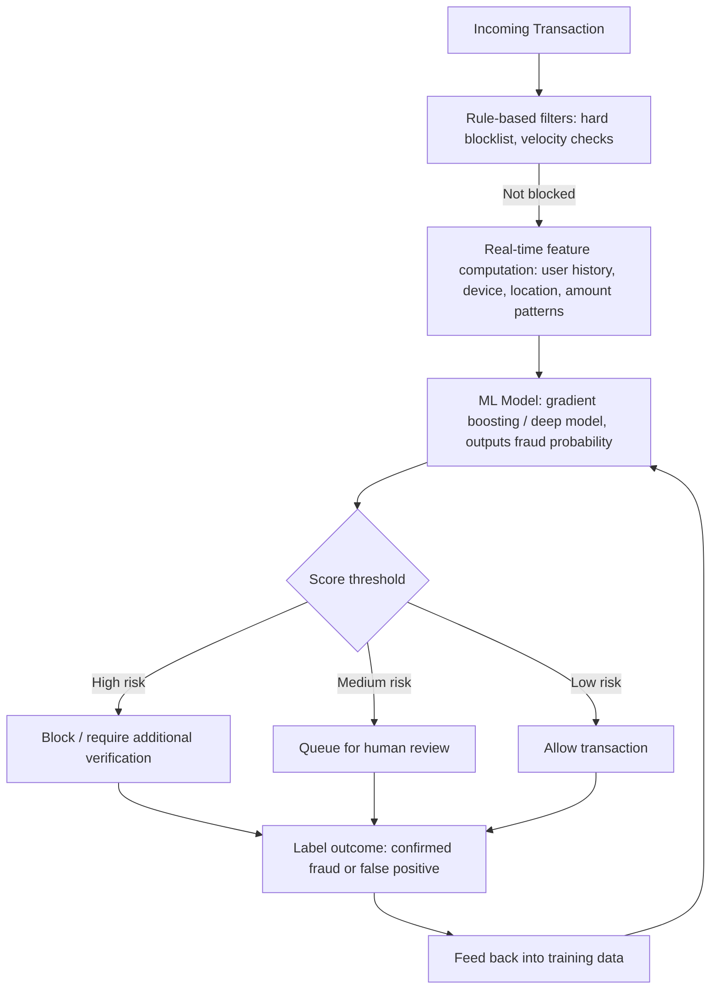
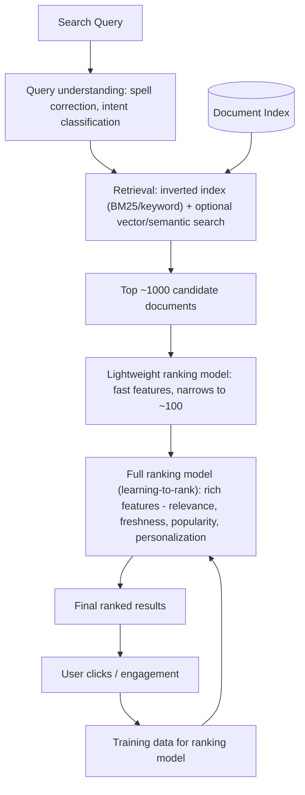
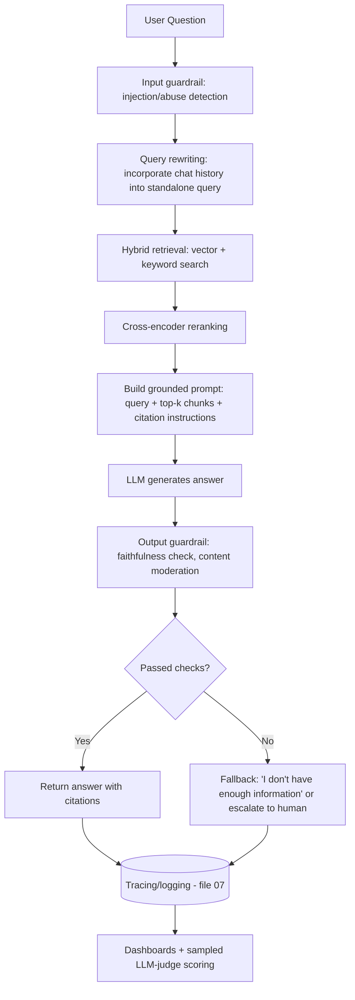
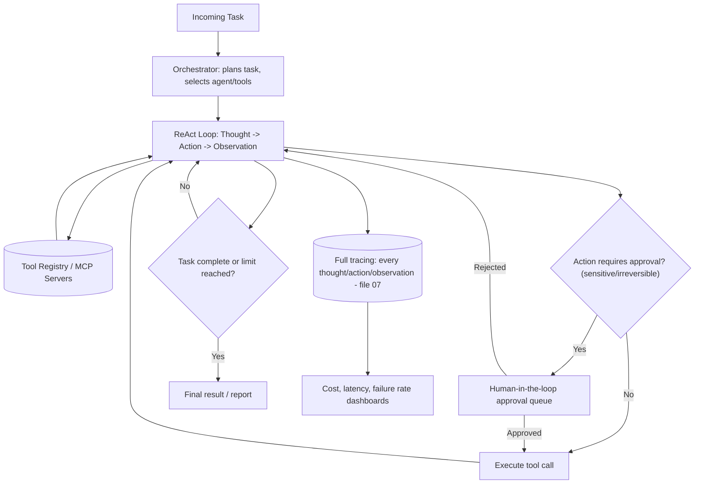

# 09. ML and GenAI System Design

System design interviews for ML/GenAI roles follow the same structure as traditional system
design: clarify requirements, propose an architecture, discuss data flow, call out
trade-offs, and address scale/reliability/cost. This file walks through five commonly asked
designs: a recommendation system, fraud detection, search ranking, a production RAG chatbot,
and an AI agent platform.

For every design, use this framing in an interview:
1. Clarify requirements (scale, latency budget, online vs. offline, cost constraints).
2. Propose a high-level architecture with a diagram.
3. Walk through the data/request flow end to end.
4. Call out 2-3 explicit trade-offs you made and why.
5. Discuss how you'd monitor and iterate on it in production.

## 1. Recommendation System

**Problem**: recommend items (products, videos, posts) to a user, ranked by predicted
relevance/engagement.

**Requirements to clarify**: scale (millions of users/items?), latency budget (typically
<100-200ms for online serving), cold-start handling (new users/items), explicit vs. implicit
feedback (clicks vs. ratings).

**Two-stage design (candidate generation + ranking)**: generating a score for every item in
a catalog of millions for every request is too slow. Stage 1 (**candidate generation**) uses
cheap, approximate methods (embedding similarity / ANN search, or simpler heuristics like
"popular in category") to narrow millions of items down to a few hundred candidates. Stage 2
(**ranking**) applies a more expensive, more accurate model (often a gradient-boosted tree or
a deep ranking model combining many features) to precisely score and order just those
candidates. This mirrors the retrieve-then-rerank pattern in RAG (file 05) — same underlying
reasoning: cheap broad filter, then expensive precise reordering of a small set.

**Trade-offs**:
- **Freshness vs. cost**: retraining models and recomputing embeddings frequently keeps
  recommendations current but costs compute; many systems retrain daily/hourly for the
  ranking model while updating embeddings and candidate indices more incrementally.
- **Cold start**: new users/items have no interaction history. Mitigate with content-based
  features (item metadata, user profile signals) as a fallback until enough behavioral data
  accumulates, or use popularity-based defaults.
- **Exploration vs. exploitation**: always showing the highest-predicted-engagement items can
  create filter bubbles and prevent learning about new items' true performance. Inject
  controlled randomness/exploration (e.g., bandit algorithms) to keep learning.
- **Diversity**: pure relevance ranking can return near-duplicate items; a business-rules or
  re-ranking layer enforces diversity constraints.

## 2. Fraud Detection

**Problem**: classify transactions/activities as fraudulent or legitimate in real time,
balancing catching fraud against blocking legitimate users.

**Requirements to clarify**: real-time (block before transaction completes) vs. near-real-time
(flag for review after), acceptable false-positive rate (blocking real customers has a
direct business cost), class imbalance (fraud is typically <1% of transactions).

**Key design decisions**:
- **Layered defense**: cheap deterministic rules (known bad actors, velocity limits like
  "5 transactions in 1 minute") run first to catch obvious cases fast and cheaply, before the
  more expensive ML model evaluates the remaining ambiguous cases — similar in spirit to the
  defense-in-depth philosophy from prompt injection (file 04) and agent guardrails (file 06).
- **Metric choice**: recall matters because missed fraud costs money directly, but precision
  matters because falsely blocking legitimate customers damages trust and revenue — this is
  the precision/recall trade-off from file 01, resolved here via a **threshold** tuned to the
  business's specific cost ratio, often with a middle "review queue" tier rather than a binary
  block/allow decision.
- **Feature engineering is critical**: velocity features (transaction frequency), behavioral
  deviation features (is this purchase unusual for this user?), and graph-based features
  (shared devices/cards/addresses across accounts) are typically far more predictive than raw
  transaction amount alone.
- **Adversarial and evolving patterns**: fraudsters actively adapt to evade detection, so
  models need frequent retraining, and monitoring for sudden shifts in fraud patterns (concept
  drift) is essential — a model that was 95% accurate last month can degrade quickly as
  attackers find new patterns.
- **Latency constraint**: for transactions that must be blocked before completing, the entire
  pipeline (rules + feature lookup + model inference) typically needs to run in tens of
  milliseconds, which constrains model complexity and requires pre-computed/cached features
  rather than expensive real-time joins.

## 3. Search Ranking

**Problem**: given a search query, return the most relevant results from a large corpus,
ranked by relevance.

**Key design decisions**:
- **Multi-stage ranking (same pattern as recommendations and RAG)**: retrieval narrows a huge
  corpus to a manageable candidate set cheaply, a lightweight ranker narrows further, and a
  final expensive ranker (often a **learning-to-rank** model trained on click/engagement data)
  produces the final order. The same cheap-then-expensive funnel pattern appears across
  recommendation systems, search, and RAG reranking because it's the general solution to
  "can't afford to run an expensive accurate model over the entire corpus for every query."
- **Hybrid retrieval**: combining keyword-based (BM25/inverted index) retrieval with
  semantic/vector retrieval (same hybrid search idea as RAG, file 05) catches both exact
  matches (product codes, names) and conceptually related results that don't share exact
  keywords.
- **Learning-to-rank from implicit feedback**: clicks are a noisy but abundant signal (users
  click on bad results sometimes, and not clicking doesn't always mean irrelevant) — handled
  via techniques like counterfactual/position-bias correction (users click top results more
  just because they're on top, not necessarily because they're more relevant) and pairwise/
  listwise ranking loss functions rather than treating each click as ground truth in
  isolation.
- **Personalization vs. generalization trade-off**: personalizing results to individual user
  history improves relevance for that user but adds complexity, cold-start issues for new
  users, and can create filter bubbles — often blended with a non-personalized baseline
  ranking.
- **Freshness**: for time-sensitive content (news, inventory), the index needs near-real-time
  updates, which constrains the choice of indexing infrastructure (incremental index updates
  vs. full periodic rebuilds).

## 4. Production RAG Chatbot

**Problem**: build a customer-facing chatbot that answers questions grounded in a company's
internal documents, at production scale and reliability.

This design combines concepts from files 04 (prompt engineering), 05 (RAG), 06 (agents), and
07 (evaluation) into one system.

**Key design decisions**:
- **Why not just a long context window stuffing all docs in?** Cost and latency scale with
  tokens, and "lost in the middle" effects (file 03) reduce accuracy on large unfiltered
  contexts — retrieval keeps the prompt focused on relevant content only.
- **Input/output guardrails are mandatory, not optional**: input guardrails screen for
  prompt injection and abuse (file 04); output guardrails check faithfulness (does the answer
  actually match retrieved content, file 05/07) and run content moderation before the answer
  reaches the user. A customer-facing bot without output guardrails risks confidently stating
  wrong information or leaking inappropriate content.
- **Explicit fallback behavior**: the system must be designed to say "I don't know" or
  escalate to a human when retrieval confidence is low or the faithfulness check fails, rather
  than always forcing a confident-sounding answer — this is a deliberate design choice, not
  an accident, since a wrong confident answer is often worse than an honest "I don't know."
- **Latency budget**: each stage (query rewrite, retrieval, rerank, generation) adds latency;
  for a chat UX, end-to-end response time should typically stay under a few seconds, which
  constrains how many retrieval rounds or how large a model you can use — this is a direct
  trade-off against the agentic RAG techniques from file 05 (more rounds = better answers but
  slower).
- **Continuous evaluation in production** (file 07): sample live conversations for
  LLM-judge scoring, track faithfulness and resolution rate over time, and feed discovered
  failures back into the golden dataset.
- **Escalation path**: for a customer-facing system, always have a clear handoff to a human
  agent for cases the bot can't resolve confidently — critical both for user trust and for
  handling genuinely out-of-scope or sensitive requests.

## 5. AI Agent Platform

**Problem**: build a platform that lets an AI agent autonomously complete multi-step tasks
(e.g., "research this topic and draft a report," "process this support ticket end to end")
using tools, with appropriate safety controls.

This design combines file 06 (agents) concepts into a platform-level architecture.

**Key design decisions**:
- **Tool registry with least-privilege scoping**: tools are registered centrally (potentially
  as MCP servers, file 06) with explicit permission scopes per agent/task type — an agent
  handling customer support tickets shouldn't have access to a "delete production database"
  tool, regardless of whether it would ever reasonably call it.
- **Human-in-the-loop gate for irreversible actions**: any action with real-world
  consequences (sending money, deleting data, sending external communications) routes through
  an approval queue rather than executing autonomously — the platform-level enforcement of
  this guardrail from file 06, not left to the agent's own judgment.
- **Hard limits on loop iterations, cost, and time** (file 06 failure modes): every task gets
  a budget (max steps, max tokens/cost, max wall-clock time) enforced by the platform, not
  just suggested in the prompt, so a confused agent can't run away with unbounded cost.
- **Full observability by default** (file 07): every thought, action, and observation is
  traced, since debugging a failed multi-step agent task without full tracing is nearly
  impossible — you need to see exactly which step went wrong in a chain of 10+ actions.
- **Single-agent vs. multi-agent decision** (file 06): the platform should default to a single
  capable agent with good tools and only introduce multi-agent orchestration (orchestrator-
  worker, debate) when a task genuinely benefits from parallelism or specialization — added
  architectural complexity should be justified by task structure, not used by default.
- **Graceful degradation**: when the agent can't complete a task (tool failure, ambiguous
  instructions, hitting iteration limits), it should fail clearly and escalate to a human with
  context about what it tried, rather than silently returning a wrong or incomplete result as
  if it succeeded.

## Practice Questions

**Q1: Why do recommendation systems, search engines, and RAG rerankers all use a two-stage
"cheap candidate generation + expensive precise ranking" pattern instead of one single model?**

A: In all three cases, running the most accurate scoring model (a deep ranking model, a
cross-encoder, a full personalized ranker) against the entire corpus — which can be millions
of items/documents — for every single request would be far too slow and expensive. Instead,
a cheap, approximate method (ANN/embedding search, BM25/inverted index, simple heuristics)
first narrows the corpus down to a small candidate set (hundreds to low thousands), and then
the expensive, more accurate model is applied only to that small set, where its cost is
affordable. This gets both speed (from the cheap stage) and precision (from the expensive
stage) without paying the full cost of precision at full corpus scale.

**Q2: In a fraud detection system, why might you use a three-tier decision (allow / review
queue / block) instead of a simple binary block/allow threshold?**

A: A binary threshold forces every borderline case into either a false positive (blocking a
legitimate customer, hurting trust and revenue) or a false negative (letting fraud through).
A middle "review queue" tier lets genuinely ambiguous cases get human judgment instead of an
automatic wrong decision in either direction, reserving automatic blocking for high-confidence
fraud and automatic allowing for high-confidence legitimate transactions — this better matches
the real-world cost asymmetry between different error types and avoids forcing the model into
an all-or-nothing decision on cases it's genuinely unsure about.

**Q3: Why is "stuff the entire knowledge base into a long context window" generally a worse
design than RAG for a production chatbot, even with models supporting very large context
windows?**

A: Cost and latency scale with the number of tokens processed, so including far more content
than needed for a given question wastes money and time on every single request. Very long
contexts can also suffer from "lost in the middle" effects where relevant details receive
less effective attention than content near the start or end, which can reduce accuracy
compared to a focused context containing just the relevant retrieved chunks. RAG keeps the
prompt scoped to what's actually relevant to the specific question, which is both cheaper and
often more accurate.

**Q4: For an AI agent platform, why should the platform itself enforce hard limits on steps/
cost/time, rather than relying on the agent's own prompt instructions to self-regulate?**

A: Prompt instructions are suggestions the model might not reliably follow, especially if it
gets confused, stuck in a loop, or encounters an unexpected situation it wasn't well-prepared
for — relying on the model to voluntarily stop is not a robust safety mechanism. Platform-
level enforcement (a hard-coded maximum number of steps, a cost budget tracked outside the
model, a wall-clock timeout) guarantees the runaway behavior is capped regardless of what the
model decides, which is essential for cost control and preventing a single malfunctioning
task from consuming unbounded resources.

**Q5: What's the key difference in how you'd design a search ranking system for freshness-
sensitive content (news) versus relatively static content (a product catalog), and why?**

A: For freshness-sensitive content like news, the index needs near-real-time updates — new
articles must become searchable and rankable within minutes, which requires an indexing
pipeline supporting incremental updates (rather than periodic full rebuilds) and ranking
features that explicitly weight recency heavily. For relatively static content like a product
catalog, the index can be rebuilt on a slower cadence (e.g., hourly or daily), and ranking can
rely more heavily on stable signals like historical engagement, reviews, and popularity rather
than recency, since the underlying items don't change meaning or relevance as quickly over
time.

**Q6: A production RAG chatbot occasionally gives a confidently wrong answer instead of
saying "I don't know." How would you redesign the system to reduce this?**

A: Add an explicit output guardrail that checks faithfulness (file 05/07) — verifying that
every claim in the generated answer is actually supported by the retrieved context — before
the answer is returned to the user; if the check fails or retrieval confidence/relevance is
low, route to a fallback response ("I don't have enough information on that") or escalate to
a human instead of returning the LLM's confident-sounding answer as-is. I'd also explicitly
instruct the model in its prompt to decline answering when the provided context doesn't
contain the needed information, and add these "should have said I don't know" cases to the
golden evaluation dataset (file 07) to catch regressions on this specific failure mode going
forward.
