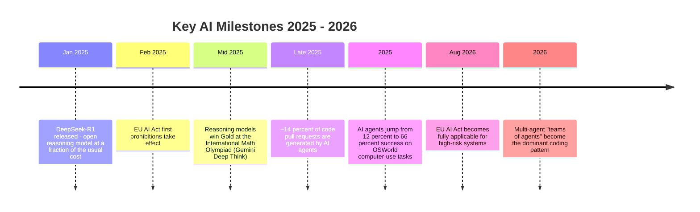
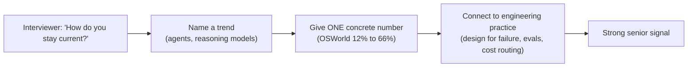

# Latest AI & Tech Trends (2025–2026)

> This page keeps your interview answers **current**. Senior interviewers love to ask: *"What recent AI developments are you following, and how would they change your system design?"* Use the facts below (sourced from the Stanford HAI AI Index 2026, Anthropic's 2026 Agentic Coding Trends Report, Deloitte Tech Trends 2026, and recent research surveys) to sound up to date.
>
> For **live daily news**, open the **[Live AI & Tech News](../news.md)** page of this site — it fetches fresh headlines from the internet every time you open it.

---

## 1. The Big Picture: What Changed in 2025–2026

### Headline facts you can quote in an interview

| Fact | Why it matters in an interview |
|---|---|
| Frontier models gained ~30 percentage points in one year on "Humanity's Last Exam"; benchmarks saturate in months | Evaluation is now the bottleneck, not capability. Great hook for ML system design answers. |
| Top 4 labs (Anthropic, xAI, Google, OpenAI) are within ~25 Elo points of each other | Model choice is now about **cost, latency, reliability**, not raw quality. |
| SWE-bench Verified went from 60% → near human baseline in one year | Coding agents are production-ready; engineers shift to **orchestrating agents**. |
| AI agents: 12% → 66% success on OSWorld (real computer tasks) | Agents work, but still fail ~1 in 3 structured tasks → you MUST design for failure (retries, human-in-the-loop). |
| "Jagged intelligence": gold at IMO math, but only ~50% accurate reading analog clocks | Never assume uniform capability. Evaluate per-task. |
| Organizational adoption of GenAI reached 88%, but only ~11% have agentic systems in production | Huge gap between pilots and production → talk about governance, evals, and process redesign. |
| Documented AI incidents rose to 362 (from 233 in 2024) | Safety/guardrails are a first-class design requirement. |

---

## 2. Trend Deep-Dives

### 2.1 Reasoning Models & Inference-Time Compute

- Models now "think before answering" using long chains of thought. The field shifted from **inference scaling** (sample more, re-rank) to **learning-to-reason** (train the thinking with reinforcement learning).
- Key algorithms: **PPO → DPO → GRPO** (used by DeepSeek-R1). GRPO removes the value model and compares groups of sampled answers — cheaper and surprisingly effective.
- **Interview sound bite:** "I'd budget inference-time compute like any other resource: use a fast non-reasoning model for routing and simple queries, and escalate to a reasoning model only for hard multi-step tasks."

### 2.2 Agentic AI (the biggest shift)

- 2025 was the year agents went from answering questions to **completing tasks**: Deep Research products, computer-use agents, coding agents.
- The standard agent stack: **planner** (goal decomposition) → **controller** (tool selection) → **retrieval layer** (grounding) → **memory** (cross-session reuse).
- 2026 pattern: **single agent → coordinated teams of agents** (multi-agent orchestration), with sub-agents specialized per task and a lead agent coordinating.
- Emerging standard protocols: **MCP (Model Context Protocol)** for tool/data connections, and agent-to-agent protocols for interoperability.
- Known failure modes you should mention: weak grounding, brittle tool interfaces, error propagation between agents, coordination overhead, poor validation of long-horizon plans. Gartner predicts ~40% of agentic projects will fail by 2027 — mostly because teams automate broken processes instead of redesigning them.

### 2.3 Agentic Coding

- Late 2025: roughly **14% of code pull requests** were agent-generated. Agents handle tests, debugging, documentation, and multi-hour feature work.
- 2026 direction: agents run for **days** on large tasks; humans do architecture, decomposition, and review. "Agentic quality control" (AI reviewing AI output at scale) becomes standard.
- The engineer's value shifts to: system architecture, task decomposition, agent coordination, and **evaluating output** — exactly the senior skills this course trains.

### 2.4 Open vs Closed Models, and the US–China Race

- The open-weight gap re-opened in 2025 (top closed model leads top open model by ~3.3%), but open models (DeepSeek, Qwen, Llama, Olmo) remain extremely competitive on cost.
- The US–China performance gap has effectively closed — leadership has traded places several times since early 2025.
- Small, well-trained models keep punching up: e.g., a ~32B parameter model (Olmo 3.1 Think) matches models ~90x larger on some math benchmarks, thanks to **data curation** over data volume.

### 2.5 Data: "Peak Data" and the Synthetic Turn

- High-quality human web text is close to exhausted ("peak data"; depletion estimates between 2026–2032).
- Response: **data-centric AI** — deduplication, pruning, quality filtering beat indiscriminate scaling; **synthetic data** is now standard for post-training (SFT, alignment, RL, long-context training).

### 2.6 Multimodal & Physical AI

- Video models (e.g., Veo 3) are starting to capture **physics**, not just appearance — simulating buoyancy, solving mazes zero-shot.
- Autonomous vehicles reached mass-scale deployment in 2025 (Waymo: 14M+ trips). Humanoid robots moved toward industrial use at CES 2026, with agentic AI becoming the robot "brain".

### 2.7 Regulation & Safety

- **EU AI Act**: first prohibitions in Feb 2025; fully applicable to high-risk systems on **Aug 2, 2026** (risk management systems, technical documentation, transparency for emotion-recognition/biometric systems).
- US: no single AI Act; instead agency-level standards, procurement oversight, and a DOJ AI Litigation Task Force (Jan 2026).
- Safety benchmarks lag capability benchmarks; improving one responsible-AI dimension (e.g., safety) can degrade another (e.g., accuracy) — a real trade-off worth naming in interviews.

---

## 3. How to Use These Trends in Interviews

**Three ready-made answers:**

1. *"What excites you in AI right now?"* — "Agentic systems. Task success on real computer-use benchmarks went from ~12% to ~66% in a year. But that still means 1 in 3 failures, so the engineering problem is harnesses: retries, verification steps, human escalation, and evals. That's where I focus."
2. *"Would you use an open or closed model?"* — "The top labs are within ~25 Elo of each other now, so I choose on cost, latency, data governance and fine-tuning needs. For sensitive data or heavy customization I'd evaluate open weights (Qwen/Llama/DeepSeek); for frontier reasoning I'd use an API model behind an abstraction layer so we can swap."
3. *"How would you ship an agent to production?"* — "Start from process redesign, not bolting an agent onto a broken workflow — that's why ~40% of agentic projects are predicted to fail. Then: narrow scope, tool allowlists, structured outputs, eval suite before launch, canary rollout, audit logs, and human-in-the-loop for irreversible actions."

---

## 4. Practice Questions

1. Explain the difference between **inference-time scaling** and **learning-to-reason**. Give one example technique for each.
2. Your company wants to deploy a customer-support agent. List five failure modes you would design against, and the mitigation for each.
3. Why does "benchmark saturation" make model selection harder? What would you measure instead?
4. What is MCP and what problem does it solve compared to bespoke tool integrations?
5. A 32B open model matches a 3T closed model on your task at 1/20th the cost. What else do you verify before switching production traffic to it?

---

## 5. Staying Current (Habit Loop)

| Habit | Source | Time |
|---|---|---|
| Daily headlines | **[Live News page](../news.md)** of this site (Hacker News + dev.to, fetched live) | 10 min |
| Weekly deep read | One paper/blog from a frontier lab (Anthropic, OpenAI, DeepMind, Meta AI) | 30 min |
| Monthly | Skim a survey (e.g., LLM reasoning / agentic reasoning surveys on arXiv) | 1 hr |
| Yearly | Stanford HAI AI Index report summary | 2 hr |

---

*Previous: [10 - Interview Questions](10-interview-questions.md) · Back to [ML/GenAI Track README](README.md)*
