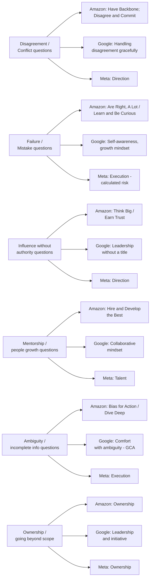

# Leadership Principles and Company-Specific Behavioral Guides

## Why company-specific prep matters

Every big tech company claims to hire for "leadership" and "ownership," but the exact words they use, the exact rubric their interviewers are trained on, and the exact follow-up questions they ask are different from company to company. A story that lands perfectly in an Amazon loop can fall a bit flat at Google if you frame it the same way, simply because the interviewer is listening for different keywords and signals.

This file walks through Amazon's 16 Leadership Principles in detail, then Google's and Meta's behavioral structures, so you can adjust the *emphasis* of your story bank (built in file 01) to match whichever company you're interviewing with.

## Amazon's 16 Leadership Principles

Amazon is famous for building almost its entire interview process - technical and non-technical - around these 16 principles. Every interviewer on your loop is assigned one or two principles to probe deeply, and your written feedback will explicitly reference which principles you demonstrated or failed to demonstrate.

| # | Principle | What it means | Example question | What a strong senior answer shows |
|---|---|---|---|---|
| 1 | Customer Obsession | Start with the customer and work backward, rather than starting with internal convenience | "Tell me about a time you pushed back on a feature that was good for the business but bad for customers" | Specific customer impact data, willingness to challenge internal priorities on the customer's behalf |
| 2 | Ownership | Act like an owner, think long term, never say "that's not my job" | "Tell me about a time you took on something outside your job description" | Taking responsibility for an outcome even without being asked, following through to completion |
| 3 | Invent and Simplify | Look for new ways to solve problems and simplify, even if it means doing things differently than everyone else | "Tell me about a time you simplified a complex process" | Reducing complexity, not just adding features; measurable simplification (fewer steps, less code, faster process) |
| 4 | Are Right, A Lot | Have strong judgment and good instincts, seek diverse perspectives to disconfirm your own beliefs | "Tell me about a time your initial judgment was wrong and how you corrected course" | Humility plus a track record of generally sound decisions; actively seeking other viewpoints |
| 5 | Learn and Be Curious | Never stop learning, seek to improve yourself | "Tell me about something you taught yourself outside of work requirements" | Self-directed learning with a clear application, not just "I took a course" |
| 6 | Hire and Develop the Best | Raise the performance bar with every hire and promotion, actively develop others | "Tell me about a time you helped someone grow into a bigger role" | Concrete mentorship outcome, like a promotion or measurable skill growth of someone you coached |
| 7 | Insist on the Highest Standards | Relentlessly high standards, even when it's not easy; don't let quality slip | "Tell me about a time you rejected work that didn't meet the bar" | Specific standard you held the line on, and how you helped the team meet it rather than just blocking it |
| 8 | Think Big | Think and communicate a bold direction that inspires results | "Tell me about the biggest idea you've pitched at work" | Scope beyond your immediate team; ambition balanced with a believable plan |
| 9 | Bias for Action | Speed matters; most decisions are reversible and don't need extensive study | "Tell me about a time you made a decision with incomplete information" | Clear reasoning for why you acted instead of waiting, and how you managed the risk of being wrong |
| 10 | Frugality | Accomplish more with less; resourcefulness over throwing money/people at a problem | "Tell me about a time you solved a problem without additional headcount or budget" | Creative resource use, not corner-cutting on quality |
| 11 | Earn Trust | Listen attentively, speak candidly, treat others respectfully | "Tell me about a time you had to rebuild trust with a team or person" | Honest acknowledgment of what broke trust, specific actions taken to repair it |
| 12 | Dive Deep | Operate at all levels, stay connected to the details, audit frequently | "Tell me about a time a surface-level metric was misleading and you found the real story underneath" | Going past dashboards into logs, code, or direct conversations to find the real root cause |
| 13 | Have Backbone; Disagree and Commit | Challenge decisions respectfully even when uncomfortable, but commit fully once a decision is made | "Tell me about a time you disagreed with a decision but committed to it anyway" | Voicing disagreement clearly and respectfully, then executing the final decision without resentment or sabotage |
| 14 | Deliver Results | Focus on key inputs and deliver with the right quality and in a timely way, despite setbacks | "Tell me about a time you delivered a result despite major obstacles" | Specific, measurable delivery, and how you handled the obstacles rather than using them as an excuse |
| 15 | Strive to be Earth's Best Employer | Create a safer, more productive, more diverse, and more just work environment | "Tell me about a time you improved your team's working environment" | Concrete action that improved team culture, inclusion, or working conditions, not just a vague statement of values |
| 16 | Success and Scale Bring Broad Responsibility | Recognize that your actions affect customers, employees, partners, and society broadly; act responsibly | "Tell me about a time you considered the broader impact of a technical decision" | Awareness of downstream effects (ethical, societal, or business) beyond the immediate task |

### How to prepare for an Amazon loop

Amazon interviewers typically probe 2-3 principles deeply per interview rather than touching all 16 shallowly. Map your 10-12 stories (from file 01) against this table and make sure you have at least one strong story per principle, even if some stories double up across two or three principles. The Bar Raiser especially will ask layered follow-ups like "what did you say in that conversation" or "what was the actual data you looked at" to confirm your story is real and specific, not a general summary.

## Google: Googleyness, GCA, and Leadership

Google structures things differently. There isn't a public list of 16 named principles, but there is a known rubric that shows up in interviewer training and feedback forms.

### The three main dimensions

| Dimension | What it evaluates | Where it's tested |
|---|---|---|
| **General Cognitive Ability (GCA)** | How you think through problems - structured reasoning, how you handle being wrong, how you use data | Partly in a dedicated round, partly inferred from how you reason through coding/design problems |
| **Googleyness and Leadership (G&L)** | Comfort with ambiguity, collaborative mindset, intellectual humility, leadership without authority, and a general "would I want to work with this person" read | A dedicated 45-minute round, usually with someone from a different team than the one hiring you |
| **Role-related knowledge (RRK) and leadership signal in technical rounds** | Whether your technical rounds also show you communicating clearly, handling feedback well, and demonstrating sound engineering leadership | Baked into feedback from coding and system design interviewers, not just the dedicated G&L round |

### What the G&L round structure typically looks like

A typical Google G&L round runs for about 45 minutes and usually follows this shape:

1. **Warm-up and background** (5 minutes): A brief walk through your background, mainly to build rapport.
2. **2-3 behavioral questions** (30 minutes): Usually drawn from themes like ambiguity, conflict, leadership, and failure. The interviewer digs deep into one or two stories rather than rushing through many shallow ones.
3. **Candidate questions** (5-10 minutes): What you ask back is also quietly evaluated - thoughtful questions about team culture or technical direction are seen as a good sign of genuine interest and leadership instinct.

### What Google interviewers are specifically trained to listen for

- **"I" vs "we" balance**: Google interviewers are explicitly trained to notice over-use of "we" and will often ask "what specifically did you do" if a candidate's story stays vague about their individual contribution.
- **Handling disagreement gracefully**: Google culture historically prizes open debate; a story where you disagreed with someone and handled it with respect and data, rather than either caving immediately or escalating aggressively, scores well.
- **Comfort with ambiguity**: Because Google's scale means requirements are often unclear, stories that show you moving forward productively despite not having a perfect spec score higher than stories where you needed everything defined before acting.
- **"Would I enjoy working with this person for years?"**: This softer, harder-to-quantify signal still matters a lot. Being pleasant, humble, and genuinely curious in how you talk about your work leaves a strong impression beyond the literal content of your answers.

### For a hiring committee, not just interviewers

Remember from the README's loop diagram: Google's final decision is made by a hiring committee that reads your whole packet, not just the G&L interviewer's personal opinion. This means consistency matters. If your G&L interviewer says "great ownership" but your system design interviewer notes "got defensive when challenged on the design," the mixed signal can hurt you more than a single mediocre round would.

## Meta: Move Fast, Be Bold, and Ownership Signals

Meta's internal culture places heavy weight on speed, ownership, and impact, and its behavioral interview (often simply called the "Jedi round" internally, though Meta has used different names over time for its behavioral/leadership interview) reflects that directly.

### The four signal areas Meta interviewers are trained on

| Signal area | What it evaluates | Example question |
|---|---|---|
| **Ownership** | Do you take responsibility for outcomes beyond your assigned scope, and follow through without being told to? | "Tell me about a time you noticed a problem nobody asked you to fix, and you fixed it anyway" |
| **Direction** | Do you influence or set technical direction, rather than only executing someone else's plan? | "Tell me about a time you changed the technical direction of a project" |
| **Talent** | Do you grow the people and teams around you - mentoring, raising hiring bar, improving processes? | "Tell me about a time you helped someone on your team grow" |
| **Execution ("Move Fast")** | Do you ship meaningful work quickly, and when speed causes mistakes, do you recover and learn fast? | "Tell me about a time you moved fast and it didn't go as planned" |

### What Meta interviewers press on

Meta is known for pushing hard on failure stories specifically, more than some other companies. The interviewer wants to distinguish between:

- **Reckless risk-taking** (red flag): moving fast without any safety net, ignoring warning signs, not learning from mistakes
- **Calculated risk-taking** (what they want): moving fast with an awareness of what could go wrong, a plan to detect problems quickly, and genuine behavior change after a mistake

If you tell a failure story at Meta, expect a follow-up like "what would you do differently if you were in that exact situation again tomorrow" - they want to hear a specific, applied lesson, not a generic "I'd communicate better."

## Comparison table: company behavioral styles at a glance

| Aspect | Amazon | Google | Meta |
|---|---|---|---|
| Framework name | 16 Leadership Principles (LPs) | Googleyness & Leadership (G&L) + GCA | Ownership, Direction, Talent, Execution |
| Dedicated round? | Often yes, plus LPs probed in every round | Yes, one dedicated 45-min round | Yes, often one dedicated round |
| Special interviewer role | Bar Raiser (outside the hiring team, has veto power) | Hiring committee reviews the whole packet | Cross-functional calibration in debrief |
| Main cultural emphasis | Customer obsession, ownership, high standards | Collaboration, intellectual humility, comfort with ambiguity | Speed, bold bets, strong individual ownership |
| What a weak answer looks like | Vague story with no specific LP demonstrated | Heavy "we" language, can't isolate personal contribution | Overly cautious story with no real risk or bold decision |
| Follow-up style | Deep, repeated "what exactly did you do" drilling | Probing for ambiguity-handling and self-awareness | Probing for calculated risk vs recklessness, and fast learning |
| Best story types to emphasize | Customer impact, data-driven decisions, raising the bar | Cross-team collaboration, handling disagreement with humility | Fast execution, bold technical bets, visible ownership |

## Mapping question types to principles: a visual guide

The diagram below shows how common behavioral question themes map onto the frameworks above. Use it to quickly figure out which of your story bank entries (from file 01) to lead with, depending on the question theme and the company.

Notice that the same underlying story (for example, a "disagreement with your manager" story) can be reframed to hit different specific labels depending on the company: at Amazon you'd emphasize the "disagree and commit" arc explicitly; at Google you'd emphasize how respectfully and collaboratively you disagreed; at Meta you'd emphasize whether your disagreement actually changed the technical direction of the project.

## Practical advice: tailoring one story bank to multiple companies

You do not need separate story banks for each company. Instead, for each of your 10-12 stories, write a one-line note in your story bank table (from file 01) indicating which company-specific angle to lead with. For example:

| Story | Amazon angle | Google angle | Meta angle |
|---|---|---|---|
| Payment retry redesign | Dive Deep (root cause investigation), Deliver Results | Comfort with ambiguity, structured reasoning (GCA) | Ownership, fast execution |
| Disagreement with manager | Have Backbone; Disagree and Commit | Handling disagreement gracefully | Direction |
| Cross-team logging consolidation | Think Big, Earn Trust | Leadership without a title | Direction, Talent |

Before each interview, spend 10 minutes reviewing this mapping for the specific company you're meeting, and mentally rehearse leading with the right emphasis. This single habit - adjusting emphasis, not inventing new stories - is one of the highest-leverage things you can do to prepare efficiently for multiple companies at once.

The next file in this track gives you the actual question bank senior and staff candidates report seeing, grouped by theme, along with guidance on what separates a "senior" answer from a "staff" answer, and a practical walkthrough of negotiating your offer once you pass.
