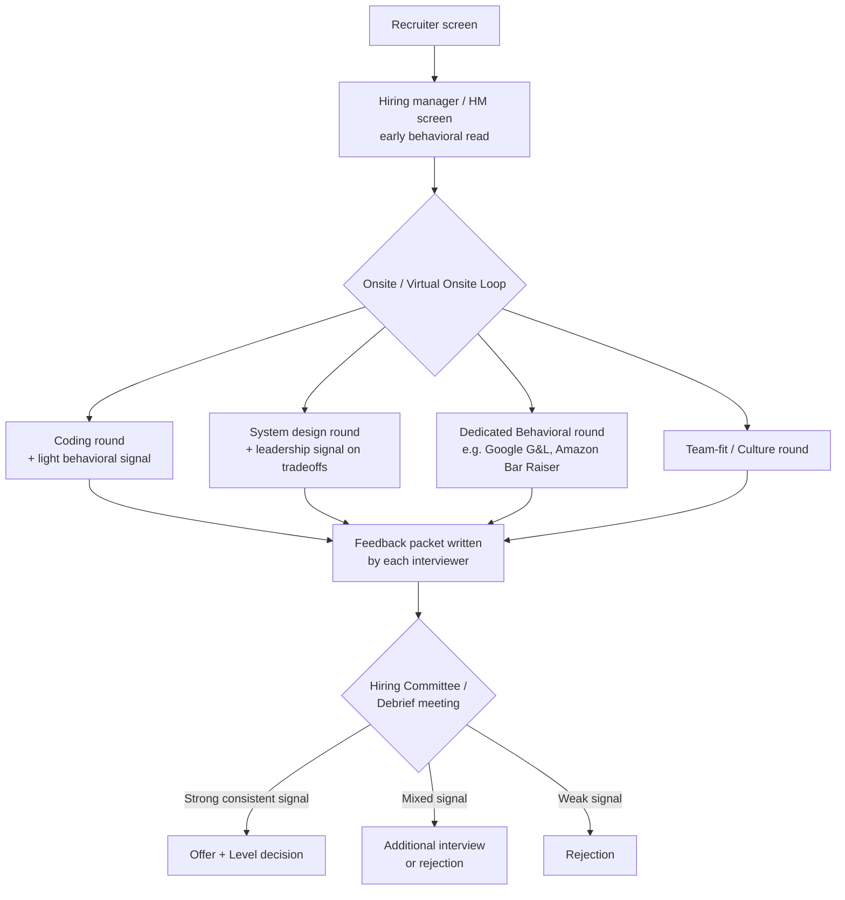

# Track 05: Behavioral & Leadership Interviews

## Why this track exists

If you are a senior or staff engineer with 10-12 years of experience, you have probably noticed something strange about FAANG interview loops: the behavioral round is no longer a formality. For a new grad, one 45-minute chat about "tell me about yourself" barely moves the needle. For you, it can be the round that decides your level, your offer, and sometimes whether you get an offer at all.

Here is the uncomfortable truth. At senior and staff level, your coding and system design skills are assumed to be strong. You have done 10+ years of this. Nobody is shocked when you solve a medium LeetCode problem or draw a reasonable system design. What interviewers are actually trying to figure out is something harder to test with a whiteboard: **can this person operate independently, influence people who don't report to them, make good judgment calls under ambiguity, and raise the bar for everyone around them?**

That is what the behavioral round measures. And at senior+ levels, it usually carries as much weight as - sometimes more weight than - the coding round.

## Why behavioral rounds matter MORE as you get senior

At junior and mid levels, companies hire for potential and raw skill. At senior and staff levels, companies hire for proven judgment. Here is the shift in what "good" looks like as you climb:

| Level | What gets tested in coding/design | What gets tested in behavioral |
|---|---|---|
| Junior (0-2 yrs) | Can you write correct code? | Are you coachable and collaborative? |
| Mid (3-6 yrs) | Can you design a reasonably scoped system? | Can you own a feature end to end? |
| Senior (7-10 yrs) | Can you handle ambiguity and tradeoffs? | Can you lead a project and influence peers? |
| Staff+ (10+ yrs) | Can you set technical direction? | Can you drive org-wide change and multiply other engineers? |

Notice the pattern. As the technical bar gets harder to differentiate (everyone at this level can code), the behavioral signal becomes the main differentiator. A staff candidate who gives weak, generic behavioral answers will often get rejected even after acing the system design round, because the interviewers can't picture that person leading a cross-team initiative, running a tough performance conversation, or making the right call when a production system is on fire and three teams disagree on the fix.

This also explains why behavioral interviewers at senior+ levels dig much deeper than "tell me about a challenge." They ask follow-up questions like "what exactly did you say in that meeting?" or "what did you do differently after that failure?" They are testing for real experience, not rehearsed answers.

## How the big companies actually weigh behavioral rounds

Every FAANG-style company has its own flavor of behavioral evaluation, but they share a common goal: separate people who *did* the work from people who can only *describe* the work in a believable way.

### Amazon: the Bar Raiser and the 16 Leadership Principles

Amazon's interview loop is built almost entirely around its 16 Leadership Principles (LPs) - things like Customer Obsession, Ownership, Dive Deep, and Deliver Results. Every interviewer, even in a "technical" round, is expected to probe at least one or two LPs through behavioral questions.

The unique part of Amazon's process is the **Bar Raiser**: a specially trained interviewer, not on the hiring team, whose only job is to protect the hiring bar. The Bar Raiser has veto power. If every other interviewer loved you but the Bar Raiser isn't convinced you demonstrated real leadership principle depth, the offer can still be blocked. Bar Raisers are trained to dig past the surface story and ask "what exactly did you do" three or four layers deep until they hit either a real, specific memory or an obvious fabrication.

For senior/staff candidates, Amazon expects your LP stories to show principle-level impact: not "I fixed a bug" but "I identified that our deployment process was causing recurring outages, built the business case, got buy-in from three teams, and reduced incident count by 40% over two quarters."

### Google: Googleyness, General Cognitive Ability, and Leadership

Google's behavioral evaluation is split across a few dimensions that show up on your feedback packet:

- **Googleyness and Leadership (G&L):** A dedicated round, often with someone outside your potential team, that evaluates comfort with ambiguity, collaborative instinct, and whether you've shown leadership "without a title" - stepping up to lead something even when you weren't officially in charge.
- **General Cognitive Ability (GCA):** Partly tested through behavioral questions about how you approach problems, not just through puzzles. Interviewers want to hear your reasoning process when you describe a decision you made.
- **Leadership signal inside technical rounds:** Even your coding and system design interviewers are asked to note leadership behavior - did you explain your thinking clearly, handle pushback on your design well, show humility when challenged?

Google's hiring committee (a separate group of senior engineers who review your whole packet, not just your individual interviewers' opinions) looks for consistency: do all your interviewers independently describe you as someone who takes ownership and collaborates well, or are the signals mixed?

### Meta: Move Fast, Be Bold, and Ownership Signals

Meta's internal culture leans heavily on speed and ownership, and its behavioral round reflects that. Interviewers are trained to listen for specific signal areas:

- **Ownership:** Did you take responsibility for outcomes beyond your assigned ticket?
- **Direction:** Did you set or influence technical direction rather than just execute someone else's plan?
- **Talent:** Did you grow the people around you (mentorship, raising the bar for code quality, hiring)?
- **Execution/"Move Fast":** Did you ship meaningful things quickly, and when you made mistakes moving fast, did you recover well?

Meta interviewers are also known for pressing on failure stories. They want to see that you take calculated risks, not that you are reckless, and that you learn fast from mistakes rather than repeating them.

### The common thread

Despite different vocabulary, all three companies (and most other big tech companies that copy this model - Netflix, Microsoft, Uber, Stripe, and others) are testing the same underlying things:

1. **Ownership** - do you take responsibility for outcomes, not just tasks?
2. **Influence without authority** - can you move people and projects forward when you don't have formal power over them?
3. **Judgment under ambiguity** - do you make reasonable decisions when the "right answer" isn't obvious?
4. **Growth mindset** - do you learn from failure and actively improve?
5. **Collaboration and communication** - can you work well with people who disagree with you?

Everything in this track is built to help you prepare strong, specific, honest stories that demonstrate these five things.

## How this track is organized

| File | What it covers |
|---|---|
| `01-star-framework-and-stories.md` | The STAR/STARL storytelling method, how to build a 10-12 story "story bank" from your real career, a template table to organize it, 5 fully worked senior-level example answers, and a table of common mistakes to avoid |
| `02-leadership-principles-and-company-guides.md` | A deep walkthrough of Amazon's 16 Leadership Principles with example questions, Google's G&L/GCA round structure, Meta's ownership and move-fast signals, a comparison table across companies, and a diagram mapping question types to principles |
| `03-senior-staff-questions-and-negotiation.md` | 40 real behavioral questions grouped by theme with "what interviewers listen for" notes, a breakdown of staff-vs-senior signal differences, and a practical guide to salary negotiation for senior engineering offers |

## The behavioral interview loop, visualized

Most FAANG-style loops run the behavioral evaluation in parallel with technical rounds, not as a single isolated interview. Here is roughly how it flows for a senior/staff candidate:

A few things to notice in this diagram:

- The behavioral signal is collected from **every** round, not just the dedicated one. Your coding interviewer is quietly watching how you react to hints, how you communicate, and whether you get defensive when challenged.
- The dedicated behavioral round (Bar Raiser at Amazon, G&L at Google) tends to carry extra weight because that interviewer's entire job is to focus on this signal.
- The final decision is made by a committee or debrief, not by one person. This means consistency across rounds matters more than being perfect in just one interview. If four interviewers all independently say "strong ownership," that is a much stronger signal than one great behavioral interview paired with a distracted, dismissive attitude in the coding round.

## How to use this track

Work through the three files in order:

1. Start with **01** to build your story bank. This is the foundation - without real, specific stories, none of the frameworks in files 02 and 03 will help you.
2. Move to **02** to understand exactly what each company is listening for, so you can tailor your story bank's emphasis (ownership vs. customer obsession vs. move-fast) to the company you're interviewing with.
3. Finish with **03** to practice against the actual question bank senior/staff candidates report seeing, and to prepare for the negotiation conversation that comes after you pass.

By the end of this track, you should have a written, rehearsed set of 10-12 stories that you can flex to answer almost any behavioral question thrown at you, a clear sense of what each major company is scoring you on, and a concrete plan for negotiating your offer once you get it.

## A word on time investment

Engineers preparing for senior/staff loops often spend 80-90% of their study time on system design and coding, and squeeze behavioral prep into a single evening before the onsite. Given everything above about how heavily behavioral signal is weighted at this level, that ratio is backwards. A more realistic split for someone 10-12 years into their career, who already codes and designs systems well, looks like this:

| Prep area | Suggested time allocation for senior/staff candidates |
|---|---|
| Coding practice | 25-30% |
| System design practice | 25-30% |
| Behavioral and leadership prep | 30-35% |
| Company/role research, negotiation prep | 10-15% |

This is not a universal rule - if your coding is rusty, shift more time there. But do not treat behavioral prep as something you can wing because "I have good stories, I just need to remember them." The engineers who struggle most in behavioral rounds are usually not short on good experience; they are short on *rehearsed, structured delivery* of that experience. That is a skill you build with deliberate practice, the same way you'd drill a tricky algorithm pattern.

## What "good" looks like versus what candidates often do

A quick, honest comparison of common failure patterns versus what strong senior/staff candidates actually do in the room:

| Common mistake | What strong candidates do instead |
|---|---|
| Answering with abstract statements like "I'm a strong communicator" or "I always collaborate well" | Answering with a specific, concrete story that shows the trait in action, letting the interviewer draw the conclusion themselves |
| Picking whichever story comes to mind first, regardless of fit | Pre-mapping 10-12 stories to question themes ahead of time, so the best-fit story is ready instantly |
| Treating every company's behavioral round the same way | Adjusting emphasis and vocabulary to match the specific company's known framework (see file 02) |
| Rambling through the Situation and Task, then rushing the Action | Spending the majority of the answer on the Action - what they personally did, said, and decided |
| Ending a story on the result alone | Adding a Learning component (STARL) that shows growth and self-awareness |
| Treating the negotiation conversation as awkward or optional | Walking into the negotiation with total comp data, a clear ask, and calm, prepared scripts (see file 03) |

## A note on authenticity

Nothing in this track is about inventing impressive-sounding stories or exaggerating your role in a project. Experienced interviewers, especially trained Bar Raisers and senior G&L interviewers, are very good at detecting inflated or borrowed stories through follow-up questions. The entire value of this track is in helping you **surface and structure stories that are already true**, so that your genuine 10-12 years of real experience comes across clearly instead of getting lost in nervous, unstructured, or overly modest delivery. If you have done real work for a decade, you almost certainly have more than enough material. The work here is in finding it, shaping it, and practicing saying it out loud with confidence.
